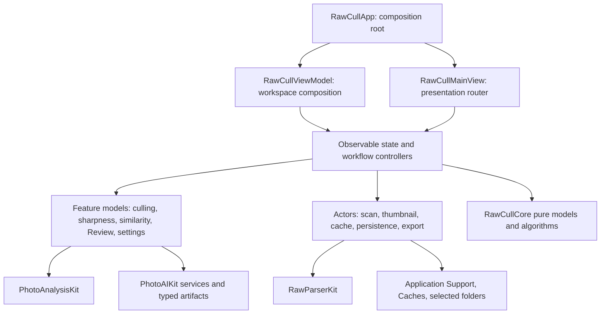

## RawCull Developer Notes

These pages explain RawCull from a developer's point of view. They are intended
for readers who already understand Swift and SwiftUI and now need to learn where
behavior lives, how data moves through the app, and which invariants must
survive a change.

Source paths in these pages are relative to the named repository. App paths such
as [RawCull/Model/ViewModels/RawCullViewModel.swift](https://github.com/rsyncOSX/RawCull/blob/5169ffd3487fe4ddc005d511fffa38172657d703/RawCull/Model/ViewModels/RawCullViewModel.swift) belong to the RawCull
repository. Package paths belong to the separately versioned Swift packages
referenced by `RawCull.xcodeproj`; this documentation repository does not
contain or compile source snapshots.

## Start Here

Read these pages in this order when learning the project:

1. [Thumbnails and Scan Pipeline](thumbnail/) follows a selected catalog from
   directory discovery to visible images.
2. [Viewer Architecture and Keyboard Ownership]()
   follows screen sessions, task identity, overlays and keyboard routing.
3. [Concurrency](concurrency-revised/) explains `@MainActor`, actor ownership,
   cancellation, and bounded parallelism across that pipeline.
4. [Cache System](cache/) explains why grid, preview, disk, full-size, and
   analysis caches are separate.
5. [Focus Mask and Sharpness](focusmask/) follows scoring and focus evidence
   into persisted culling data.
6. [Burst Groups](burstgroup/) combines sharpness, similarity artifacts,
   grouping, ranking, and the burst-review UI.
7. [Artificial Intelligence](ai/) covers Review presets, model requirements and saved evidence. Read
   [AI Runtime](ai/airuntime/) for the object graph and [Full Review Execution](ai/full-review/) for one run from button to saved file.
8. [RawCull Packages](packages/) explains the reusable package boundaries behind the app.
9. [Review Record](#open-source-findings) lists known defects. They are useful exercises: each one
   names the code, the mistake and the rule that would have prevented it.

Use [File Read and Write](filereadandwrite/) and
[Security-Scoped URLs](security/) whenever a change touches persistence, caches,
user-selected folders, export, or copying.

## Repository And Target Map

| Area                       | Primary source                                                            | Responsibility                                                                                                                |
| -------------------------- | ------------------------------------------------------------------------- | ----------------------------------------------------------------------------------------------------------------------------- |
| App composition            | [RawCull/Main/RawCullApp.swift](https://github.com/rsyncOSX/RawCull/blob/5169ffd3487fe4ddc005d511fffa38172657d703/RawCull/Main/RawCullApp.swift)                                           | Uses `RawCullApplicationState.live()` to assemble stable models/features, inject environment state, and define windows and commands |
| Main presentation          | [RawCull/Main/RawCullMainView.swift](https://github.com/rsyncOSX/RawCull/blob/5169ffd3487fe4ddc005d511fffa38172657d703/RawCull/Main/RawCullMainView.swift)                                      | Switches between loupe, grid, similarity, rated, comparison, and Review modes and owns top-level sheets and overlays                  |
| App orchestration          | [RawCull/Model/ViewModels/RawCullViewModel.swift](https://github.com/rsyncOSX/RawCull/blob/5169ffd3487fe4ddc005d511fffa38172657d703/RawCull/Model/ViewModels/RawCullViewModel.swift) | Assembles catalog, culling, burst, presentation and AI owners for environment injection                         |
| Background ownership       | `RawCull/Actors/`                                                         | Serializes scans, thumbnail requests, caches, persistence, extraction, and contention gates                                   |
| App services and adapters  | `RawCull/Model/`                                                          | Connects the UI model to RAW parsing, sharpness analysis, AI providers, persistence, diagnostics, and rsync                   |
| Reusable domain logic      | `RawCullCore` package                                                     | Value models and pure algorithms such as burst grouping and ranking                                                           |
| RAW decoding               | `RawParserKit` package                                                    | Dedicated ARW/NEF/DNG and generic macOS-backed RAW dispatch, metadata normalization, MakerNote parsing, thumbnail extraction, and preview creation              |
| Image analysis             | `PhotoAnalysisKit` package                                                | Sharpness, saliency, focus evidence, masks, and analysis descriptors                                                          |
| AI contracts and workflows | `PhotoAIKit` package products                                             | Typed similarity artifacts, Vision/CLIP backends, semantic search, segmentation, and storage contracts                        |
| Tests                      | `RawCullTests/` and package test targets                                  | Executable behavior contracts, concurrency checks, cache identity checks, and integration coverage                            |

## Architectural Shape

The boundaries are based on ownership:

- SwiftUI views render observable state and translate gestures, commands, and
  bindings into model actions.
- `RawCullViewModel` and feature view models are `@MainActor` because their
  state drives presentation.
- Actors own shared mutable background state and serialize work such as cache
  access, thumbnail coalescing, and writes.
- `RawCullCore` contains reusable value models and pure decisions that do not
  need UI isolation.
- `RawParserKit`, `PhotoAnalysisKit`, and `PhotoAIKit` hide specialized parsing
  and analysis implementations behind typed boundaries.
- Security-scoped access remains alive at the app or operation boundary for as
  long as user-selected files are used.

## Workspace owners in 3.5.0

[RawCullViewModel.swift](https://github.com/rsyncOSX/RawCull/blob/5169ffd3487fe4ddc005d511fffa38172657d703/RawCull/Model/ViewModels/RawCullViewModel.swift) wires the long-lived workspace objects together.
`workspaceEnvironment(_:)` supplies those objects to SwiftUI. Views read the
state and operations they use through the environment or explicit inputs.

| Owner | State or actions |
| --- | --- |
| `CatalogWorkspace` | Open source, scanned and filtered files, scan progress, focus-point lookup |
| `CatalogController` | Catalog loading, sorting and filtering, grid and zoom projections, sharpness and AI input |
| `CatalogLifecycleCoordinator` | Catalog transitions, load tasks and security grant |
| `SelectionModel` and `RatingsModel` | Focus, selection and comparison IDs, plus culling store and rating revision |
| `CullingController` | Rating changes, selection advance and culling-store recovery |
| `BurstWorkflowController` | Analysis coordination, review queue, keep-best, undo and review state |
| `WorkspaceNavigationModel`, `ZoomOverlayModel` and `LoupeViewportModel` | View mode, overlay lifecycle and result metadata, and persistent loupe pan/zoom |
| `WorkspacePresentationModel` and `FileOperationsModel` | Window chrome, sheets and banners, plus JPG work and progress |

See [Internal Swift API]() for call sites and
[Viewer Architecture]() for presentation lifetimes.

## Follow One Feature Through The Code

When investigating a behavior, read it in this direction:

1. Find the SwiftUI control or lifecycle trigger.
2. Find the environment model or controller that handles the action.
3. Identify which actor, adapter, or package owns the expensive or mutable work.
4. Follow the value returned to main-actor state.
5. Read the tests named after the actor, model, or feature before changing the
   invariant.

This approach is more reliable than starting with an individual utility type
because it shows both ownership and the complete lifetime of the operation.

## Focused References

| Page                                                  | Use it when changing                                          |
| ----------------------------------------------------- | ------------------------------------------------------------- |
| [Memory Pressure](memorypressure/)                    | Cache limits, pressure events, or diagnostics                 |
| [Detailed Sharpness Scoring](detailsharpnessscoring/) | Formula-level sharpness behavior and score-impacting factors  |
| [Detailed Focus Mask Computation](detailsfocusmask/)  | Focus-mask rendering, region selection, and visual thresholds |
| [Synchronous Code](heavy/)                            | Blocking ImageIO, RAW parsing, or explicit executor bridges   |
| [Sony/Nikon MakerNote Parser](sonymakernoteparser/)   | Focus-point metadata and vendor-specific parsing              |
| [AI Model Downloads](ai/rawcullai/)            | Model installation, validation, signing, and activation       |
| [Repository Git Workflow](pushpull/)                  | The documentation repository's linear-history workflow        |

## Reviewed source baseline

Reviewed on **25 November 2026** against **RawCull 3.5.0 build 469**,
commit [5169ffd3](https://github.com/rsyncOSX/RawCull/commit/5169ffd3487fe4ddc005d511fffa38172657d703). The commit
is present on both `version-3.5.0` and `main`. The Xcode workspace resolves
24 remote pins. See the [package snapshot]() and
[review record](). Historical measurements retain
their original source revisions.

Read [Viewer Architecture and Keyboard Ownership]()
for screen sessions, task identity and key routing, and
[RAW Formats and Exposure Inspection]()
for generic RAW admission, temporary EV rendering, histogram and clipping.
The [developer guide]()
provides the application tour; its detailed method reference is separate.

## What is new in 3.5.0

| Area | Change | Guide |
| --- | --- | --- |
| Review controls | Focus check is preselected, and choosing a type is separate from running it | [AI Models]() |
| Review photo | Focus point, focus mask and magnifier layers | [AI Models](#read-a-result), [Viewer Architecture]() |
| Burst frames | AI top, Sharpest and Best Frame marks, with a bar when they differ | [Burst Groups](#three-opinions-on-the-best-frame) |
| Burst assessment | Reassess asks first, and the toolbar and maintenance actions are disabled during a run | [Burst Groups]() |
| Developer tools | `make test-full` syncs version and build into the README | [Developer guide]() |

## State ownership and historical catalog performance

`BurstWorkflowController` retains [BurstReviewSessionModel.swift](https://github.com/rsyncOSX/RawCull/blob/5169ffd3487fe4ddc005d511fffa38172657d703/RawCull/Model/ViewModels/BurstReviewSessionModel.swift)
for review decisions, independently of viewport/image sessions.
`SimilarityScoringModel` retains [RawCullSemanticSearchModel.swift](https://github.com/rsyncOSX/RawCull/blob/5169ffd3487fe4ddc005d511fffa38172657d703/RawCull/Intelligence/SemanticSearch/RawCullSemanticSearchModel.swift)
for semantic evidence, provider configuration and queries, while keeping its
existing forwarding API. Combined Review still has one mutable feature/run
owner, with orchestration, work support and comparison in separate extensions.

Preload workers await disk saves before releasing worker slots, but release
each file's grid gate before the save. See
[Performance Measurement]() for the historical
October 25 catalog reference, coalesced progress, cache-state limits and deferred
validation. The phase 3–6 encoder, grid and source-load candidates were deferred; reduced
sampled main-thread work does not establish faster loading or smoother frames.
The build 469 smoke manifest expects 384 unique test identifiers. [Test targets](https://github.com/rsyncOSX/RawCull/blob/5169ffd3487fe4ddc005d511fffa38172657d703/Makefile)

## RAW previews in ZoomView

Fit-to-window RAW viewing can render bounded, eagerly completed pixels while
retaining native geometry. Native zoom preserves the developed-JPEG path; temporary
exposure inspection stays native. ZoomView says whether the displayed result is a
reduced preview or full detail, shows preparation progress and reports the latest
request duration, including cache retrieval. The current image stays visible while a
replacement loads. Read [RAW viewing policy](),
[performance results]() and
[the internal API]().

## Close Up

The burst and Single Images workspace embeds PhotoEvidenceKit's manual Close-ups
panel, with comparison membership, retained references, source-labeled crops, saved
regions and AF assistance from upright camera points. A strip above the manual cards
shows human faces and an animal head and eye pilot from the embedded previews of the
compared frames. The crops are inspection evidence. **Apply People Ranking** uses
face evidence for a temporary comparison order. See
[Close Up](),
[Burst Groups]() and
[Viewer Architecture]().
