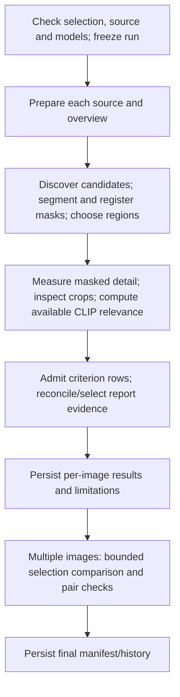

+++
author = "Thomas Evensen"
title = "Combined AI Review: A Step-by-Step Code Guide"
linkTitle = "Combined AI Review"
date = "2026-10-10"
lastmod = "2026-10-13"
description = "Trace 1–8-image Combined Review through source admission, registered masks, criterion observations, evidence-row reports, comparison, and saved-run compatibility."
weight = 60
tags = ["ai", "combined-review", "architecture", "qwen", "sam", "clip", "swift"]
categories = ["technical details"]
mermaid = true
+++

# Combined AI Review: A Step-by-Step Code Guide

Combined connects local Qwen observations, SAM masks, deterministic subject-detail
measurements and CLIP relevance under a frozen review contract. These outputs
are different kinds of evidence. A mask identifies pixels, CLIP relates content
to text, a deterministic scorer measures render-dependent detail, and Qwen
produces observations subject to validation.

This guide was updated against the local `version-3.3.0` working tree on
13 October 2026. The current UI accepts **1–8 images**, with individual results
and selection comparison for multiple images. It supersedes the October 10
single-image description; that day's source-admission recovery is preserved
below as a historical example. No Combined implementation was changed as part
of the October 13 standalone Qwen/Objects repairs or this documentation update.

## 1. Build a vocabulary before tracing execution

| Term | Meaning |
| --- | --- |
| Snapshot | Frozen files, criteria, models, source preference, budgets and compatibility versions |
| Source identity | Declared render and image identity used to qualify crops/masks/evidence |
| Subject | Registered candidate with a source-normalized mask and provenance |
| Region | Bounded source rectangle selected for inspection, associated with source/subject |
| Observation | Accepted model statement with availability, criterion fields and provenance |
| Measurement | Deterministic render-dependent values with mask/scorer semantics |
| Report | Validated claims selected from admitted evidence rather than unconstrained rewritten prose |
| Selection report | Bounded comparison of admitted per-image evidence, with possible abstention |
| Work item | Persisted task/state/dependency record in the run manifest |

For provider composition and service replacement, read [AI Runtime](/docs/ai/airuntime/).
For the Swift patterns, read [Swift Behind the AI Pipelines](/docs/ai/aiswift/).

## 2. Start with the visible controls

1. Select or tag 1–8 photographs in the catalog.
2. Open AI Analysis and choose Combined.
3. Choose Selected or Tagged in the header to identify the file collection.
4. Enter criteria, choose depth and source preference, and choose input retention.
5. Wait for parameter/source availability checking, then start the review.
6. Inspect each result, its limitations and retained inputs. For multiple files,
   also inspect the comparison and any shortlist or abstention.

The header's Selected/Tagged choice determines **which files**. The inner
High-quality preview/RAW detail control determines **which render** is requested.
Neither retargets evidence already stored in a frozen run.

`CombinedReviewFeature.prepareParameters` checks the current selection and source
availability. `canStartReview(for:)` requires that the admitted checked selection
matches the current files, criteria are valid and the feature is not running or
checking. More than eight files is not enabled through the current UI; the
broader snapshot type's expanded-plan field does not make it a supported UI path.

Criteria are nonempty and at most 512 UTF-8 bytes. That byte cap differs from
Swift-character caps in model response validation. Cropping a user-chosen region
is admitted for a single-image selection; multi-image selection does not reuse
one user rectangle indiscriminately for every file.

## 3. Understand depth and budgets

| Depth | Crops per image | Selection crop ceiling | Follow-ups per image / selection | Pair cap |
| --- | ---: | ---: | --- | ---: |
| Standard | 3 | 16 | 0 / 0 | 0 |
| Deep | 8 | 32 | 2 / 8 | 2 |
| Exhaustive | 16 | 64 | 4 / 16 | 4 |

These are contract ceilings. Actual work depends on admitted candidates,
available evidence and scheduled stages. A budget entry is not proof that all
possible follow-up mechanisms execute. `ReviewBudget.cropAllocation` allocates
round-robin coverage so earlier images cannot consume every crop before another
image gets its first opportunity.

Budgets distinguish overview, crop, follow-up, reconciliation, report,
comparison, SAM, CLIP and repair. `consume` checks global and per-image limits
before recording an attempt. Repair has its own allowance; failed requests
cannot retry indefinitely. The old crops-plus-three single-image Qwen-pass table
is not a complete ceiling for today's multi-image and bounded-repair workflow.
The current frozen request response cap is 768 tokens, with context admission
against the model's available capabilities.

## 4. Locate the code and long-lived owners

| File under `RawCull/Intelligence` | Responsibility |
| --- | --- |
| `Composition/RawCullIntelligenceRuntime.swift` | Creates stable feature and live-backend factory |
| `Composition/CombinedReviewLiveBackend.swift` | Admits and uses concrete Qwen/SAM/CLIP model services |
| `CombinedReview/CombinedReviewFeature.swift` | Observable controls, admission, task lifecycle, restore/resume |
| `CombinedReview/CombinedReviewExecution.swift` | Stage execution, repair, report selection, comparison |
| `CombinedReview/ReviewRunContract.swift` | Typed IDs, frozen snapshot and compatibility versions |
| `CombinedReview/ReviewRunManifest.swift` | Persisted work states and evidence history |
| `CombinedReview/ReviewImageSource.swift` | Source availability, bounded loading and declared render |
| `CombinedReview/ReviewMaskRegistration.swift` | Registers decoded mask foreground against source raster |
| `CombinedReview/ReviewSynthesisGrounding.swift` | Accepted observation and claim ownership rules |
| `CombinedReview/ReviewArtifactStore.swift` | Artifact persistence and retained inputs |

Presentation lives in `RawCull/Views/AIAnalysis/CombinedReviewView.swift` and the
inspection/evidence views beside it. These are source paths for the inspected
working tree; a published branch can lag local edits.

`CombinedReviewFeature` is `@Observable @MainActor`. Its backend factory injects
current services; tests can inject deterministic backends. Stable ownership
keeps views and runtime commands attached to the same feature instance.

## 5. Reserve resources and freeze admission

Combined acquires its application-owned lease and drains the standalone Qwen,
Objects and Deep Review workers through `cancelAndWait()`. A shared Qwen generation
gate also serializes individual model generations. The lease and gate protect
different scopes; neither is a substitute for the other.

A run snapshots source-file identities, criteria, depth, source preference,
retention, selected region where applicable, model/runtime/preprocessing
identities, response cap and stage versions. Catalog access grants survive
navigation until source work terminates. Source fingerprints are revalidated
for resume; changed files are not silently interpreted as original evidence.

Model snapshots qualify the admitted backend. Reading metadata such as encoder
side does not itself verify actual runtime encoder geometry. Backend admission
keeps declared configuration and observed geometry separate. The inspected
runtime records PhotoAIKit/Core AI revisions as part of runtime identity.

## 6. Follow the stage graph



A stage can fail without erasing unrelated accepted evidence. The result carries
failures, limitations, inspected/uninspected regions and availability. A completed
operation with limitations must not be mistaken for complete evidence coverage.

## 7. Choose a source before claiming detail

High-quality preview uses a bounded camera-authored preview where available.
Its sharpening, noise reduction and exposure processing are not fully known.
RAW detail requests a declared demosaic/render, with resource admission before
expensive source decoding. Retained source/render settings explain what pixels
underlie a metric or crop observation.

Default full-source limits are 24,000,000 pixels and 2,000,000,000 estimated
working bytes. Admission uses 80 estimated bytes per pixel and overflow-safe
arithmetic. These are configured resource limits, not available disk space or
an automatic measurement of free RAM. Refused RAW detail does not silently
switch fidelity; choose preview and create a new rerun.

An exact retained input is the unannotated CGImage submitted to the backend,
encoded losslessly. It is not original sensor data or the final resized/normalized
model tensor. Keeping source/render and input identities prevents those levels
from being confused.

## 8. Register masks and select regions

SAM returns candidate instances. The host decodes foreground against the source
raster and records source-normalized registration. `ReviewMaskRegistration`
derives foreground bounds from decoded mask content rather than trusting only
the producer bounding box. Region ownership, source identity, mask semantics
and selected subject must remain consistent through inspection and persistence.

A mask score or a requested “head” concept does not qualify anatomy. A usable
region can still have uncertain specificity. Near-full mask occupancy is explicitly
limited as uncertain subject specificity rather than promoted to calibrated focus.

`ReviewSubjectPriority` and plan logic govern which candidates receive bounded
inspection. Context identity, region padding and image geometry must be traced
from source coordinates; a yellow display outline is presentation, not new
pixel evidence.

## 9. Distinguish deterministic metrics from model judgments

The scorer measures broad/local/detail information under a declared render and
mask contract. Finite values and current scorer/mask semantics are validated.
Results are render-dependent metrics, not calibrated sharp/blur thresholds or
eye claims. CLIP relevance is separately recorded where an admitted provider
and geometry permit it. Cosine relevance cannot prove technical focus.

The model does not get to convert a numeric detail score into a photographic
assertion merely by citing that score. Measurements are displayed deterministically.
A generated claim needs an eligible independent observation; measurements alone
do not support model-written prose.

## 10. Understand the current crop observation schema

Crop observation uses one string or null per criterion:

```json
{
  "regionID": "the actual admitted region ID",
  "criteria": {
    "composition": null,
    "exposure": null,
    "visibility": null,
    "detail": null
  },
  "uncertainty": "",
  "targetIdentified": false
}
```

This illustrates shape, not a conclusion that all observations are absent.
The prompt asks for criterion-specific observations, aiming for 80 characters
with a hard maximum of 120 per non-null string. Empty strings, repeated criterion
sentences and `supported/text` response objects are not the requested shape.

Composition describes framing/placement/obstructions; exposure describes
illumination or tonal contrast; visibility describes extent/occlusion of the
generic intended target. Detail describes resolved surface texture on that
target, not background texture, anatomy, focus classification or RAW recovery.
Unsupported detail is null, not a sentence claiming unresolved texture.

`targetIdentified` means a visibly present and distinguishable **generic target**.
It does not prove species, individual identity, qualified anatomy or fine-detail
quality. Purpose text alone does not establish that the target is present.

## 11. Report synthesis selects eligible evidence rows

Current synthesis is narrower than asking Qwen to rewrite evidence into a new
report. The request contains admitted observation rows and allowed row IDs for
composition, exposure, visibility and detail. Qwen returns one eligible row ID
or null for each category. Code copies that row's criterion text and resolves
its alias to the original observation provenance.

```json
{"composition": null, "exposure": null, "visibility": null, "detail": null}
```

A real response substitutes only IDs actually admitted for that category. Null
means abstention. The model cannot invent a new observation, borrow another
category's row, or rewrite a statement into stronger language. Reconciliation
and report construction use admitted original evidence; reconciliation prose
is not a new independent visual observation.

`ReviewSynthesisGrounding` checks source/stage compatibility, availability,
subject/region registration and reference ownership. For current criterion
observations, accepted claim text must match the supported criterion text.
Detail requires one qualified subject and region, a target crop and available
surface-detail support. Measurements cannot independently support prose; numeric
metric presentation remains deterministic. Missing criteria become explicit
coverage limitations. Evidence-only summaries can remain useful when synthesis
cannot admit a report.

These are structural grounding rules, not a proof of visual truth. A correctly
referenced observation can itself be mistaken; inspection of source and crop
still matters.

## 12. Context admission and bounded repair

Prompts are checked against admitted model context and requested output tokens.
Evidence rows are ordered and admitted deliberately; primary subjects and
overview evidence are not displaced indiscriminately by metric summaries.
Room is reserved for validation feedback. Repair does not drop the schema or
required evidence simply to fit another generation.

`CombinedReviewResponse` classifies rejection by owned validation codes/checks.
One fresh response can repair a malformed request-boundary payload, within the
run budget. Repairs use the same acceptance conditions. The standalone Objects
two-attempt board repair is a separate implementation and schema; changes to
it do not change Combined repair behavior.

## 13. Compare multiple images conservatively

For multi-image selections, the workflow builds bounded comparison inputs and
validates reports against those per-image results and admitted references.
A selection report carries comparability, decision, preferred image IDs and
claims/reason. Deep/exhaustive permit additional pair checks under their pair
caps; Standard has no extra pair allowance.

If comparison fails validation or exceeds context, the result can abstain with
insufficient comparability while individual reports remain available. A shortlist
is advisory; it does not silently apply star ratings or delete photographs.
Treat changed source fidelity, missing inspections and unavailable evidence as
comparison limitations, not reasons to invent a confident winner.

## 14. Persistence, cancellation, resume and rerun

The manifest records frozen inputs and work dependencies. Typed stage evidence
and retained images have their own policies/limits. Exact inputs are retained
when requested; compact retention does not mean that no typed evidence persists.
Masks needed for evidence inspection have their own retention handling.
Rejected-response retention is independently opt-in; compact diagnostics need
not persist every raw model response.

Cancellation is cooperative. The lease is released when the owned worker finishes,
not immediately when cancellation is requested. Restore makes saved evidence
inspectable; Resume additionally requires compatible files, models, source,
stage versions and contracts. Rerun creates a new run using current controls.
Changing a picker does not mutate the frozen preference in an older run.

Current compatibility values on October 13:

| Contract | Version |
| --- | --- |
| Overall pipeline | `combined-v21` |
| Overview stage | `combined-v10` |
| Crop observation | `combined-v21` |
| Reconciliation/report/comparison | `combined-v21` |
| Segmentation/identity/measurement | `combined-v6` |
| Other stage defaults | `combined-v1` |
| Render | `review-srgb-v1` |

Compatibility also includes file/render/model/runtime/preprocessing identities,
source preference, goal-dependent criteria, region, response cap, user regions,
depth, mask registration and scorer semantics where applicable. An unchanged
storage-envelope name does not establish compatible stage semantics. Historical
runs can remain inspectable even when resume is correctly disabled.

## 15. Historical October 10 large-ARW recovery

The earlier investigation used `_DSC8318.ARW`, a Sony RAW measuring
9,984 × 6,656 = 66,453,504 pixels. At 80 estimated bytes per pixel, admission
estimated 5,316,280,320 working bytes, above both default source limits.
The refusal occurred before model analysis. Choosing High-quality preview and
Rerun with current settings was the supported recovery; Resume preserved the
old RAW-detail preference and therefore did not apply the new picker choice.

That historical full-model preview probe completed 11 work items with three
validated report claims and no failures, taking about 137 seconds on that host.
It used Qwen, SAM and DataComp CLIP and a private artifact store. Those facts
qualify that file/build/workflow, not today's complete regression inventory,
full-resolution RAW admission or general photographic accuracy. The original
fix involved earlier `combined-v2` prompts; current stages are versioned as
shown above, so those historical prompt versions must not be treated as current.

## 16. Select the appropriate verification

`Scripts/RunAIAnalysis.py` exercises the existing SAM/Qwen/Objects tabs plus a
separate CLIP embedding probe. It does **not** test Combined. To inspect Combined,
use its opt-in real-model suite and available Makefile target:

```sh
TEST_RUNNER_RAWCULL_COMBINED_REVIEW_RUN=1 \
TEST_RUNNER_RAWCULL_COMBINED_REVIEW_QWEN="/Users/thomas/ModelAssets/Release/Models/Qwen/qwen3_vl_2b" \
TEST_RUNNER_RAWCULL_COMBINED_REVIEW_IMAGE="/path/to/selected.ARW" \
TEST_RUNNER_RAWCULL_COMBINED_REVIEW_SAM3="/Users/thomas/ModelAssets/Release/Models/SAM3" \
TEST_RUNNER_RAWCULL_COMBINED_REVIEW_CLIP="/Users/thomas/ModelAssets/Release/Models/CLIP-DataComp" \
make combinedreviewtest
```

Verify the target and opt-in variables in the current Makefile/test source before
using an older invocation. Supplying only Qwen tests a reduced backend; it does
not establish a full-provider result. Inspect retained source dimensions,
work failures, accepted observation/report references and limitations in the
result bundle rather than reading a final completion line alone.

The October 13 tab-negation update passed the focused Objects and Combined
feature regression suites (52 tests reported), but that is distinct from a
new Combined installed-model qualification. See [AI Diagnostics](/docs/ai/aidiagnostics/)
for why schema acceptance, model confidence and visual accuracy must remain
separate claims.
