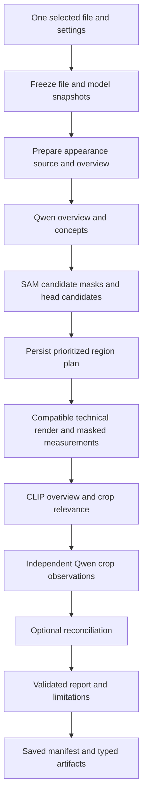

+++
author = "Thomas Evensen"
title = "Combined AI Review: A Step-by-Step Code Guide"
linkTitle = "Combined AI Review"
date = "2026-10-10"
lastmod = "2026-10-10"
description = "Follow RawCull's Combined view from image selection through source preparation, Qwen observations, SAM masks, measured detail, CLIP relevance, grounded reporting, and saved runs."
weight = 60
tags = ["ai", "combined-review", "architecture", "qwen", "sam", "clip", "swift"]
categories = ["technical details"]
mermaid = true
+++

# Combined AI Review: A Step-by-Step Code Guide

The **Combined** view brings several local analysis tools into one review of a photograph. Qwen describes visible content, SAM supplies candidate subject masks, a deterministic scorer measures detail inside those masks, and CLIP measures how closely image content relates to the review criteria. Qwen then produces a report whose claims must refer to accepted evidence.

This guide follows the implementation on the `version-3.3.0` branch, inspected on 10 October 2026. It explains both the visible controls and the code behind each step. The current feature accepts **exactly one image**. Multi-image comparison, adaptive tiling, and photographic qualification belong to later work; their presence in shared types does not mean that the Combined view implements them.

The code's main entry points are:

| File, relative to the RawCull repository | What to look for |
| --- | --- |
| `RawCull/Views/AIAnalysis/AIAnalysisView.swift` | Chooses the analysis tool and the selected/tagged input files. |
| `RawCull/Views/AIAnalysis/CombinedReviewView.swift` | Controls, progress, task history, input inspection, and evidence presentation. |
| `RawCull/Intelligence/CombinedReview/CombinedReviewFeature.swift` | Observable state, admission, start, resume, cancellation, and initial work plan. |
| `RawCull/Intelligence/CombinedReview/CombinedReviewExecution.swift` | The actual `prepare → plan → inspect → finish` pipeline. |
| `RawCull/Intelligence/Composition/CombinedReviewLiveBackend.swift` | Connects the pipeline to the real model providers and checks their identities. |

For the surrounding runtime, see [The RawCull AI Runtime](/docs/ai/airuntime/). For model installation, see [AI Model Downloads](/docs/ai/aimodelsdownload/).

## 1. Understand the vocabulary first

A **source** is the decoded, orientation-normalized image that this run has declared it will use. It is separate from the grid thumbnail. An **overview** is a smaller representation of that source. A **region** is a rectangle planned in source coordinates; a **crop** is the image cut from that rectangle.

A **mask** identifies candidate subject pixels. A mask is proposed by a model and does not prove the semantic identity of every pixel. An **observation** is accepted model text with uncertainty and provenance. A **measurement** is a numerical result calculated from pixels. A **claim** is a sentence in the final report that cites observations or measurements.

A **manifest** is the saved record of a run: its frozen settings, work items, dependencies, attempt counters, and artifact references. An **artifact** is a saved typed stage result. **Provenance** records where evidence came from, including its image, work item, source/render identity, compatibility information, and optional retained image reference.

These distinctions matter. A numerical detail metric, a segmentation confidence, and a CLIP relevance value describe different things. They cannot be treated as interchangeable quality scores.

## 2. Start from the visible interface

1. Open a catalog and select one photograph, or tag one photograph.
2. Open AI Analysis and choose **Combined** in the analysis tool picker.
3. Choose **Selected** or **Tagged** in the header's source picker. The counts tell you which file collection will be passed to the view.
4. Enter review criteria, choose depth and image source, and decide whether to retain exact input images.
5. Press **Start review**. Once a manifest exists, the button reads **Rerun with current settings**.
6. Watch the progress message and expand task history to follow individual stages.
7. Read the report alongside crop observations, measurements, and limitations. Inspect retained inputs when you want to see what was actually supplied to a model.

`AIAnalysisView.inputFiles` calls `viewModel.aiAnalysisFiles(for: inputSource)`. The Combined branch passes those files and the long-lived `combinedReviewFeature` into `CombinedReviewView`.

The outer view normally displays an empty state when no input files exist. A Combined result, manifest, or active run counts as stored state, so the interface can remain available even after the selection changes. The displayed evidence belongs to the frozen run's file; changing the current selection does not retarget an existing result.

### The two source pickers have different jobs

The header's **Selected / Tagged** picker chooses *which file* to analyze. Inside Combined, **High-quality preview / RAW detail** chooses *which rendering of that file* to request. Confusing these controls can make the input seem to change unexpectedly.

### Review criteria

The default text is:

> Describe composition, exposure, subject visibility and technical detail.

`analyze(_:)` trims surrounding whitespace and requires nonempty criteria of at most **512 UTF-8 bytes**. Bytes are not the same as characters: some characters occupy several UTF-8 bytes.

The criteria guide crop inspection, CLIP text matching, reconciliation, and report synthesis. The initial overview uses a fixed discovery instruction rather than the criteria. This lets overview discovery describe the scene before later stages interpret it in relation to the user's goal.

### Depth

| Depth | Maximum planned crop inspections | Maximum current Qwen passes |
| --- | ---: | ---: |
| Standard | 3 | 6 |
| Deep | 8 | 11 |
| Exhaustive | 16 | 19 |

The pass ceiling is crops plus three: one overview, one possible reconciliation, and one final report. Reconciliation only runs when suitable measurements and crop observations exist, and fewer crops may be proposed. These are ceilings, not promised counts.

`ReviewBudget` also contains follow-up and comparison allowances for the broader contract. The current single-image execution does not schedule adaptive follow-up passes or comparison. Increasing depth raises the crop cap; it does not automatically tile every part of the photograph.

### Retain exact inputs

Enabled by default, this chooses the frozen run's `exactInputs` retention policy. Disabling it chooses `compact`: typed evidence still persists, but overview and crop images are not retained by the ordinary retention path. Derived subject masks use forced retention even in compact mode, subject to cache limits.

An “exact input” here means the **unannotated CGImage supplied to the backend**, retained as lossless PNG. It does not mean the original RAW sensor data or the final normalized tensor inside the model. The backend still resizes and normalizes that image.

Controls are disabled during execution. The start button is also disabled unless exactly one file is passed in. The feature repeats the one-image check so correctness does not rely only on the UI.

## 3. Follow the long-lived objects

`RawCullIntelligenceRuntime` creates one `CombinedReviewFeature`. SwiftUI receives that stable feature object rather than building a new pipeline whenever the view redraws.

The feature is `@Observable @MainActor`. Its properties, such as `progress`, `result`, `manifest`, and `isRunning`, drive the interface. `@Bindable` lets controls edit criteria, depth, source preference, and retention state. Main-actor ownership keeps those UI-facing mutations coordinated; it does not mean that every decoder and model operation runs synchronously on the UI thread.

The feature receives a source loader, a subject-detail scorer, an artifact store, a lease, and a backend factory. Production uses real providers. Tests can supply fake providers to exercise the pipeline without downloading or loading models.

The backend factory captures:

- The Qwen inference runtime and installed model URL.
- An optional segmentation service and SAM identity.
- An optional CLIP provider and location, preferring DataComp over OpenAI when available.

Before starting inference, `beforeStart` calls `cancelAndWait()` on the standalone Qwen, Objects, and Deep Review workflows. A `CombinedReviewLease` reserves those sibling workflows, and their AI Analysis panels are disabled while it is held. Qwen also retains its existing generation gate.

Cancellation requests termination; the lease is released only when the owned worker has finished. This is why a cancelled run can briefly remain in “Cancelling” while native work unwinds.

## 4. Admission freezes the run

Read `CombinedReviewFeature.analyze(_:)` from top to bottom:

1. Reject a second start while the feature is running.
2. Require exactly one file and valid criteria.
3. Create a run UUID and acquire the lease.
4. Set `isRunning`, clear the failure message, and create the backend.
5. Capture depth, source preference, retention, and any chosen region.
6. Start the owned task and await the sibling-workflow shutdown hook.
7. Freeze the selected file and retain catalog access for the run.
8. Ask the backend for admitted model snapshots.
9. Build and validate a `ReviewRunSnapshot`.
10. Move the preceding manifest into history, clear the old result, create the initial manifest, and save it before execution.

The snapshot records the file identity, criteria, depth, source preference, retention policy, render version, models and runtimes, stage versions, response token limit, pipeline version, creation date, and optional user region. The current response allowance is **768 tokens per Qwen request**.

`ReviewCatalogSession` retains access grants so navigation does not prematurely end file access during native reads. File freezing checks readability and records a fingerprint derived from path, resource identifier, size, and modification date. This is an identity/change check, not a cryptographic hash of the entire photograph.

### Model admission is deliberately specific

`CombinedReviewLiveBackend.models()` requires the verified Qwen configuration: **448 × 448**, **stretch**, **4096 context tokens**, and **196 image tokens**. It hashes the installed bundle and requires the pinned Qwen bundle fingerprint. A model can be installed yet fail Combined admission if its identity or capabilities do not match.

SAM and CLIP are optional. CLIP is admitted only for recognized bundle fingerprints with recorded input geometry: the supported OpenAI and DataComp variants use 224- and 256-pixel encoder sides respectively. Runtime identity also records the operating-system version and pinned dependency identifiers.

This avoids assuming that different model bundles or preprocessors preserve image detail in the same way. Missing required Qwen stops admission; missing optional evidence creates a degraded review with limitations.

## 5. See the pipeline as a sequence



This diagram shows the broad flow. In code, overview CLIP runs before the crop loop; each crop's Qwen observation is followed by that crop's CLIP request. The top-level `execute(_:)` calls four methods in order: `prepare`, `plan`, `inspect`, and `finish`.

## 6. Prepare: decode a declared source and inspect its overview

`prepare(_:)` creates the result container, revalidates the file snapshot, and asks `ReviewImageSourceService` for an **appearance** render. It checks that the decoded source's file identity still matches the frozen fingerprint.

### What source preparation does

For raster formats such as JPEG, PNG, TIFF, and HEIF, the source is an orientation-normalized raster. For a camera file, high-quality preview requests a camera-authored embedded JPEG. RAW detail requests a fresh `CIRAWFilter` decode with full scale, draft mode disabled, and SDR output.

If RAW demosaic is unavailable, the service can fall back to an embedded preview and record the limitation. An allocation refusal is not permission to silently substitute a lower-fidelity RAW rendering. Embedded-preview fallback has its own bounded decoding policy and can record reduced dimensions.

The default full-source admission limits are **24 million pixels** and **2,000,000,000 estimated working bytes**, using a conservative estimate of 80 bytes per source pixel. These are admission estimates, not measured guarantees of process or GPU memory usage. Large full rasters and RAW demosaics can be refused before full decoding. The bounded embedded-preview fallback caps its longest edge at 4096 pixels.

The service color-manages output to **sRGB RGBA8 SDR**. Raster HDR inputs use HDR-to-SDR tone mapping. These outputs cannot establish how much highlight or shadow information the original RAW could recover.

An overview is generated with a default maximum dimension of **2048 pixels**. This is distinct from Qwen's later 448 × 448 model input geometry.

### Why source identity matters

The source record contains fidelity, dimensions, orientation, color space, render policy, recorded settings, and limitations. Its render identity distinguishes an appearance rendering from a technical rendering. Two images with the same filename or aspect ratio are not automatically interchangeable.

The source stage persists the record. With exact retention enabled, the overview CGImage is saved too. Qwen receives the unannotated overview and a fixed JSON instruction requesting composition, exposure, subjects, obstructions, uncertainty, and up to three subject concepts.

`CombinedReviewResponse.overview` validates text lengths and concept discovery. Accepted text becomes an overview observation with provenance. If the stage fails, the pipeline records its unavailability and can continue toward independent fallback crop inspection.

The feature also records standing limitations: eyes are not localized, AF mapping is unavailable, edit suggestions are untested hypotheses, and RAW recovery has not been evaluated.

## 7. Plan: find candidates and choose regions

`plan(_:context:)` uses Qwen's concepts as queries for SAM when SAM and a valid overview are available. A concept such as “bird” is a segmentation request, not proof that the region is a bird.

For each concept, the backend segments the **full appearance source**. `ObjectInstanceDeduplicator` retains up to eight candidates. Each retained record stores bounds, confidence, aliases, identity, and a retained mask reference. Candidates are then deduplicated across concepts, again with a maximum of eight surviving subjects.

A separate `head` segmentation request is made when subjects exist. A head candidate must be contained inside exactly one subject and have an area smaller than 60% of that subject's bounding-box area. Ambiguous associations are omitted. A contained head candidate still does not establish eye position or eye sharpness.

The region proposal order is:

1. The user-chosen region, if one was frozen into the snapshot.
2. Unambiguously associated head candidates.
3. Whole-subject bounds.
4. A whole-frame fallback, only when no region proposals exist.

The chosen depth limits how many proposals are admitted. Omitted region IDs are recorded as uninspected coverage. A manual region therefore takes priority and can displace an automatic proposal under a small crop budget.

### Coordinates and padding

Public source rectangles use orientation-normalized pixels with a **top-left origin**. Subject bounds and user selections are normalized coordinates, where the full width and height each span 0 to 1. The service converts normalized bounds into source pixels.

`source.region` uses default padding of 15%, creates an integer-enclosing crop within the source bounds, records clipping, and attaches an encoder geometry trace. Region records distinguish the requested rectangle, padded rectangle, actual source crop, retained encoder coverage, encoder size, and horizontal/vertical scale.

Crops come from the full declared source **before** overview/model resizing. They are not enlargements cut out of a small grid thumbnail. Even so, a crop may need model upscaling, and a full-frame fallback may add little fine detail beyond the overview.

The persisted `CombinedReviewPlan` keeps subjects, selected regions, and omitted region IDs. Planning is separate from later measurements so a saved run can recover the original crop decisions.

## 8. Inspect: measure pixels and observe crops

### Technical render and subject detail

When subjects exist, `inspect` requests a separate **technical** render. For RAW, this records the technical recipe, including sharpness 0, detail 0.6, contrast 1, and exposure 0; decoder noise-reduction defaults are retained and recorded.

Before applying appearance masks to technical pixels, the service checks alignment. Cross-render mapping requires compatible file identity, fidelity, orientation, and dimensions. An embedded preview and RAW demosaic are not considered registered merely because their aspect ratios match. If alignment is unavailable, masked measurement abstains and the limitation is visible.

For each subject, measurement requires a surviving mask with the technical image's dimensions. `SubjectMaskFocusScorer.score` receives `normalizedAFPoint: nil`: this path makes no AF-point-based conclusion.

The scorer converts RGB pixels to luminance, measures a four-neighbour edge response, collects samples inside mask alpha greater than 16, and examines a 6 × 6 patch grid. It combines broad subject response, strongest usable local response, and fine-detail response:

```text
subjectDetail = 0.40 × broadDetail
              + 0.40 × (localDetail, or broadDetail when local is unavailable)
              + 0.20 × fineDetail
```

If global edge response suggests background dominance, the result is multiplied by 0.82. Patch admission requires enough masked samples; unusable evidence can return no measurement. Nonfinite outputs are rejected.

The view can display `subjectDetail`, `fineDetail`, `maskCoverage`, and optional `broadDetail` and `localDetail`. These are **render-dependent, uncalibrated metrics**. They do not supply a universal sharp/blur threshold, a probability, or an eye-sharpness verdict.

### CLIP relevance

An admitted CLIP provider embeds the overview and review criteria, checks finite matching vector dimensions, and calculates cosine similarity. The same operation is performed for each admitted crop.

CLIP preprocessing uses shortest-side resize followed by center crop. Rectangular inputs can lose edge content, so its recorded geometry differs from Qwen's stretch geometry. The relevance number means similarity to the supplied text, not technical quality, segmentation confidence, or a probability of correctness. The UI displays crop relevance to three decimal places; the overview value is kept in the result but has no separate relevance row in this view.

### Independent crop observations

Each planned rectangle is cut from the appearance source. Qwen receives that unannotated crop, the criteria, region ID, purpose, and a JSON schema. It does not receive previous overview prose or other crop observations in this request.

The expected result includes `regionID`, `observations`, `uncertainty`, and `insufficientEvidence`. The decoder requires the exact requested region ID and bounded nonempty text. Its conservative substring checks reject observation text containing `eye`, `iris`, or `recover`; these guards can also reject innocent wording that contains those sequences.

An accepted response with `insufficientEvidence: true` is stored as an **unknown** observation. Its text is visible in the crop disclosure, but it cannot act as available evidence during synthesis. Completing a request therefore does not necessarily mean the region supplied usable evidence.

“Independent” describes the information supplied to each request. All these passes use the same Qwen model; their agreement is not independent confirmation by different models or human reviewers.

## 9. Finish: reconcile and validate a report

Reconciliation runs only when there is at least one measurement and one available crop observation. It asks Qwen to reconcile terminal evidence, note conflicts, or abstain. Accepted reconciliation claims become observations that preserve referenced IDs and explicitly state that the same model is being used.

The report stage then builds evidence rows from available observations and measurements. CLIP values and raw mask confidence are not directly included as report evidence rows in this implementation.

The prompt includes the criteria, source fidelity/dimensions, stage counts, accepted evidence IDs, and these constraints:

- At most six claims, of type `composition`, `exposure`, `visibility`, `detail`, or `suggestion`.
- Cite supplied evidence references; abstain when necessary evidence is missing.
- Avoid eye localization, RAW recovery, and calibrated quality claims.
- Treat measurements as render-dependent metrics and suggestions as untested hypotheses.

### Context admission

`CombinedReviewResponse.admitted` checks a conservative bound:

```text
instruction UTF-8 bytes + image tokens + output tokens + 256 template tokens
    must fit within the admitted model context
```

This is an admission bound, not an exact tokenizer count. Optional evidence rows are added in reverse order, favouring later crop observations over the initial overview. Rows that do not fit are omitted with a visible limitation. Schemas and evidence IDs are not silently truncated.

### Validation after generation

The decoder checks claim counts, text lengths, allowed evidence references, and prohibited wording. Execution checks allowed claim types. A `detail` claim must cite a crop observation or measurement. If its wording contains `sharp`, `blur`, `soft`, or `focus`, it must cite an available crop observation; numerical measurement alone does not authorize that wording.

These checks reject malformed or ungrounded structures. They do **not** prove that every accepted natural-language claim is photographically correct.

If synthesis fails, the feature creates an incomplete report with no accepted claims and retains completed stage evidence. The user can still inspect those stages. A successful report is marked incomplete when coverage is missing, stages failed, measurements are absent, CLIP evidence is absent, or there are no claims.

Thus **Complete with limitations** is an expected degraded outcome. Even **Complete** should be read with the standing limitations; it does not mean all photographic questions were answered.

## 10. Read the evidence in the view

The filename and source summary identify the frozen image, fidelity, dimensions, and color space. **Inspect overview input** opens the retained unannotated overview.

The preview shows yellow planned crop rectangles. These describe location and coverage, not detected eyes or verified object identities. **Show available subject masks** loads retained subject masks and overlays them at 25% opacity.

The report shows each claim, uncertainty, and evidence IDs. Match those IDs to the observation or measurement disclosures to trace the basis of a statement:

| Visible section | How to interpret it |
| --- | --- |
| Independent overview | Broad Qwen description before crop inspection. |
| Crop observation | Text generated from one source crop, with uncertainty and exact-input inspection. |
| Evidence reconciliation | Same-model reasoning across completed evidence. |
| Region purpose | Source crop dimensions, encoder dimensions, clipping, optional CLIP relevance, and crop inspection. |
| Measured subject detail | Numerical values, metric limitation, and measurement ID. |
| Limitations and coverage | Missing evidence, unsupported conclusions, and inspected/uninspected counts. |

### Choose a region for the next run

Drag across the retained preview. The view divides drag coordinates by displayed image dimensions, intersects the rectangle with the normalized unit square, and accepts it only when width and height both exceed 0.01. Dragging is ignored while a run is active.

The new rectangle is assigned to `feature.userRegion`. It affects the **next rerun**, not the evidence already displayed. **Clear chosen region** removes that pending choice. There is no separate immediate inspection request or live analysis of the dragged area. Compact retention can leave no preview available to drag on.

## 11. Understand task history and stage persistence

The initial manifest contains source, overview, identity, and report work. SAM, measurement, crop, CLIP, and reconciliation items are added as execution discovers what work is needed. The denominator in “N of M tasks completed” can therefore increase during a run.

Each history row shows stage title, work-ID suffix, state, attempts, and reason. Work states include pending, running, completed, failed, cancelled, and skipped. A saved running row is presented as **Interrupted** when its run is not the active worker. History disclosures show task records; they do not offer a selector for displaying an older run's full report.

The generic `perform` helper coordinates persistence:

1. Check cancellation and find the work item.
2. If it is already completed, load and decode its compatible artifact.
3. If terminal and unavailable, retain its reason and return no value.
4. Begin pending work, charge any relevant category allowance, and save the running manifest.
5. Execute and encode the typed result.
6. Check cancellation before committing.
7. Write the artifact, then save the completed manifest without an actor suspension between those writes.
8. On ordinary failure, record failed/skipped state and reason, save, and allow supported degraded execution.

Each file write is atomic; the artifact and manifest are separate files, not one filesystem transaction. Writing the artifact first avoids advertising completed evidence before its artifact exists. Restore checks both rather than trusting the status label alone.

Qwen attempts are charged by category before inference. SAM allows up to four calls per image; CLIP allows the overview plus admitted crops. Failed inference consumes allowance too. Source preparation, planning, and numerical measurement are tasks but are not Qwen passes.

## 12. Cancel, restore, resume, and rerun

**Cancel** cancels the owned task and marks the manifest cancelled. Finished evidence and spent attempt counters survive. Unfinished output is discarded. The worker retains its lease and catalog session until termination, then clears them in its deferred cleanup.

When `CombinedReviewView` appears, its `.task` calls `restoreStoredRun()`. With no active manifest, this loads saved history and the latest saved manifest. It does **not** immediately reconstruct the complete evidence display from all artifacts. After a fresh feature instance, **Resume saved run** executes the restore/reuse path that assembles the result again.

Resume uses the **saved snapshot**, not the current text fields or current selected image. It:

1. Acquires the lease and waits for sibling workflows.
2. Retains access to the saved file URLs and revalidates file snapshots.
3. Requires the current admitted model snapshots to equal the saved snapshots.
4. Checks pipeline, render, and stage versions.
5. Finds compatible surviving artifacts.
6. Restores work with `retryFailed: false` and invalidates missing outputs and their dependents.
7. Runs the pipeline, loading completed stage artifacts where valid.

The source is decoded again and checked against saved source identity. Resume is therefore not an entirely file-free operation. Missing masks cannot justify new masked measurements.

Interrupted or cancelled work can become pending, but another inference consumes another attempt. The saved allowance is not reset. Failed stages are not secretly retried by this resume path, so an interrupted mandatory pass may lack remaining budget.

Use **Rerun with current settings** when the file, models, render compatibility, or goal has changed, or when a new attempt plan is needed. It creates a new UUID, snapshot, manifest, and budget. Previous runs remain in history. Changing controls alone does not mutate the saved snapshot.

## 13. Know what is stored locally

`ReviewArtifactStore` is an actor that serializes access to the default root under the user's application-support directory:

```text
RawCull/AnalysisArtifacts/CombinedReview/
    runs/       run manifests
    stages/     typed stage artifacts
    inputs/     content-addressed retained PNG inputs and masks
```

On macOS the application-support location can vary with the application environment. The code asks `FileManager` for it rather than hard-coding a home-directory path.

Manifests and artifacts use a V1 envelope with integer `schemaVersion`, kind, producer pipeline version, and compatibility data. Future versions are rejected and preserved; the current reader does not invent a migration or overwrite them as V1.

Compatibility distinguishes file/source/render changes, criteria, depth/user-region settings, model/runtime identity, preprocessing, and consuming-stage versions. Missing or incompatible artifacts cannot remain completed after restore; dependency invalidation propagates.

The input cache has a default **256,000,000-byte** limit. PNG content hashes form opaque names. Old inputs are evicted to enforce the bound; an oversized input cannot be retained. Exact retention is therefore best effort under the bounded cache, not permanent archiving.

**Clear retained inputs** clears the input cache, including masks, across stored runs using that store. It does not delete manifests or typed evidence. Cleared or evicted images are reported unavailable rather than replaced with a fresh rendering presented as the original input.

Already loaded preview/mask images can remain visible in the current view's state until it reloads; a visible image after clearing is not proof that its disk cache entry survives. Removing a mask can also prevent future measurement reuse or reconstruction that needs that mask.

## 14. Work through one example

Suppose one bird photograph is selected and the criteria are “Describe composition and visible feather detail.” Choose Standard, high-quality preview, and exact retention.

The run freezes the file and models, decodes the declared preview source, and creates its overview. Qwen may propose “bird.” SAM attempts that concept; if a mask survives, the head query may find a contained candidate. Planning prioritizes a head crop, then a whole-bird crop, up to Standard's three-crop limit.

A compatible technical source and surviving mask allow numerical subject-detail measurement. Qwen independently inspects each planned appearance crop. CLIP compares the overview and crops with the criteria. If at least one available crop observation and measurement exist, reconciliation runs. Report synthesis accepts only claims that survive schema and evidence validation.

If SAM is unavailable, the run records missing subject/mask evidence. Without a manual region, planning uses a whole-frame fallback. Qwen can still inspect that crop, but the review has no verified subject measurement and ends with limitations. The fallback does not turn overview-scale evidence into a precise feather or eye examination.

After completion, drag a wing area on the retained preview and press **Rerun with current settings**. The second run freezes that rectangle and gives it first crop priority. The first run remains in task history. Pressing Resume instead would continue the first run's frozen plan rather than use the new rectangle.

## 15. Troubleshoot by locating the failed stage

| Symptom | First explanation to check |
| --- | --- |
| Start is disabled | The selected/tagged collection must contain exactly one file, and no run can already be active. |
| Criteria are rejected | Empty trimmed text or more than 512 UTF-8 bytes. |
| Review stops during model checks | Required Qwen availability, pinned bundle identity, or capability mismatch. |
| RAW detail uses a preview | The decoder could not supply an admitted RAW demosaic; inspect the recorded source fidelity and limitation. |
| A large image is refused | Source pixel or estimated-memory admission limits. |
| No subject detail measurement | SAM discovery, mask survival, dimensions, render alignment, or scorer evidence requirements failed. |
| A crop task completes but provides no report evidence | The structured response can explicitly mark insufficient evidence. |
| Generated wording is rejected | JSON/schema bounds, unknown IDs, conservative substring guards, or unsupported detail references. |
| Report has no claims | Synthesis failed validation or lacked admissible evidence; inspect completed stages. |
| Exact input is unavailable | Compact retention, cache eviction, failed retention, or explicit cleanup. |
| Resume is unavailable | Saved file/model/version identity no longer matches, or source/artifact compatibility fails. |
| Resume does not retry a failed request | This path explicitly restores with `retryFailed: false`; attempts also retain their spent budget. |

## 16. Continue reading the code in this order

Start with the view and trace the button into `analyze`. Then follow `execute` into its four methods. Read the response decoder before interpreting any generated text, and read the run/store contract before changing resume behavior.

| Next source | Reason to read it |
| --- | --- |
| `ReviewImageSource.swift`, `ReviewEmbeddedPreviewLoader.swift`, `ReviewImageGeometry.swift` | Source fidelity, decoding, orientation, render alignment, crop and encoder geometry. |
| `CombinedReviewResponse.swift` | Accepted schemas, context admission, and conservative text validation. |
| `ReviewEvidence.swift` | IDs, claims, references, measurements, limitations, and provenance. |
| `ReviewRunContract.swift`, `ReviewBudget.swift` | Frozen settings, compatibility, depth values, and attempt allowances. |
| `ReviewRunManifest.swift`, `ReviewArtifactStore.swift` | Work transitions, invalidation, storage envelopes, and input eviction. |
| `ReviewRunAdmission.swift`, `CombinedReviewLease.swift` | Catalog access and workflow reservation. |
| `RawCull/Intelligence/DeepReview/SubjectMaskFocusScorer.swift` | The pixel-based detail metric reused by Combined. |

The repository's `Docs/combined-review-input-contract.md`, `combined-review-source-contract.md`, `combined-review-storage-contract.md`, and `combined-review-single-image.md` explain the engineering contracts and phased delivery. They include implementation-time verification records; those records should not be interpreted as a newly run test result or a photographic quality guarantee.

Relevant tests include `CombinedReviewFeatureTests`, `ReviewImageSourceTests`, and `ReviewRunContractTests`. They exercise fake-provider execution, provenance, degraded evidence, validation, cancellation, compatibility, budgets, and storage. `CombinedReviewRealModelTests` provides an opt-in installed-Qwen probe. Contract tests and a successful real-model workflow probe establish execution behavior; independent photographic evaluation remains a separate requirement.
