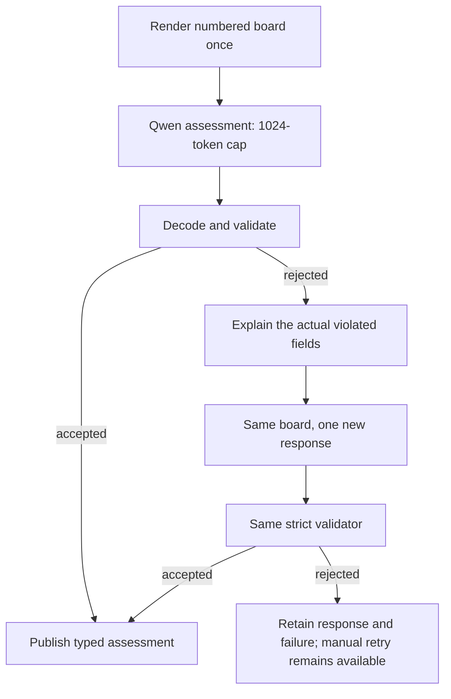

+++
author = "Thomas Evensen"
title = "AI Diagnostics and Validation: From Model Output to Accepted Evidence"
linkTitle = "AI Diagnostics"
date = "2026-10-13"
lastmod = "2026-10-13"
description = "A practical workbook for installed-model tests, structured Qwen output, bounded repairs, confidence, and visual qualification."
weight = 61
tags = ["ai", "qwen", "sam3", "clip", "testing", "swift", "validation"]
categories = ["technical details"]
mermaid = true
+++

# AI Diagnostics and Validation

A model can finish inference and still produce an unsuccessful analysis. RawCull
separates model execution from acceptance of a response. This distinction is
central to understanding both AI behavior and the Swift implementation.

This workbook follows the local `version-3.3.0` implementation inspected on
13 October 2026. It complements [AI Models in RawCull](/docs/ai/aiinrawcull/),
[AI Runtime](/docs/ai/airuntime/), and [Swift Behind the AI Pipelines](/docs/ai/aiswift/).
The tests discussed here do not execute [Combined Review](/docs/ai/aicombined/).

## 1. Understand the five different success questions

| Question | Evidence | Example failure |
| --- | --- | --- |
| Did the test execute? | Completed diagnostic, test log and result bundle | Build failure or disabled opt-in test |
| Was the provider usable? | Model capabilities and admitted asset identity | Missing vision asset or incompatible bundle |
| Did inference return data? | Embedding, mask or raw generated response | Empty result, runtime failure or cancellation |
| Did that data satisfy the application contract? | Decoder and validator acceptance | Unknown ID, bad enum, unsupported focus evidence |
| Was the result visually correct and useful? | Human annotation and source comparison | A structurally valid but incorrect focus judgment |

Passing one row never proves all subsequent rows. The automated probe mostly
exercises the first four; it is not a photographic ground-truth benchmark.

## 2. Run the installed-model probe

From the RawCull repository:

```sh
python3 Scripts/RunAIAnalysis.py --directory /Users/thomas/tmp --limit 6
```

`--limit` accepts 1 through 6. Selection uses filename order, not randomness or
quality. It selects regular files with a case-insensitive `.arw` suffix. The
manifest records SHA-256 for each chosen RAW. `--preflight-only` checks inputs
and model directories without building or testing. `--models` changes the
installed model root; `--packages` can select an existing Swift package cache.

The default model root is `~/ModelAssets/Release/Models`, with:

```text
SAM3/
CLIP-DataComp/
Qwen/qwen3_vl_2b/
```

Directory existence at preflight is not provider validation. Validation occurs
inside `AIAnalysisRealModelTests` when the private model runtime applies those
locations and refreshes capabilities.

The runner selects one opt-in Swift Testing suite through `xcodebuild test`.
It disables unrelated Combined model probes, turns off parallel testing, and
writes Xcode output into a private log. It does not download models or modify
source photographs. The test uses a private runtime and stores so application
cached results cannot masquerade as a fresh analysis.

### Stage order and what each stage establishes

1. Six Deep Review operations under the `sam-clip` stage label.
2. One separate real DataComp CLIP embedding probe for each corresponding image.
3. Six standalone Qwen analyses.
4. Six Objects analyses.

Deep Review does not invoke CLIP embedding inference in this probe. It receives
one candidate per image, no supplied subject label, no normal sharpness score,
and no AF point. CLIP is tested separately for a nonempty, finite embedding.
The stage label must not be interpreted as an integrated SAM/CLIP/Combined
quality benchmark or a semantic-search test.

## 3. Inspect the evidence in the correct order

| Artifact | Contents and interpretation |
| --- | --- |
| `evidence.inputs.json` in the parent | Selected source directory, limit and RAW SHA-256 values |
| `models.txt` | Capability dump and actual model locations/backend identities |
| `diagnostic.json` | Final stage/file/time/failure/result rows |
| `progress.json` | Incrementally rewritten rows; can lag the console's polling |
| `sam-clip-N.txt` | Deep Review state, score components, masks and cautions |
| `clip-N.txt` | Separate image embedding values |
| `qwen-N.txt`, `objects-N.txt` | Typed feature results and failure strings |
| `*-request-N.txt` | Instruction, response cap and supplied image dimensions |
| `*-request-N.png` | Actual supplied request CGImage, encoded as PNG |
| `*-request-N.response.txt` | Original response, including each retry |
| `*.error.txt` when present | Runtime exception instead of a response |
| `evidence.log`, `evidence.xcresult` | Build/test diagnostics and Xcode result bundle |

Use `diagnostic.json` as the final count. The console polls every two seconds;
a last progress message of 17 does not establish that the eighteenth analysis
never ran. Also, “Finished” means a row was recorded, including failed analyses.
The final failure message is driven by Xcode's exit status. If the completed
diagnostic is absent, inspect build/test admission rather than model quality.

A quick read-only summary:

```python
import json
from pathlib import Path

root = Path("/private/tmp/rawcull-analysis-EXAMPLE/evidence")
rows = json.loads((root / "diagnostic.json").read_text())
for stage in ("sam-clip", "qwen", "objects"):
    selected = [row for row in rows if row["stage"] == stage]
    passed = sum(not row["failure"] for row in selected)
    seconds = sum(float(row["elapsedSeconds"]) for row in selected)
    print(stage, passed, "/", len(selected), round(seconds, 1), "seconds")
    for row in selected:
        if row["failure"]:
            print(" ", row["file"], row["failure"])
```

Replace the example directory with the printed evidence path. Do not copy
private request images into a public documentation repository to explain an error.

## 4. Learn the Qwen photo contract

`QwenPhotoAssessment` uses schema version 2. All declared keys must exist;
optional fields permit null, not silent omission of required keys. Composition,
exposure and visibility use 1...5 integers or null. Every non-null score requires
its own nonempty evidence sentence. An unsupported score and its evidence are
both null. `eyesOpen` is null because this path does not supply qualified
anatomical evidence. Confidence must be finite and in 0...1.

Subject and evidence strings, and every problem/strength item, have a 240-character
limit. The decoder uses Swift `String.count`, not UTF-8 byte length. Lists have
at most four unique entries. An October response had valid JSON but evidence of
284 and 252 characters: JSON syntax success was not contract success.

`QwenModelResponse` distinguishes valid structured content, genuine freeform
answers, and rejected JSON-like content. Broken JSON is never treated as a
successful ordinary answer just because it contains prose.

The tab adds shorter-evidence guidance and one automatic structured-response
retry. Regeneration receives the same image and validation feedback. It does
not truncate the evidence, invent a missing observation or raise the limit.

## 5. Learn the Objects evidence contract

Qwen discovers concept phrases, SAM segments instances, RawCull deduplicates
masks, and Qwen sees a numbered board. Each ID owns a physical subject in one
photograph. The lower crops repeat that photograph at the same camera viewpoint.
They are not separate captures or alternate angles.

A compact illustrative object fragment:

```json
{
  "id": "1",
  "concept": "bird",
  "visibility": "clear",
  "focusQuality": "soft",
  "focusEvidence": {
    "cropID": "1",
    "observation": "The subject's feather edges lack crisp detail."
  },
  "expression": null,
  "strengths": [],
  "strengthEvidence": [],
  "problems": ["Subject detail is soft."],
  "problemEvidence": [
    {"cropID": "1", "observation": "Feather edges lack crisp detail."}
  ]
}
```

This is a fragment for learning, not a full schema or an observation of one of
the test files. A real response also includes description, obstructions,
confidence, photo-level fields and every required board object.

The critical invariants are:

- Every expected board ID appears exactly once; unknown/duplicate IDs fail.
- Every focus/claim evidence `cropID` belongs to its object's ID.
- `strengths.count == strengthEvidence.count`, likewise for problems.
- Empty claim arrays require empty evidence arrays.
- Evidence entries are objects, not plain strings.
- Definite focus requires supporting evidence; uncertain focus requires null.
- Visibility is `clear`, `partial`, `obscured`, or `uncertain`, never `visible`.
- Expression is null, and global strengths/problems are empty.

The prompt requests at most one strength/problem per object to simplify
paired generation. The decoder retains its existing bounded-list contract;
the prompt simplification is not automatic removal of extra model claims.
Certain narrow historical decoder accommodations, such as whole-number board
IDs, remain in the code. They do not permit null arrays or evidence strings.

## 6. Follow one bounded repair



Automatic repair reuses the already rendered board and retained masks. It does
not repeat discovery or SAM. Manual Retry Failed is a new operation and reuses
segmentation only after source/model/concept/cache compatibility checks.

Objects feedback inspects invalid visibility before typed decoding because an
unknown enum prevents decoding the entire assessment. Once typed decoding is
possible, feedback can report multiple claim-count and focus problems together.
The same focus-description helper is used by feedback and acceptance, avoiding
two competing definitions of supported wording.

A repair requests new output. It is not schema-constrained decoding: the current
request still asks the model to generate text, then validates that text in Swift.
Repeated prompting can improve compliance without guaranteeing it.

## 7. Negation: a concrete Swift validator lesson

The horses retry changed `focusQuality` to soft and wrote “not sharply focused.”
The consistency checker previously stripped “not sharp” but missed “not sharply
focused,” then found the positive substring “sharp.” A valid negation became a
false contradiction.

The Objects-only fix normalizes the longer negated phrase before searching for
positive claims. Tests cover several negations and a mixed sentence containing
both negation and a separate positive sharpness claim. The mixed sentence must
still fail. This is a narrow language heuristic; it is not a general natural-language
entailment engine. Broadly deleting every occurrence of “sharp” would hide real
contradictions and would be the wrong fix.

Similarly, accepting “clearly resolved” as equivalent detail wording does not
mean accepting “visible” or “in focus” alone. Subject visibility and resolved
texture answer different questions. Background grass/fence texture is not
support for the subject's focus.

## 8. October 13 diagnostic progression

The same six filename-selected ARWs were used in the inspected sequence:

| Evidence directory suffix | SAM + separate CLIP | Qwen | Objects | Total |
| --- | --- | --- | --- | --- |
| `nrns3l9l` | 6/6 | 5/6 | 0/6 | 11/18 |
| `kp34mwl_` | 6/6 | 6/6 | 1/6 | 13/18 |
| `778b7ak7` | 6/6 | 6/6 | 3/6 | 15/18 |
| `a83amono` | 6/6 | 6/6 | 4/6 | 16/18 |
| `f5j_7tc4` | 6/6 | 6/6 | 5/6 | 17/18 |

Each directory is below `/private/tmp/rawcull-analysis-`. These counts measure
application acceptance on this selected set, not independent statistical trials
or general model accuracy. Inputs were not a random or annotated benchmark.
Prompts changed between runs, and generated judgments changed too.

The most recent inspected failure was the horses negation issue. The subsequent
code fix passed 52 tests across the focused Objects and Combined Review suites.
The next installed-model run was still pending when this page was written; this
page therefore does not claim 18/18 success.

Some earlier responses copied example wording; some described crops as different
angles; many labelled every subject sharp with similar confidence. Improving
schema acceptance does not settle those visual-quality questions.

## 9. Design tests at the correct layer

| Test kind | What to test | Suitable isolation |
| --- | --- | --- |
| Pure decoder tests | Counts, IDs, enums, finite values, negation, contradictions | No models/images needed |
| Feature tests with stubs | One bounded retry, state, failure retention, cached SAM reuse | Actor inference stub plus image/segmenter stubs |
| Installed-model probe | Actual bundles, CGImages, generation and accepted output | Explicit opt-in, private stores and retained diagnostics |
| Annotated visual evaluation | Correct subjects, masks, detail and useful decisions | Human source/crop labels plus held-out inputs |

Use Swift Testing `#expect` for a check and `#require` when later code depends on
its result. Parameterized tests are useful for wording variations. A regression
must reject a neighbouring invalid case as well as accept the corrected one.

## 10. Reproducibility, timing and retention

Record the app commit and local diff, package pins, selected RAW hashes, model
identities, instructions, source dimensions and runtime/OS alongside results.
The model archive hash, installed asset identity and metadata hash describe
different things and should not be interchanged.

The first Qwen request includes lazy-load cost; later requests reuse the model.
Objects time includes discovery, segmentation, board rendering and assessment;
repair adds another generation to assessment time. Do not compare totals as
pure token-generation speed or claim a universal performance improvement.

Keep evidence while diagnosing. Unique run directories avoid overwriting older
responses, so old logs do not affect a new run. Once outcomes are compared and
needed records preserved, older temporary directories can be removed. Diagnostic
files and PNGs are private evidence, not durable application caches or public
teaching fixtures.
