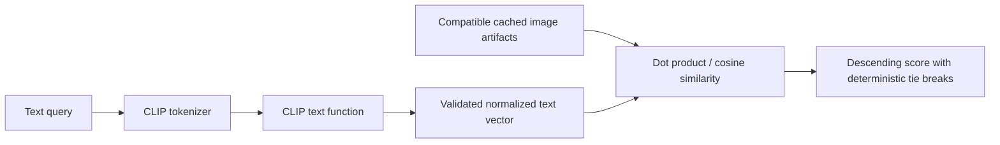

+++
author = "Thomas Evensen"
title = "AI Models in RawCull"
linkTitle = "AI Models in RawCull"
date = "2026-09-20"
lastmod = "2026-11-25"
description = "Review presets, model requirements, findings, saved evidence, decision controls and CLIP indexing in RawCull."
weight = 58
tags = ["ai", "clip", "sam3", "qwen", "review", "architecture", "core-ai"]
categories = ["technical details"]
mermaid = true

reviewed_commit = "328b570bf14d44bcf33efc58dc23da94bfadf439"
reviewed_version = "3.5.0"
reviewed_build = 469
reviewed_on = "2026-11-25"
review_scope = "Corrected the default preset, run controls and CLIP uses. Added photo layers, the preset contract, depth table, model inventory and source catalog."
+++

# AI models in RawCull

Open **Review** from the toolbar to inspect a shortlist. Choose **Selected** or **Tagged**, pick a review type, then click the button that names it: **Run Focus Check**, **Run Describe** or **Run Full Review**. Choosing a type never starts a run. Only the button does. The selected input must contain one to eight photos. If no grid items are explicitly selected, the focused visible photo can supply the input. Tagged input uses ratings of two or more in the active scope. To assess the top frames across the catalog’s ranked bursts, use **Assess All Bursts** on the burst list. [Burst Groups]()

## Choose a Review preset

| Preset | Required model | What the run produces |
| --- | --- | --- |
| **Focus check** | SAM 3 | Segments the generic `subject` prompt, registers available masks against the source and measures detail within usable foreground. CLIP can add relevance to the review criteria when available. This preset runs without Qwen. |
| **Describe** | Qwen3-VL | One whole-photo overview per image. The run finishes after the overview, so expect no region crops or masked measurements. |
| **Full** | Qwen3-VL | Starts with the overview, uses its concepts for SAM 3 when available, measures registered subjects and inspects crops within the depth budget. Reconciliation and report stages preserve evidence, omissions and conflicts. Multiple images also schedule a selection comparison. Missing optional models limit what the report can establish. |

Describe and Full require at least 16 GB of unified memory. Below 32 GB the app displays a memory advisory. Review starts with **Focus check** preselected, because it is the one preset that runs on every supported Mac. Below 16 GB the Describe and Full choices are disabled and the run bar shows the reason. Enter nonblank criteria of at most 512 UTF-8 bytes. Review checks that the chosen preview or RAW-detail source works across the selection. Model availability is checked for the chosen preset when the run starts. [ReviewRunContract](https://github.com/rsyncOSX/RawCull/blob/328b570bf14d44bcf33efc58dc23da94bfadf439/RawCull/Intelligence/CombinedReview/Execution/ReviewRunContract.swift) · [CombinedReviewFeature](https://github.com/rsyncOSX/RawCull/blob/328b570bf14d44bcf33efc58dc23da94bfadf439/RawCull/Intelligence/CombinedReview/CombinedReviewFeature.swift) · [CombinedReviewLiveBackend](https://github.com/rsyncOSX/RawCull/blob/328b570bf14d44bcf33efc58dc23da94bfadf439/RawCull/Intelligence/Composition/CombinedReviewLiveBackend.swift)

Select **Full**, then click **Run Full Review** to start. For the call path and model inputs, see [Full Review execution]().

A preset is data, not a branch scattered through the code. `ReviewPreset` names its stages, the models it requires and the models it can use:

```swift
var stages: Set<ReviewStage> {
    switch self {
    case .focusCheck: [.source, .segmentation, .identity, .measurement, .clip]
    case .describe: [.source, .overview]
    case .full: Set(ReviewStage.allCases)
    }
}
```

`requiredModels` decides whether a run may start. `usedModels` is derived from the stages and decides which model snapshots are requested. This is why Focus check never hashes the Qwen bundle, and why a missing CLIP model makes a run weaker instead of impossible.

The depth setting matters only where crops are inspected:

| Depth | Crops per photo | Crops per selection | Follow-ups per photo | Comparison pairs |
| --- | ---: | ---: | ---: | ---: |
| Standard | 3 | 16 | 0 | 0 |
| Deep | 8 | 32 | 2 | 2 |
| Exhaustive | 16 | 64 | 4 | 4 |

These are upper limits. A photo with one subject cannot use sixteen crops.

## Read a result

The photo stays in place as you inspect the findings. During a run, the card on the photo shows the current step and progress. Select a finding to see its crop and highlight its region when region evidence exists. **Region details** shows the subject, crop geometry and provenance. The up and down arrows move between findings and Escape goes back one level. The layer controls below the photo show regions, the subject mask, the camera's focus point, a focus mask and crop geometry. Regions are on when a result opens. Both focus layers start off.

- **Focus point** draws the camera's recorded AF position. It is disabled when the file has none.
- **Focus mask** draws the areas measured as in focus, so you can compare them with the AF point. It is generated on demand from the retained overview with the current `effectiveFocusConfig` and the photo's ISO (400 when unknown). It needs a retained overview. It is a *display aid*: it is not stored in the run, and it is a different calculation from the subject-masked measurement in the report.
- **Magnifier** (Off, 100%, 200%) shows a round lens under the pointer. At 100% one preview pixel maps to one screen pixel, with no interpolation. The lens loads the full-size embedded preview only while it is on. If that preview has a different aspect ratio from the overview (more than 1%), the lens falls back to the overview, because the pointer position would otherwise map to the wrong place. The lens is off while you choose a region for the next run.

The magnifier setting is remembered with `@AppStorage`. The layer switches are view state and reset with the view. [CombinedReviewLayouts](https://github.com/rsyncOSX/RawCull/blob/328b570bf14d44bcf33efc58dc23da94bfadf439/RawCull/Views/AIAnalysis/CombinedReviewLayouts.swift) · [ReviewMagnifier](https://github.com/rsyncOSX/RawCull/blob/328b570bf14d44bcf33efc58dc23da94bfadf439/RawCull/Views/AIAnalysis/ReviewMagnifier.swift)

Open **Coverage & limits** to see what the run could establish. For example, a mask touching the image edge may represent only part of a subject. A head-shaped region alone cannot establish eye sharpness. A crop omitted because the depth budget ran out has no crop observation. If synthesis fails, read the surviving observations as individual findings. The separate **Review Record** window follows the selected result and also exposes the technical record, JSON copy action and task history. [CombinedReviewView](https://github.com/rsyncOSX/RawCull/blob/328b570bf14d44bcf33efc58dc23da94bfadf439/RawCull/Views/AIAnalysis/CombinedReviewView.swift) · [CombinedReviewInspectorPane](https://github.com/rsyncOSX/RawCull/blob/328b570bf14d44bcf33efc58dc23da94bfadf439/RawCull/Views/AIAnalysis/CombinedReviewInspectorPane.swift) · [CombinedReviewRecordWindow](https://github.com/rsyncOSX/RawCull/blob/328b570bf14d44bcf33efc58dc23da94bfadf439/RawCull/Views/AIAnalysis/CombinedReviewRecordWindow.swift) · [CombinedReviewLimitDigest](https://github.com/rsyncOSX/RawCull/blob/328b570bf14d44bcf33efc58dc23da94bfadf439/RawCull/Intelligence/Presentation/CombinedReviewLimitDigest.swift)

## Follow a finding back to its pixels

A Full run records whether it used an embedded camera preview, a developed RAW or an ordinary raster. The overview is bounded to 2048 pixels on the long side by default. Review records the dimensions and orientation of the source used to cut a crop. It keeps the requested, padded, source and encoder-retained rectangles separately. **Inspect exact crop** can open the retained input when available. This matters on a small subject near the frame edge, where a source region, the visible foreground and the pixels supplied to the encoder can cover different areas. [ReviewImageSource](https://github.com/rsyncOSX/RawCull/blob/328b570bf14d44bcf33efc58dc23da94bfadf439/RawCull/Intelligence/CombinedReview/Imaging/ReviewImageSource.swift) · [CombinedReviewInspectorPane](https://github.com/rsyncOSX/RawCull/blob/328b570bf14d44bcf33efc58dc23da94bfadf439/RawCull/Views/AIAnalysis/CombinedReviewInspectorPane.swift)

For masked detail, Review loads the technical render, checks alignment against the appearance render, and requires the mask dimensions to match. A valid camera AF point can add evidence about the focus location. If alignment fails or the foreground is unusable, read the resulting limitation before interpreting a focus claim. The detail value depends on the render, with no calibrated sharp/blur threshold. A high CLIP relevance score describes a match to the criteria and cannot qualify an eye as sharp. [CombinedReviewExecution](https://github.com/rsyncOSX/RawCull/blob/328b570bf14d44bcf33efc58dc23da94bfadf439/RawCull/Intelligence/CombinedReview/Execution/CombinedReviewExecution.swift)

## Apply a decision

Reading or reopening a result leaves culling decisions untouched. **Tag** sets two stars. **Untag** removes a two-star record. A photo with three to five stars shows a disabled **Tagged** button so using it cannot erase those stars. Use the rating controls to change them. **Mark Reviewed** applies to the burst containing the photo and appears when the photo maps to exactly one burst in the active scope.

The decision bar resolves the saved photo against the open, editable catalog and checks its on-disk fingerprint at the time of the action. Scanning, pending shutdown, an unavailable ratings store, duplicate filenames or a changed file can prevent an edit. Ratings use filenames as keys, so duplicate names make the target ambiguous. [ReviewDecisionActions](https://github.com/rsyncOSX/RawCull/blob/328b570bf14d44bcf33efc58dc23da94bfadf439/RawCull/Model/ReviewDecisionActions.swift) · [CombinedReviewDecisionBar](https://github.com/rsyncOSX/RawCull/blob/328b570bf14d44bcf33efc58dc23da94bfadf439/RawCull/Views/AIAnalysis/CombinedReviewDecisionBar.swift)

### Rating keys

With the result active, **X** rejects, **P** or **0** marks a keeper, **1** or **2** assigns two stars, **3** or **T** assigns three, and **4** or **5** assigns the corresponding stars. A text field or other control that owns the keystroke keeps it. The action targets the displayed result after the same live-file checks as the buttons. [ImageReviewPolicies](https://github.com/rsyncOSX/RawCull/blob/328b570bf14d44bcf33efc58dc23da94bfadf439/RawCull/Model/ImageReviewPolicies.swift) · [CombinedReviewView](https://github.com/rsyncOSX/RawCull/blob/328b570bf14d44bcf33efc58dc23da94bfadf439/RawCull/Views/AIAnalysis/CombinedReviewView.swift)

## Where the subject outline comes from

Focus check and Full can supply the thumbnail mask badge and the **S** outline in loupe, zoom and the burst workspace. For the last displayed result matching the standardized photo URL, RawCull prefers an available primary-candidate mask with a retained input key, then the highest-confidence usable mask. Loading the image checks the file fingerprint again. Clearing retained inputs can leave a readable report with no drawable mask. Describe supplies no subject masks. [ReviewSubjectMasks](https://github.com/rsyncOSX/RawCull/blob/328b570bf14d44bcf33efc58dc23da94bfadf439/RawCull/Intelligence/CombinedReview/ReviewSubjectMasks.swift) · [ImageReviewSubjectOutlineLoader](https://github.com/rsyncOSX/RawCull/blob/328b570bf14d44bcf33efc58dc23da94bfadf439/RawCull/Model/Handlers/ImageReviewSubjectOutlineLoader.swift)

## Saved runs and repeatability

The snapshot freezes the preset, files, source preference, criteria, depth, model identities, stage versions and retention choices. The manifest tracks work and dependencies. Focus check starts with source and identity work, Describe with source and overview, and Full adds report work and, for a selection, comparison. Discovered subjects and crop regions add work as the run progresses.

An interrupted run can retain completed evidence. Resume revalidates the saved source fingerprints, model snapshots, pipeline contract and stored artifacts. A historical run without a preset decodes as Full and uses the earlier Full compatibility keys. After relaunch, RawCull restores the latest manifest and task history. The photo picker draws from results held in memory. **Resume** reconstructs results for a compatible run and reuses valid stage artifacts. If the original photo has changed, the saved task history remains available. When there is no displayed photo result, open **Run history & diagnostics** in the Review workspace. **Clear retained inputs** removes stored images. **Clear rejected responses** removes optional response diagnostics. [CombinedReviewFeature+Manifest](https://github.com/rsyncOSX/RawCull/blob/328b570bf14d44bcf33efc58dc23da94bfadf439/RawCull/Intelligence/CombinedReview/CombinedReviewFeature+Manifest.swift) · [CombinedReviewExecution](https://github.com/rsyncOSX/RawCull/blob/328b570bf14d44bcf33efc58dc23da94bfadf439/RawCull/Intelligence/CombinedReview/Execution/CombinedReviewExecution.swift) · [ReviewRunContract](https://github.com/rsyncOSX/RawCull/blob/328b570bf14d44bcf33efc58dc23da94bfadf439/RawCull/Intelligence/CombinedReview/Execution/ReviewRunContract.swift)

When resuming, the store checks the stage’s compatibility and that any mask inputs referenced by a segmentation artifact still exist. Evicting a referenced mask makes that stage ineligible for reuse. The historical report can still explain what the earlier run observed. [ReviewArtifactStore](https://github.com/rsyncOSX/RawCull/blob/328b570bf14d44bcf33efc58dc23da94bfadf439/RawCull/Intelligence/CombinedReview/Storage/ReviewArtifactStore.swift) · [ReviewRunContractTests](https://github.com/rsyncOSX/RawCull/blob/328b570bf14d44bcf33efc58dc23da94bfadf439/RawCullTests/ReviewRunContractTests.swift)

## How CLIP Works in RawCull

CLIP places images and text in a shared vector space. RawCull uses that property
in three ways: image-to-image distance for similarity and burst grouping,
text-to-image semantic search, and relevance between Review criteria and the
overview or crops of a reviewed photo. The earlier closed-set label pass that
chose SAM prompts was removed together with Deep Review. Focus check now always
segments the generic `subject` prompt, and Full uses the concepts Qwen named.

### Provider construction and identity

PhotoAIKit's
[`CoreAICLIPProvider`](https://github.com/rsyncOSX/PhotoAIKit/blob/26647c62d9933968d92bd00b162290cdd7c78fee/Sources/CoreAICLIPBackend/CoreAICLIPProvider.swift)
is an actor implementing image embedding, artifact generation/comparison, text
embedding, and image/text comparison. During initialization it:

1. validates the supplied model bundle;
2. derives a `ModelIdentity` and asset fingerprint;
3. decodes model-specific preprocessing, tokenizer, function-name,
   normalization, and configuration metadata; and
4. exposes a `SimilarityBackendDescriptor` containing all compatibility-critical
   versions.

The descriptor is effectively the type identity of an embedding on disk. It
records backend, model fingerprint, representation, preprocessing,
normalization, and configuration versions. Image artifacts additionally record
vector dimensions, schema version, and a source fingerprint. Consequently,
RawCull does not compare a DataComp vector with an OpenAI vector, reuse an
artifact after preprocessing changes, or silently treat an edited source file
as unchanged.

### Image preprocessing and inference

`RawCullSimilarityImageDecoder` first asks `RawParserKitImageLoader` for a
bounded thumbnail. If that fails it attempts an ImageIO thumbnail without
requesting a full fallback decode. The resulting `CGImage` is passed through
the model-specific preprocessing declared by the CLIP bundle. Current metadata
supports either the legacy stretch/bilinear path or shortest-side resize plus
square center crop with bicubic interpolation and configured RGB mean/standard
deviation.

The provider lazily loads Core AI functions and tokenizer resources. The image
function receives the prepared image tensor and, if required by the exported
graph, dummy text inputs. Its output is flattened, checked against the expected
dimension, wrapped in an `ImageEmbedding`, JSON-encoded, and stored in a
`SimilarityArtifact`. The backend descriptor records the bundle's declared
normalization version; image/text comparison later verifies that the image
vector actually has approximately unit magnitude.

### Indexing and recovery

`RawCullCLIPSimilarityService` uses PhotoAIKit's bounded
`SimilarityArtifactIndexer` with concurrency limit 1. CLIP inference is kept
serial because the provider is actor-owned and model execution is resource
intensive. There is no per-file or whole-batch Vision substitution during a
CLIP pass.

For a non-finite vector, `RawCullRecoveringCLIPArtifactProvider` performs a
targeted sequence:

1. reject the invalid output;
2. retry once with the already-loaded provider;
3. construct a fresh provider from the same validated model location;
4. verify that the replacement descriptor is exactly the same; and
5. retry once with the replacement.

Successful CLIP artifacts from other files are retained. A file that still
fails is reported and remains unindexed; it is not given a Vision artifact that
would make the batch heterogeneous. Decode failures and inference failures are
recorded separately for diagnostics.

### Image similarity and burst grouping

For compatible normalized image embeddings, PhotoAIKit returns cosine distance.
`SimilarityScoringModel` owns the artifact dictionary and computes distances
from an anchor. When ranking against an anchor it adds a 0.10 penalty if both
photos have a saliency subject label and the labels differ. Those labels come
from PhotoAnalysisKit's Vision classification during sharpness scoring, not from
CLIP. The distances are then used for ranking and burst grouping.

This responsibility split is deliberate:

- CLIP defines the vector and mathematical comparison;
- PhotoAIKit defines artifact compatibility and indexing mechanics; and
- RawCull defines catalog admission, grouping thresholds, ordering, progress,
  persistence, and culling policy.

Vision remains the runtime fallback when CLIP is disabled or cannot be
validated. Vision and CLIP artifacts are both descriptor-bearing, so switching
backends causes incompatible state to be rejected or rehydrated rather than
misinterpreted.

### Semantic search

Semantic search never indexes missing images as a side effect. It operates only
on already-persisted, descriptor-compatible CLIP image artifacts:



`RawCullCLIPSemanticSearchService` trims and validates the query, filters image
artifacts by the complete backend descriptor, generates one transient text
embedding, and scores each compatible image. Because both vectors are
normalized, their dot product is cosine similarity. Valid scores lie in
`-1...1`; they are relative ranking values, not confidence percentages.

Sorting is deterministic: score descending, then original catalog order,
localized filename, and UUID. Individual malformed artifacts become per-file
failures rather than aborting every valid result. Text embeddings are scoped to
one search and are not persisted.

## Model inventory

The catalog in code is the authority. `RawCullAIModelDownloadCatalog.prepared` lists every known pack, and `production` filters it through the switches in `RawCullAIModelInclusion`.

| Production model | Job in RawCull | Asset pack and path | Download | Installed |
| --- | --- | --- | ---: | ---: |
| DataComp CLIP, ViT-B/32 at 256 px | Similarity, burst grouping, semantic search, Review relevance | `rawcull-clip-datacomp`, `Models/CLIP-DataComp` | 282,967,354 bytes | 307,800,172 bytes |
| Meta SAM 3 | Subject and concept masks in Review | `rawcull-sam3`, `Models/SAM3` | 1,542,689,931 bytes | 1,667,570,378 bytes |
| Qwen3-VL-2B-Instruct | Review text, burst and MCP assessments | `rawcull-qwen3-vl-2b`, `Models/Qwen/qwen3_vl_2b` | 3,754,599,603 bytes | 5,395,195,663 bytes |

SAM 3 requires explicit acceptance of its bundled, hash-verified licence before download. The other two do not. OpenAI CLIP has an enum case, a resource manager and a path, but `includeOpenAICLIP` is `false`, so no production pack offers it. Vision needs no download and is always available for similarity. [RawCullAIModelDownloadCatalog](https://github.com/rsyncOSX/RawCull/blob/328b570bf14d44bcf33efc58dc23da94bfadf439/RawCull/Intelligence/ModelManagement/RawCullAIModelDownloadCatalog.swift)

## Source catalog: `RawCull/Intelligence`

The directory is organized by responsibility, not by model.

| Folder | Start here | Responsibility |
| --- | --- | --- |
| `Composition` | [RawCullIntelligenceRuntime](https://github.com/rsyncOSX/RawCull/blob/328b570bf14d44bcf33efc58dc23da94bfadf439/RawCull/Intelligence/Composition/RawCullIntelligenceRuntime.swift), [RawCullAIModelRuntime](https://github.com/rsyncOSX/RawCull/blob/328b570bf14d44bcf33efc58dc23da94bfadf439/RawCull/Intelligence/Composition/RawCullAIModelRuntime.swift), [CombinedReviewLiveBackend](https://github.com/rsyncOSX/RawCull/blob/328b570bf14d44bcf33efc58dc23da94bfadf439/RawCull/Intelligence/Composition/CombinedReviewLiveBackend.swift) | App graph, provider ownership, and the per-run backend that Review calls |
| `Contracts` | [RawCullAIModels](https://github.com/rsyncOSX/RawCull/blob/328b570bf14d44bcf33efc58dc23da94bfadf439/RawCull/Intelligence/Contracts/RawCullAIModels.swift) | Model choices, paths and capability states |
| `ModelManagement` | [RawCullAIModelDownloadsModel](https://github.com/rsyncOSX/RawCull/blob/328b570bf14d44bcf33efc58dc23da94bfadf439/RawCull/Intelligence/ModelManagement/RawCullAIModelDownloadsModel.swift), [RawCullAIModelResourceManager](https://github.com/rsyncOSX/RawCull/blob/328b570bf14d44bcf33efc58dc23da94bfadf439/RawCull/Intelligence/ModelManagement/RawCullAIModelResourceManager.swift), [RawCullAISettingsModel](https://github.com/rsyncOSX/RawCull/blob/328b570bf14d44bcf33efc58dc23da94bfadf439/RawCull/Intelligence/ModelManagement/RawCullAISettingsModel.swift) | Download, licence, validation and activation |
| `CombinedReview` | [CombinedReviewFeature](https://github.com/rsyncOSX/RawCull/blob/328b570bf14d44bcf33efc58dc23da94bfadf439/RawCull/Intelligence/CombinedReview/CombinedReviewFeature.swift), then `Execution`, `Evidence`, `Imaging` and `Storage` | The Review run: admission, stages, pixels, evidence rules and saved artifacts |
| `Qwen` | [QwenInferenceRuntime](https://github.com/rsyncOSX/RawCull/blob/328b570bf14d44bcf33efc58dc23da94bfadf439/RawCull/Intelligence/Qwen/QwenInferenceRuntime.swift), [QwenPhotoAssessment](https://github.com/rsyncOSX/RawCull/blob/328b570bf14d44bcf33efc58dc23da94bfadf439/RawCull/Intelligence/Qwen/QwenPhotoAssessment.swift) | The inference actor and the structured photo assessment |
| `Similarity` | [SimilarityScoringModel](https://github.com/rsyncOSX/RawCull/blob/328b570bf14d44bcf33efc58dc23da94bfadf439/RawCull/Intelligence/Similarity/SimilarityScoringModel.swift), [RawCullVisionSimilarityService](https://github.com/rsyncOSX/RawCull/blob/328b570bf14d44bcf33efc58dc23da94bfadf439/RawCull/Intelligence/Similarity/RawCullVisionSimilarityService.swift) | Artifacts, ranking, grouping, and the Vision and CLIP services |
| `SemanticSearch` | [RawCullSemanticSearchModel](https://github.com/rsyncOSX/RawCull/blob/328b570bf14d44bcf33efc58dc23da94bfadf439/RawCull/Intelligence/SemanticSearch/RawCullSemanticSearchModel.swift), [RawCullSemanticSearchService](https://github.com/rsyncOSX/RawCull/blob/328b570bf14d44bcf33efc58dc23da94bfadf439/RawCull/Intelligence/SemanticSearch/RawCullSemanticSearchService.swift) | Query state and deterministic ranking of cached CLIP artifacts |
| `SubjectMasks` | [SubjectMaskFocusScorer](https://github.com/rsyncOSX/RawCull/blob/328b570bf14d44bcf33efc58dc23da94bfadf439/RawCull/Intelligence/SubjectMasks/SubjectMaskFocusScorer.swift), [SubjectMaskOutlineRenderer](https://github.com/rsyncOSX/RawCull/blob/328b570bf14d44bcf33efc58dc23da94bfadf439/RawCull/Intelligence/SubjectMasks/SubjectMaskOutlineRenderer.swift) | Detail measured inside a mask, and the drawn outline |
| `ObjectAnalysis` | [ObjectInstanceDeduplicator](https://github.com/rsyncOSX/RawCull/blob/328b570bf14d44bcf33efc58dc23da94bfadf439/RawCull/Intelligence/ObjectAnalysis/ObjectInstanceDeduplicator.swift), [ObjectJSONEnvelope](https://github.com/rsyncOSX/RawCull/blob/328b570bf14d44bcf33efc58dc23da94bfadf439/RawCull/Intelligence/ObjectAnalysis/ObjectJSONEnvelope.swift) | Two helpers kept from the retired Objects feature. Review uses both. |
| `BurstAnalysis` | [BurstAnalysisCoordinator](https://github.com/rsyncOSX/RawCull/blob/328b570bf14d44bcf33efc58dc23da94bfadf439/RawCull/Intelligence/BurstAnalysis/BurstAnalysisCoordinator.swift) | Burst pipeline, snapshots and People Ranking. See [Burst Groups](). |
| `Persistence` | [PerFileAnalysisArtifactStore](https://github.com/rsyncOSX/RawCull/blob/328b570bf14d44bcf33efc58dc23da94bfadf439/RawCull/Intelligence/Persistence/PerFileAnalysisArtifactStore.swift), [BurstAnalysisCache](https://github.com/rsyncOSX/RawCull/blob/328b570bf14d44bcf33efc58dc23da94bfadf439/RawCull/Intelligence/Persistence/BurstAnalysisCache.swift) | Similarity artifacts, burst snapshots and face evidence |
| `Presentation` | [CombinedReviewPresentation](https://github.com/rsyncOSX/RawCull/blob/328b570bf14d44bcf33efc58dc23da94bfadf439/RawCull/Intelligence/Presentation/CombinedReviewPresentation.swift), [CombinedReviewLimitDigest](https://github.com/rsyncOSX/RawCull/blob/328b570bf14d44bcf33efc58dc23da94bfadf439/RawCull/Intelligence/Presentation/CombinedReviewLimitDigest.swift) | Turns stored evidence and pipeline reasons into sentences and findings |

## Earlier model evaluations

The September puffin tests exercised the former Objects workflow. All 16 runs produced the expected board IDs, yet visual inspection found swapped bird descriptions and a wrong bird count. Those observations explain why a valid structured response still needs photographic review. The archived guide preserves the fixtures, timings and evidence limits for that workflow. [September evaluation](https://github.com/rsyncOSX/TechDocRawCull/blob/152cb6fc81a06429191a4f3fb32028c28beac410/content/en/docs/ai/aiinrawcull.md#september-24-2026-packaged-model-check)
