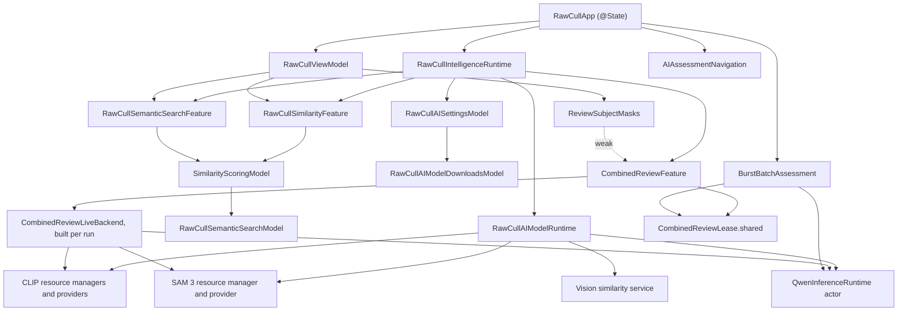
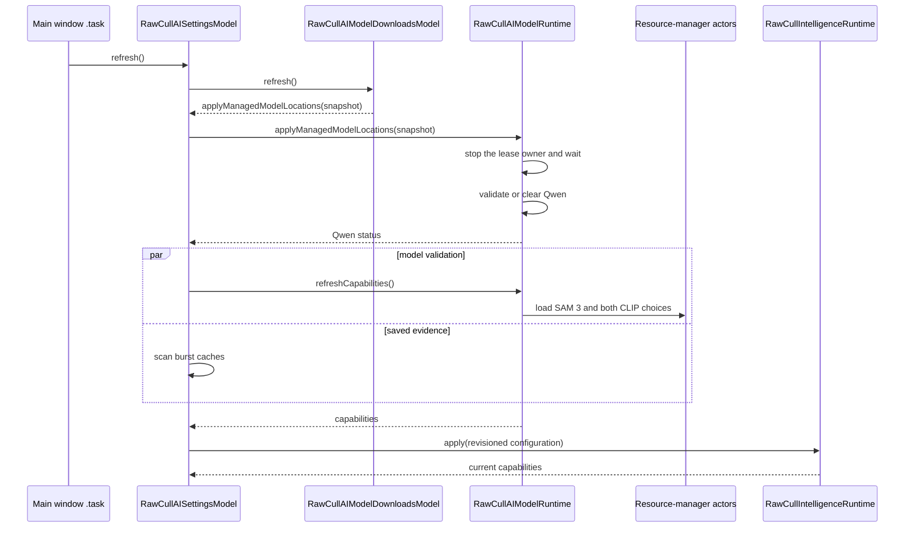

+++
author = "Thomas Evensen"
title = "The RawCull AI Runtime"
linkTitle = "AI Runtime"
date = "2026-09-03"
lastmod = "2026-11-25"
description = "Runtime ownership, model activation, preset admission, inference sharing and Vision scheduling in RawCull."
weight = 59
tags = ["ai", "architecture", "runtime", "swift", "dependency-injection", "review"]
categories = ["technical details"]
mermaid = true

reviewed_commit = "5169ffd3487fe4ddc005d511fffa38172657d703"
reviewed_version = "3.5.0"
reviewed_build = 469
reviewed_on = "2026-11-25"
review_scope = "Rebuilt topology, construction order, configuration apply, lease and gate, isolation, stale-result and fallback sections from current source."
+++

# The RawCull AI runtime

`RawCullApplicationState.live()` assembles the catalog workspace and long-lived intelligence services. `RawCullApp` holds the view model and intelligence runtime in SwiftUI state. The main view receives the similarity, semantic search, settings and Review features explicitly. Source code still uses the name `CombinedReviewFeature` for the feature behind the **Review** toolbar item. [RawCullApp](https://github.com/rsyncOSX/RawCull/blob/5169ffd3487fe4ddc005d511fffa38172657d703/RawCull/Main/RawCullApp.swift) · [RawCullIntelligenceRuntime](https://github.com/rsyncOSX/RawCull/blob/5169ffd3487fe4ddc005d511fffa38172657d703/RawCull/Intelligence/Composition/RawCullIntelligenceRuntime.swift)

The model runtime and the intelligence runtime are separate on purpose. The first one answers "which providers are valid right now?". The second one answers "which feature objects does the app keep for its whole lifetime?". Models come and go when the user downloads, removes or selects them. Feature objects do not.

| Lifetime | Owner | What it owns |
| --- | --- | --- |
| App | `RawCullAIModelRuntime` | Validated CLIP and SAM providers, Vision similarity, subject-mask stores and the Qwen inference actor |
| App | `RawCullIntelligenceRuntime` | Similarity and semantic search features, Review, settings and downloads, configuration revision, and Review Record navigation |
| App session | `BurstBatchAssessment` and `AIAssessmentNavigation` | Qwen batch task, its progress and the burst entries shown in AI Assessments |
| Review run | `CombinedReviewFeature` | Frozen inputs, model snapshots, task and lease, evidence, manifest and optional retained inputs |
| Displayed Review results | `ReviewSubjectMasks` | Lookup of a primary or highest-confidence retained mask for a catalog photo. Image loads verify the photo fingerprint. |

## Runtime topology



Solid arrows mix ownership and use. The dashed arrow is a weak reference. Similarity, semantic search and the view model refer to the *same* scoring model and feature instances. Debug assertions in `RawCullApplicationState.make` check this, because a second instance would have its own tasks, progress, artifacts and observation.

Two things in the model runtime look more active than they are. The subject-mask stores, `subjectMaskRepository` and `sam3Segmentation` are rebuilt when the SAM provider changes, but no feature reads them at this revision. Review builds its own `ObjectSegmentationService` through `combinedSegmentationService()` with an empty store list and an eight-instance limit, and keeps masks in its own artifact store. From that older pipeline Review uses only `sam3Configuration.modelIdentity`, which becomes part of the saved SAM snapshot.

## Construction, step by step

`RawCullApplicationState.live()` creates a default `RawCullAIModelRuntime` and calls `make(...)`. Tests call `make` directly with substitute stores, preferences and download coordinators.

**Phase 1. The model runtime does only bounded, synchronous work.** It creates one resource-manager actor per model (SAM 3, DataComp CLIP, OpenAI CLIP) with no candidate URL yet, one Vision backend with the app's serializer, the mask stores, a placeholder `UnavailableSegmentationProvider`, and a first capability snapshot in which Vision is available and every model is `checking`. No model engine is loaded here.

**Phase 2. `make` assembles the stable graph** in this order:

1. `RawCullAIModelDownloadsModel` from the runtime's paths and the production catalog.
2. `RawCullAISettingsModel` from the model runtime, downloads model and user defaults. It reads the saved CLIP and segmentation choices.
3. A synchronous revision-0 configuration. Nothing is validated yet, so this normally selects Vision.
4. One `SimilarityScoringModel` from that configuration, then `RawCullSimilarityFeature` and `RawCullSemanticSearchFeature` around it.
5. `ReviewSubjectMasks`, then `RawCullViewModel` with those exact instances.
6. `RawCullIntelligenceRuntime`, which constructs `CombinedReviewFeature` with a backend *factory* rather than a backend, and sets the 16 GB and 32 GB memory messages.
7. The weak callbacks: semantic search to `CatalogController`, settings to the runtime, subject masks to Review. Binding settings publishes the first configuration, so it happens after every receiver exists.

**Phase 3. Validation happens later.** `RawCullApp` starts `settingsModel.refresh()` from the main window's `.task`. The app is usable with Vision similarity while disk checks run.

The factory in step 6 matters. A backend captures provider values for one run, so it must be built at the moment a run starts. If Review stored a backend at launch, it would hold "no models installed" for the whole session.

[RawCullIntelligenceRuntime](https://github.com/rsyncOSX/RawCull/blob/5169ffd3487fe4ddc005d511fffa38172657d703/RawCull/Intelligence/Composition/RawCullIntelligenceRuntime.swift) · [RawCullAIModelRuntime](https://github.com/rsyncOSX/RawCull/blob/5169ffd3487fe4ddc005d511fffa38172657d703/RawCull/Intelligence/Composition/RawCullAIModelRuntime.swift) · [RawCullApp](https://github.com/rsyncOSX/RawCull/blob/5169ffd3487fe4ddc005d511fffa38172657d703/RawCull/Main/RawCullApp.swift)

## From settings to a running Review

1. Settings validates installed model locations and publishes a complete configuration. The runtime compares its revision with the last accepted revision. Equal or older revisions leave the active services in place.
2. A newer revision with identical descriptors advances the revision alone. Changes to similarity or semantic identity replace those services independently. A segmentation change selects the provider through the model runtime.
3. The Review backend factory reads the currently available Qwen URL, the SAM object-instance segmenter, and the CLIP provider and location. The preset determines which model snapshots the run requests. Qwen validation checks encoder capability and bundle identity for a Qwen preset. Focus check can construct a backend with no Qwen URL.
4. After admission, the feature holds the shared lease, retains access to selected files, freezes their fingerprints and persists the initial work manifest. Resume uses the original snapshot. A provider or file change can make work incompatible.
5. The record window reads the same feature and navigation selection as the main workspace. Opening it does not create another run. The old SAM/CLIP, Qwen and Objects tab controllers have been removed. At startup the model runtime attempts to remove the obsolete Objects mask directory.

[RawCullAIModelRuntime](https://github.com/rsyncOSX/RawCull/blob/5169ffd3487fe4ddc005d511fffa38172657d703/RawCull/Intelligence/Composition/RawCullAIModelRuntime.swift) · [CombinedReviewLiveBackend](https://github.com/rsyncOSX/RawCull/blob/5169ffd3487fe4ddc005d511fffa38172657d703/RawCull/Intelligence/Composition/CombinedReviewLiveBackend.swift) · [CombinedReviewFeature](https://github.com/rsyncOSX/RawCull/blob/5169ffd3487fe4ddc005d511fffa38172657d703/RawCull/Intelligence/CombinedReview/CombinedReviewFeature.swift) · [CombinedReviewRecordWindow](https://github.com/rsyncOSX/RawCull/blob/5169ffd3487fe4ddc005d511fffa38172657d703/RawCull/Views/AIAnalysis/CombinedReviewRecordWindow.swift)

For a debugger walkthrough of Full, including the precise instruction and pixel inputs at each provider boundary, see [Full Review execution]().

## Startup Refresh and Installed-Model Activation

The graph is usable immediately with Vision while disk checks happen later.
`RawCullApp` attaches the settings refresh to the main window's root view:

```swift
.task {
    await intelligenceRuntime.settingsModel.refresh()
}
```

The call path is:



### One complete location snapshot

`applyManagedModelLocations(_:)` is the only activation path for a complete set
of installed locations. It gives the current SAM and CLIP URLs to their resource
managers. A missing Qwen URL calls `qwenInference.clear()`; a present URL is
standardized and validated.

Before it touches anything, the method calls
`CombinedReviewLease.shared.invalidateAndWait()`. That asks a running Review,
burst batch or MCP assessment to stop and suspends until it has released the
lease. `refreshCapabilities()` does the same. Model replacement therefore never
runs underneath an active run.

Using a complete snapshot avoids a transient mixture such as “new CLIP, old
SAM, removed Qwen still active.” Every invocation describes one model-install
state.

### Generation-gated refresh

Settings increments `refreshGeneration` before beginning work. The generation
is checked after Qwen validation and after the concurrent capability/evidence
work. A later refresh therefore supersedes an earlier one; the earlier result
cannot publish merely because its disk work finished last.

The `defer` that clears `isScanningSavedBurstData` also checks the generation,
so an obsolete refresh cannot hide the current refresh's progress indicator.

### Concurrent capability validation

`RawCullAIModelRuntime.refreshCapabilities()` starts SAM 3, DataComp CLIP, and
OpenAI CLIP loads with `async let`. Each resource-manager actor computes a
lightweight recursive metadata snapshot. When unchanged, the previous validated
capability/provider result is reused. When changed, PhotoAIKit validates the
bundle and constructs a provider.

After all three complete, the main-actor runtime atomically replaces its
provider dictionaries and resolved location dictionaries, translates package
statuses into RawCull statuses, builds semantic-search readiness separately,
stores one new capability snapshot, and activates the selected segmentation
provider.

## Applying a revisioned configuration

Settings never calls individual setters on the features. It builds one complete
`RawCullIntelligenceConfiguration`: a revision number, the similarity service,
the semantic capability and optional service, and the segmentation choice. Its
`identity` contains only descriptors. Concrete services stay on the main actor,
and the `Sendable` identity cannot carry a provider across an isolation boundary.

`RawCullIntelligenceRuntime.apply(configuration:)` then works in this order:

1. Reject a revision that is not newer than the last accepted one. An assertion
   catches a publisher that reuses one revision for two identities.
2. If the identity is unchanged, record the revision and stop. No work is reset.
3. If segmentation changed, ask the model runtime to select it.
4. If the similarity backend or accepted artifact backends changed, replace the
   service inside the existing `RawCullSimilarityFeature`.
5. If semantic capability or backend changed, replace that part alone.
6. Record the identity and revision, and return current capabilities.

Revision and identity solve different problems. The revision orders decisions,
so an older one cannot win by arriving late. The identity decides whether a
newer decision needs any work at all.

### What a replacement invalidates

`replaceSimilarityService` cancels and resets burst analysis through the weak
application context, installs the new service, cancels the running image
hydration, advances its generation, and rehydrates the open catalog for the new
descriptors. `replaceSemanticSearchConfiguration` does the same for semantic
artifacts with its own task and generation. Changing one concern does not
discard the other.

The feature object itself is kept. Rebuilding it would leave SwiftUI views
observing the old object while commands reached the new one, and would drop
progress, hydrated artifacts and task handles that are still valid.

## Capability State Is More Than “Loaded”

`RawCullAICapabilityStatus` distinguishes:

| State | Meaning |
| --- | --- |
| `checking(expectedLocations:)` | Validation is pending. |
| `available(location:)` | Bundle validation and provider construction succeeded, or an always-available service such as Vision is ready. |
| `missing(expectedLocations:)` | No candidate bundle was found. |
| `invalid(location:reason:)` | A candidate exists but validation or provider construction failed. |
| `unavailable(reason:)` | The runtime cannot offer the capability for another explicit reason. |

CLIP model availability and semantic-search readiness are separate. A provider
must expose the text/image contracts before semantic search is `.ready`. Vision
remains a valid similarity service but can never satisfy semantic text search.

Qwen uses an internal `QwenModelStatus` with not-configured, checking,
available, missing, and invalid states. Settings translates it to the common
capability presentation and retains the validated Qwen status for the Review backend factory.

## Resource Managers and Their Cache

`RawCullAIModelResourceManager<Provider>` is an actor because filesystem
inspection, cryptographic bundle validation, and provider initialization must
not run on the main actor or race with a managed-location change.

The resource cache has two keys:

- `RawCullAIModelResourceSnapshot`, a sorted list of path, file kind, byte
  count, modification time, and symlink target; and
- the resulting capability, optional provider, and optional provider-init
  failure.

`setManagedCandidateURL` invalidates both when the URL changes. `load()` also
detects modifications within the same directory. The snapshot only decides
whether validation may be reused. PhotoAIKit's resolver remains responsible for
metadata, required files, asset extension, fingerprint, and checksum validity.

Bundle validity and provider construction are reported separately. A bundle can
be structurally valid yet fail to initialize its concrete runtime; RawCull maps
that case to `.invalid` with the provider error so Settings can explain the
actual stage that failed.

## Selecting the Similarity Runtime

`RawCullAIModelRuntime.similarityService(prefersCLIP:clipModel:)` has a strict
selection order:

1. If the user disabled CLIP, return the existing Vision service.
2. If the selected CLIP provider is absent, log the expected/resolved path and
   return Vision.
3. If the provider exists but its resolved location is missing, return Vision.
4. Otherwise return a new `RawCullCLIPSimilarityService` around the validated
   provider and supply a factory that can reconstruct a provider from the exact
   validated location for finite-vector recovery.

The service value can change while `RawCullSimilarityFeature` and
`SimilarityScoringModel` retain their identities. Backend descriptors determine
whether existing artifacts are still compatible.

Semantic search is constructed only from a currently validated CLIP provider.
The provider itself satisfies both `TextEmbeddingProviding` and
`ImageTextSimilarityComparing`, so `RawCullCLIPSemanticSearchService` can use
the same model identity as the cached image embeddings.

## Model identity at Review admission

The live Review backend accepts Qwen when the installed bundle hash and encoder contract match its expected configuration: a 448 × 448 stretch input, 196 image tokens and a 4096-token context. For CLIP it recognizes two bundle hashes and records the corresponding 224- or 256-pixel encoder geometry. An unrecognized CLIP hash leaves Review without CLIP relevance. The SAM entry records the segmenter identity and source-normalized mask preprocessing. A preset requests only its participating models. For example, Focus check skips Qwen bundle hashing entirely. [CombinedReviewLiveBackend](https://github.com/rsyncOSX/RawCull/blob/5169ffd3487fe4ddc005d511fffa38172657d703/RawCull/Intelligence/Composition/CombinedReviewLiveBackend.swift)

The backend also stores a runtime-version string containing historical abbreviated revisions and the OS version. That string participates in saved evidence identity. Use the [application lockfile]() for the actual Swift package revisions in this build.

## Qwen model lifetime

Validation cancels active generation, advances the model generation, checks vision modality and retains a provider. The first request lazily constructs the vision-language model. Subsequent requests can reuse that model, each with a fresh session. A generation gate limits responses to one at a time. A request waiting for its turn rechecks its captured generation after admission. After model loading and response generation the actor checks cancellation and generation again before publishing text. [QwenInferenceRuntime](https://github.com/rsyncOSX/RawCull/blob/5169ffd3487fe4ddc005d511fffa38172657d703/RawCull/Intelligence/Qwen/QwenInferenceRuntime.swift)

## Shared inference: the lease and the generation gate

Two mechanisms protect different scopes. They are easy to confuse.

| Mechanism | Scope | Protects |
| --- | --- | --- |
| `CombinedReviewLease.shared` | Main actor, one whole run | Only one of Review, the in-app burst batch and an MCP assessment can own AI work. It also lets model replacement stop the owner. |
| `QwenGenerationGate` | Inside the Qwen actor, one response | Only one generation runs at a time, across all callers. |

The gate is needed even though `QwenInferenceRuntime` is an actor. An actor
method that awaits gives up the actor, so a second `respond(to:)` call could
enter while the first is waiting for the model. `acquire()` waits with short
cancellable sleeps until the gate is free.

Cancelling the owner does not release the lease. The worker releases it in its
`defer`, when it has really stopped. `invalidateAndWait()` suspends on that
release and throws `CancellationError` if its own caller is cancelled.
`RawCullSimilarityFeature.index` and semantic search return early while the
lease is held.

Because preparation also goes through the lease, code that already *holds* the
lease must not start a model refresh. At this revision two callers do:
`BurstBatchAssessment.run` and the MCP follow-up both call their prepare
closure after acquiring the lease, if Qwen has no identity yet. The refresh then
invalidates its own caller. This path is only reached when Qwen was not already
validated at launch. It is recorded under
[known source limits](#open-source-findings).

The in-app batch and MCP follow-ups use `assessForMCP`, which binds each request
to one model generation, retries one invalid response, and throws
`modelChanged` if the model is replaced. MCP also has a cross-process worker
lock and authorization checks for shared jobs. A batch writes session entries
using the open catalog's access. MCP results use the job's catalog grant.

[CombinedReviewLease](https://github.com/rsyncOSX/RawCull/blob/5169ffd3487fe4ddc005d511fffa38172657d703/RawCull/Intelligence/CombinedReview/Storage/CombinedReviewLease.swift) · [QwenGenerationGate](https://github.com/rsyncOSX/RawCull/blob/5169ffd3487fe4ddc005d511fffa38172657d703/RawCull/Intelligence/Qwen/QwenGenerationGate.swift) · [QwenInferenceRuntime](https://github.com/rsyncOSX/RawCull/blob/5169ffd3487fe4ddc005d511fffa38172657d703/RawCull/Intelligence/Qwen/QwenInferenceRuntime.swift) · [BurstBatchAssessment](https://github.com/rsyncOSX/RawCull/blob/5169ffd3487fe4ddc005d511fffa38172657d703/RawCull/Model/ViewModels/BurstBatchAssessment.swift) · [MCPAnalysisController+FollowUp](https://github.com/rsyncOSX/RawCull/blob/5169ffd3487fe4ddc005d511fffa38172657d703/RawCull/Main/MCPAnalysisController+FollowUp.swift)

### What the interface disables during AI work

`RawCullMainView.toolbarIsDisabled` is true while Review *or* the burst batch
runs. The re-index and similarity actions in the burst list's **More** menu are also
disabled during a batch. These are conveniences. The lease and the
`isStillCurrent` check between bursts remain the real guards.

### Vision scheduling

Vision similarity has a different constraint. RawCull injects
`RawCullVisionWorkSerializer` into its feature-print backend. That adapter
forwards Vision request bodies to PhotoAnalysisKit's process-wide serial queue.
Waiting tasks suspend while the queue executes the blocking Vision request.
Image decoding still proceeds four wide. [Concurrency]()

## Where the work runs

| Component | Isolation | Why |
| --- | --- | --- |
| `RawCullAIModelRuntime`, `RawCullIntelligenceRuntime` | `@MainActor` | Publish capabilities and replace services used by observable features in one step |
| Settings, features, `CombinedReviewFeature`, `BurstBatchAssessment` | `@MainActor` | Own observable state, tasks and progress |
| `RawCullAIModelResourceManager` | actor | Serializes location and cache state, keeps filesystem work off the main actor |
| `CoreAICLIPProvider`, `CoreAISAM3Provider` | actors (PhotoAIKit) | Own lazily loaded engines and tokenizers |
| `QwenInferenceRuntime` | actor | Owns provider, loaded model and model generation |
| `ObjectSegmentationService` | actor (PhotoAIKit) | Coordinates concept inference for one service |
| `CombinedReviewLiveBackend` | nonisolated value | Captured providers are immutable for the run. Bundle hashing is `@concurrent`. |

The main actor coordinates. It does not hash bundles, run models, decode images
or compare vectors.

## Stale-result defences

Task cancellation is cooperative, so late results are always possible. Each
counter below rejects a different kind of late result.

| Counter or identity | Rejects |
| --- | --- |
| Settings `refreshGeneration` | An older refresh that finishes after a newer one |
| Runtime configuration revision | An older settings decision that arrives late |
| Image, semantic and catalog hydration generations | Hydration for a replaced service or catalog |
| Ranking generation plus catalog and backend identity | Ranking for an old anchor, catalog or backend |
| Qwen `modelGeneration` | A load or response from a removed or replaced model |
| Review snapshot id, model snapshots and file fingerprints | Saved evidence that no longer matches the run or photo |
| Batch `isStillCurrent` | A batch whose bursts were regrouped or whose catalog was closed |

## Failure and fallback policy

- CLIP disabled, missing, invalid or failing to construct: similarity uses Vision.
- A CLIP pass that has started never mixes in Vision artifacts. Failed files stay unindexed.
- Semantic search is unavailable without a validated CLIP provider.
- Focus check needs SAM 3. Describe and Full need Qwen. Other missing models reduce what a run can establish, and the run records why.
- A missing Qwen location clears the actor. An invalid or text-only bundle is reported as invalid.
- A mask disk store that cannot be created is reported as a capability and never blocks launch.

Choosing a service may fall back. An operation that is already running does not.
That keeps one batch from containing two kinds of evidence.

## Weak coordination edges

Children call back to owners through weak protocol references, so the graph has
one ownership direction and tests can release it.

| Strong owner | Weak callback |
| --- | --- |
| Intelligence runtime → settings | `RawCullIntelligenceConfigurationApplying` |
| Settings → downloads model | `RawCullAIManagedModelLocationsApplying` |
| View model → similarity feature | `RawCullSimilarityApplicationContext` |
| View model → semantic feature | `RawCullSemanticSearchApplicationTarget` |
| View model → `ReviewSubjectMasks` | `CombinedReviewFeature` |

## Exercise: trace a CLIP switch

1. Put a breakpoint in `RawCullAISettingsModel.setUseCLIPForSimilarity`.
2. Turn the CLIP option off in Settings and step into `publishConfiguration()`. Note the revision.
3. Step into `RawCullIntelligenceRuntime.apply`. Compare the two identities.
4. Step into `replaceSimilarityService`. Watch the burst reset happen before the service changes.
5. Explain why semantic search keeps its artifacts. The semantic capability and backend in the identity did not change.

For preset requirements, evidence limits and culling actions, see [AI Models in RawCull]().
