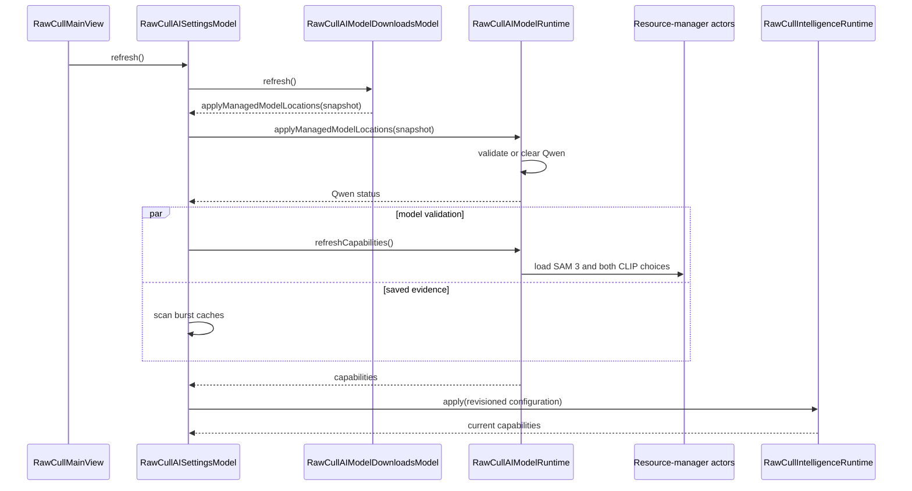

+++
author = "Thomas Evensen"
title = "The RawCull AI Runtime"
linkTitle = "AI Runtime"
date = "2026-09-03"
lastmod = "2026-11-23"
description = "Runtime ownership, model activation, preset admission, inference sharing and Vision scheduling in RawCull."
weight = 59
tags = ["ai", "architecture", "runtime", "swift", "dependency-injection", "review"]
categories = ["technical details"]
mermaid = true

reviewed_commit = "0513a30e4567b4b5e3093e10791d49c86ecfe7e6"
reviewed_version = "3.4.9"
reviewed_build = 466
reviewed_on = "2026-11-23"
review_scope = "Traced model activation, live backend admission, Qwen generation, the shared lease and Vision scheduling."
+++

# The RawCull AI runtime

`RawCullApplicationState.live()` assembles the catalog workspace and long-lived intelligence services. `RawCullApp` holds the view model and intelligence runtime in SwiftUI state. The main view receives the similarity, semantic search, settings and Review features explicitly. The executable still uses the name `CombinedReviewFeature` for the feature behind the **Review** toolbar item. [RawCullApp](https://github.com/rsyncOSX/RawCull/blob/0513a30e4567b4b5e3093e10791d49c86ecfe7e6/RawCull/Main/RawCullApp.swift) · [RawCullIntelligenceRuntime](https://github.com/rsyncOSX/RawCull/blob/0513a30e4567b4b5e3093e10791d49c86ecfe7e6/RawCull/Intelligence/Composition/RawCullIntelligenceRuntime.swift)

| Lifetime | Owner | What it owns |
| --- | --- | --- |
| App | `RawCullAIModelRuntime` | Validated CLIP and SAM providers, Vision similarity, subject-mask stores and the Qwen inference actor |
| App | `RawCullIntelligenceRuntime` | Similarity and semantic search features, Review, settings and downloads, configuration revision, and Review Record navigation |
| App session | `BurstBatchAssessment` and `AIAssessmentNavigation` | Qwen batch task, its progress and the burst entries shown in AI Assessments |
| Review run | `CombinedReviewFeature` | Frozen inputs, model snapshots, task and lease, evidence, manifest and optional retained inputs |
| Displayed Review results | `ReviewSubjectMasks` | Lookup of a primary or highest-confidence retained mask for a catalog photo. Image loads verify the photo fingerprint. |

## From settings to a running Review

1. Settings validates installed model locations and publishes a complete configuration. The runtime compares its revision with the last accepted revision. Equal or older revisions leave the active services in place.
2. A newer revision with identical descriptors advances the revision alone. Changes to similarity or semantic identity replace those services independently. A segmentation change selects the provider through the model runtime.
3. The Review backend factory reads the currently available Qwen URL, the SAM object-instance segmenter, and the CLIP provider and location. The preset determines which model snapshots the run requests. Qwen validation checks encoder capability and bundle identity for a Qwen preset. Focus check can construct a backend with no Qwen URL.
4. After admission, the feature holds the shared lease, retains access to selected files, freezes their fingerprints and persists the initial work manifest. Resume uses the original snapshot. A provider or file change can make work incompatible.
5. The record window reads the same feature and navigation selection as the main workspace. Opening it does not create another run. The old SAM/CLIP, Qwen and Objects tab controllers have been removed. At startup the model runtime attempts to remove the obsolete Objects mask directory.

[RawCullAIModelRuntime](https://github.com/rsyncOSX/RawCull/blob/0513a30e4567b4b5e3093e10791d49c86ecfe7e6/RawCull/Intelligence/Composition/RawCullAIModelRuntime.swift) · [CombinedReviewLiveBackend](https://github.com/rsyncOSX/RawCull/blob/0513a30e4567b4b5e3093e10791d49c86ecfe7e6/RawCull/Intelligence/Composition/CombinedReviewLiveBackend.swift) · [CombinedReviewFeature](https://github.com/rsyncOSX/RawCull/blob/0513a30e4567b4b5e3093e10791d49c86ecfe7e6/RawCull/Intelligence/CombinedReview/CombinedReviewFeature.swift) · [CombinedReviewRecordWindow](https://github.com/rsyncOSX/RawCull/blob/0513a30e4567b4b5e3093e10791d49c86ecfe7e6/RawCull/Views/AIAnalysis/CombinedReviewRecordWindow.swift)

## Startup Refresh and Installed-Model Activation

The graph is usable immediately with Vision while disk checks happen later.
The main window attaches the settings refresh to its root view:

```swift
.task {
    await intelligenceRuntime.settingsModel.refresh()
}
```

The call path is:



### One complete location snapshot

`applyManagedModelLocations(_:)` is the only activation path for a complete set
of installed locations. It gives the current SAM and CLIP URLs to their resource
managers. A missing Qwen URL calls `qwenInference.clear()`; a present URL is
standardized and validated.

Using a complete snapshot avoids a transient mixture such as “new CLIP, old
SAM, removed Qwen still active.” Every invocation describes one model-install
state.

### Generation-gated refresh

Settings increments `refreshGeneration` before beginning work. The generation
is checked after Qwen validation and after the concurrent capability/evidence
work. A later refresh therefore supersedes an earlier one; the earlier result
cannot publish merely because its disk work finished last.

The `defer` that clears `isScanningSavedBurstData` also checks the generation,
so an obsolete refresh cannot hide the current refresh's progress indicator.

### Concurrent capability validation

`RawCullAIModelRuntime.refreshCapabilities()` starts SAM 3, DataComp CLIP, and
OpenAI CLIP loads with `async let`. Each resource-manager actor computes a
lightweight recursive metadata snapshot. When unchanged, the previous validated
capability/provider result is reused. When changed, PhotoAIKit validates the
bundle and constructs a provider.

After all three complete, the main-actor runtime atomically replaces its
provider dictionaries and resolved location dictionaries, translates package
statuses into RawCull statuses, builds semantic-search readiness separately,
stores one new capability snapshot, and activates the selected segmentation
provider.

## Capability State Is More Than “Loaded”

`RawCullAICapabilityStatus` distinguishes:

| State | Meaning |
| --- | --- |
| `checking(expectedLocations:)` | Validation is pending. |
| `available(location:)` | Bundle validation and provider construction succeeded, or an always-available service such as Vision is ready. |
| `missing(expectedLocations:)` | No candidate bundle was found. |
| `invalid(location:reason:)` | A candidate exists but validation or provider construction failed. |
| `unavailable(reason:)` | The runtime cannot offer the capability for another explicit reason. |

CLIP model availability and semantic-search readiness are separate. A provider
must expose the text/image contracts before semantic search is `.ready`. Vision
remains a valid similarity service but can never satisfy semantic text search.

Qwen uses an internal `QwenModelStatus` with not-configured, checking,
available, missing, and invalid states. Settings translates it to the common
capability presentation and retains the validated Qwen status for the Review backend factory.

## Resource Managers and Their Cache

`RawCullAIModelResourceManager<Provider>` is an actor because filesystem
inspection, cryptographic bundle validation, and provider initialization must
not run on the main actor or race with a managed-location change.

The resource cache has two keys:

- `RawCullAIModelResourceSnapshot`, a sorted list of path, file kind, byte
  count, modification time, and symlink target; and
- the resulting capability, optional provider, and optional provider-init
  failure.

`setManagedCandidateURL` invalidates both when the URL changes. `load()` also
detects modifications within the same directory. The snapshot only decides
whether validation may be reused. PhotoAIKit's resolver remains responsible for
metadata, required files, asset extension, fingerprint, and checksum validity.

Bundle validity and provider construction are reported separately. A bundle can
be structurally valid yet fail to initialize its concrete runtime; RawCull maps
that case to `.invalid` with the provider error so Settings can explain the
actual stage that failed.

## Selecting the Similarity Runtime

`RawCullAIModelRuntime.similarityService(prefersCLIP:clipModel:)` has a strict
selection order:

1. If the user disabled CLIP, return the existing Vision service.
2. If the selected CLIP provider is absent, log the expected/resolved path and
   return Vision.
3. If the provider exists but its resolved location is missing, return Vision.
4. Otherwise return a new `RawCullCLIPSimilarityService` around the validated
   provider and supply a factory that can reconstruct a provider from the exact
   validated location for finite-vector recovery.

The service value can change while `RawCullSimilarityFeature` and
`SimilarityScoringModel` retain their identities. Backend descriptors determine
whether existing artifacts are still compatible.

Semantic search is constructed only from a currently validated CLIP provider.
The provider itself satisfies both `TextEmbeddingProviding` and
`ImageTextSimilarityComparing`, so `RawCullCLIPSemanticSearchService` can use
the same model identity as the cached image embeddings.

## Model identity at Review admission

The live Review backend accepts Qwen when the installed bundle hash and encoder contract match its expected configuration: a 448 × 448 stretch input, 196 image tokens and a 4096-token context. For CLIP it recognizes two bundle hashes and records the corresponding 224- or 256-pixel encoder geometry. An unrecognized CLIP hash leaves Review without CLIP relevance. The SAM entry records the segmenter identity and source-normalized mask preprocessing. A preset requests only its participating models. For example, Focus check skips Qwen bundle hashing entirely. [CombinedReviewLiveBackend](https://github.com/rsyncOSX/RawCull/blob/0513a30e4567b4b5e3093e10791d49c86ecfe7e6/RawCull/Intelligence/Composition/CombinedReviewLiveBackend.swift)

The backend also stores a runtime-version string containing historical abbreviated revisions and the OS version. That string participates in saved evidence identity. Use the [application lockfile]() for the actual Swift package revisions in this build.

## Qwen model lifetime

Validation cancels active generation, advances the model generation, checks vision modality and retains a provider. The first request lazily constructs the vision-language model. Subsequent requests can reuse that model, each with a fresh session. A generation gate limits responses to one at a time. A request waiting for its turn rechecks its captured generation after admission. After model loading and response generation the actor checks cancellation and generation again before publishing text. [QwenInferenceRuntime](https://github.com/rsyncOSX/RawCull/blob/0513a30e4567b4b5e3093e10791d49c86ecfe7e6/RawCull/Intelligence/Qwen/QwenInferenceRuntime.swift)

## Shared inference and Vision scheduling

The app creates one Qwen inference actor. Review uses it through its live backend. The in-app burst batch and MCP follow-ups use the structured assessment interface. The latter binds work to a model generation and validates the requested findings before publication. The shared Review lease coordinates exclusive work within the app. MCP also has a cross-process worker lock and authorization checks for shared jobs. An in-app batch writes session entries using the open catalog’s access. MCP results use the job’s catalog grant. [QwenInferenceRuntime](https://github.com/rsyncOSX/RawCull/blob/0513a30e4567b4b5e3093e10791d49c86ecfe7e6/RawCull/Intelligence/Qwen/QwenInferenceRuntime.swift) · [BurstBatchAssessment](https://github.com/rsyncOSX/RawCull/blob/0513a30e4567b4b5e3093e10791d49c86ecfe7e6/RawCull/Model/ViewModels/BurstBatchAssessment.swift) · [MCPAnalysisController+FollowUp](https://github.com/rsyncOSX/RawCull/blob/0513a30e4567b4b5e3093e10791d49c86ecfe7e6/RawCull/Main/MCPAnalysisController+FollowUp.swift)

Vision similarity has a different scheduling constraint. RawCull injects `RawCullVisionWorkSerializer` into its feature-print backend. That adapter forwards Vision request bodies to PhotoAnalysisKit’s process-wide serial queue. Waiting tasks suspend while the queue executes the blocking Vision request. Image decoding can proceed concurrently. [Concurrency]()

For preset requirements, evidence limits and culling actions, see [AI Models in RawCull]().
