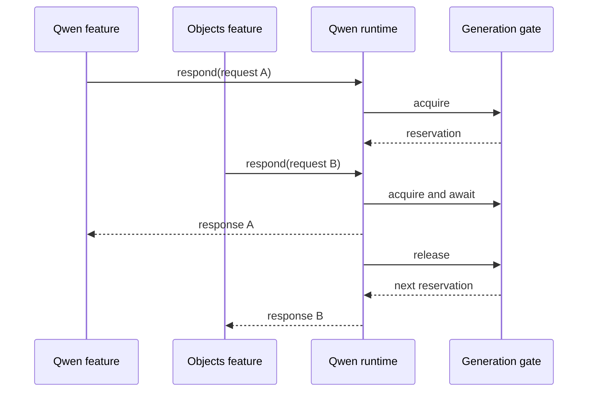

+++
author = "Thomas Evensen"
title = "Swift Behind the AI Pipelines"
linkTitle = "Swift and AI"
date = "2026-10-13"
lastmod = "2026-10-13"
description = "Learn dependency injection, observable features, actor reentrancy, cancellation, generation guards, typed validation, and regression testing through RawCull AI."
weight = 62
tags = ["ai", "swift", "concurrency", "actors", "observation", "testing"]
categories = ["technical details"]
mermaid = true
+++

# Swift Behind the AI Pipelines

RawCull is a useful learning example because it combines expensive native model
work with a responsive SwiftUI interface and strict application-owned evidence
contracts. The difficult part is not merely calling an async model function. It
is preserving identity, cancelling safely, validating output and publishing only
results belonging to the current operation.

This guide describes the local `version-3.3.0` implementation on 13 October
2026. Examples marked schematic explain a pattern; read the named source for
the complete implementation. See [AI Runtime](/docs/ai/airuntime/) for the object
graph and [AI Diagnostics](/docs/ai/aidiagnostics/) for the real-model workbook.

## 1. Start with protocols and injected dependencies

`QwenInferenceServing` separates a caller from the concrete inference actor.
Both production `QwenInferenceRuntime` and test actors can implement it. The
feature receives its inference dependency during construction, along with an
image-loading abstraction. Objects similarly receives segmentation and stores.

A protocol is valuable when it defines a stable responsibility, not because
all concrete types need an abstraction. Here, callers need validation,
capabilities, ordinary vision requests and photo assessment without owning a
provider's internal tokenizer or loaded model.

Trace this boundary:

```text
RawCullQwenAnalysisFeature
  → QwenInferenceServing
    → production QwenInferenceRuntime
      → PhotoAIKit CoreAIQwenProvider
        → loaded vision-language model and LanguageModelSession
```

Tests substitute an actor returning selected responses. A repair can then be
verified deterministically: invalid first response, corrected second response,
exactly two calls, successful result. Separate tests keep both responses invalid
and check that the feature stops after two calls.

## 2. Separate mutable UI state from transferable evidence

AI features use `@Observable @MainActor`. Observable properties include progress,
results and availability. `@MainActor` coordinates their mutations with UI use.
It does not itself make native inference run off the main actor; the actual
provider and actor boundaries determine work placement.

`@ObservationIgnored` marks task handles, dependencies and coordination fields
that do not need to drive view invalidation. It is not a thread-safety annotation
and does not change reference ownership. A strong property remains strong; a
weak callback still needs `weak` explicitly.

Many result/request types are `nonisolated struct ...: Sendable`. Immutable
values can cross boundaries without exposing the feature's mutable state.
`Codable` and `Sendable` serve different purposes: serialization does not prove
concurrent access is safe, and transferability does not validate model output.

Read:

- `RawCull/Intelligence/Qwen/RawCullQwenAnalysisFeature.swift`
- `RawCull/Intelligence/ObjectAnalysis/ObjectAnalysisModels.swift`
- `RawCull/Intelligence/Composition/RawCullIntelligenceRuntime.swift`

## 3. Preserve the feature object; replace its service

The composition root creates long-lived feature instances. Settings can install
a new provider into the existing feature rather than construct another feature
for a view redraw. Otherwise a view might observe feature A while the runtime
publishes into feature B.

Provider identity and feature identity answer different questions. A model can
be removed/reinstalled while a stable observable owner preserves the relevant
results, selection and cancellation policy. The runtime compares configuration
revision and identity before replacing services.

A monotonically increasing revision orders settings decisions. A descriptor
identity determines whether a newer decision actually changes a backend. Using
only revision would reset work unnecessarily; using only identity would not
order asynchronous updates.

## 4. Understand actor reentrancy before relying on serialization

An actor protects its isolated state. It does not guarantee that a complete
async operation is indivisible across awaits. While a generation awaits native
work, another caller may enter the actor.

RawCull's shared Qwen actor therefore also uses `QwenGenerationGate`. The gate
holds a reservation across a full generation. A queued caller waits using short
cancellable sleeps, not a blocking main-thread loop. The inference runtime
releases the gate on both success and error.



This is a conceptual schedule, not a promise of FIFO queue order. The current
gate polls availability and does not implement a dedicated FIFO waiter queue.

## 5. Cancellation and generation checks solve different problems

Calling `Task.cancel()` sets cancellation state. Some native work may not stop
immediately. A generation token protects publication even when the old work
continues temporarily.

Schematic pattern:

```swift
// Schematic main-actor feature logic, not a standalone implementation.
generation &+= 1
let admittedGeneration = generation
let response = try await inference.respond(to: request)
try Task.checkCancellation()
guard generation == admittedGeneration else { return }
results.append(validatedResult(response))
```

The post-await checks matter because settings or cancellation can run while the
operation is suspended. A check only before the await cannot establish that the
operation still owns current state afterward.

RawCull uses distinct generations for the feature batch and Qwen model lifetime.
Replacing a model invalidates a load/generation even if the UI batch identity
has not changed. Cancelling a batch invalidates publication even if the installed
model stays the same.

## 6. Drain workers before transferring workflow ownership

Standalone feature cancellation stores the worker in `drainingTasks` and clears
UI running state. `cancelAndWait()` subsequently awaits retained workers.

Clearing a task property is not the same as terminating the task. Without
retaining a draining handle, a later Combined run could begin native work while
a previously cancelled feature still executes. Combined startup drains sibling
workers, then holds `CombinedReviewLease` until its own worker terminates.

The lease governs application workflows; the Qwen gate governs model generation.
Neither replaces the other. Source access grants also remain alive through work:
features retain catalog access across a batch so navigation does not revoke
permission while later files are still being read.

## 7. Place CPU work deliberately

Objects uses concurrent tasks for mask deduplication and board rendering, then
returns immutable outputs to the main-actor feature. Model execution lives
behind backend actors. The composition root and settings remain main-actor
isolated because they publish coherent service/capability state.

Do not assume that writing `async` moves synchronous pixel processing to a
background executor. Inspect isolation and the synchronous prefix before the
first suspension. Likewise, `Task {}` inherits relevant context; it is not a
universal escape from main-actor work. Follow the actual Swift 6 build settings
rather than importing old assumptions about executor behavior.

The inspected app uses Swift 6 and approachable concurrency; several app targets
have default MainActor isolation. Pure contract types deliberately declare
`nonisolated` when they should not inherit UI isolation.

## 8. Decode first, validate meaning second

`JSONDecoder` answers a type question: can this JSON create the declared Swift
value? It can reject `visibility: "visible"` if that enum has no such case. It
does not automatically establish that the generated object belongs to a crop,
that claim/evidence counts match, or that a sharp judgment is supported.

Objects therefore follows two layers:

```text
ObjectJSONEnvelope
  → complete balanced JSON object
  → Codable shape and field types
ObjectAnalysisResponseDecoder
  → schema/ranges/lists
  → ID and concept ownership
  → focus and paired claim evidence
  → conservative prose consistency
```

Missing values, null and empty arrays differ. A nonoptional `[String]` can validly
be `[]`; it cannot be null. A nullable focus field can be null only when the
application's focus-quality rule permits it. These conditions belong in a
validator, not merely in the Swift property declaration.

## 9. Diagnose malformed enums without accepting them

Typed decoding of the entire response fails on an unknown enum. For better
Objects retry feedback, RawCull first inspects the JSON object for invalid
visibility text. That inspection explains permitted values but does not convert
or accept the invalid value. If typed decoding becomes possible, the feedback
helper identifies count mismatches and unsupported focus evidence.

Feedback and acceptance share the focus-description predicate. Duplication here
would produce confusing behavior: a repair instruction might describe a response
as acceptable while the real decoder still rejects it.

Do not silently “repair” source model claims in application code merely to obtain
a passing test. Removing an unsupported claim or inventing its missing evidence
would change the meaning of the model output.

## 10. Treat language checks as bounded heuristics

The validator detects certain explicit contradictions using normalized prose.
Negation normalization runs before positive sharpness detection. The October
regression covers “not sharply focused,” “not sharp,” and “lacks sharp detail.”
A mixed sentence with a separate positive sharpness assertion must still fail.

This illustrates a useful testing discipline: the successful edge case should
have a nearby failing case. The code is conservative text checking, not proof
of photographic truth or a general semantic reasoner.

## 11. Learn from Swift Testing at three levels

The project uses `@Suite`, `@Test`, `#expect`, `#require` and parameterized tests.
For a pure validator, test the relevant outcome directly. For a feature, inject
stubs and check public result state, bounded inference calls and segmentation
reuse. For real models, explicitly opt in and retain request/response evidence.

`#require` is appropriate when subsequent statements need a result; otherwise
`#expect` records a failed check without unnecessarily ending the test.
Parameterized cases make wording variation clear without copy/pasted functions.
Actor stubs keep mutable call counters and responses safely isolated.

A green unit suite proves the behaviors represented by its cases. It does not
prove that a small vision-language model will comply with the prompt on unseen
images. That is why the private six-ARW runner exists and why visual annotation
is still a separate step.

## 12. Suggested source-reading exercises

1. Follow one Objects file from discovery through segmentation, board and result.
   Mark each await and identify what can change during the suspension.
2. Find the two automatic assessment attempts and verify SAM is outside that loop.
3. Trace a cancelled Qwen worker into `drainingTasks` and `cancelAndWait()`.
4. Inspect `.structured`, `.freeform`, `.rejected` and the corresponding failure
   policy in the Qwen feature.
5. Compare a mask score, generated confidence and deterministic detail metric.
   Locate the producer and consumer of each rather than comparing their numbers.
6. Trace Combined report row selection to original observation provenance. Notice
   how selecting an ID is narrower than asking a model to rewrite accepted text.

Each exercise should produce a small ownership or data-flow diagram before any
code change. Understanding who owns a value and which identity qualifies it
usually explains the failure more clearly than adding another prompt sentence.
