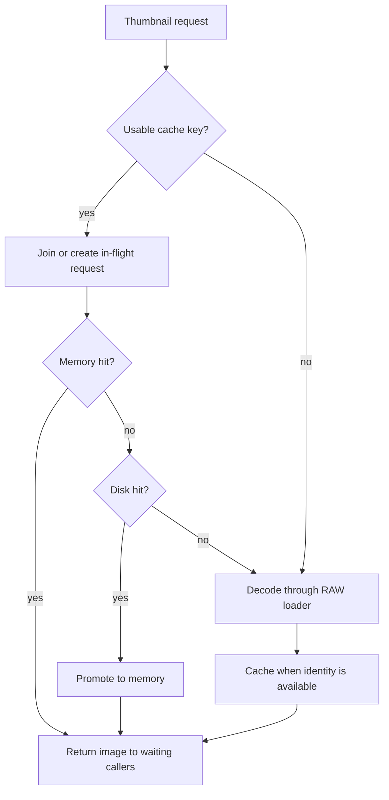
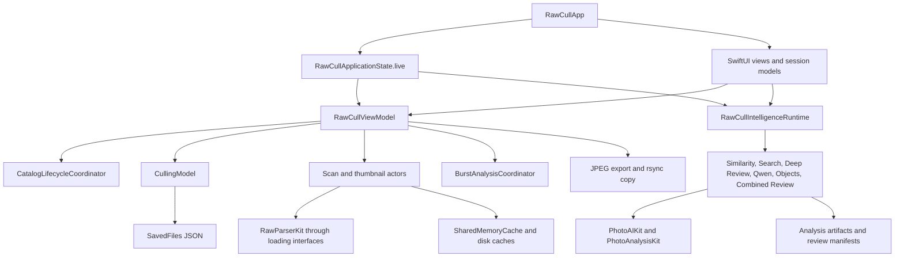
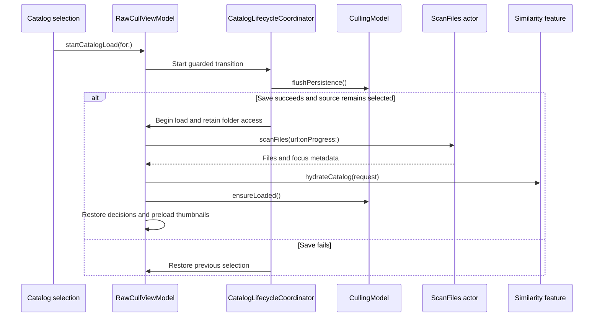

+++
author = "Thomas Evensen"
title = "RawCull Developer Guide"
date = "2026-10-15"
lastmod = "2026-10-25"
weight = 20
tags = ["API"]
categories = ["technical details"]
mermaid = true
+++


# RawCull developer documentation

Last reviewed: 2026-10-23. Baseline: RawCull 3.3.5, build 426, commit `2ca891be5c013dc38fe3c931a829a04083b69c2a`.

Read this guide in order for a tour from application launch to exported photographs. The walkthrough establishes the ownership and data-flow model; the API reference then explains individual operations, inputs, results and failure behavior. Source links use the immutable reviewed application commit so the described implementation remains reproducible. Code marked **source excerpt** is copied from the implementation; **usage example** means an illustrative call inside the app module, with existing application objects and selected files. Neither kind is intended to be pasted into an unrelated standalone Swift program.

RawCull has no HTTP server or REST endpoints in the application workflows documented here. “API” means the internal Swift application interface. Requests are arguments and configuration; responses are return values or observable state. Errors use Swift error types, result cases, optional values, and presentation state—not HTTP status codes. These interfaces are generally internal to the app target, not a versioned public SDK.

## Navigation and reading priorities

Start with [A photograph’s journey through RawCull](#a-photographs-journey-through-rawcull), then continue through setup, architecture and the separate internal API reference.

1. [Developer setup and quick start](#developer-setup-and-quick-start) — immediate development needs.
2. [Architecture and ownership](#architecture-and-ownership) — understand boundaries before making changes.
3. [Main function API reference](#main-function-api-reference) — implement and debug workflows.
4. [Errors and recovery](#errors-and-recovery) — interpret failures accurately.
5. [Stakeholder onboarding](#stakeholder-onboarding) — review photographs without development knowledge.
6. [Comments and docstrings](#comments-and-docstrings) — document contracts consistently.
7. [Troubleshooting](#troubleshooting) — resolve common development and operational issues.
8. [Contributing](#contributing) — preserve correctness and reviewability.
9. [Changelog template](#changelog-template) — record updates.
10. [Maintenance and automation](#maintenance-and-automation) — keep this guide useful over time.

## A photograph's journey through RawCull

Imagine opening a folder containing a short sequence of owl photographs. You want to inspect the images, find the sharpest frame, record a decision and export a keeper. That apparently simple interaction crosses several boundaries: permission to read the folder, metadata scanning, image decoding, state publication, saved decisions, optional model inference and output writing. RawCull coordinates those boundaries rather than treating the folder as a single array of images.

### 1. Launch creates the objects that will survive navigation

Begin in [RawCullApp.swift](https://github.com/rsyncOSX/RawCull/blob/2ca891be5c013dc38fe3c931a829a04083b69c2a/RawCull/Main/RawCullApp.swift). Its initializer asks `RawCullApplicationState.live()` for the application assembly and retains two roots: `RawCullViewModel` and `RawCullIntelligenceRuntime`.

**Source excerpt — application initialization:**

```swift
let applicationState = RawCullApplicationState.live()
_viewModel = State(
    initialValue: applicationState.viewModel,
)
_intelligenceRuntime = State(
    initialValue: applicationState.intelligenceRuntime,
)
```

The view model owns the working catalog and coordinates user actions. The runtime retains the AI feature instances, model runtime, settings model and downloads model. Opening a sheet or changing the focused photograph should use those same instances. Otherwise, a settings screen could configure one inference service while a review screen uses another.

Follow `RawCullApplicationState.make(...)` in [RawCullIntelligenceRuntime.swift](https://github.com/rsyncOSX/RawCull/blob/2ca891be5c013dc38fe3c931a829a04083b69c2a/RawCull/Intelligence/Composition/RawCullIntelligenceRuntime.swift). It constructs a shared similarity model, passes it to similarity and semantic-search features, creates the view model, and binds the application context and settings consumer. Identity assertions at the assembly boundary check that these objects share the intended dependencies. This is the best entry point for understanding dependency wiring.

The main window then passes feature instances to `RawCullMainView` and supplies the view model through the SwiftUI environment. Its startup tasks load culling data, apply stored scoring settings and refresh AI settings. Construction establishes ownership; those tasks initialize persisted and capability state.

### 2. Opening a folder is a guarded transition

In [RawCullViewModel+Catalog.swift](https://github.com/rsyncOSX/RawCull/blob/7b8e200f07ceb8a6f10947236a5f3de5a099fb45/RawCull/Model/ViewModels/RawCullViewModel+Catalog.swift), `startCatalogLoad(for:)` first recognizes an already active source with valid access. Otherwise, it requests a transition from [CatalogLifecycleCoordinator.swift](https://github.com/rsyncOSX/RawCull/blob/2ca891be5c013dc38fe3c931a829a04083b69c2a/RawCull/Model/ViewModels/CatalogLifecycleCoordinator.swift).

The coordinator flushes pending decisions before allowing the replacement. After that suspension, it checks cancellation, transition generation and whether the requested source is still selected. A successful flush for folder B must not open B if the user has already selected folder C. A failed flush restores the previous source selection.

**Source excerpt — transition admission after the save attempt:**

```swift
guard !Task.isCancelled, transitionGeneration == generation,
      isStillSelected() else { return }
if didFlush {
    onReady()
} else {
    onFailure()
}
```

Once admitted, `beginCatalogLoad(for:)` clears selection, cancels old catalog work, resets the working arrays and obtains security-scoped access. The coordinator retains access for the load task. The URL identifies a location; the access grant keeps that location readable while work uses it. Cancelling the old catalog also invalidates the Combined Review lease and cancels hydration, burst analysis, thumbnail preload and preview-cache warming.

This explains why UI code should call the view-model entry point instead of merely replacing `files`: replacing the array would skip save ordering, task cancellation and access management.

### 3. Scanning builds file descriptions before loading every preview

Open [ScanFiles.swift](https://github.com/rsyncOSX/RawCull/blob/7b8e200f07ceb8a6f10947236a5f3de5a099fb45/RawCull/Actors/ScanFiles.swift). `scanFiles(url:onProgress:)` lists the immediate folder, skips hidden entries and admits formats recognized by `RawFormatRegistry`. It uses a task group with a bounded number of pending metadata reads. Before scheduling beyond that bound, it waits for a result. This limits simultaneous file access rather than starting a decode task for every photograph at once.

Each admitted file becomes a `FileItem` containing its URL, name, size, modification date, optional capture time, EXIF metadata and normalized autofocus point. [RawCullFileItem.swift](https://github.com/rsyncOSX/RawCull/blob/2ca891be5c013dc38fe3c931a829a04083b69c2a/RawCull/Main/RawCullFileItem.swift) aliases `FileItem` and `ARWSourceCatalog` to RawCullCore domain types: the application uses package models through familiar local names.

Metadata and native focus information are read together. If no native focus locations were collected, the scanner attempts the catalog’s `focuspoints.json` fallback. This fallback is chosen for the collected scan, rather than filling each individual missing native point independently. Progress counts discovered supported files; it is not a count of successfully rendered previews.

**Usage example — inspect metadata without starting the app’s catalog workflow:**

```swift
let scanner = ScanFiles(maximumConcurrentReads: 2)
let discovered = await scanner.scanFiles(url: catalogURL)
let ordered = await ScanFiles.sortFiles(
    discovered,
    by: FileItemSortDescriptor(field: .name, direction: .ascending),
    searchText: ""
)
for file in ordered {
    print(file.name, file.size, file.dateModified)
}
```

This lower-level example is useful for understanding the scanner. It does not restore ratings, hydrate similarity artifacts or update the application’s current catalog. Also, metadata tasks finish in completion order; use the sorting operation when a deterministic presentation order matters.

### 4. The working set has several distinct projections

Back in `handleSourceChange(url:)`, the view model scans, sorts, assigns the discovered files, hydrates compatible similarity artifacts, constructs visible results, restores persisted decisions and scoring, and preloads thumbnails. It checks that the load is still active after asynchronous boundaries before publishing further state.

Read the following names as different questions, not interchangeable collections:

| State | Question it answers |
|---|---|
| `files` | Which files were discovered in the loaded folder? |
| `catalogDisplayCandidates` | Which files pass filename filtering, in the requested base order? |
| `filteredFiles` | Which files are currently displayed after rating, sharpness and similarity/search rules? |
| `activeCatalogFiles` | Which files belong to the active catalog scope, including a semantic-search selection? |
| `selectedFileID` | Which photograph currently has focus? |
| `selectedFileIDs` | Which photographs form the explicit grid selection? |

For example, a folder may contain 200 files, filename filtering may admit 80, and a star filter may display 12. Semantic search can establish a further active selection used by downstream workflows. A count of selected thumbnails, a count of visible files and a count of files in the folder can all be correct while differing.

`applyFilters(to:)` first applies nonsemantic rules. When semantic results exist, it keeps and orders admitted files by semantic result order. An empty semantic index yields an empty visible result. Without semantic search, image-to-image similarity ordering can take precedence over sharpness ordering, with the anchor first.

**Usage example — inspect the scope before choosing an operation:**

```swift
print("Discovered:", viewModel.files.count)
print("Visible:", viewModel.filteredFiles.count)
print("Active scope:", viewModel.activeCatalogFiles.count)
let analysisInput = viewModel.aiAnalysisFiles(for: .gridSelection)
print("AI input:", analysisInput.count)
```

These are observations of current state. Do not reconstruct a workflow’s input by guessing from one count: use its input resolver.

### 5. A thumbnail request follows the cache and shares duplicate work

[RequestThumbnail.swift](https://github.com/rsyncOSX/RawCull/blob/2ca891be5c013dc38fe3c931a829a04083b69c2a/RawCull/Actors/RequestThumbnail.swift) is an actor that coordinates preview requests. It resolves a `ThumbnailCacheKey` from source identity, purpose and requested pixel size. With a usable key, concurrent callers for the same thumbnail join one in-flight request.

The resolution order is memory cache, disk cache, then the RAW loading interface. A disk hit is promoted to memory. A decoded image is added to memory and encoded to JPEG data for a background disk save. Display can proceed before that disk save finishes. If a trustworthy cache key cannot be produced, the actor still attempts to load the image, but avoids keyed cache reuse.



Each waiting caller has its own cancellation identity. Cancelling one waiter resumes that waiter with nil; the shared task is cancelled when no waiters remain. A request generation prevents a late result from completing a replacement request with the same key. These details matter when scrolling creates and destroys many thumbnail views quickly.

A nil return means no image is available to that caller, including cancellation or decode failure. It is not a recommendation to remove the source file from the catalog. Thumbnail loading and full JPEG export have different purposes and result contracts.

### 6. Rating changes state immediately and persists it separately

Follow the public action in [RawCullViewModel+Culling.swift](https://github.com/rsyncOSX/RawCull/blob/2ca891be5c013dc38fe3c931a829a04083b69c2a/RawCull/Model/ViewModels/RawCullViewModel+Culling.swift), then the store in [CullingModel.swift](https://github.com/rsyncOSX/RawCull/blob/2ca891be5c013dc38fe3c931a829a04083b69c2a/RawCull/Model/ViewModels/CullingModel.swift). The view model keeps the UI’s derived state consistent; the store updates the record identified by catalog and filename and schedules persistence.

The store must reach `ready` before mutations are admitted. A missing store initializes an empty collection. An unreadable or damaged store produces a failed load and blocks automatic mutation, preserving the original data for recovery.

Repeated updates debounce saving with a default delay of 350 milliseconds. Each scheduled save captures a snapshot and revision. If another edit occurs while an earlier save is suspended, that earlier save must not mark the newer state clean.

**Source excerpt — clearing the dirty flag only for the saved revision:**

```swift
try await saveHandler(snapshot)
if revision == persistenceRevision {
    hasUnsavedChanges = false
    persistenceError = nil
}
```

**Usage example — apply a decision and explicitly inspect durability:**

```swift
viewModel.updateRating(for: file, rating: 3)
if await viewModel.cullingModel.flushPersistence() {
    print("Current decisions saved")
} else {
    print(viewModel.cullingModel.persistenceError ?? "Save failed")
}
```

Normally the UI lets debouncing handle repeated ratings. A catalog transition or quit requires explicit flushing because the user is leaving the context containing those decisions. `AppDelegate.beginTermination(...)` in the application entry file delays termination, retries saving when requested and releases folder access only when quitting is accepted. Cancel Quit keeps the process and unsaved decisions alive.

### 7. Analysis input is resolved before inference starts

[RawCullViewModel+AIAnalysis.swift](https://github.com/rsyncOSX/RawCull/blob/2ca891be5c013dc38fe3c931a829a04083b69c2a/RawCull/Model/ViewModels/RawCullViewModel+AIAnalysis.swift) centralizes selection rules. Grid input uses explicit selected IDs or falls back to the focused photograph, intersected with visible files. Tagged input resolves saved ratings of at least 2 in the active scope. `preserveAIAnalysisGridSelection()` captures the fallback selection before browsing tagged photographs changes focus.

The analysis features answer different questions. Sharpness scoring measures image detail; burst analysis groups and ranks related frames; semantic search ranks compatible CLIP artifacts against text; Qwen produces a validated assessment; Objects combines concept discovery, segmentation and assessment. A search score is not a star rating, and an AI recommendation does not become a saved culling decision until the relevant apply action runs.

The shared runtime also coordinates settings changes. `apply(configuration:)` rejects obsolete configuration revisions, avoids replacing unchanged services and updates the affected similarity, semantic-search or segmentation configuration. Model identity and preprocessing matter because cached evidence from one configuration may not be reusable under another.

### 8. Combined Review freezes a reproducible run

Read [CombinedReviewFeature.swift](https://github.com/rsyncOSX/RawCull/blob/2ca891be5c013dc38fe3c931a829a04083b69c2a/RawCull/Intelligence/CombinedReview/CombinedReviewFeature.swift) alongside [ReviewRunContract.swift](https://github.com/rsyncOSX/RawCull/blob/2ca891be5c013dc38fe3c931a829a04083b69c2a/RawCull/Intelligence/CombinedReview/ReviewRunContract.swift). The feature coordinates execution and presentation; the contract defines snapshots, typed IDs, compatibility and work stages.

`analyze(_:)` prepares admission, acquires a shared lease and captures criteria, depth, source preference and retention settings. The runtime’s `beforeStart` hook waits for Qwen, Objects and Deep Review cancellation handling. The worker then freezes source descriptions, retains catalog access, reads model identities, validates a run snapshot, saves its initial manifest and executes the work. The async method awaits that worker; returning still requires inspecting result and failure state because failures are captured internally.

The snapshot records what the run intended to analyze. The manifest records the run and its work. Compatibility keys describe whether evidence can be reused. Source fingerprints use path, size, modification time and file resource identity; they are metadata-derived fingerprints, not a full hash of every RAW byte.

The depth settings define budgets rather than a promise that every possible crop will run:

| Depth | Crops per image | Crops across selection | Followups per image | Followups across selection | Pair cap |
|---|---:|---:|---:|---:|---:|
| `standard` | 3 | 16 | 0 | 0 | 0 |
| `deep` | 8 | 32 | 2 | 8 | 2 |
| `exhaustive` | 16 | 64 | 4 | 16 | 4 |

The contract validates nonempty, uniquely identified input, nonblank criteria, supported source preference and bounded response tokens. Selections larger than eight require an expanded-selection plan in the snapshot contract; this does not mean the ordinary UI automatically supplies one. Regions must reference selected images and lie within normalized image bounds.

Resume revalidates source fingerprints, model identities and pipeline versions before continuing. A retained observation can remain useful even if report synthesis fails. Exact-input retention controls saved imagery, so deleting retained inputs and deleting review records are separate operations.

### 9. Export creates output; copying has its own process lifecycle

JPEG export uses [ExtractAndSaveJPGs.swift](https://github.com/rsyncOSX/RawCull/blob/2ca891be5c013dc38fe3c931a829a04083b69c2a/RawCull/Actors/ExtractAndSaveJPGs.swift) and returns a batch result with successes and per-file failures. Embedded export uses the camera preview; developed export renders the RAW. These can look different because they use different image sources. Cancellation can leave successful outputs already written.

RAW copying starts through [ExecuteCopyFiles.swift](https://github.com/rsyncOSX/RawCull/blob/2ca891be5c013dc38fe3c931a829a04083b69c2a/RawCull/Model/ParametersRsync/ExecuteCopyFiles.swift). It prepares access, selection and a unique include list before launching rsync. Startup success means the subprocess launched. Final completion and dry-run status determine what can be reported as copied. This is a different completion contract from awaiting a JPEG export result.

At this point the complete chain is visible: the assembly owns services, the lifecycle admits a folder, scanning creates domain records, projections determine scope, workers load imagery, decisions persist independently, analysis produces evidence, and explicit output workflows write or copy files. The reference below gives the individual calls for each part of that chain.

## Developer setup and quick start

### Requirements

The repository README specifies Apple Silicon, macOS 27, Xcode 27, and Swift 6. The Xcode project sets macOS deployment to 27.0 and Swift language version to 6.0; app configurations use default MainActor isolation. Use the project settings as the authority if these requirements change.

Open `RawCull.xcodeproj` in Xcode, choose the RawCull scheme and a local Mac destination, and resolve packages using the checked-in lockfile. Configure an appropriate signing team if Xcode requires it for your local build.

From the repository root:

```bash
xcodebuild \
  -project RawCull.xcodeproj \
  -scheme RawCull \
  -destination 'platform=macOS,arch=arm64' \
  -onlyUsePackageVersionsFromResolvedFile
```

Launch from Xcode, open a folder containing supported RAW photographs, inspect a preview, rate a frame, and export a JPEG to a separate destination folder. Start with a small catalog so problems are easy to isolate. Optional AI features require compatible local models; they are not needed for the basic browsing workflow.

`make debug` builds and exports a Debug archive. For ordinary development, the direct scheme build above avoids the release pipeline. `make build` signs, notarizes, staples, and creates a DMG; it requires configured release credentials and the external `create-dmg` tool. It is not the quick-start command.

### Dependencies

| Component | Responsibility |
|---|---|
| SwiftUI and AppKit | App scenes, views, commands, macOS lifecycle and integration |
| Foundation, ImageIO, CoreGraphics, OSLog | Files, serialization, images and diagnostics |
| RawParserKit | RAW formats, metadata, embedded JPEGs, rendered previews and MakerNotes |
| PhotoAnalysisKit | Focus, sharpness, saliency and calibration |
| PhotoAIKit | Local AI capabilities, similarity, segmentation and model support |
| RawCullCore | Shared photo, burst, ranking and review domain models |
| RsyncArguments and RsyncProcessStreaming | Copy arguments and process execution |
| ParseRsyncOutput | Interpretation of rsync output |
| DecodeEncodeGeneric | Codable persistence support |

Read exact direct and transitive pins in [Package.resolved](https://github.com/rsyncOSX/RawCull/blob/2ca891be5c013dc38fe3c931a829a04083b69c2a/RawCull.xcodeproj/project.xcworkspace/xcshareddata/swiftpm/Package.resolved). Model bundles are separate assets with separate licences; consult [ModelAssets](https://github.com/rsyncOSX/RawCull/blob/2ca891be5c013dc38fe3c931a829a04083b69c2a/ModelAssets/README.md) and its notices. Avoid copying a static version list into additional documents.

### Tests and release checks

```bash
make test-smoke
make test-full
make test-performance
make verify-ai-import-boundary
make release-preflight
```

Choose checks appropriate to the change. Smoke covers selected critical paths; full runs the suite with Thread Sanitizer; performance covers deliberately expensive cases. Selection manifests and enumeration verification are part of the test contract. See [test architecture](https://github.com/rsyncOSX/RawCull/blob/2ca891be5c013dc38fe3c931a829a04083b69c2a/RawCullTests/TEST_ARCHITECTURE.md).

Installed-model probes are opt-in: `make releaseaiobjectstest`, `make releasesharpnesstest`, `make combinedinputstest`, and `make combinedselectiontest`. Read the current Makefile and [release-test guide](https://github.com/rsyncOSX/RawCull/blob/2ca891be5c013dc38fe3c931a829a04083b69c2a/RawCullReleaseTests/README.md) before running them: they can read local photographs and write reports. These checks are not substitutes for deterministic tests.

Maintenance: update requirements and commands when project settings, package resolution, schemes, or Make targets change.

## Architecture and ownership

### Application structure



`RawCullApp` constructs the live application assembly once and retains the view model and intelligence runtime in SwiftUI state. The runtime supplies stable feature instances to views. Preserve shared identity: creating independent similarity or inference services in a view can split indexing, search, model configuration, and cancellation state.

`RawCullViewModel` coordinates catalog selection, filtering, navigation and workflow side effects. Its extensions divide catalog, culling, thumbnail, sharpness, similarity, AI input and burst responsibilities. Session models own focused UI interactions such as loupe, zoom, comparison and burst workspace state. `CullingModel` owns saved decisions and persistence state.

Actors coordinate scanning, decoding, caches and export. MainActor models publish UI-facing state. `async` describes suspension; it does not by itself guarantee background execution. Retain explicit actor boundaries and the existing loading interfaces when moving expensive work.

### Catalog lifecycle



Catalog and sort generations reject stale asynchronous results. Changing catalogs cancels existing load, preload, extraction, hydration and burst work and invalidates the Combined Review lease. File access must remain valid while downstream tasks use source URLs.

### Persistence and cache boundaries

- Decisions and compatible sharpness metadata are represented by `SavedFiles` and `FileRecord`. The default culling store is `~/Library/Application Support/RawCull/savedfiles.json`.
- `CullingModel` debounces writes, tracks unsaved changes, and exposes persistence failures. Catalog transitions flush pending decisions; app termination offers retry, cancellation or explicit discard if flushing fails.
- Thumbnail identity includes source metadata and rendering identity. A path alone cannot safely identify a replacement image. Missing source fingerprint metadata disables thumbnail reuse.
- Per-file analysis artifacts and burst snapshots have compatibility requirements. Do not interpret an artifact from a different backend or model as current evidence.
- Combined Review retains run manifests, evidence and optionally exact model inputs. Clearing retained input images is different from deleting all reports.

Caches can be rebuilt; ratings and saved review records are user data. Recovery guidance must preserve that distinction.

Maintenance: revise diagrams when ownership, workflow ordering, persistence schemas, or package boundaries change.

## Main function API reference

The detailed method tables and usage examples have moved to
[RawCull Internal Swift API]().
The walkthrough above introduces the owners; use the reference to inspect
arguments, observable outputs, cancellation and recovery for a specific action.

## Errors and recovery

These are source-level identifiers, not numeric API status codes. Preserve the associated message or underlying error in diagnostics. Do not promise a stable external error-code protocol.

| Error surface | Cases or representation | Handling |
|---|---|---|
| `CopyStartupFailure` | `rsyncArgumentsUnavailable`, `missingViewModel`, `noMatchingFiles` | Check copy configuration, application binding and selected/rated scope. |
| `CopyStartupFailure` | `applicationSupportDirectoryUnavailable`, `includeFileWriteFailed(String)` | Restore writable support-folder access and free space; retry startup. |
| `CopyStartupFailure` | `sourceAccessFailed`, `destinationAccessFailed` | Reopen source or reselect destination to restore access. |
| `CopyStartupFailure` | `processLaunchFailed(String)` | Inspect executable/configuration and supplied diagnostic. |
| `CopyOutcome` | `failed(message:)`, `cancelled` | Report the final process outcome; distinguish cancellation and partial output from success. |
| `JPGExportResult` | `succeeded`, `[JPGExportFailure(fileName, message)]` | Report each failed file and retain successful output. |
| `QwenModelError` | `modelUnavailable`, `visionModelRequired`, `imageUnavailable` | Validate model capability or source image availability. |
| `QwenModelError` | `emptyResponse`, `invalidStructuredResponse`, `invalidTokenLimit` | Inspect bounded diagnostics/configuration; do not treat malformed text as an accepted assessment. |
| `ReviewRunError` | `invalidSnapshot`, `sourceUnavailable`, `modelUnavailable` | Check frozen input and installed capabilities; prepare a valid new run if needed. |
| `ReviewRunError` | `invalidDependency`, `invalidTransition`, `budgetExhausted` | Inspect manifest ordering and limits; do not bypass execution admission. |
| `ReviewRunError` | `incompatible`, `corrupt`, `unsupportedVersion(Int)` | Preserve evidence and diagnose compatibility; rerun under current settings where appropriate. |
| `ReviewRunError` | `storageLimit`, `invalidEvidence` | Review retention/storage or evidence validation; do not synthesize unsupported conclusions. |
| Model download service | `serviceNotConfigured`, `backgroundAssetsUnavailable(String)`, `releaseBlocked(String)`, `assetPackNotFound(String)`, `downloadedModelNotFound(String)` | Check distribution configuration, asset availability and validation. |
| Model download service | `licenceAcceptanceRequired(String)`, `missingVerifiedLicenceText(String)` | Complete the actual licence/provenance flow; do not bypass it. |
| Culling JSON read | `.missing(URL)`, `.loaded([SavedFiles])`, `.failed(SavedFilesReadFailure)` | Missing store is different from damaged/unreadable data. Failed data must not be silently replaced. |
| Settings / culling writes | Bool return plus persistence state | Retry after fixing storage/access; retain unsaved in-memory decisions. |
| Swift cancellation | `CancellationError` or task cancellation state | Preserve completed work where supported and stop presenting the operation as running. |

Optional image returns and empty nonthrowing scan results do not carry a detailed error code. Use logs, capability state and the surrounding workflow to distinguish causes.

Maintenance: add new cases when error enums change; keep wording aligned with recovery behavior and tests.

## Stakeholder onboarding

RawCull helps you choose photographs to keep. A catalog is a folder of photographs. A preview is a JPEG representation used for fast viewing. A burst group contains related frames that may be useful to compare.

1. **Open a folder.** Choose a small RAW catalog first and allow scanning to finish. RawCull is focused on Sony ARW workflows; support for a camera's metadata and previews depends on its format.
2. **Review photographs.** Browse thumbnails, enlarge a frame, and compare detail. Focus points and sharpness overlays are evidence to inspect, not a replacement for your judgment.
3. **Record decisions.** Use the rating/tag/reject controls. A rejection records a culling decision; it does not delete the original photograph.
4. **Compare related frames.** Open burst comparison and inspect recommended candidates. Applying Keep Best or Keep Top Two changes the group's ratings; undo is available for the last captured burst action.
5. **Try optional local AI.** Install the required models through AI settings and complete their licence prompts. CLIP supports search, SAM 3 supports subject masks, and Qwen provides photo assessments. These features run locally; downloading model assets requires connectivity.
6. **Check the input scope.** AI Analysis and Combined Review can use selected or tagged photos. Semantic search also narrows the active working set; clear it when you want the ordinary catalog again.
7. **Export keepers.** Export JPEGs or copy RAWs to a chosen folder. Use copy dry run to inspect the planned operation. Check final completion and any per-file errors, then verify destination files.
8. **Close safely.** If saving fails during quit, retry after restoring access or cancel quitting to keep changes in memory. Quit Without Saving explicitly discards unsaved decisions.

Example: for a sequence of owl photographs, open the folder, inspect the eye detail in comparison, rate the strongest frame, and export its embedded JPEG for a quick share. A developed RAW export can differ from the camera's embedded preview.

For Combined Review, start with Photo-first to see the retained overview and findings. Use Inspect evidence for crops and observations. Coverage limits explain what the analysis could establish; missing retained imagery does not erase stored measurements or reports.

Maintenance: revisit onboarding when visible labels, input scope rules, export modes or recovery dialogs change. Avoid documenting shortcuts without checking the current command and keyboard-routing code.

## Comments and docstrings

All proposed comments stay in this document; this documentation task does not change Swift source files. When applying comments in a later code change, place them on the actual declaration and keep them focused on its contract.

```swift
/// Starts a guarded transition to the requested RAW catalog.
///
/// Flushes pending culling decisions before replacing the current catalog.
/// The operation publishes progress through the view model rather than returning files.
/// - Parameter source: Catalog to open, or nil to clear the current working set.
func startCatalogLoad(for source: ARWSourceCatalog?)

/// Rates compatible cached CLIP artifacts for the current admitted files by query relevance.
///
/// Applies the selected results as the application's active catalog scope.
/// This operation does not create missing image embeddings.
/// - Parameter query: Natural-language description; blank text clears search.
func search(for query: String) async

/// Exports the files configured at initialization into the selected destination.
///
/// Completed output remains on disk if cancellation stops the batch.
/// - Returns: Successful export count and per-file failures collected during the run.
func extractAndSavejpgs() async -> JPGExportResult

/// Flushes pending culling decisions before leaving the current workflow.
/// - Returns: True if persistence succeeded or no changes required writing;
///   false if loading or saving failed. Inspect persistence state for details.
func flushPersistence() async -> Bool

/// Prepares and launches the configured rsync operation.
/// - Returns: Startup success or a typed preparation/launch failure.
///   Startup success does not indicate that the copy has completed.
func startCopyFiles() -> Result<Void, CopyStartupFailure>
```

These are declaration/comment examples, not a compilable extension. For throwing APIs, include `- Throws:` and describe when the error occurs. For stateful APIs, document the observed state and cancellation behavior. Explain important invariants inline, for example:

```swift
// Reject an obsolete catalog result so a completed scan cannot replace a newer selection.
// Helper function: resolves a display title from an already determined copy outcome.
```

Do not document every trivial formatter or view builder separately. Mark a helper's purpose where it is not obvious. Avoid comments that only repeat a function name or claim guaranteed success for asynchronous work.

Maintenance: change comments in the same review as their function contract. DocC generation becomes useful once these comments are applied to source; Markdown snippets alone do not populate symbol documentation.

## Troubleshooting

| Symptom | Likely checks | Recovery |
|---|---|---|
| Project will not build | Selected Xcode/SDK, macOS target, pinned package resolution and signing | Use Xcode 27 and supported Mac; inspect the first actionable build error. Resolve the checked-in package graph before changing versions. |
| Folder appears empty | Immediate directory contents, supported RAW extensions, hidden files and access | Open the folder containing the files directly; reopen permission through the picker and inspect scan logs. Scan is nonrecursive. |
| Old catalog appears after switching | Persistence flush failure or stale task handling | Resolve save failure first. In development, inspect lifecycle generation guards and current source identity. |
| Thumbnail or preview is missing | Source access, changed file metadata, decoder result, cache identity | Reopen source; retry decoding with an isolated fixture. Do not disable source-fingerprint checks to force reuse. |
| Focus points are absent | Camera metadata availability and parser support | Confirm metadata for that camera/file; allow browsing without the overlay. |
| Ratings appear lost or do not persist | Load failure, unsaved state, storage permissions and available space | Retry persistence. Preserve a damaged store before the explicit archive/reset recovery action. Do not delete `savedfiles.json` as a first step. |
| Quit is blocked | Pending decisions failed to save | Retry after restoring access/freeing space or cancel quitting. Use discard only when losing pending changes is acceptable. |
| Sharpness used fewer files than expected | Selection, star filter and semantic scope | Inspect `sharpnessScoringTargetFiles` and its displayed target description; clear scope if appropriate. |
| Semantic search finds nothing | CLIP availability, compatible indexed count, rating/name admission | Index with a compatible CLIP backend, then search again. A search does not automatically decode missing source images. |
| AI action is disabled | Model validation, missing licence, empty input/prompt, another operation | Inspect capability and progress state; complete model installation or finish/cancel the conflicting review. |
| Objects results miss a subject | Concepts, mask availability and board assessment | Refine concepts and inspect masks. Treat the result as concept matching rather than an exhaustive count. |
| Combined Review cannot resume | Source changed, model identity changed, contract/version mismatch | Preserve saved evidence; start a new run with current inputs and settings when compatibility cannot be restored. |
| Combined Review shows observations only | Synthesis failed or evidence was insufficient | Read retained observations and coverage limits; do not relabel them as a completed recommendation. |
| JPEG export partially fails | Per-file decode/write messages and destination access | Retain successful output, fix the named cause and retry affected files. |
| RAW copy does not start | Typed `CopyStartupFailure` | Check active scope, rsync configuration, source/destination access and writable include-list storage. |
| Dry run completes but destination is empty | `CopyOperation.dryRun` | Run an actual copy after reviewing the preview. A dry run is not an export. |
| Test manifest verification fails | Changed suite names/selectors or counts | Update the source, response file and expected enumeration inventory together when the change is intentional. |
| Tests depend on local user files | Production singletons or hardcoded paths in fixtures | Use isolated cache/settings/model factories; move real-photo probes to the opt-in release path. |

For a reproducible issue, record the app/build version, macOS/Xcode version, workflow, source format, active filters, selected model/backend and exact error. Prefer synthetic or permission-cleared sample files when sharing a reproduction. Logs and retained diagnostics may include filenames or source paths.

Maintenance: add an entry when a recurring issue gains a verified recovery path, and remove obsolete workarounds after fixes.

## Contributing

The following is a recommended team workflow grounded in the current boundaries and test architecture; it does not imply a repository-enforced PR policy.

1. Describe the user-visible problem and identify the owning model, actor or feature before changing code.
2. Keep views focused on presentation and user intent. Reuse the runtime's shared feature instances and the existing injectable service boundaries.
3. Preserve MainActor ownership, bounded decoding concurrency, security-scoped access lifetimes and cancellation checks. Never apply stale catalog/model results to current state.
4. Treat persistence and compatibility as part of the change. Keep nil ratings distinct from zero, preserve damaged data for recovery, and update signatures/schema versions when reuse rules change.
5. Add meaningful behavior tests for changed logic using Swift Testing and isolated temporary stores. Existing helpers in `TestIsolationHelpers.swift` provide cache, settings, thumbnail and view-model isolation.
6. Update manifest selectors and expected enumeration inventory when adding/renaming selected suites. Keep deliberately shared-state stress tests explicit.
7. Run relevant checks, then the appropriate broader test target. For AI-boundary changes, run `make verify-ai-import-boundary`; use installed-model checks when actual inference compatibility needs verification.
8. Update this document, relevant source comments and release notes in the same change. Explain observable behavior, validation and remaining limits in the review description.

Example review description:

```text
Problem: semantic results from an earlier catalog could overwrite a newer selection.
Change: reject completion when the catalog generation no longer matches.
Validation: isolated catalog-switch regression test and smoke suite.
Documentation: updated catalog lifecycle and cancellation notes.
```

Keep credentials, signing keys, private photo fixtures and downloaded model bundles out of source control. Model redistribution must follow the repository's licence/provenance records. Use the current release scripts and preflight checks for distribution rather than recreating their steps from memory.

Maintenance: revisit this guidance when test infrastructure, release processes or code ownership change.

## Changelog template

Use this template for future entries. It is not a claim that any listed change has shipped. Order released entries newest first; move completed items from Unreleased into the actual release version and date.

```markdown
# Changelog

## [Unreleased]

### Added
- User-facing feature and the workflow it enables.

### Changed
- Observable behavior change and affected input/scope.

### Fixed
- Trigger, previous behavior and corrected result.

### Compatibility and data
- Minimum macOS/Xcode changes, model/backend compatibility,
  persistence migration or cache invalidation requirements.

### Developer documentation
- API contracts, diagrams, onboarding or troubleshooting updates.

### Validation
- Relevant automated checks and opt-in model probes completed.
- Known limitations or checks not performed.

## [X.Y.Z] - YYYY-MM-DD

### Added
- ...

### Changed
- ...

### Fixed
- ...

### Compatibility and data
- ...
```

Example prospective entry: “Fixed: changing catalogs during indexing no longer applies results from the previous catalog.” Replace examples with verified changes before publishing. Do not infer release history from the current source tree.

Maintenance: review Unreleased during every release and verify the version against Xcode project metadata.

## Maintenance and automation

The API reference and recovery rules are the immediate priority. Setup, architecture and isolated tests support sustained development. Onboarding and changelog entries should evolve with visible features and releases.

| Documentation area | Review trigger | Suggested automation |
|---|---|---|
| API functions and errors | Signature, state or enum change | CI symbol/enum inventory diff that flags documentation review; a human confirms semantics. |
| Setup and dependencies | SDK, scheme, target or package update | Compare documented requirements with project settings; link the lockfile instead of duplicating pins. |
| Architecture diagrams | Ownership, service wiring or lifecycle change | Render Mermaid in documentation CI and check referenced source paths. |
| Source docstrings | Main entry-point change | Adopt DocC for documented symbols and publish generated output after validating target support. |
| Onboarding | UI label, selection or export behavior change | Add a release-review checklist with a short real workflow walkthrough. |
| Troubleshooting | Repeated incident or recovery change | Link issue reports to regression tests and update the verified recovery entry. |
| Contribution/testing guide | Test selector or isolation rules change | Reuse existing manifest enumeration checks and AI import-boundary verification. |
| Changelog | Release preparation | Generate a draft from reviewed changes, then edit for behavior and compatibility rather than raw commit titles. |

Suggested documentation checks, not currently claimed as installed: Markdown lint, local-link validation, Mermaid rendering, fenced Swift snippet validation in a suitable app test harness, and documentation-review prompts when core files change. Keep context snippets separate from standalone compilable examples.

A maintainer should review this document whenever a main workflow changes and during release preparation. Record the review date only after checking implementation and commands. Generated documentation can detect drift, but it cannot establish cancellation semantics, privacy claims, failure recovery or the meaning of a photographic recommendation without implementation review.

## Current viewer, format and Settings architecture

The October viewer refactor removes the old `GridThumbnailViewModel` environment
object and composes focused loupe, zoom, burst, comparison and AI sections.
Sessions retain source/viewport state; presentation models and coordinators own
async results and keyboard lifetimes. Read
[Viewer Architecture]() for the full trace.

RawParserKit 1.3.2 adds generic RAW admission through macOS decoding. Display
support, camera AF metadata, RAW 9 availability and embedded-byte export remain
separate capabilities. Temporary exposure inspection has its own serialized
renderer, display histogram and clipping overlay; it writes no editing sidecar.
See [RAW Formats and Exposure Inspection]().

Single Images opens one synthetic workspace while persisting real singleton
group states. Saved Files cleanup now lives in Settings, and Delete Cache also
removes stored Combined Review evidence. Follow
[Burst Groups]() and
[File Read and Write]() before changing
these user-visible behaviors.

## Build 426 ownership and validation

Review decisions live in `BurstReviewSessionModel`; semantic evidence and
queries live in `RawCullSemanticSearchModel`, retained by the similarity model.
Existing interfaces forward to them. Use the
[internal API]() commands instead of
assigning result/state dictionaries.

Preload releases each file's grid gate before awaiting saving, and retains its
worker slot and catalog grant through completion. See
[Performance Measurement]() for the
cache-preserved recordings and the unproven backlog-performance benefit.

The smoke manifest expects 401 unique identifiers; parameterized invocations
are separate from identifier counts. `make releaseafcomparison` is an additional
opt-in real-photo export/comparison workflow, not a production scoring change.

## Catalog progress and navigation updates — October 25

`handleSourceChange(url:)` owns separate metadata and thumbnail progress coalescers.
They publish intermediate observable values at a 100 ms cadence and initial/terminal
values immediately. Cancelling or replacing a catalog cancels pending ticks and
rejects obsolete callbacks. The pipeline still accounts for every file; thumbnail
readiness and awaited disk saves do not wait for presentation ticks. `ProgressCount`
animates only the ring for 100 ms and respects Reduce Motion.

Zoom navigation reuses a revision-keyed projection rather than rebuilding ordered
files and lookup maps on every selection. Sharpness control descriptions use a
membership count without sorting the target execution list. See
[Viewer Architecture]() and
[Performance Measurement]() for the cache inputs
and evidence limits. The October 24–25 investigation retained no further encoder,
grid, parser or picker optimizations in Phases 3–6.
