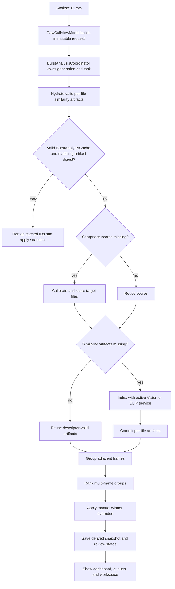

+++
author = "Thomas Evensen"
title = "Burst Groups"
date = "2026-07-15"
lastmod = "2026-10-23"
weight = 45
tags = ["burst", "similarity", "grouping", "vision", "sharpness"]
categories = ["technical details"]
mermaid = true
+++

# Burst Groups

Burst analysis turns a flat catalog into groups of adjacent, visually similar
frames. It ranks each multi-frame group, presents review queues, and supports
culling decisions such as keeping the best frame, keeping the top two, deferring
a group, or setting a manual pick.

The implementation separates application commands in `RawCullViewModel`, worker
orchestration in `BurstAnalysisCoordinator`, backend-selectable similarity
indexing behind `RawCullSimilarityFeature`, pure grouping and ranking engines,
two levels of artifact persistence, and the review UI. Vision feature prints are
the safe default. A validated CLIP model can become the active burst-similarity
backend when the user enables it; the rest of the burst pipeline works with
typed `SimilarityArtifact` values rather than assuming one representation.

## Source Map

| Area                                         | Main files                                                                                                                            |
| -------------------------------------------- | ------------------------------------------------------------------------------------------------------------------------------------- |
| Application commands and result publication  | [RawCull/Model/ViewModels/RawCullViewModel+BurstGrouping.swift](https://github.com/rsyncOSX/RawCull/blob/2ca891be5c013dc38fe3c931a829a04083b69c2a/RawCull/Model/ViewModels/RawCullViewModel+BurstGrouping.swift)                                                                       |
| Worker orchestration and cache compatibility | [RawCull/Intelligence/BurstAnalysis/BurstAnalysisCoordinator.swift](https://github.com/rsyncOSX/RawCull/blob/2ca891be5c013dc38fe3c931a829a04083b69c2a/RawCull/Intelligence/BurstAnalysis/BurstAnalysisCoordinator.swift) and coordinator extensions                                        |
| Similarity feature and shared state          | [RawCull/Intelligence/Similarity/RawCullSimilarityFeature.swift](https://github.com/rsyncOSX/RawCull/blob/2ca891be5c013dc38fe3c931a829a04083b69c2a/RawCull/Intelligence/Similarity/RawCullSimilarityFeature.swift), [SimilarityScoringModel.swift](https://github.com/rsyncOSX/RawCull/blob/2ca891be5c013dc38fe3c931a829a04083b69c2a/RawCull/Intelligence/Similarity/SimilarityScoringModel.swift)                                      |
| Backend composition and adapters             | [RawCull/Intelligence/Composition/RawCullAIModelRuntime.swift](https://github.com/rsyncOSX/RawCull/blob/2ca891be5c013dc38fe3c931a829a04083b69c2a/RawCull/Intelligence/Composition/RawCullAIModelRuntime.swift), [RawCull/Intelligence/Similarity/RawCullVisionSimilarityService.swift](https://github.com/rsyncOSX/RawCull/blob/2ca891be5c013dc38fe3c931a829a04083b69c2a/RawCull/Intelligence/Similarity/RawCullVisionSimilarityService.swift) |
| Per-file durable artifacts                   | [RawCull/Intelligence/Persistence/PerFileAnalysisArtifactStore.swift](https://github.com/rsyncOSX/RawCull/blob/2ca891be5c013dc38fe3c931a829a04083b69c2a/RawCull/Intelligence/Persistence/PerFileAnalysisArtifactStore.swift)                                                                 |
| Pure grouping and ranking                    | RawCullCore [Sources/RawCullCore/BurstGroupingEngine.swift](https://github.com/rsyncOSX/RawCullCore/blob/d25a51e65ad32a82bf82f86fa0ec07d6e14498e9/Sources/RawCullCore/BurstGroupingEngine.swift), [BurstRankingEngine.swift](https://github.com/rsyncOSX/RawCullCore/blob/d25a51e65ad32a82bf82f86fa0ec07d6e14498e9/Sources/RawCullCore/BurstRankingEngine.swift)                                               |
| Shared models                                | RawCullCore [Sources/RawCullCore/BurstAnalysisModels.swift](https://github.com/rsyncOSX/RawCullCore/blob/d25a51e65ad32a82bf82f86fa0ec07d6e14498e9/Sources/RawCullCore/BurstAnalysisModels.swift); app [BurstAnalysisModels.swift](https://github.com/rsyncOSX/RawCull/blob/2ca891be5c013dc38fe3c931a829a04083b69c2a/RawCull/Intelligence/BurstAnalysis/BurstAnalysisModels.swift), [BurstReviewQueueModels.swift](https://github.com/rsyncOSX/RawCull/blob/2ca891be5c013dc38fe3c931a829a04083b69c2a/RawCull/Intelligence/BurstAnalysis/BurstReviewQueueModels.swift)          |
| Cache and repository boundary                | [RawCull/Intelligence/Persistence/BurstAnalysisCache.swift](https://github.com/rsyncOSX/RawCull/blob/2ca891be5c013dc38fe3c931a829a04083b69c2a/RawCull/Intelligence/Persistence/BurstAnalysisCache.swift), [RawCull/Intelligence/BurstAnalysis/BurstAnalysisCacheRepository.swift](https://github.com/rsyncOSX/RawCull/blob/2ca891be5c013dc38fe3c931a829a04083b69c2a/RawCull/Intelligence/BurstAnalysis/BurstAnalysisCacheRepository.swift)  |
| Ratings and manual overrides                 | [CullingModel.swift](https://github.com/rsyncOSX/RawCull/blob/2ca891be5c013dc38fe3c931a829a04083b69c2a/RawCull/Model/ViewModels/CullingModel.swift), [SavedFiles.swift](https://github.com/rsyncOSX/RawCull/blob/2ca891be5c013dc38fe3c931a829a04083b69c2a/RawCull/Model/JSON/SavedFiles.swift)                                                                                              |
| Burst home and review list                   | [BurstGroupsHomeView.swift](https://github.com/rsyncOSX/RawCull/blob/2ca891be5c013dc38fe3c931a829a04083b69c2a/RawCull/Views/SimilarityGridView/BurstGroupsHomeView.swift), [SimilarityGridSelectionView.swift](https://github.com/rsyncOSX/RawCull/blob/2ca891be5c013dc38fe3c931a829a04083b69c2a/RawCull/Views/SimilarityGridView/SimilarityGridSelectionView.swift), [CullingGridView.swift](https://github.com/rsyncOSX/RawCull/blob/2ca891be5c013dc38fe3c931a829a04083b69c2a/RawCull/Views/CullingGrid/CullingGridView.swift)                                             |
| Single-burst workspace and comparison        | [BurstCullingWorkspaceView.swift](https://github.com/rsyncOSX/RawCull/blob/2ca891be5c013dc38fe3c931a829a04083b69c2a/RawCull/Views/ComparisonGridView/BurstCullingWorkspaceView.swift), [ComparisonGridView.swift](https://github.com/rsyncOSX/RawCull/blob/2ca891be5c013dc38fe3c931a829a04083b69c2a/RawCull/Views/ComparisonGridView/ComparisonGridView.swift)                                                                         |
| Batch badge selection and rating              | [CullingGridSelectionCoordinator.swift](https://github.com/rsyncOSX/RawCull/blob/2ca891be5c013dc38fe3c931a829a04083b69c2a/RawCull/Views/CullingGrid/CullingGridSelectionCoordinator.swift), [CullingGridView.swift](https://github.com/rsyncOSX/RawCull/blob/2ca891be5c013dc38fe3c931a829a04083b69c2a/RawCull/Views/CullingGrid/CullingGridView.swift)                                                                      |
| Deep Review subject outlines                  | [DeepAIReviewMaskOutlineRenderer.swift](https://github.com/rsyncOSX/RawCull/blob/2ca891be5c013dc38fe3c931a829a04083b69c2a/RawCull/Intelligence/DeepReview/DeepAIReviewMaskOutlineRenderer.swift), [LoupeMainImageView.swift](https://github.com/rsyncOSX/RawCull/blob/2ca891be5c013dc38fe3c931a829a04083b69c2a/RawCull/Views/ThumbnailComponents/LoupeMainImageView.swift), [ZoomOverlayView.swift](https://github.com/rsyncOSX/RawCull/blob/2ca891be5c013dc38fe3c931a829a04083b69c2a/RawCull/Views/ZoomViews/ZoomOverlayView.swift), [BurstCullingWorkspaceView.swift](https://github.com/rsyncOSX/RawCull/blob/2ca891be5c013dc38fe3c931a829a04083b69c2a/RawCull/Views/ComparisonGridView/BurstCullingWorkspaceView.swift)   |
| Tests                                        | [RawCullCore/Tests/RawCullCoreTests/BurstGroupingEngineTests.swift](https://github.com/rsyncOSX/RawCullCore/blob/d25a51e65ad32a82bf82f86fa0ec07d6e14498e9/Tests/RawCullCoreTests/BurstGroupingEngineTests.swift), [BurstRankingEngineTests.swift](https://github.com/rsyncOSX/RawCullCore/blob/d25a51e65ad32a82bf82f86fa0ec07d6e14498e9/Tests/RawCullCoreTests/BurstRankingEngineTests.swift), app burst/culling tests         |

## End-to-End Flow



The coordinator owns the worker generation, task, progress, cache preparation,
missing sharpness/similarity work, grouping, ranking, and the primary cache
save. It receives callbacks for the application-owned catalog validity check and
final result publication. Every awaited phase is therefore protected by both the
coordinator generation and selected catalog; a cancelled or superseded run
cannot publish late results into a newer catalog.

The target is normally every catalog file sorted by localized filename, which
acts as shot order. If files are selected, visible selected files are followed
by hidden selected files. If no selection exists and a star filter is active,
only files with that rating are analyzed.

## Similarity Artifacts And Backend Selection

`SimilarityScoringModel` depends on the `RawCullSimilarityServicing` protocol.
The active service supplies a backend descriptor, the descriptors it can
produce, an indexing operation, and a distance operation. This keeps grouping
independent of whether the payload is a Vision feature print or a CLIP image
embedding.

`RawCullAIModelRuntime` owns provider selection and model resources;
`RawCullIntelligenceRuntime` owns stable feature surfaces:

- `RawCullVisionSimilarityService` is always available and is the
  startup/default service.
- `RawCullCLIPSimilarityService` is selected only when CLIP is enabled and the
  chosen model bundle has validated and produced a provider.
- A selected CLIP pass uses `fallbackPolicy: .none`. Failed files are retried
  once with the loaded provider, then once with a newly constructed provider.
  Successful CLIP artifacts survive; remaining failures are recorded and
  excluded from grouping. Vision is the startup/service-selection fallback,
  not an automatic whole-batch replacement for a partially failed CLIP pass.
  The concrete CLIP service lives in [RawCullVisionSimilarityService.swift](https://github.com/rsyncOSX/RawCull/blob/2ca891be5c013dc38fe3c931a829a04083b69c2a/RawCull/Intelligence/Similarity/RawCullVisionSimilarityService.swift).

| Setting                     |                                       Current value |
| --------------------------- | --------------------------------------------------: |
| Input thumbnail maximum     |                                              512 px |
| Similarity pipeline version |                                                   3 |
| Artifact schema             | `SimilarityArtifactDescriptor.currentSchemaVersion` |
| Default backend             |                                Vision feature print |
| Optional backends           |          Validated OpenAI or DataComp CLIP provider |

Each `SimilarityArtifact` contains a descriptor and encoded payload. The
descriptor records backend identity, model fingerprint, representation,
preprocessing, normalization, configuration, and schema version.
`RawCullSimilarityArtifactValidation` compares that descriptor and the source
fingerprint before an artifact is admitted.

`PerFileAnalysisArtifactStore` persists individually valid artifacts
independently of the catalog-wide burst snapshot. On a later run,
`hydrateArtifacts(_:)` loads only artifacts allowed by the current service and
pipeline signature. This makes a partial index reusable and lets invalid entries
be removed without discarding every other file.

The same model can rank a catalog by distance from an anchor image. Burst
grouping calculates distances only between adjacent files. Those distances are
cached in memory under the current artifact/backend signature and reused when
regrouping remains compatible.

## Grouping Rules

`BurstGroupingEngine.group(...)` makes one sequential pass. It starts a new
group when any boundary rule fires.

| Boundary reason             | Trigger                                                                                                            |
| --------------------------- | ------------------------------------------------------------------------------------------------------------------ |
| Visual distance changed     | Adjacent active-backend distance is at or above `visualDistanceThreshold`                                          |
| Similarity evidence missing | No adjacent distance is available                                                                                  |
| Capture gap                 | Absolute capture-date gap exceeds `maxTimeGapSeconds`; modification-date fallback uses `maxFallbackTimeGapSeconds` |
| Camera changed              | Normalized camera value changed and `requireSameCamera` is enabled                                                 |
| Focal length changed        | Parsed focal-length delta exceeds `maxFocalLengthDeltaMM`                                                          |
| Exposure changed            | Shutter, aperture or ISO delta exceeds 0.5 EV, or exposure compensation exceeds 0.34 EV; unparseable values use conservative text fallback                                      |

Lens changes are recorded as evidence but do not independently split a group.
They do make group metadata unstable during ranking.

Default configuration:

```text
visualDistanceThreshold = 0.25
maxTimeGapSeconds = 2.0
maxFallbackTimeGapSeconds = 10.0
requireSameCamera = true
requireSimilarFocalLength = true
maxFocalLengthDeltaMM = 3.0
algorithmVersion = 4
```

The burst sensitivity control changes only the visual threshold.
`reGroupBursts()` cancels older grouping work, reuses similarity artifacts and
adjacent-distance data, rebuilds rankings, and saves a new cache. The current
home/category presentation is preserved instead of being forced into the grouped
grid.

## Ranking Formula

`BurstRankingEngine` computes:

```text
overall =
    rankingSharpness * 0.62
  + focusPoint      * 0.12
  + saliency        * 0.10
  + metadata        * 0.16
```

Sharpness is normalized by `SharpnessScoringModel.maxScore`. When at least two
group members have scores and their normalized spread is at least 0.03, global
and burst-relative sharpness are blended:

```text
rankingSharpness = normalizedSharpness * 0.65
                 + burstRelativeSharpness * 0.35
```

The other components are heuristic evidence:

- Focus is 0.70 when camera AF data exists and 0.45 otherwise.
- Saliency is 0.75 when the subject label matches the group's dominant label,
  0.25 on a mismatch, and 0.45–0.60 when evidence is incomplete.
- Metadata starts at 0.70 for stable groups or 0.40 otherwise and gains 0.15
  for tight similarity. Above ISO 1600 it loses 0.05 per stop, capped at 0.15,
  and gains 0.05 at f/5.6 or wider. Lower motion risk adds 0.05; elevated
  motion risk subtracts a stop-based penalty capped at 0.15. The final
  component is clamped to 0...1. High ISO (3200+) is also a candidate caution.

Ties in overall score retain original shot order.

## Confidence And One-Click Safety

| Confidence | Conditions                                                                                                                                                                                     |
| ---------- | ---------------------------------------------------------------------------------------------------------------------------------------------------------------------------------------------- |
| High       | Scores exist, group has at least 3 files, best leads second by at least 0.12, best normalized sharpness is at least 0.65, metadata is stable, all members have parsed capture times, and all internal visual distances are below 0.22 |
| Medium     | Best leads by at least 0.05 and metadata is stable                                                                                                                                             |
| Low        | Scores are absent, candidates are close, or evidence is unstable                                                                                                                               |

`isSafeForOneClickCulling` is true only for high-confidence results.
`keepBestInGroup` and `keepTopTwoInGroup` also require the current sharpness
score table to be non-empty; otherwise they return without changing ratings.

## Home Dashboard And Review Queues

After analysis, `BurstGroupsHomeView` composes `BurstGroupsHomeHeader`, `BurstNextUpCard`,
`BurstQueueActionCard`, `BurstRecentGroupsCard` and `BurstGroupsSidebar`
to build the dashboard. They present coverage, group counts, threshold, suggested
picks and these queue categories:

| Category        | Selection rule                                                                            |
| --------------- | ----------------------------------------------------------------------------------------- |
| All             | Every computed group, including singleton groups                                          |
| Single Images   | Groups containing exactly one file                                                        |
| Needs Review    | Multi-frame groups with explicit review-needed state or unsafe/uncertain ranking evidence |
| Deferred        | Multi-frame groups explicitly deferred                                                    |
| Marked Reviewed | Multi-frame groups explicitly marked `.reviewed`                                          |
| Reviewed        | Effective reviewed results, decisions already applied, and manual-winner groups           |

The grouped culling grid can collapse a burst to its top three ranked frames. A
group header opens the dedicated workspace and toggles Reviewed or Deferred
state.

The grid can also derive batch selectors from visible burst-rank, saliency, and
sharpness badges. A normal badge action replaces the selection with every
visible match, Command toggles the matching set, and Shift extends/replaces
according to the coordinator's modifier policy. Batch rating applies one rating
to the resulting selected files. The coordinator is a pure value transformation
so these semantics are testable without SwiftUI.

`BurstCullingWorkspaceView` displays one large selected frame plus a bounded
three-frame image window around the current selection and a filmstrip of ranked
candidates. It reuses `ComparisonImagePaneView`,
`ComparisonViewportInteractionState`, `ImageSourceSelectionState`, and
`ZoomMetadataPanel` rather than creating a second image-inspection
implementation. The cache key combines file identity and selected image source.

`P`/`N` and the arrow keys move between frames, `G` advances to the next
eligible multi-frame group, and `E` toggles the metadata panel. The workspace
also exposes zoom, thumbnail/embedded-JPEG source selection, focus evidence,
rating, pick/reject, reviewed state, and the detailed comparison grid. Escape
returns to the active burst list.

When Deep Review has produced a stored mask for the selected file, the workspace
can render its orange subject outline. `S` toggles the outline. The lookup uses
completed mask candidates indexed by file ID, and asynchronous outline results
are committed only while the selected file and mask identity remain current.

## Review States

`RawCullCore.BurstReviewState` currently defines:

- `.none`
- `.needsReview`
- `.reviewed`
- `.deferred`
- `.algorithmReviewed`
- `.manualWinnerOverride`
- `.decisionApplied`

The app and package enum are now aligned. `algorithmReviewed` remains for cache
compatibility.

`BurstReviewQueuePolicy.effectiveState(for:)` preserves explicit modern states.
For `.none` or legacy `.algorithmReviewed`, it derives Needs Review when
confidence is not high, cautions exist, no recommendation exists, or one-click
culling is unsafe; otherwise it treats the group as reviewed.

Toggling Reviewed or Deferred a second time resets the result to `.none` and
removes that group from the explicit state dictionary. Review states are
persisted using a catalog-and-membership `BurstGroupSignature`, so they can be
restored after a threshold change even if numeric group IDs change.

## Manual Winner Overrides

A manual winner is stored in `savedfiles.json` as `BurstWinnerOverride`:

| Field             | Meaning                   |
| ----------------- | ------------------------- |
| `winnerFileName`  | User-selected winner      |
| `memberFileNames` | Group membership snapshot |

Overrides use filenames because saved-file persistence is filename-based.
`CullingModel` canonicalizes member names so lookup is order-independent and
prunes overrides whose files no longer exist. Applying an override promotes the
selected file, recalculates second place, and sets `.manualWinnerOverride`.

## User Actions

| Action                   | Method                                                 | Effect                                                                                |
| ------------------------ | ------------------------------------------------------ | ------------------------------------------------------------------------------------- |
| Keep best                | `keepBestInGroup`                                      | On a safe result, rate the winner 3 stars and reject the rest                         |
| Keep top two             | `keepTopTwoInGroup`                                    | On a safe result, rate first place 3 stars, second place 2 stars, and reject the rest |
| Set manual pick          | `setManualBurstWinner`                                 | Persist the winner override and rate the selected frame 3 stars                       |
| Open group               | `compareBurstGroup`                                    | Open the workspace with up to four ranked comparison IDs                              |
| Next group               | `advanceToNextBurstGroup`                              | Open the next eligible multi-frame group in the active queue                          |
| Toggle reviewed/deferred | `toggleBurstGroupReviewed`, `toggleBurstGroupDeferred` | Persist or clear the explicit review state                                            |
| Undo last burst action   | `undoLastBurstAction`                                  | Restore the previous ratings captured for the last one-click action                   |
| Reindex                  | `reindexBurstAnalysis`                                 | Clear loaded analysis, delete the catalog cache, and recompute                        |

One-click rating actions capture a `BurstUndoEntry` before writing ratings. Only
the most recent burst action is retained for undo.

## Cache Validity

`BurstAnalysisCache` stores similarity artifacts, scores, saliency, groups,
boundary evidence, ranked results, and review-state snapshots. It is a derived
catalog snapshot; `PerFileAnalysisArtifactStore` is the reusable per-image
artifact layer. The current burst-cache schema is 9. A snapshot is accepted only
when all of these still match:

- cache schema version,
- grouping algorithm version,
- catalog path,
- effective sharpness thumbnail size and complete sharpness signature,
- grouping configuration and active backend descriptor,
- all allowed artifact backend descriptors, artifact schema, input size, and
  pipeline version,
- file count,
- every file path, size, and modification date,
- a digest of the current descriptor-and-payload artifact set.

On load, every embedded artifact is revalidated against its source and allowed
backend descriptors. Cached UUIDs are then remapped to the current scan's UUIDs
by file path because `FileItem.id` values are recreated. Cache saves are guarded
by the completed analysis context, generation, catalog, artifact digest, and
similarity signature so stale asynchronous work cannot overwrite a newer result.
Schema 8 can be read only as a migration candidate; individually valid artifacts
and stable review-state signatures may be imported, but the old snapshot is not
treated as a current cache hit.

## What To Check When Changing This Area

- Bump `BurstGroupingConfig.algorithmVersion` when grouping semantics change.
- Update the similarity pipeline version or descriptor/signature when artifact
  inputs or meaning change.
- Preserve descriptor validation and the separation between per-file artifacts
  and the derived burst snapshot.
- Test both the always-available Vision path and validated CLIP
  selection/fallback behavior.
- Update the sharpness scoring signature when score meaning changes.
- Keep review-state decoding backward compatible and preserve signature-based
  restoration across regrouping.
- Keep manual winner overrides durable across cache invalidation and UUID
  remapping.
- Treat high confidence plus available sharpness scores as the one-click culling
  gate.
- Keep the workspace's bounded image window and source-aware cache identity when
  changing image navigation.

## Grid projection and keyboard ownership

[CullingGridProjection.swift](https://github.com/rsyncOSX/RawCull/blob/2ca891be5c013dc38fe3c931a829a04083b69c2a/RawCull/Model/ViewModels/CullingGridProjection.swift) memoizes visible files, burst ordering, selection
IDs and badge data. Its key combines content/similarity/saliency mutation
revisions, source URL, rating and review filters, grouped mode and score
availability. Cache hits avoid rebuilding membership sets during view updates.
The cache itself is observation-ignored; mutation sites must advance the
corresponding revision. [RawCullTests/CullingGridProjectionTests.swift](https://github.com/rsyncOSX/RawCull/blob/2ca891be5c013dc38fe3c931a829a04083b69c2a/RawCullTests/CullingGridProjectionTests.swift) checks
reuse and invalidation.

`ReviewKeyboardScope` restricts local event monitors to the anchored key window,
with no sheet/modal and no focused native text/control. Command, Control and
Option combinations are left to their owners. In grouped grid mode,
`ThumbnailKeyboardRouting` consumes Return, Escape, B, 2 and U as burst commands
before ordinary rating dispatch, including reserved commands that cannot act.
This prevents an unavailable burst command from becoming a rating edit. See
[RawCullTests/ReviewKeyboardScopeTests.swift](https://github.com/rsyncOSX/RawCull/blob/2ca891be5c013dc38fe3c931a829a04083b69c2a/RawCullTests/ReviewKeyboardScopeTests.swift) and
[RawCullTests/ThumbnailKeyboardRoutingTests.swift](https://github.com/rsyncOSX/RawCull/blob/2ca891be5c013dc38fe3c931a829a04083b69c2a/RawCullTests/ThumbnailKeyboardRoutingTests.swift).

## Single Images is a synthetic review workspace

Singletons remain real one-file groups in the analysis result. In the Single
Images grid projection, [CullingGridProjection.swift](https://github.com/rsyncOSX/RawCull/blob/2ca891be5c013dc38fe3c931a829a04083b69c2a/RawCull/Model/ViewModels/CullingGridProjection.swift)
flattens visible singleton files into one presentation group with ID **−1**.
`compareBurstGroup` uses that ID when opening this queue. The workspace obtains
`singleImageReviewFiles` from singleton membership in active catalog order,
so it can traverse all single images rather than opening a separate workspace
for each. That workspace scope can be broader than the visible rating-filtered
grid projection.

ID −1 has no ranking or winner. `burstGroupReviewState(groupID:)` returns a
shared explicit state only when all active singleton groups agree; a mixed set
returns `.none`. Setting Reviewed or Deferred fans out to the constituent
singleton groups with per-group persistence suppressed, then saves once.
Persistence therefore uses real group signatures; −1 is not a stored domain
group and must not become input to the ranking engine.

Read [RawCullViewModel+BurstGrouping.swift](https://github.com/rsyncOSX/RawCull/blob/2ca891be5c013dc38fe3c931a829a04083b69c2a/RawCull/Model/ViewModels/RawCullViewModel+BurstGrouping.swift),
[BurstCullingWorkspaceView.swift](https://github.com/rsyncOSX/RawCull/blob/2ca891be5c013dc38fe3c931a829a04083b69c2a/RawCull/Views/ComparisonGridView/BurstCullingWorkspaceView.swift)
and [CullingGridCoordinatorTests.swift](https://github.com/rsyncOSX/RawCull/blob/2ca891be5c013dc38fe3c931a829a04083b69c2a/RawCullTests/CullingGridCoordinatorTests.swift) together. The
tests cover the combined singleton workspace and review-state behavior.

## Workspace components and work ownership

The burst screen now composes `BurstWorkspaceHeader`, `BurstImageStage`,
`BurstWorkspaceFilmstrip` and `BurstEvidenceShelf`. Image-window decoding lives
in `BurstWorkspaceImageCoordinator`, keyboard actions in
`BurstKeyboardController`, and cleanup in `BurstWorkspaceSessionModel`.
[Viewer Architecture]() explains
the three-frame cache, source identity, focus invalidation and monitor lifetime.
These presentation extractions do not change RawCullCore's ranking formula.

## Review session and membership-based persistence

[BurstReviewSessionModel.swift](https://github.com/rsyncOSX/RawCull/blob/2ca891be5c013dc38fe3c931a829a04083b69c2a/RawCull/Model/ViewModels/BurstReviewSessionModel.swift) owns results,
explicit states, queue filter, comparison group and undo entry. The view model
keeps its facade and coordinates ratings, navigation, persistence and admission.
Reset clears the same session object rather than replacing it.

Results/states are externally read-only. Commands apply analysis, replace
rankings, restore states, set manual winners and synchronize result state after
undo. Explicit restored workflow state may differ from a ranking's embedded
state. Manual overrides retain precedence when decisions are applied, without
redundant persistence. Rating undo consumes its entry without reverting the
established workflow state. `contentRevision` is in the grid-projection cache key.

[BurstReviewStateMapping.swift](https://github.com/rsyncOSX/RawCull/blob/2ca891be5c013dc38fe3c931a829a04083b69c2a/RawCull/Intelligence/BurstAnalysis/BurstReviewStateMapping.swift)
shares snapshot/restore rules across the coordinator and live review. Membership
signatures map decisions onto current group IDs; `.none` and invalid signatures
are omitted. Missing file references are filtered. The persisted schema is
unchanged. Read [CullingGridCoordinatorTests.swift](https://github.com/rsyncOSX/RawCull/blob/2ca891be5c013dc38fe3c931a829a04083b69c2a/RawCullTests/CullingGridCoordinatorTests.swift) and
[BurstAnalysisCoordinatorTests.swift](https://github.com/rsyncOSX/RawCull/blob/2ca891be5c013dc38fe3c931a829a04083b69c2a/RawCullTests/BurstAnalysisCoordinatorTests.swift) for the contracts.

## Missing AF evidence in older burst caches

Opening a workspace requests `loadMissingAFPointScores(for:)` on the sharpness
model. It analyzes only files with valid AF points and missing AF-center scores,
retains access, and checks cancellation/scoring identity before publication.
It does not start while ordinary scoring is active. Existing blended scores
and recommended winners are not replaced. Read
[SharpnessScoringModel.swift](https://github.com/rsyncOSX/RawCull/blob/2ca891be5c013dc38fe3c931a829a04083b69c2a/RawCull/Model/ViewModels/FocusandSharpness/SharpnessScoringModel.swift)
and [SharpnessScoringTests.swift](https://github.com/rsyncOSX/RawCull/blob/2ca891be5c013dc38fe3c931a829a04083b69c2a/RawCullTests/SharpnessScoringTests.swift).
