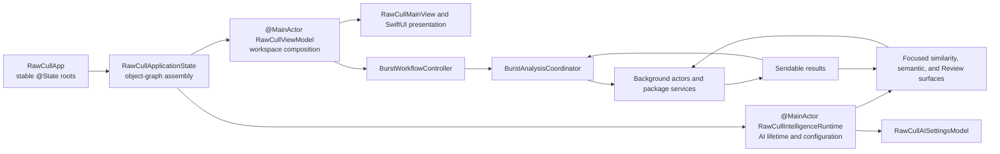
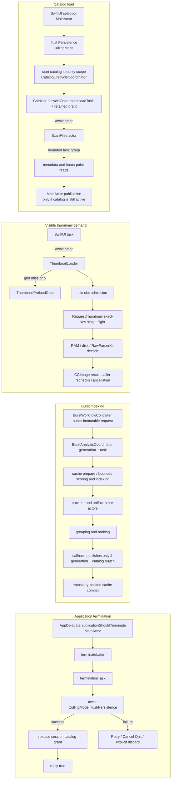

+++
author = "Thomas Evensen"
title = "Concurrency"
date = "2026-08-21"
lastmod = "2026-11-25"
tags = ["concurrency", "actors", "swift"]
categories = ["technical details"]
mermaid = true
weight = 35
slug = "concurrency-revised"

reviewed_commit = "328b570bf14d44bcf33efc58dc23da94bfadf439"
reviewed_version = "3.5.0"
reviewed_build = 469
reviewed_on = "2026-11-25"
review_scope = "Added the detachedCancellable walkthrough, lease waiters and the stale-publication example. Corrected actor and guard tables."
+++

# Concurrency

This page describes the current RawCull runtime in the **RawCull** repository.
The app uses Swift 6 with default main-actor isolation: presentation state
begins on `@MainActor`, shared mutable background state lives in actors, and
CPU, decode, or file work leaves inherited UI isolation explicitly.

A Swift task is not a thread. `await` is a suspension point, not an automatic
hop to a background thread. RawCull reasons about actor, executor, queue, and
task ownership; it never uses worker-thread identity as an application
invariant.

## Composition And Presentation Boundaries

`RawCullApp` retains the two roots returned by `RawCullApplicationState.live()`:
one `RawCullViewModel` and one `RawCullIntelligenceRuntime`. The application
state assembles one integration, one shared similarity model, focused similarity
and semantic-search features, the Review feature,
settings/model-management models, and the main view model. Settings publishes a
complete revisioned configuration to the runtime rather than invoking
independent callbacks on the view model.

`RawCullMainView` is the presentation boundary. It binds the main-actor view
model to SwiftUI scenes, sheets, alerts, commands, and child views. It does not
own catalog decoding, thumbnail admission, analysis, or persistence work.

`RawCullViewModel` assembles main-actor state and controllers. `CatalogController`
coordinates loads and publication using `CatalogWorkspace` and
`CatalogLifecycleCoordinator`. `FileOperationsModel` owns export and cache
warming. `BurstWorkflowController` owns application burst actions and uses
`BurstAnalysisCoordinator` for the worker task, generation, progress, cache
preparation and save. Background actors own mutable storage and provider state.



## Four Runtime Paths And Their Hops



The invisible ordering links (`~~~`) make Mermaid place the four runtime paths
below one another. They describe layout only; they are not runtime hops.

The catalog path is latest-wins. `startCatalogLoad` first flushes pending
culling data, then checks cancellation and the selected source before starting
the new load. `cancelCatalogLoad` cancels catalog, preload, hydration, and
cache-warming tasks; asks batch actors to cancel their inner tasks; resets
dependent analysis; and stops the active catalog scope. Publication repeatedly
checks `isActiveCatalogLoad(url)` and task cancellation.

The termination path deliberately delays AppKit termination. `AppDelegate`
stores one termination task, flushes persistence, and releases the catalog
security scope only after a successful save. A failed flush presents Retry, Cancel Quit, or Quit Without Saving. Retry
continues in the same termination task; Cancel Quit replies false and retains
state/access; explicit discard releases session access and replies true.
`isTerminationPending` suppresses the ordinary persistence alert while quitting.

## Concurrency Mechanisms

### Main-Actor Isolation

Use the main actor for observable UI state and workflow coordination, not for
expensive work.

| Owner                                                       | State and lifetime owned                                                                                                     |
| ----------------------------------------------------------- | ---------------------------------------------------------------------------------------------------------------------------- |
| `RawCullViewModel`                                          | Assembles catalog, selection, ratings, navigation and workflow owners |
| `CullingModel`                                              | In-memory culling records, debounced save task, persistence revision and errors                                              |
| `SharpnessScoringModel`                                     | Scoring request/generation, options, progress, scores and breakdowns                                                         |
| `SimilarityScoringModel` | Image artifacts, indexing/ranking/grouping generations and forwarding semantic API |
| `RawCullSemanticSearchModel` | Semantic service, evidence, hydration/query tasks and generations, progress and result selection |
| `BurstReviewSessionModel` | Review results, explicit states, queue filter, comparison group, undo entry and review revision |
| `RawCullSimilarityFeature` / `RawCullSemanticSearchFeature` | Focused operation surfaces, application bindings, and projections over the one shared scoring model                          |
| `BurstAnalysisCoordinator`                                  | Burst worker task, generation, progress, cache preparation, missing compute, grouping, ranking, and cache save               |
| `CombinedReviewFeature` | Run admission and cancellation, manifest, saved history and presentation of evidence |
| `RawCullIntelligenceRuntime`                                | Stable AI feature lifetimes and last accepted configuration revision/identity                                                |
| `RawCullAISettingsModel`                                    | Capability-refresh generation, preferences, and complete configuration publication                                           |

A task created in one of these main-actor contexts inherits that isolation. That is
useful for its stateful prefix and final publication. Heavy work must then be
reached through an actor, a package async API, or an explicit `@concurrent`
boundary.

### Actor Serialization

Actors protect shared asynchronous state.

| Actor                                                           | Serialized invariant                                               |
| --------------------------------------------------------------- | ------------------------------------------------------------------ |
| `ThumbnailPreloadGate`                                          | Active preload catalogs and parked grid-demand waiters             |
| `ThumbnailLoader`                                               | Six decode slots and FIFO continuations                            |
| `RequestThumbnail`                                              | Setup single flight and one producer per exact `ThumbnailCacheKey` |
| `ScanFiles`, `ScanAndCreateThumbnails`, `ExtractAndSaveJPGs`    | Batch task, progress, cancellation, and result accumulation        |
| `DiskCacheManager`, `BurstAnalysisCache`, `WriteSavedFilesJSON` | File-backed cache or persistence transactions                      |
| PhotoAIKit provider/store actors                                | Model runtime, artifact, index, and mask-store state               |

Actor serialization does not make independent work parallel. Where file work can
overlap, owners use a bounded task group and keep only a sliding window of
children active.

### Synchronous Cache Storage and Accounting

`SharedMemoryCache` remains an actor for configuration, monitoring, and pressure
handling. Its `nonisolated let` preview and grid properties expose independent
`TrackedThumbnailCache` wrappers, so thumbnail access does not require an actor
hop.

Each wrapper owns its private `NSCache`, metadata, stored cost, and eviction
delegate. One `NSRecursiveLock` serializes reads, mutations, limit changes, and
callback accounting. Registering metadata before insertion handles immediate
eviction; an entry UUID makes callbacks for replaced values harmless. The lock
is recursive because `NSCache` can call its delegate during an operation that
already holds it. No locked operation suspends with `await`.

The wrapper's `@unchecked Sendable` conformance relies on this private,
lock-protected state and the immutability contract of cached thumbnails. It does
not make `NSImage` mutation safe. Separate accounting reads are not a combined
snapshot during concurrent writes. See
[Synchronizing Cache Storage and Accounting]()
for the source walkthrough and delegate teardown rule.

### Bounded Structured Parallelism

| Operation                              |                                                          Bound |
| -------------------------------------- | -------------------------------------------------------------: |
| Visible thumbnail loading              |                                   6 slots in `ThumbnailLoader` |
| Metadata scan | `metadataScanLimit`: CPU count clamped to 1...8 |
| Thumbnail preload | `thumbnailPreloadLimit`: half CPU count clamped to 1...4 |
| Explicit extraction batches | `batchExtractionLimit`: twice CPU count, minimum 1 |
| Sharpness scoring                      | Fast 6, Balanced 4, High Precision 3; RAW demosaic capped at 2 |
| PhotoAnalysisKit batch and calibration |              Caller supplied; RawCull passes the scoring bound |
| PhotoAIKit indexing                    |                        `maximumConcurrentTasks` sliding window |

Structured child tasks inherit cancellation and finish before the task-group
scope returns. Completion order can drive progress, but final arrays are
restored to request order where order is part of the API. Cancellation calls
`cancelAll()` and partial results are not committed as a successful run.

### Explicit Concurrent Work

A task closure marked `@concurrent`, or an `@concurrent` function, explicitly
leaves inherited actor isolation. That does not make `Task { ... }` structured:
its owner must still retain/await it and arrange cancellation. Task-group
children, by contrast, remain scoped to their group. Examples
include RawCull's RAW demosaic helper, sorting and ranking helpers, diagnostics,
and PhotoAnalysisKit's Core Image/Vision worker. The audited PhotoAnalysisKit
1.3.1 implementation uses an explicit concurrent child and a cancellation
handler; it does not use a detached task for the focus engine.

### Detached And Queue-Backed Work

`Task.detached` is reserved for operations that deliberately must not inherit
actor isolation, including selected cache/file operations and conversion of
blocking image representations. Cancellation does not automatically propagate from the caller. When completion
or access lifetime matters, the caller must explicitly await/control the task
and arrange cancellation. Preload now does so; interactive thumbnail requests
still launch a separate asynchronous cache save.

Where cancellation must follow the caller, use `detachedCancellable` instead. The
name is historical. It does not create a detached task. It opens a one-child task
group and runs an `@concurrent` closure in it, so the work leaves the caller's
actor and still inherits cancellation, priority and structured lifetime:

```swift
nonisolated func detachedCancellable<Success: Sendable>(
    priority: TaskPriority? = nil,
    _ operation: @escaping @Sendable @concurrent () async -> Success,
) async -> Success {
    await withTaskGroup(of: Success.self) { group in
        group.addTask(priority: priority, operation: operation)
        return await group.next()!   // exactly one child was added
    }
}
```

Compare the two forms. With `Task.detached { … }.value`, a cancelled caller keeps
waiting and the decode keeps running for a photo nobody wants. With the group, a
child of an already cancelled task starts cancelled, so there is no window in
which work begins before it learns that. Disk-cache decode, full-size cache
decode, sidecar loading and preview sharpening use it. Cache *writes* stay
detached on purpose: a write that has started should finish.

Blocking ImageIO work is stronger than ordinary CPU work. RawParserKit bridges
it to a GCD queue with a checked continuation and lock-backed cancellation state
so it does not occupy Swift's cooperative executor. Framework pipe and PTY
callbacks similarly arrive outside main-actor isolation and explicitly return
through a main-actor task.

## Thumbnail Contention Invariants

Thumbnail concurrency has three separate layers:

1. `ThumbnailPreloadGate` blocks only grid misses whose parent directory is the
   catalog currently being preloaded. Other catalogs, preview requests, AI
   workflows, semantic search, and Review bypass the gate.
2. `ThumbnailLoader` admits at most six active loads. A released slot is
   transferred directly to the next waiter; cancellation removes and resumes a
   queued continuation exactly once.
3. `RequestThumbnail` coalesces only an exact `ThumbnailCacheKey`. Each waiter
   owns its continuation. Cancelling one waiter preserves the shared producer;
   cancelling the final waiter removes the table entry and cancels the producer.

`ThumbnailCacheKey` is replacement-safe and representation-aware. It includes
the standardized path, source file size, modification-date bit pattern, purpose
(grid or preview), requested pixel size, orientation policy, and thumbnail
schema. If source metadata cannot be resolved, reusable coalescing and caching
are skipped: a path alone cannot identify bytes replaced in place.

Every in-flight request also has a generation UUID. A producer may finish after
its final waiter was cancelled and a new request for the same key began; the
generation check prevents that old completion from removing or resuming the new
request's waiters.

## Latest-Wins And Stale-Result Prevention

Cancellation is cooperative and is not enough by itself. A callback or framework
operation may complete after cancellation, so owners pair task cancellation with
identity checks.

| Workflow                                   | Commit guard                                                |
| ------------------------------------------ | ----------------------------------------------------------- |
| Catalog load                               | Active catalog URL, selected source, and cancellation       |
| Catalog sort/search                        | Requested text, sort order, file IDs, and cancellation      |
| Sharpness scoring                          | `ScoringRequest`, scoring-generation UUID, and cancellation |
| Similarity hydrate/index/rank/search/group | Per-workflow generation plus catalog/query snapshots        |
| Burst analysis                             | Burst generation plus catalog URL                           |
| Review | Shared lease, frozen source and model snapshots, cancellation and compatibility checks |
| Model replacement                          | Settings refresh generation, configuration revision and identity |
| Review photo layers                        | Optional key per layer, compared again after the await      |
| Thumbnail single flight                    | Exact cache key plus producer-generation UUID               |

Progress callbacks use the same guard as final publication. An older run must
not update a newer run's progress, clear its task property, or publish a stale
result.

## Continuation Ownership And Cleanup

| Owner                       | Normal resume                     | Cancellation cleanup                                           |
| --------------------------- | --------------------------------- | -------------------------------------------------------------- |
| `ThumbnailPreloadGate`      | File finishes in all blocking sessions, or sessions end | Remove waiter, record cancellation, resume false               |
| `ThumbnailLoader`           | A real slot is transferred        | Remove queued waiter and resume cancelled                      |
| `RequestThumbnail`          | Exact-key producer finishes       | Remove waiter and resume nil; cancel producer when none remain |
| RawParserKit decode limiter | A decode permit becomes free      | Remove cancelled admission waiter and resume cancellation      |
| RawParserKit ImageIO bridge | GCD operation completes           | Lock-backed state guarantees exactly one completion            |

The collection owner is responsible for exactly one continuation resume. Never
hold a lock across `await`, invoke arbitrary client code while holding a lock,
or use a continuation without a cancellation path.

The AI lease is one more continuation owner. `CombinedReviewLease.invalidateAndWait()`
parks a model refresh until the current AI run has released the lease. `release`
resumes every parked waiter, and cancellation removes and resumes one waiter with
`CancellationError`. A run that refreshes the models for itself must not park there,
because it would wait for a lease it holds. A task-local owner marks that case. See
[AI runtime](#shared-inference-the-lease-and-the-generation-gate).

### When serialization is not enough

Main-actor and actor isolation prevent data races. They do not prevent a *stale
publication*. `ComparisonSessionModel` is the example to study: all of its methods
run on the main actor, and two of them can still overwrite each other's results
after an `await`. The [viewer guide](#comparison-publication-has-a-known-gap)
walks through both cases. Ask two questions at every `await`: what could have
changed while I was suspended, and does my guard cover exactly that?

## Security-Scope And Persistence Lifetimes

| Operation           | Owner                            | Start                                                               | Stop / failure cleanup                                                                                                         |
| ------------------- | -------------------------------- | ------------------------------------------------------------------- | ------------------------------------------------------------------------------------------------------------------------------ |
| Active catalog      | `CatalogLifecycleCoordinator` / retained grants | Before `CatalogLifecycleCoordinator.loadTask`, after the previous catalog is flushed     | Session release on cancellation, empty/failed load, replacement or termination; actual stop after final worker grant release                                        |
| Selected JPG export | `FileOperationsModel`    | Before constructing `ExtractAndSaveJPGs`                            | Main-actor completion path after success, failure, or cancellation                                                             |
| Rsync copy          | `ExecuteCopyFiles`               | Active catalog URL for source; `destBookmark` for destination       | One idempotent `cleanup()` on startup failure, completion, close, or deinit; it also removes the operation's include-list file |
| App termination     | `AppDelegate` and `CullingModel` | No new scope; uses the active catalog scope                         | Flush first; release scope only on successful flush                                                                            |

Every successful security-scope start has one owner that records the URL and one
idempotent cleanup path.

## Source-To-Test Map

| Runtime rule                                                                                                 | Protecting tests                                                             |
| ------------------------------------------------------------------------------------------------------------ | ---------------------------------------------------------------------------- |
| Exact-key thumbnail coalescing and independent waiter cancellation                                      | [RawCullTests/ThumbnailProviderTests.swift](https://github.com/rsyncOSX/RawCull/blob/328b570bf14d44bcf33efc58dc23da94bfadf439/RawCullTests/ThumbnailProviderTests.swift)                                  |
| Preload-gate drain and cancellation races                                                                | [RawCullTests/ThumbnailPreloadGateTests.swift](https://github.com/rsyncOSX/RawCull/blob/328b570bf14d44bcf33efc58dc23da94bfadf439/RawCullTests/ThumbnailPreloadGateTests.swift) |
| Six-slot limit, FIFO transfer, queued cancellation, and cancel-all                                           | [RawCullTests/ThumbnailLoaderConcurrencyTests.swift](https://github.com/rsyncOSX/RawCull/blob/328b570bf14d44bcf33efc58dc23da94bfadf439/RawCullTests/ThumbnailLoaderConcurrencyTests.swift)                         |
| Replacement-safe source/representation identity                                                              | [RawCullTests/ThumbnailCacheIdentityTests.swift](https://github.com/rsyncOSX/RawCull/blob/328b570bf14d44bcf33efc58dc23da94bfadf439/RawCullTests/ThumbnailCacheIdentityTests.swift)                             |
| Synchronized cache replacement, clear/insert races, and eviction accounting in isolated owners | [RawCullTests/CacheAccountingConcurrencyTests.swift](https://github.com/rsyncOSX/RawCull/blob/328b570bf14d44bcf33efc58dc23da94bfadf439/RawCullTests/CacheAccountingConcurrencyTests.swift) |
| Scoring request coalescing and generation-safe completion                                                    | [RawCullTests/SharpnessScoringTests.swift](https://github.com/rsyncOSX/RawCull/blob/328b570bf14d44bcf33efc58dc23da94bfadf439/RawCullTests/SharpnessScoringTests.swift)                                   |
| Persistence debounce, failed-save dirty state, retry, atomic backup/write, and legacy decode                 | [RawCullTests/CullingModelTests.swift](https://github.com/rsyncOSX/RawCull/blob/328b570bf14d44bcf33efc58dc23da94bfadf439/RawCullTests/CullingModelTests.swift)                                       |
| Catalog scope idempotence, replacement, failed start, cancellation, and empty catalog                        | [RawCullTests/RawCullVerifyViewModelSecurityScopeTests.swift](https://github.com/rsyncOSX/RawCull/blob/328b570bf14d44bcf33efc58dc23da94bfadf439/RawCullTests/RawCullVerifyViewModelSecurityScopeTests.swift)                |
| Export selection and denied destination scope                                                                | [RawCullTests/ExtractJPGsSelectionTests.swift](https://github.com/rsyncOSX/RawCull/blob/328b570bf14d44bcf33efc58dc23da94bfadf439/RawCullTests/ExtractJPGsSelectionTests.swift)                               |
| Rsync source/destination cleanup and operation-local include files                                           | [RawCullTests/ExecuteCopyFilesStartupTests.swift](https://github.com/rsyncOSX/RawCull/blob/328b570bf14d44bcf33efc58dc23da94bfadf439/RawCullTests/ExecuteCopyFilesStartupTests.swift)                            |
| Package batch ordering, bounds, progress, and cancellation                                                   | [PhotoAnalysisKit/Tests/PhotoAnalysisKitTests/PhotoAnalysisBatchTests.swift](https://github.com/rsyncOSX/PhotoAnalysisKit/blob/2a1466e04d821fa2628d6985296643e0d0c7e465/Tests/PhotoAnalysisKitTests/PhotoAnalysisBatchTests.swift) |

## Review Checklist

1. Which actor or task owns the mutable state and lifetime?
2. Does the synchronous prefix require that actor?
3. Is independent work bounded and structured?
4. Is the work CPU-bound, blocking, or callback-based, and which executor or
   queue boundary is appropriate?
5. What Sendable value crosses the boundary?
6. How is every continuation resumed on success and cancellation?
7. Which generation, catalog, query, key, or request identity prevents a stale
   commit?
8. Who stops each successfully started security scope?
9. What test makes the invariant executable?

“`await` moves this to a background thread” is not a valid concurrency model.
Name the actual actor, task, executor, queue, cancellation owner, and commit
guard.

## Catalog grants outlive selection when workers still need them

`CatalogLifecycleCoordinator` owns transition and load tasks plus the session's
`RawCullCatalogGrant`. `RawCullCatalogAccess` registers grants weakly and returns
strong references covering requested URLs, choosing the longest matching root
by path components. Decoder adapters and batches retain those references until
their asynchronous operation exits, using `withExtendedLifetime` in cleanup.

Cancelling a catalog releases the session reference; the actual security-scope
stop occurs in the grant's isolated deinitializer after the final worker also
releases it. Cancellation cannot instantly interrupt synchronous image rendering.
A generation/catalog guard still prevents those workers from publishing stale
results. See [RawCullTests/CatalogLifecycleCoordinatorTests.swift](https://github.com/rsyncOSX/RawCull/blob/328b570bf14d44bcf33efc58dc23da94bfadf439/RawCullTests/CatalogLifecycleCoordinatorTests.swift) and
[RawCullTests/CatalogConcurrencyTests.swift](https://github.com/rsyncOSX/RawCull/blob/328b570bf14d44bcf33efc58dc23da94bfadf439/RawCullTests/CatalogConcurrencyTests.swift).

## Viewer task and event ownership

The October 22 refactor makes the presentation boundary explicit:
`LoupeFocusPresentationModel` owns its focus task/generation,
`SubjectOutlinePresentationModel` rejects obsolete outline results, and
`ZoomOverlayAnalysisCoordinator` checks selected file, source and analysis-image
identity around awaited computation. SwiftUI task IDs remain on their screen
owners; extracting a rendering section must not start a duplicate worker.

`BurstWorkspaceImageCoordinator` retains only a three-frame source-keyed
working set.
`ReviewKeyMonitor` owns registration/removal only; screen scope and keyboard
controllers decide whether an event is accepted and what it does.

Read [Viewer Architecture]() for
the complete lifecycle and tests. The private RAW exposure renderer is a separate
actor with synchronous native render work; its serialization does not make
rendering preemptible. See
[RAW Formats and Exposure Inspection]().

## Bounded preload saves and separate observable owners

[ScanAndCreateThumbnails.swift](https://github.com/rsyncOSX/RawCull/blob/328b570bf14d44bcf33efc58dc23da94bfadf439/RawCull/Actors/ScanAndCreateThumbnails.swift) keeps saving inside each
bounded worker: process and encode, release the file's grid gate, await
`DiskCacheManager.save`, then release the slot. A cancellation check after
`group.next()` prevents new admission when a cancelled producer gets a slot.
Already-started writes are awaited and the retained catalog grant covers the
drain. Interactive saves are unchanged; each preload group has its own bound.

Review results/states use explicit session commands. The session's
`contentRevision` is part of `CullingGridProjectionKey`. Semantic configuration
replacement advances hydration generation and rejects stale publication.
Similarity's grid revision combines image and semantic changes. These owners
remain observable main-actor models, not new background actors.

Read [ThumbnailPreloadSaveOwnershipTests.swift](https://github.com/rsyncOSX/RawCull/blob/328b570bf14d44bcf33efc58dc23da94bfadf439/RawCullTests/ThumbnailPreloadSaveOwnershipTests.swift),
[CullingGridCoordinatorTests.swift](https://github.com/rsyncOSX/RawCull/blob/328b570bf14d44bcf33efc58dc23da94bfadf439/RawCullTests/CullingGridCoordinatorTests.swift) and
[RawCullSemanticSearchTests.swift](https://github.com/rsyncOSX/RawCull/blob/328b570bf14d44bcf33efc58dc23da94bfadf439/RawCullTests/RawCullSemanticSearchTests.swift) for the contracts.

## Catalog progress lifetime — October 2026

[CatalogProgressCoalescer](https://github.com/rsyncOSX/RawCull/blob/328b570bf14d44bcf33efc58dc23da94bfadf439/RawCull/Model/Handlers/CatalogProgressCoalescer.swift)
is main-actor presentation state. Each catalog load creates independent metadata
and thumbnail instances. A cancellable 100 ms scheduling task weakly references
the coalescer; scheduled identifiers and an accepting flag reject obsolete ticks.
Initial and terminal publication bypass the cadence. Catalog cancellation cancels
both coalescers, and callbacks check current catalog or instance identity.
Internal accounting and thumbnail availability do not wait for a UI tick.

Catalog instrumentation pairs `CatalogOpen`, `CatalogMetadataScan` and
`CatalogThumbnailPreload` intervals. Optional source-load stage diagnostics are
opt-in measurement support; ordinary loading continues through the production
adapter. No parser concurrency or save-lifetime rewrite was retained in Phases
3–6. The [current findings]() establish reduced
sampled main-thread progress work, not that every expensive path avoids the main
thread or that interaction is hitch-free.

## October 31 integration

`RAWPreviewRenderer` serializes synchronous Core Image work on its actor. Cancellation checks surround native calls; they cannot preempt them. Zoom load operation IDs guard completion state, while cancelled tasks cannot publish obsolete pixels or analysis. RawParserKit 1.3.3 separately places thumbnail decoding in an `@concurrent` helper under the existing six-slot limiter.

## RAW status publication — November 2–3

The handler publishes decode status and request duration on the main actor with
the completed display pixels, before waiting for the analysis thumbnail. A
preserved-image replacement keeps the previous result metadata until publication.
Session loading state independently drives the preparing indicator; the completed
quality label follows renderer metadata. Cancellation and existing load IDs keep
the same publication/completion responsibilities. See
[viewer ownership]().

## Close-up rendering and publication

[BurstCloseUpRenderer](https://github.com/rsyncOSX/RawCull/blob/328b570bf14d44bcf33efc58dc23da94bfadf439/RawCull/Views/ComparisonGridView/BurstCloseUpsView.swift)
is an actor with an explicit tail-task chain. Actor isolation alone would allow
reentrancy across awaits; waiting for the preceding task prevents overlapping
native decodes within this renderer instance. A cancellation handler cancels the
queued task, which checks cancellation after waiting and around decoding.
Synchronous native calls still cannot be preempted arbitrarily.

Its `@concurrent` worker retains catalog access, validates file and render-source
revisions before and after image loading, and returns bounded raster artifacts.
The PhotoEvidenceKit card model separately checks cancellation, request generation,
render descriptor, dimensions and transform before publication. These protect
different boundaries: a valid current descriptor does not replace a host file
revision check, and cancellation does not replace result-generation checks.

The main burst stage retains its separate cache and loading coordinator. This
renderer serializes its own work; it is not a global cap shared by all image
pipelines. See [cache ownership]() and
[security-scope lifetime]().

## Automatic detection scheduling

Each compared URL scopes one detection task. The view delays starting work
briefly, removes the detection strip during similarity indexing and cancels
obsolete loads when the current URL changes. The loader retains catalog access
and checks cancellation and source revision before saving or returning results.
Manual card metadata loads off the main actor and is published after a
cancellation check.

## Vision request scheduling

PhotoAnalysisKit schedules saliency, classification, face and animal detection, and feature-print requests on `VisionRequestGate.shared`. RawCull injects `RawCullVisionWorkSerializer` into PhotoAIKit’s Vision similarity backend, so feature prints from similarity indexing use the same queue. The indexer can keep up to four decodes in flight while Vision executes one request body at a time. This leaves the cooperative thread pool available to other tasks.

A waiting caller suspends. Cancelling before its turn skips the body. Once a request has started, it finishes on the serial queue and returns its result or error. Construct the non-Sendable Vision request and handler inside that body and return Sendable data. Sharpness still bounds concurrent images by quality and source, allowing six Fast, four Balanced or three High Precision preview jobs and at most two RAW demosaics. [VisionRequestGate](https://github.com/rsyncOSX/PhotoAnalysisKit/blob/2f41e8b756f006e0218f86b103801ebb47cf8983/Sources/PhotoAnalysisKit/VisionRequestGate.swift) · [VisionWorkSerializing](https://github.com/rsyncOSX/PhotoAIKit/blob/26647c62d9933968d92bd00b162290cdd7c78fee/Sources/VisionFeaturePrintBackend/VisionWorkSerializing.swift) · [RawCullVisionSimilarityService](https://github.com/rsyncOSX/RawCull/blob/328b570bf14d44bcf33efc58dc23da94bfadf439/RawCull/Intelligence/Similarity/RawCullVisionSimilarityService.swift) · [SharpnessScoringModel](https://github.com/rsyncOSX/RawCull/blob/328b570bf14d44bcf33efc58dc23da94bfadf439/RawCull/Model/ViewModels/FocusandSharpness/SharpnessScoringModel.swift)
