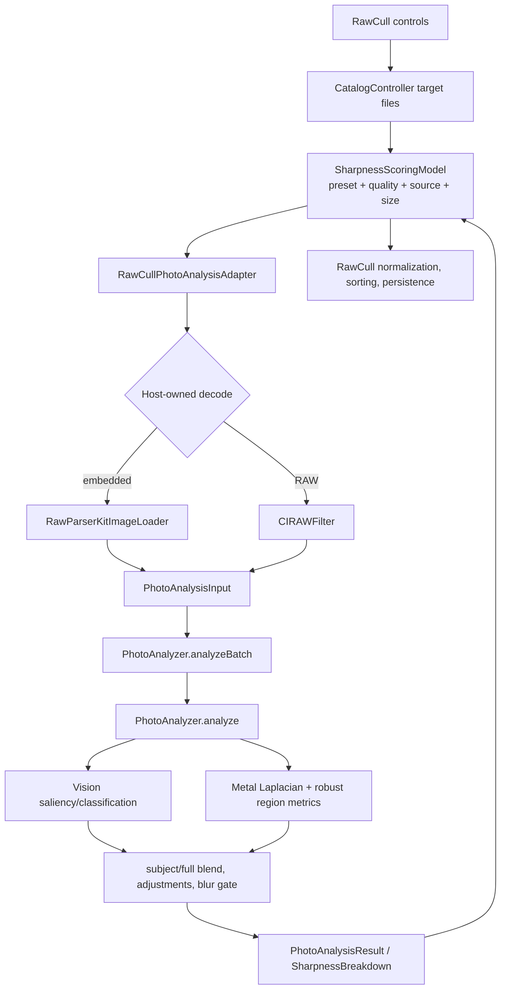

+++
author = "Thomas Evensen"
title = "Detailed Sharpness Scoring"
date = "2026-08-21"
lastmod = "2026-11-25"
weight = 41
tags = ["sharpness", "focus", "scoring", "vision", "metal", "saliency"]
categories = ["technical details"]
mermaid = true

reviewed_commit = "328b570bf14d44bcf33efc58dc23da94bfadf439"
reviewed_version = "3.5.0"
reviewed_build = 469
reviewed_on = "2026-11-25"
review_scope = "Rewrote the formula for scalar algorithm 7 and added a table of changes since algorithm 4."
+++

# Detailed Sharpness Scoring

This is the algorithm-level reference for scalar sharpness at **PhotoAnalysisKit
1.4.1**, revision **2f41e8b756f006e0218f86b103801ebb47cf8983**, the version RawCull
3.5.0 resolves. Its scalar algorithm version is **7**. An earlier edition of this
page described version 4 (package 1.3.1); [what changed](#what-changed-since-algorithm-4)
is listed at the end. RawCull chooses
files and image sources, maps UI settings, bounds work, publishes progress,
normalizes badges, and persists results. PhotoAnalysisKit owns the analysis
formula.

For ownership, cancellation, calibration, and UI flow, start with
[Focus Mask And Sharpness](../focusmask/). This page concentrates on the package
algorithm and names RawCull policy only where it changes package input or
consumes package output.

## Compact Worked Example

Consider a wildlife frame after Laplacian sampling:

```text
full-frame robust score                 0.18
AF broad score                          0.30
Vision salient broad score              0.24
best AF-local patch                     0.34
best salient-interior patch             0.28
wildlife salient weight                 0.85
subject saliency area                   ignored because a usable AF point exists
subject border fraction                 0.50 (below silhouette trigger)
subject micro-contrast                  0.020
aperture                                f/5.6 -> wide gate 0.010...0.025
```

The actual pipeline combines the evidence in stages:

```text
broad subject = 0.6 * 0.30 + 0.4 * 0.24 = 0.276

local detail  = 0.6 * 0.34 + 0.4 * 0.28 = 0.316
subject       = 0.75 * 0.276 + 0.25 * 0.316 = 0.286

base          = 0.15 * 0.18 + 0.85 * 0.286 = 0.2701

blur t        = (0.020 - 0.010) / (0.025 - 0.010) = 0.6667
attenuation   = 0.20 + 0.80 * 0.6667 = 0.7333

final         = 0.2701 * 0.7333 = about 0.198
```

There is no silhouette penalty because 50% is below 62%, and no subject-size
bonus because the frame has a usable AF point. The final value is a raw relative score, not
a percentage. RawCull later normalizes it against the catalog denominator for a
badge.

The numeric values above are illustrative inputs to the current formulas; they
are not fixture output from a particular image.

## End-To-End Boundary



## 1. RawCull-Owned Input Policy

### Target Files

`CatalogController.sharpnessScoringTargetFiles` chooses, in order:

1. explicitly selected files, keeping visible selected files first and appending
   selected files hidden by the current projection;
2. the exact active star-rating set;
3. otherwise the active catalog set, including semantic-search scope, sorted by
   filename.

Burst analysis uses a different list, sorted by capture time. Order does not affect
a score. It only decides which frames are scored first.

Calibration uses embedded previews capped at 1616 px. Scoring uses the
selected source and effective size. Calibration adjusts only the visual mask threshold; it does not calibrate
the scalar score. After a non-cancelled,
nonempty result, RawCull merges scores and subject labels into `CullingModel`
and reapplies catalog sorting.

Protected by: [RawCullTests/CullingModelTests.swift](https://github.com/rsyncOSX/RawCull/blob/328b570bf14d44bcf33efc58dc23da94bfadf439/RawCullTests/CullingModelTests.swift) target-scope and
`calibrateAndScoreCurrentCatalog` tests.

### Preset And Quality

RawCull starts from the shared focus config, initially `.birdsInFlight`, then
applies the selected PhotoAnalysisKit preset and quality. Auto preserves that
config; it does not infer a photo type from classification. Unlike the explicit
Birds/Wildlife preset, `.birdsInFlight` leaves the explicit salient override nil,
so the f/8 aperture fallback can reduce Auto's subject weight to 0.55.

| RawCull photo type | Package changes from the input config                                                                                                                  |
| ------------------ | ------------------------------------------------------------------------------------------------------------------------------------------------------ |
| Auto               | No preset change                                                                                                                                       |
| Birds/Wildlife     | pre-blur 2.2; border 0.05; salient weight and explicit override 0.85; size factor 0.05; silhouette strength 0.55; AF radius 0.06; classify and isolate |
| Portrait           | pre-blur at most 1.7; salient weight/override 0.80; size factor 0.08; silhouette 0.25; AF radius 0.10; classify and isolate                            |
| Landscape          | pre-blur at most 1.55; salient weight 0.35 with explicit override 0.35; size factor 0; silhouette 0.15; AF radius 0; do not isolate mask               |
| Action             | pre-blur 2.0; salient weight/override 0.65; size factor 0.05; silhouette 0.40; AF radius 0.09; classify and isolate                                    |

| Quality        |               Package fine-detail weight | RawCull minimum size | Requested concurrency |
| -------------- | ---------------------------------------: | -------------------: | ------------------: |
| Fast           |                                        0 |                  512 |                   6 |
| Balanced       |                            at least 0.25 |                  768 |                   4 |
| High Precision | at least 0.45 and classification enabled |                 1024 |                   3 |

The effective maximum pixel size is clamped between the quality minimum
and 2048; a nonpositive setting resolves to 2048. RAW demosaic further caps
concurrency at two. Embedded-preview scoring uses the quality limit in the table. The shared Vision gate serializes blocking request bodies across these jobs. [SharpnessScoringModel](https://github.com/rsyncOSX/RawCull/blob/328b570bf14d44bcf33efc58dc23da94bfadf439/RawCull/Model/ViewModels/FocusandSharpness/SharpnessScoringModel.swift)

Protected by: [RawCullTests/SharpnessScoringTests.swift](https://github.com/rsyncOSX/RawCull/blob/328b570bf14d44bcf33efc58dc23da94bfadf439/RawCullTests/SharpnessScoringTests.swift) preset, quality, size,
and concurrency assertions; package policy also has
[PhotoAnalysisKitTests/SharpnessMetricsTests.swift](https://github.com/rsyncOSX/PhotoAnalysisKit/blob/2f41e8b756f006e0218f86b103801ebb47cf8983/Tests/PhotoAnalysisKitTests/SharpnessMetricsTests.swift).

### Image Source

| Source           | RawCull implementation                                                                                                   |
| ---------------- | ------------------------------------------------------------------------------------------------------------------------ |
| Embedded Preview | `RawParserKitImageLoader.shared.thumbnailCGImage` at the effective size                                                  |
| RAW Demosaic     | `RawScoringDemosaic.render`: `CIRAWFilter` with the preferred RAW 9 decoder when supported, sharpness 0, detail 0.6, contrast 1.0, exposure 0; longest side scaled to the effective size; written as 8-bit sRGB |

The sRGB step matters. The engine measures edge energy on *gamma-encoded* pixels.
A linear RAW render has different energies for the same photo, so it would produce
different scores and a different mask. Every scoring path therefore uses the same
render function and the same color handling.

The adapter returns `PhotoAnalysisInput(image:iso:aperture:normalizedAFPoint:)`.
RawCull passes ISO 400 when the file has none. PhotoAnalysisKit never opens RawCull
files and does not choose a source. The AF point is already in upright image
coordinates. `SharpnessScoringSignature.inputPipelineVersion` 1 records both facts,
so scores made before AF rotation and sRGB encoding are not reused.

Protected by: [RawCullTests/PhotoAnalysisKitIntegrationTests.swift](https://github.com/rsyncOSX/RawCull/blob/328b570bf14d44bcf33efc58dc23da94bfadf439/RawCullTests/PhotoAnalysisKitIntegrationTests.swift) and adapter
overrides in [RawCullTests/SharpnessScoringTests.swift](https://github.com/rsyncOSX/RawCull/blob/328b570bf14d44bcf33efc58dc23da94bfadf439/RawCullTests/SharpnessScoringTests.swift).

## 2. Package Defaults And Per-Image Resolution

The default `SharpnessConfiguration` values at the pinned revision are:

| Value                         | Default | Role                                                          |
| ----------------------------- | ------: | ------------------------------------------------------------- |
| `preBlurRadius`               |    1.92 | Shared edge-energy input                                      |
| `iso`                         |     400 | Replaced by capture ISO; used as the fallback when it is absent |
| `threshold`                   |    0.46 | Mask presentation only. Fixed cutoff, effective range 0.01–0.95 |
| `energyMultiplier`            |    7.62 | Stable scoring and shared edge gain                           |
| `borderInsetFraction`         |    0.04 | Scalar full-frame border exclusion, clamped to 0–0.10         |
| `salientWeight`               |    0.75 | Scalar subject/full blend, clamped to 0–1                     |
| `subjectSizeFactor`           |    0.10 | Scalar saliency-only size bonus                               |
| `silhouettePenaltyStrength`   |    0.55 | Scalar penalty maximum                                        |
| `fineDetailBlendWeight`       |       0 | Scalar second pass                                            |
| `enableSubjectClassification` |    true | Label only; saliency candidates are still analysis evidence   |
| `afRegionRadius`              |    0.12 | Broad AF scoring region                                       |
| `afCenterRegionRadius`        |   0.025 | Evidence diagnostic/local region                              |
| `afNeighborhoodRegionRadius`  |   0.075 | Evidence diagnostic/local-patch region                        |
| `apertureHint`                |     mid | Replaced when a valid aperture is present                     |

`PhotoAnalysisInput.resolvingCaptureSettings(in:)` copies the configuration and
overrides it only with metadata that exists. A finite, positive aperture replaces the
hint; a missing one keeps the configured hint. The hints are:

| Aperture              | Hint      | Blur gate low/high | Blur damp | Fallback salient override |
| --------------------- | --------- | ------------------ | --------: | ------------------------: |
| f/5.6 or wider        | wide      | 0.010 / 0.025      |       1.0 |                      none |
| between f/5.6 and f/8 | mid       | 0.008 / 0.022      |       1.0 |                      none |
| f/8 or narrower       | landscape | 0.006 / 0.018      |       0.8 |                      0.55 |
| missing               | configured (default mid) | from that hint | from that hint | from that hint |

The effective weight is the explicit preset override, else the aperture override,
else `salientWeight`. Each is clamped to 0–1, and a nonfinite value is skipped.

Protected by: [PhotoAnalysisKitTests/SharpnessMetricsTests.swift](https://github.com/rsyncOSX/PhotoAnalysisKit/blob/2f41e8b756f006e0218f86b103801ebb47cf8983/Tests/PhotoAnalysisKitTests/SharpnessMetricsTests.swift) and
[RawCullTests/SharpnessScoringTests.swift](https://github.com/rsyncOSX/RawCull/blob/328b570bf14d44bcf33efc58dc23da94bfadf439/RawCullTests/SharpnessScoringTests.swift).

## 3. Normalization And Vision

Analysis has three steps, so that no cooperative thread waits for Vision:

1. A worker normalizes the decoded `CGImage` to sRGB RGBA. If that fails, there is
   no score. Analysis does not silently continue on unnormalized pixels.
2. The caller awaits saliency through `VisionRequestGate.shared`.
3. A second worker computes the score. A result produced after cancellation is
   discarded.

Vision produces attention-based saliency candidates. Classification runs only when
it is enabled *and* at least one candidate survived filtering. It matches whole
words in the Vision identifier, so `wood` no longer matches inside `woodpecker`.
The label is metadata; it is not itself a score. A Vision error is logged and
treated as "no candidates".

Candidates are retained when normalized area is greater than 0.03 or Vision
confidence is at least 0.9. For each retained candidate, the engine computes a
broad region detail score when it has at least 64 finite samples. Candidate
selection prefers a rectangle that contains the AF point, then the nearest center to
the AF point, then confidence, detail and area. The last tie-break is position, so
the order is deterministic. Vision rectangles use
a bottom-origin coordinate convention; the rendered bitmap is sampled with the Y
coordinate inverted so the intended pixels are measured.

Checked against [FocusMaskEngine+Scoring.swift](https://github.com/rsyncOSX/PhotoAnalysisKit/blob/2f41e8b756f006e0218f86b103801ebb47cf8983/Sources/PhotoAnalysisKit/FocusMaskEngine+Scoring.swift). The package facade and
RawCull integration tests check that analysis is available; they do not directly
test candidate filtering, selection tie-breaks, or asymmetric Y-coordinate fixtures.

## 4. Edge-Energy Image

The package applies:

```text
isoFactor:
  ISO < 800          -> 1.0
  800 <= ISO < 3200  -> 1.0 + (ISO - 800) / 2400 * 0.6
  ISO >= 3200        -> min(1.6 + (ISO - 3200) / 6400 * 0.6, 2.2)

resolutionFactor =
  clamp(sqrt(max(longestSide, 512) / 512), 1, 3)

effective blur radius =
  min(preBlurRadius * isoFactor * resolutionFactor * apertureBlurDamp, 100)
```

After Gaussian pre-blur, the Metal `focusLaplacian` kernel computes:

```text
laplace = 8 * center - sum(the 8 neighboring pixels)
energy  = dot(abs(laplace.rgb), [0.299, 0.587, 0.114])
```

A color matrix multiplies that energy by 7.62.

Before blurring, the input is extended with `clampedToExtent()`, and the kernel runs
on the original extent. Repeating the edge pixels outward means the border of a
photo is compared with itself. A blur against transparent black would invent a
strong edge around every frame, and the border inset would then be hiding an
artifact instead of excluding weak evidence.

Balanced and High Precision additionally build a fine pass with:

```text
fine pre-blur = max(0.35, primary pre-blur * 0.58)
combined      = primary * (1 - w) + fine * w
w             = clamped to 0...0.65
```

Protected by: [PhotoAnalysisKitTests/SharpnessMetricsTests.swift](https://github.com/rsyncOSX/PhotoAnalysisKit/blob/2f41e8b756f006e0218f86b103801ebb47cf8983/Tests/PhotoAnalysisKitTests/SharpnessMetricsTests.swift) ISO and
numeric helper tests, and [PhotoAnalysisKitTests/PhotoAnalyzerTests.swift](https://github.com/rsyncOSX/PhotoAnalysisKit/blob/2f41e8b756f006e0218f86b103801ebb47cf8983/Tests/PhotoAnalysisKitTests/PhotoAnalyzerTests.swift)
end-to-end tests.

## 5. Region Samples And Robust Tail Score

The engine creates these sample sets:

- full frame, excluding `borderInsetFraction` on every edge;
- each Vision candidate;
- a broad AF square with half-size `afRegionRadius`;
- AF-center and AF-neighborhood squares for evidence;
- best local patches within the AF neighborhood and winning saliency region.

Broad AF, saliency, and AF-neighborhood regions need at least 64 finite samples;
the tighter AF center needs 16. Full-frame scoring needs at least two. Local patches
use a separate patch sampling/ranking path.

**The broad AF region keeps its size at the frame edge.** `afScoringRegion` *shifts*
the square inside the frame. The tighter center and neighborhood squares are still
clipped. If the scoring square were clipped, an AF point in a corner would be
measured over a quarter of the area, and its score would not be comparable with the
frames beside it in the burst.

For a sample array with at least two values:

```text
p20 = sample at floor((n - 1) * 0.20)
p90 = sample at floor((n - 1) * 0.90)
p97 = sample at floor((n - 1) * 0.97)

band mean = mean(max(0, value - p20))
            for original samples where p90 <= value <= p97

density = min(1, (bandCount / n) / 0.06)
robust tail score = band mean * density
```

If p97 is not greater than p90, or the band is unexpectedly empty, the fallback
is `max(0, p90 - p20)`. The density factor is a band-occupancy multiplier,
not an independent measure
of spatial edge density. With distinct continuous samples, the p90...p97 band
contains about 7% of samples, so the multiplier usually saturates at 1. Sparse
outliers can still score low because the top 3% is excluded and the band mean
is small; dense residual noise is not ruled out by this factor. Micro-contrast
is the standard deviation of finite Laplacian samples, accumulated in `Double` so a
large region does not lose precision.

Protected by: [PhotoAnalysisKitTests/SharpnessMetricsTests.swift](https://github.com/rsyncOSX/PhotoAnalysisKit/blob/2f41e8b756f006e0218f86b103801ebb47cf8983/Tests/PhotoAnalysisKitTests/SharpnessMetricsTests.swift) and the
forwarding checks in [RawCullTests/SharpnessScoringTests.swift](https://github.com/rsyncOSX/RawCull/blob/328b570bf14d44bcf33efc58dc23da94bfadf439/RawCullTests/SharpnessScoringTests.swift).

## 6. Subject Construction

The broad subject score is:

```text
AF and saliency present -> 0.6 * AF + 0.4 * saliency
only one present        -> that score
neither present         -> nil
```

The local detail score uses the same 0.6/0.4 blend for the best AF-local and
salient-interior patches. The effective subject is conservative:

```text
broad and local present -> 0.75 * broad + 0.25 * local
only one present        -> that score
```

This prevents one tiny high-energy patch from replacing the broad subject
measurement while still rewarding localized detail.

Checked against `conservativeSubjectScore` and `computeSharpnessAnalysis` in
[FocusMaskEngine+Scoring.swift](https://github.com/rsyncOSX/PhotoAnalysisKit/blob/2f41e8b756f006e0218f86b103801ebb47cf8983/Sources/PhotoAnalysisKit/FocusMaskEngine+Scoring.swift). The pinned tests do not directly assert this
blend.

### How A Local Patch Is Chosen

"Best" means first selected by composite patch ranking, not necessarily the
patch with the largest robust-tail score. The scoring path reuses
`patchRankings` and `selectEvidencePatches` from
[FocusMaskEngine+MaskGeneration.swift](https://github.com/rsyncOSX/PhotoAnalysisKit/blob/2f41e8b756f006e0218f86b103801ebb47cf8983/Sources/PhotoAnalysisKit/FocusMaskEngine+MaskGeneration.swift), applied to the scoring energy image.

When the search region is at most 1,048,576 pixels, the engine reads it back from the
GPU once and slices every overlapping patch out of that buffer. Larger regions keep
one bounded readback per patch. This is a speed change only; a test compares the
shared readback with a direct render.

Patch dimensions are 34% of the search region, bounded to 3.5%...14% of the
full image dimension, with 50% overlap. Ranking combines robust-tail score,
micro-contrast, adaptive-threshold coverage, AF proximity, an interior bonus,
silhouette penalties, and ring/compact/linear shape heuristics. AF-anchored
patches also receive a penalty for being below the AF point. A nearest-to-AF
patch is preferred when the strongest composite score is less than
1.15 times its score. The first selected patch contributes its robust-tail value
to the scalar blend.

A salient-interior patch is favored by an interior bonus; it is not required to
exclude the region border. Landscape sets the broad AF radius to zero, but it
retains the AF-neighborhood radius. An AF-local patch can therefore still
contribute to Landscape scoring. Changes to shared patch-ranking helpers can
change scalar scores even when made in the mask-generation source file.

## 7. Full/Subject Blend And Adjustments

When both full and subject scores exist:

```text
weight = explicit preset override
         ?? aperture hint override
         ?? config.salientWeight

base = full * (1 - weight) + subject * weight
```

Two adjustments occur before the blur gate:

1. **Silhouette penalty.** The package compares average energy in the outer rim
   of the effective subject region with its interior. Rim thickness is
   `max(1, floor(0.12 * min(regionWidth, regionHeight)))` pixels, and the
   comparison is `borderMean / max(borderMean + interiorMean, 1e-6)`, rather
   than the fraction of total energy located in the rim. If the derived border
   fraction exceeds 0.62:

   ```text
   over = min(1, (borderFraction - 0.62) / 0.38)
   base *= 1 - silhouettePenaltyStrength * over
   ```

2. **Subject-size bonus.** Only when the frame has no *usable AF point* and Vision
   supplied the subject. The test is the AF point itself, not whether its region kept
   enough samples, so one frame cannot switch into a different scoring mode:

   ```text
   base *= 1 + saliencyArea * subjectSizeFactor
   ```

When one side is missing, the other is used as it is:

```text
full only    -> full
subject only -> subject
neither      -> no analysis
```

Earlier versions multiplied a full-only score by `(1 - weight)^3`. With the wildlife
weight that is 0.003, so a frame where Vision found no subject dropped to almost
zero whatever its sharpness. Missing evidence is not evidence of blur, and version 7
no longer treats it that way. `FocusMaskAccuracyTests` asserts that a frame without
subject evidence keeps its global score.

## 8. Aperture-Aware Blur Gate

The effective AF analysis is preferred over saliency for subject micro-contrast.
With at least 64 samples in the chosen region:

```text
t = clamp((sigma - blurGateLow) / (blurGateHigh - blurGateLow), 0, 1)
attenuation = 0.20 + 0.80 * t
final score = base * attenuation
```

Without a valid subject sample set, attenuation is 1.0.

Focus-failure classification is diagnostic. Here `subject` means the broad
saliency score, falling back to broad AF; it is not the conservative blended
subject score described above. These labels are heuristic indicators rather than a
reliable diagnosis of the physical cause of blur:

- **motion blur** when global, subject, AF-or-subject and sigma were all *measured*,
  the three scores are below 0.08 and sigma is below 0.012. A missing measurement
  can no longer count as zero;
- **missed focus** when global is at least 0.12 and subject/global is below
  0.55;
- otherwise **none**.

Protected by: [PhotoAnalysisKitTests/SharpnessMetricsTests.swift](https://github.com/rsyncOSX/PhotoAnalysisKit/blob/2f41e8b756f006e0218f86b103801ebb47cf8983/Tests/PhotoAnalysisKitTests/SharpnessMetricsTests.swift) focus-failure
and aperture tests.

## 9. Score Range, UI Normalization, And Persistence

The package score is nonnegative for valid finite inputs, but the implementation
does **not** clamp the final score to 1.0. The subject-size multiplier can also
raise the blended value. Treat the output as a stable relative metric, not a
percentage or probability.

RawCull stores the raw value. It computes a badge denominator from the lone
score, small-set maximum, or large-set 90th-percentile element and clamps the UI
ratio to 0...1. That presentation normalization does not change the stored score
or burst-ranking input.

`SharpnessAnalysisDescriptor` schema 2 / algorithm 7 identifies package
behavior. It includes scoring-affecting config, policy versions and the fallback ISO
and aperture hint, excludes mask-only settings and actual capture values, and fixes
the scoring gain at 7.62.
RawCull adds source and effective pixel size, then validates source file size
and modification date on reload. Legacy descriptors decode but are stale.

Protected by:

- [PhotoAnalysisKitTests/SharpnessAnalysisDescriptorTests.swift](https://github.com/rsyncOSX/PhotoAnalysisKit/blob/2f41e8b756f006e0218f86b103801ebb47cf8983/Tests/PhotoAnalysisKitTests/SharpnessAnalysisDescriptorTests.swift);
- [RawCullTests/SharpnessScoringTests.swift](https://github.com/rsyncOSX/RawCull/blob/328b570bf14d44bcf33efc58dc23da94bfadf439/RawCullTests/SharpnessScoringTests.swift);
- [RawCullTests/CullingModelTests.swift](https://github.com/rsyncOSX/RawCull/blob/328b570bf14d44bcf33efc58dc23da94bfadf439/RawCullTests/CullingModelTests.swift).

## Assessment And Validation Priorities

Source review on 2026-11-25 confirms that the formulas above match the pinned
implementation. The metric is a practical relative-detail heuristic, but the
existing numeric and facade tests do not establish that its ranking is optimal
for real photographs.

Before tuning coefficients, validate these specific policies:

- **Missing subject evidence:** a full-only frame now keeps its global score. That
  removes the old collapse, but a sharp background with no detected subject can rank
  above a frame with a measured, slightly soft subject. Check mixed bursts where
  detection fails on some frames, and expose unavailable subject evidence in the UI.
- **Texture and noise:** band occupancy generally saturates. Evaluate sharp
  low-contrast subjects, sparse real detail, blurred textured backgrounds, and
  high-ISO residual noise before adding an independently measured noise or
  edge-support term.
- **Local subject intent:** test Landscape with and without AF metadata and
  test small wildlife subjects against sharper neighboring/background detail.
  Decide explicitly whether AF-local scoring belongs in Landscape.
- **Blur gate and scale:** test ISO, aperture, thumbnail size, preview processing,
  and RAW decode independently. The fixed sigma thresholds and pre-blur are
  heuristics; larger thumbnails and a higher quality setting do not by themselves
  prove better rankings.
- **Presentation:** a lone score above the denominator floor normalizes to 100%, and an all-soft
  catalog can still produce Sharp labels. These are relative labels, not absolute
  focus-quality judgments.

Use expert-ranked pairs from representative bursts and report pairwise ordering,
top-choice agreement, and severe subject/background mistakes by condition.
Keep evaluation images separate from coefficient tuning. Add deterministic
regressions for the confirmed failure cases, then compare proposed changes with
the current algorithm before replacing it.

## Change Checklist

When changing scoring:

1. change package code and package tests first, including shared patch-ranking
   helpers used by scalar scoring;
2. decide whether the scalar algorithm or ISO/aperture policy version must
   increase;
3. verify descriptor tests include every scalar-affecting setting and exclude
   mask-only presentation;
4. verify RawCull preset, quality, source, and size mapping;
5. test batch cancellation and latest-generation publication;
6. inspect raw score distributions separately from normalized badge labels;
7. update this reference and the overview together.

## What changed since algorithm 4

| Topic | Algorithm 4 (package 1.3.1) | Algorithm 7 (package 1.4.1) |
| --- | --- | --- |
| No subject found | `full * (1 - weight)^3` | `full` |
| AF point near an edge | AF square clipped | AF square shifted inside the frame |
| Subject-size bonus | Off when an AF region was used | Off when the frame has a usable AF point |
| Image border | Blurred against transparency, then cropped | Input clamped to extent before the blur |
| Missing ISO or aperture | ISO 400 and mid hint | Configured fallback, recorded in the descriptor |
| Motion-blur label | Missing scores counted as zero | Requires every measurement |
| Failed sRGB normalization | Continued on the original image | No score |
| Classification | Always when enabled, substring match | Only with a candidate, whole-word match |
| Cached results | Descriptor schema 1 | Descriptor schema 2, old scores are stale |

A score stored by an older version is never compared with a new one. The descriptor
differs, so the app recomputes it.

## Validate AF-center ordering separately

The app can backfill missing AF-center scores without replacing blended scores
or recommended winners. This hydrates evidence; it does not change the formula.

`make releaseafcomparison RELEASE_CATALOG="/path/to/photos"` exports the fixed
Wildlife / Balanced / 1024 px / embedded-preview recipe.
[CompareAFSharpness.py](https://github.com/rsyncOSX/RawCull/blob/328b570bf14d44bcf33efc58dc23da94bfadf439/Scripts/CompareAFSharpness.py) compares exported AF scores against
Laplacian variance and mean Sobel magnitude on matching crops. Production
filtering retains full-frame context; baselines use crop-local OpenCV boundaries.
Compare pair ordering, never absolute scores or units. Keep intended-subject
pairs and blinded photographer labels fixed; track unavailable evidence,
photographer ties, model ties and uncertain labels alongside agreement.

Follow the optional NumPy/OpenCV setup and labeling protocol in
[Release test guide](https://github.com/rsyncOSX/RawCull/blob/328b570bf14d44bcf33efc58dc23da94bfadf439/RawCullReleaseTests/README.md). The report does not
claim statistical significance or change app scoring. This documentation pass
did not run this opt-in comparison or qualify photographic accuracy.

## Target count and execution order

Control labels now read `sharpnessScoringTargetCount`, which computes membership
without sorting `sharpnessScoringTargetFiles`. Execution still uses the ordered
array: visible selections first, hidden selected files in filename order; a star
filter uses visible matching files when available, otherwise matching active files
in filename order; the unfiltered active scope is filename-sorted. This avoids
presentation-only sorting without changing scoring options or package throughput.
See [Viewer Architecture]().
