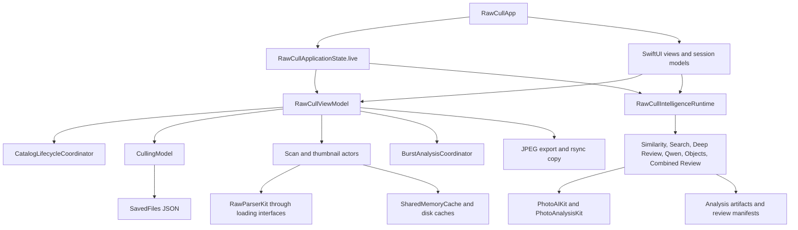
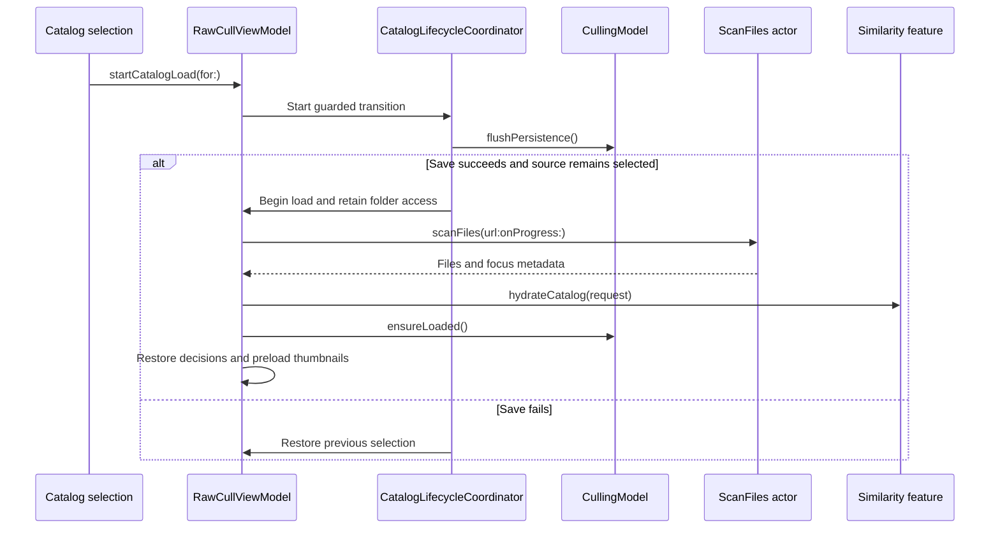

+++
author = "Thomas Evensen"
title = "API Documentation"
date = "2026-10-15"
lastmod = "2026-10-15"
weight = 20
tags = ["API"]
categories = ["technical details"]
mermaid = true
+++


# RawCull developer documentation

Last reviewed: 2026-10-17. Scope: the checked-in Swift/SwiftUI macOS application.

This single document combines the API reference, developer quick start, stakeholder onboarding, documentation-comment examples, architecture, troubleshooting, contribution guidance, and changelog template. Main workflow functions receive detailed coverage; minor implementation functions are identified as helpers rather than exhaustively catalogued. The filename `doumentation.md` is intentional to match the requested location.

RawCull has no HTTP server or REST endpoints in the application workflows documented here. “API” means the internal Swift application interface. Requests are arguments and configuration; responses are return values or observable state. Errors use Swift error types, result cases, optional values, and presentation state—not HTTP status codes. These interfaces are generally internal to the app target, not a versioned public SDK.

## Navigation and reading priorities

1. [Developer setup and quick start](#developer-setup-and-quick-start) — immediate development needs.
2. [Architecture and ownership](#architecture-and-ownership) — understand boundaries before making changes.
3. [Main function API reference](#main-function-api-reference) — implement and debug workflows.
4. [Errors and recovery](#errors-and-recovery) — interpret failures accurately.
5. [Stakeholder onboarding](#stakeholder-onboarding) — review photographs without development knowledge.
6. [Comments and docstrings](#comments-and-docstrings) — document contracts consistently.
7. [Troubleshooting](#troubleshooting) — resolve common development and operational issues.
8. [Contributing](#contributing) — preserve correctness and reviewability.
9. [Changelog template](#changelog-template) — record updates.
10. [Maintenance and automation](#maintenance-and-automation) — keep this guide useful over time.

## Developer setup and quick start

### Requirements

The repository README specifies Apple Silicon, macOS 27, Xcode 27, and Swift 6. The Xcode project sets macOS deployment to 27.0 and Swift language version to 6.0; app configurations use default MainActor isolation. Use the project settings as the authority if these requirements change.

Open `RawCull.xcodeproj` in Xcode, choose the RawCull scheme and a local Mac destination, and resolve packages using the checked-in lockfile. Configure an appropriate signing team if Xcode requires it for your local build.

From the repository root:

```bash
xcodebuild \
  -project RawCull.xcodeproj \
  -scheme RawCull \
  -destination 'platform=macOS,arch=arm64' \
  -onlyUsePackageVersionsFromResolvedFile
```

Launch from Xcode, open a folder containing supported RAW photographs, inspect a preview, rate a frame, and export a JPEG to a separate destination folder. Start with a small catalog so problems are easy to isolate. Optional AI features require compatible local models; they are not needed for the basic browsing workflow.

`make debug` builds and exports a Debug archive. For ordinary development, the direct scheme build above avoids the release pipeline. `make build` signs, notarizes, staples, and creates a DMG; it requires configured release credentials and the external `create-dmg` tool. It is not the quick-start command.

### Dependencies

| Component | Responsibility |
|---|---|
| SwiftUI and AppKit | App scenes, views, commands, macOS lifecycle and integration |
| Foundation, ImageIO, CoreGraphics, OSLog | Files, serialization, images and diagnostics |
| RawParserKit | RAW formats, metadata, embedded JPEGs, rendered previews and MakerNotes |
| PhotoAnalysisKit | Focus, sharpness, saliency and calibration |
| PhotoAIKit | Local AI capabilities, similarity, segmentation and model support |
| RawCullCore | Shared photo, burst, ranking and review domain models |
| RsyncArguments and RsyncProcessStreaming | Copy arguments and process execution |
| ParseRsyncOutput | Interpretation of rsync output |
| DecodeEncodeGeneric | Codable persistence support |

Read exact direct and transitive pins in [Package.resolved](../RawCull.xcodeproj/project.xcworkspace/xcshareddata/swiftpm/Package.resolved). Model bundles are separate assets with separate licences; consult [ModelAssets](../ModelAssets/README.md) and its notices. Avoid copying a static version list into additional documents.

### Tests and release checks

```bash
make test-smoke
make test-full
make test-performance
make verify-ai-import-boundary
make release-preflight
```

Choose checks appropriate to the change. Smoke covers selected critical paths; full runs the suite with Thread Sanitizer; performance covers deliberately expensive cases. Selection manifests and enumeration verification are part of the test contract. See [test architecture](../RawCullTests/TEST_ARCHITECTURE.md).

Installed-model probes are opt-in: `make releaseaiobjectstest`, `make releasesharpnesstest`, `make combinedinputstest`, and `make combinedselectiontest`. Read the current Makefile and [release-test guide](../RawCullReleaseTests/README.md) before running them: they can read local photographs and write reports. These checks are not substitutes for deterministic tests.

Maintenance: update requirements and commands when project settings, package resolution, schemes, or Make targets change.

## Architecture and ownership

### Application structure



`RawCullApp` constructs the live application assembly once and retains the view model and intelligence runtime in SwiftUI state. The runtime supplies stable feature instances to views. Preserve shared identity: creating independent similarity or inference services in a view can split indexing, search, model configuration, and cancellation state.

`RawCullViewModel` coordinates catalog selection, filtering, navigation and workflow side effects. Its extensions divide catalog, culling, thumbnail, sharpness, similarity, AI input and burst responsibilities. Session models own focused UI interactions such as loupe, zoom, comparison and burst workspace state. `CullingModel` owns saved decisions and persistence state.

Actors coordinate scanning, decoding, caches and export. MainActor models publish UI-facing state. `async` describes suspension; it does not by itself guarantee background execution. Retain explicit actor boundaries and the existing loading interfaces when moving expensive work.

### Catalog lifecycle



Catalog and sort generations reject stale asynchronous results. Changing catalogs cancels existing load, preload, extraction, hydration and burst work and invalidates the Combined Review lease. File access must remain valid while downstream tasks use source URLs.

### Persistence and cache boundaries

- Decisions and compatible sharpness metadata are represented by `SavedFiles` and `FileRecord`. The default culling store is `~/Library/Application Support/RawCull/savedfiles.json`.
- `CullingModel` debounces writes, tracks unsaved changes, and exposes persistence failures. Catalog transitions flush pending decisions; app termination offers retry, cancellation or explicit discard if flushing fails.
- Thumbnail identity includes source metadata and rendering identity. A path alone cannot safely identify a replacement image. Missing source fingerprint metadata disables thumbnail reuse.
- Per-file analysis artifacts and burst snapshots have compatibility requirements. Do not interpret an artifact from a different backend or model as current evidence.
- Combined Review retains run manifests, evidence and optionally exact model inputs. Clearing retained input images is different from deleting all reports.

Caches can be rebuilt; ratings and saved review records are user data. Recovery guidance must preserve that distinction.

Maintenance: revise diagrams when ownership, workflow ordering, persistence schemas, or package boundaries change.

## Main function API reference

### Calling conventions

Examples below run inside the app module. Names such as `viewModel`, `runtime`, `feature`, `file`, `groupFiles`, `source`, and `destinationURL` represent existing, correctly configured instances or selected values. They are context snippets, not standalone programs. Use MainActor context for UI-facing models and `await` for actor calls. Void-returning actions often communicate success or failure through observable state, so completion alone is not proof of success.

### 1. Catalog loading and sorting

Source: [RawCullViewModel+Catalog.swift](../RawCull/Model/ViewModels/RawCullViewModel+Catalog.swift), [ScanFiles.swift](../RawCull/Actors/ScanFiles.swift).

| Function | Request | Response and effects |
|---|---|---|
| `startCatalogLoad(for:)` | Optional `ARWSourceCatalog` | Returns `Void`; schedules a persistence-safe transition. A nil source clears the working set. Same active source with access is a no-op. |
| `handleSourceChange(url:) async` | Active catalog URL | Scans, sorts, hydrates compatible similarity state, restores ratings/scoring, and preloads previews. Guards against obsolete catalog results. |
| `cancelCatalogLoad()` | None | Cancels transition and active load-related tasks. Does not delete catalog files. |
| `ScanFiles.scanFiles(url:onProgress:) async -> [FileItem]` | Folder URL; optional MainActor progress callback | Scans immediate directory contents, skips hidden files and admits formats recognized by `RawFormatRegistry`; reads metadata with bounded concurrency. Focus metadata is available through `decodedFocusPoints`. |
| `ScanFiles.sortFiles(_:by:searchText:) async -> [FileItem]` | Files, `FileItemSortDescriptor`, filename query | Sorts by name, modification date or size and filters names case-insensitively. This is filename filtering, separate from semantic search. |
| `handleSortOrderChange() async` | Current sort and filter state | Updates `catalogDisplayCandidates` and `filteredFiles`; ignores superseded work. |
| `applyFilters(to:) -> [FileItem]` | Pre-sorted files | Applies rating/sharpness policies and semantic ranking or image similarity ordering. Semantic empty-index state yields no visible results. |

```swift
// App UI entry point; this schedules the lifecycle transition.
viewModel.startCatalogLoad(for: source)

// Lower-level scan for an isolated integration path.
let scanner = ScanFiles()
let files = await scanner.scanFiles(url: catalogURL) { count in
    print("Discovered \(count) RAW files")
}
let ordered = await ScanFiles.sortFiles(
    files,
    by: FileItemSortDescriptor(field: .name, direction: .ascending),
    searchText: "DSC"
)
```

The scanner is nonthrowing; directory errors produce an empty result, and its catch-path warning is currently commented out. Cancellation detected after collection also returns an empty array. An empty array does not distinguish an empty folder from an access/read problem. In the app, prefer the lifecycle entry point over directly invoking its worker.

Helper functions: `beginCatalogLoad`, `isActiveCatalogLoad`, `resetCatalogWorkingSet`, and selection reconciliation implement transition bookkeeping.

### 2. Culling decisions and persistence

Source: [RawCullViewModel+Culling.swift](../RawCull/Model/ViewModels/RawCullViewModel+Culling.swift), [CullingModel.swift](../RawCull/Model/ViewModels/CullingModel.swift).

| Function | Request | Response and effects |
|---|---|---|
| `updateRating(for:rating:)` | One `FileItem` or an array, integer rating | Updates saved decisions for the selected catalog and refreshes derived UI state. No selected catalog means no mutation. |
| `updateRatingAndAdvance(for:rating:in:)` | File, rating, explicit ordered list | Rates the file, marks an active comparison group reviewed, and selects the next item when present. |
| `rating(for:) -> Int?` | File | Returns explicit cached rating or nil. |
| `getRating(for:) -> Int` | File | Returns rating or zero; this collapses unrated and explicit zero for display. |
| `extractTaggedfilenames() -> [String]` | Current catalog and active scope | Returns stored names rated at least 2 within `activeCatalogFiles`. |
| `extractRatedfilenames(_:) -> [String]` | Minimum rating | Returns qualifying names from `filteredFiles`. |
| `ensureLoaded() async -> Bool` | None, on `CullingModel` | Loads the store if necessary; false indicates loading did not succeed. |
| `flushPersistence() async -> Bool` | None, on `CullingModel` | Immediately persists pending changes; true also covers an already clean store. |
| `retryCullingPersistence() async -> Bool` | None, on view model | Retries loading or saving and restores presentation after successful load recovery. |
| `archiveCullingStoreAndReset() async -> Bool` | None, on view model | Archives a damaged store before resetting; subsequent save can still fail. This is a recovery action, not normal loading. |
| `clearCurrentCatalogCullingState()` / `clearAllCullingState()` | Current catalog / all stored catalogs | Clears saved culling state at the indicated scope; expose through the app's explicit user action. |

Rating conventions: `-1` means rejected; `.keepers` filters explicit `0`; star filters use `2...5`. A nil stored rating is distinct from explicit zero, even though `getRating` displays both as zero. Do not invent a one-star convention.

```swift
viewModel.updateRating(for: file, rating: 3)
let persisted = await viewModel.cullingModel.flushPersistence()
if !persisted {
    print(viewModel.cullingModel.persistenceError ?? "Save failed")
}
```

Response example: rating a file at 3 updates in-memory decisions immediately, while persistence may still be pending. Check `hasUnsavedChanges`, `persistenceError`, and load-failure state when reporting durability.

Helper functions: `rebuildRatingCache`, `refreshCullingDerivedState`, and `scheduleSave` maintain projections and write scheduling.

### 3. Preview loading, zoom and JPEG export

Source: [RequestThumbnail.swift](../RawCull/Actors/RequestThumbnail.swift), [RawCullViewModel+Thumbnails.swift](../RawCull/Model/ViewModels/RawCullViewModel+Thumbnails.swift), [ExtractAndSaveJPGs.swift](../RawCull/Actors/ExtractAndSaveJPGs.swift).

| Function | Request | Response and effects |
|---|---|---|
| `RequestThumbnail.requestThumbnail(for:targetSize:purpose:) async -> CGImage?` | Source URL, pixel size, `ThumbnailCacheKey.Purpose` | Resolves cached/generated thumbnail; coalesces matching requests. Nil means no image was produced. |
| `selectFile(_:)` | File | Changes the focused file through the view model. |
| `closeZoomOverlay()` / `resetZoom()` | None | Closes the overlay / resets zoom state. Session models hold detailed interaction state. |
| `presentExtractJPGsSheet()` | Current selection | Prepares the export sheet. |
| `startSelectedJPGExtraction(destination:exportMode:)` | Destination `ARWSourceCatalog`, `ExtractJPGExportMode` | Starts selected-file export and publishes completion/failure presentation. |
| `ExtractAndSaveJPGs.extractAndSavejpgs() async -> JPGExportResult` | Files, destination and mode supplied at initialization | Returns successful count plus per-file failures. Empty input returns zero successes and no failures. |
| `cancelExtractJPGSTask()` | None, on exporter | Requests cancellation. Result counts can describe partial work. |
| `ScanAndExtractJPGs.extractCatalogJPGs() async -> Int` | Source URLs configured on the actor | Warms the full-size preview cache. The count is processed files, including cache hits and unsuccessful decode attempts—not successful exported files. |
| `abort()` | Current view-model tasks | Stops workflow work managed by the view model; inspect its implementation when adding a new task type. |

```swift
let exporter = ExtractAndSaveJPGs(
    files: selectedFiles,
    destinationCatalogURL: destinationURL,
    exportMode: .embeddedJPG
)
let result = await exporter.extractAndSavejpgs()
print("Saved: \(result.succeeded)")
for failure in result.failures {
    print("\(failure.fileName): \(failure.message)")
}
```

`.embeddedJPG` exports embedded preview data. `.demosaicedRAW` renders a full-size JPEG through `SonyRawFormat`. Output names are `name.jpg` and `name_demosaic.jpg`; collisions produce numbered suffixes such as `name (1).jpg`. Existing files are protected by exclusive creation. Cancellation is cooperative and does not remove already written output; `JPGExportResult` has no separate cancellation flag.

Helper functions: `SaveJPGImage.outputURL`, JPEG encoding, timing estimates, progress callbacks, and per-file extraction routines support the public workflow. `SaveJPGImage.save` performs the actual throwing write.

### 4. Sharpness and focus analysis

Source: [RawCullViewModel+Sharpness.swift](../RawCull/Model/ViewModels/RawCullViewModel+Sharpness.swift), [SharpnessScoringModel.swift](../RawCull/Model/ViewModels/FocusandSharpness/SharpnessScoringModel.swift).

`calibrateAndScoreCurrentCatalog() async` calibrates and scores `sharpnessScoringTargetFiles`, re-sorts, and persists compatible scoring metadata after a non-cancelled run. Despite its name, the target may be a selection or filtered scope:

1. Explicit selected IDs take precedence.
2. A star filter narrows scoring to that rating.
3. Otherwise, scoring uses the active catalog scope, including semantic-search selection when active.

`handleSharpnessSortingChange(isEnabled:) async` applies current sorting and selects the first visible file when sharpness sorting is enabled. Read `sharpnessModel.scores`, `afPointScores` and `saliencyInfo` for results; these are measurements, not guaranteed judgments of photographic quality.

```swift
await viewModel.calibrateAndScoreCurrentCatalog()
let score: Float? = viewModel.sharpnessModel.scores[file.id]
```

`getFocusPoints() -> [FocusPoint]?` supplies selected-image focus information when available. Missing camera metadata is a supported absence; overlays must not invent focus points.

Helper functions: calibration adapters, persisted-score hydration, mask rendering and numeric scoring routines support these workflows. Preserve scoring signatures when reusing saved measurements.

### 5. Similarity indexing and semantic search

Source: [RawCullSimilarityFeature.swift](../RawCull/Intelligence/Similarity/RawCullSimilarityFeature.swift), [RawCullSemanticSearchFeature.swift](../RawCull/Intelligence/SemanticSearch/RawCullSemanticSearchFeature.swift).

| Function | Request | Response and effects |
|---|---|---|
| `hydrateCatalog(_:) async -> Bool` | `RawCullSimilarityCatalogHydrationRequest` | Loads compatible cached artifacts for a catalog identity; false covers rejected or obsolete hydration. |
| `indexCurrentCatalog(forceRefresh:) async` | Optional refresh flag, default false | Builds similarity artifacts for the current application scope. Read feature indexing progress and capability. |
| `hasCompleteIndex(for:) -> Bool` | Files | Reports coverage; does not perform indexing. |
| `search(for:) async` | Natural-language query | Ranks admitted files with compatible cached CLIP artifacts and applies result selection to the application. Blank text clears search. |
| `resultEvidence(for:)` | File ID | Optional rank and score for CLIP results. Rank is one-based; score is not a calibrated probability. |
| `setShowsAllResults(_:) async` / `adjustSelection(by:) async` | Result scope flag / count delta | Changes active semantic selection and invalidates scoped burst analysis. |
| `clear() async` / `cancel() async` | None, on semantic feature | Clears or cancels search and restores ordinary catalog presentation. |

```swift
await runtime.similarityFeature.indexCurrentCatalog()
await runtime.semanticSearchFeature.search(for: "an owl in flight")
let ids = runtime.semanticSearchFeature.orderedResultIDs
let summary = runtime.semanticSearchFeature.resultSummary
```

Search does not decode or index missing images as a side effect. It requires compatible CLIP artifacts; a Vision similarity backend alone does not supply text search. Read `presentation`, `state`, `progress`, and `hasEmptyIndex` to explain availability. A held Combined Review lease prevents starting a semantic search.

Semantic results create a durable active catalog scope used by other workflows until cleared or reindexed. Filename and rating admission still apply before semantic ranking. This matters when an export or analysis operates on fewer files than the whole folder.

Helper functions: generation checks, application binding, identity probes, backend projections, and selection reconciliation coordinate shared state.

### 6. Burst grouping and decisions

Source: [RawCullViewModel+BurstGrouping.swift](../RawCull/Model/ViewModels/RawCullViewModel+BurstGrouping.swift), [BurstAnalysisCoordinator.swift](../RawCull/Intelligence/BurstAnalysis/BurstAnalysisCoordinator.swift).

| Function | Request | Response and effects |
|---|---|---|
| `reindexBurstAnalysis() async` | Current catalog scope | Rebuilds burst analysis through the coordinator. |
| `reGroupBursts() async` | Current state and grouping configuration | Recomputes grouping using the application's current analysis context. |
| `restoreExistingFullCatalogBurstAnalysis() async -> Bool` | Current catalog | Attempts to restore full-catalog analysis; inspect returned success. |
| `keepBestInGroup(from:)` | Group files | When admitted, rates the winner 3 and others -1, captures undo and marks a decision applied. Winner preference is manual override, recommendation, sharpest file, then first file. |
| `keepTopTwoInGroup(from:)` | Group files | When admitted, rates first 3, second 2 and remaining frames -1, with undo capture. |
| `compareBurstGroup(_:)` | Group files | Opens group comparison. |
| `undoLastBurstAction()` | None | Restores the most recently captured burst action. |
| `markBurstGroupReviewed(groupID:)` / `deferBurstGroup(groupID:)` | Group ID | Updates review-queue state. |
| `advanceToNextBurstGroup(after:) -> Bool` | Current group ID | Attempts navigation; false means no next activation was made. |

```swift
viewModel.compareBurstGroup(groupFiles)
// Invoke after the user chooses to apply the group decision.
viewModel.keepBestInGroup(from: groupFiles)
```

These actions update culling decisions; rejection is a rating, not deletion of source RAW files. Empty or ineligible groups can be no-ops. Inspect ranking confidence and cautions before presenting automatic recommendations as certain.

Helper functions: group signatures, cache snapshots, ranking assembly, undo capture and review-state serialization maintain compatibility and presentation.

### 7. AI analysis input and feature actions

Source: [RawCullViewModel+AIAnalysis.swift](../RawCull/Model/ViewModels/RawCullViewModel+AIAnalysis.swift) and feature files under `RawCull/Intelligence`.

`aiAnalysisFiles(for:) -> [FileItem]` resolves `.gridSelection` or `.taggedImages`. Grid selection uses `selectedFileIDs`, falling back to the focused ID, and admits only visible filtered files. Tagged input uses persisted ratings of at least 2 within the active scope. `preserveAIAnalysisGridSelection()` freezes the fallback batch before browsing tagged images changes focus.

| Feature and function | Input | Result and lifecycle |
|---|---|---|
| `DeepAIReviewController.start(for:) async` | Burst/group files | Uses bound application context and SAM 3 capability to evaluate subject detail. Inspect controller state for unavailable, preparing, running, cancelled, failed or completed result. |
| `applyDeepAIReviewRecommendation(_:to:)` | Result and matching group files | Checks group signature, stores winner override, rates winner 3 and marks reviewed. Does not reject other frames. |
| `RawCullQwenAnalysisFeature.analyze(_:) async` | Files and nonblank `prompt` property | Processes files not already represented in results, uses local vision-language inference, validates structured output and retries a rejected response once with feedback. Publishes `results`, `progress`, `failureMessage`, `isRunning`. |
| `RawCullObjectAnalysisFeature.analyze(_:) async` | Files and feature configuration | Uses Qwen concept discovery, SAM 3 instance segmentation and a numbered review board for assessment. Publishes per-photo results and stage/progress state. |
| `RawCullObjectAnalysisFeature.retryFailed(_:) async` | Files | Retries failed object-analysis entries. |
| `cancel()` / `cancelAndWait() async` | None, on Deep Review, Qwen or Objects controller/feature | Requests cancellation / waits for cancellation handling to drain. Use the waiting form when ordering shutdown or replacement matters. |

```swift
let files = viewModel.aiAnalysisFiles(for: .gridSelection)
runtime.qwenAnalysisFeature.prompt =
    "Evaluate composition, exposure, subject visibility, and obstructions."
await runtime.qwenAnalysisFeature.analyze(files)
let assessments = runtime.qwenAnalysisFeature.results
```

Qwen requires an available vision model and nonempty pending files. Objects requires both Qwen and SAM 3. AI analysis can be unavailable or return rejected/partial evidence; model output is advisory. Objects analysis finds instances matching requested concepts, not a guaranteed exhaustive object inventory. Feature actions respect the Combined Review resource lease where implemented.

Helper functions: response decoders, validation feedback, mask outlines, object deduplication, prompt assembly and diagnostic capture support the main analysis APIs.

### 8. Combined Review

Source: [CombinedReviewFeature.swift](../RawCull/Intelligence/CombinedReview/CombinedReviewFeature.swift), [ReviewRunContract.swift](../RawCull/Intelligence/CombinedReview/ReviewRunContract.swift), and execution/backend files in the same directory.

| Function | Request | Response and effects |
|---|---|---|
| `prepareParameters(_:) async` | `[ReviewSelectedFile]` | Prepares admission and model/source information for the selected input. |
| `canStartReview(for:) -> Bool` | Selected files | Evaluates current admission; it does not run review. |
| `analyze(_:) async` | Selected files plus `criteria`, `depth`, source preference and retention properties | Acquires the shared lease, freezes source metadata, validates models and snapshot, persists manifest, executes stages and publishes results. |
| `restoreStoredRun() async` | None | Restores latest manifest and saved history when idle. |
| `resume() async` | Existing manifest | Revalidates sources, models, pipeline and artifacts before resuming compatible pending work. |
| `cancel()` | None | Cancels worker and marks the manifest; completion handling retains finished evidence. |
| `exactInput(_:) async -> CGImage?` | Retained input key | Decodes retained image when available; nil does not imply the report is missing. |
| `currentManifest() throws -> CombinedReviewRunV1` | Current state | Returns the validated current manifest or throws. |
| `clearAllReviews() async throws` | None | Deletes stored reviews through the feature's cleanup path. |
| `clearRejectedResponses() async` / `clearRetainedInputs() async` | None | Removes optional rejected-text diagnostics / retained source inputs. |

```swift
// selectedReviewFiles is the UI-prepared [ReviewSelectedFile].
feature.criteria = "Compare subject detail and explain coverage limits."
await feature.prepareParameters(selectedReviewFiles)
if feature.canStartReview(for: selectedReviewFiles) {
    await feature.analyze(selectedReviewFiles)
}
let manifest = feature.manifest
let failure = feature.failureMessage
```

Depth uses `standard`, `deep` or `exhaustive` budgets. The run records criteria, source fingerprints, model identities, stage versions, pipeline/render versions and retention policy. Source, overview, segmentation, identity, measurement, CLIP, crop observation, reconciliation, report and comparison are explicit stage categories; work dependencies and budgets constrain execution.

Success is observable evidence and run state, not simply the absence of a thrown error: `analyze` catches failures into `failureMessage` and progress. Failed synthesis can leave observations without a synthesized conclusion. Resume rejects changed sources or incompatible models/contracts rather than silently merging different evidence. Exact-input retention consumes storage and is optional.

Helper functions: manifest construction, work IDs, evidence grounding, geometry, mask registration, source decoding and budget admission implement the review contract.

### 9. Model installation and settings

Source: [RawCullAIModelDownloadsModel.swift](../RawCull/Intelligence/ModelManagement/RawCullAIModelDownloadsModel.swift), [RawCullAIModelDownloadService.swift](../RawCull/Intelligence/ModelManagement/RawCullAIModelDownloadService.swift), [SettingsViewModel.swift](../RawCull/Model/ViewModels/SettingsViewModel.swift).

| Function | Input | Response and effects |
|---|---|---|
| `refresh() async` | None, on downloads model | Refreshes installation states and applies managed locations to the configured consumer. |
| `acceptModelLicence(for:) async` | `RawCullAIModelDownloadID` | Records acceptance through coordinator; errors become failed download state. |
| `startModelDownload(_:)` | Model ID | Starts only when the current state admits download and no conflicting task/removal exists. Returns before download completes. |
| `cancelModelDownload(_:)` | Model ID | Requests download cancellation. |
| `removeManagedModel(_:) async` | Model ID | Removes an idle managed model and refreshes capability state. |
| `SettingsViewModel.ensureLoaded() async` | None | Ensures settings loading has been attempted. |
| `saveSettings() async -> Bool` | Current settings values | Saves settings; inspect false and persistence-failure state. |
| `retryPersistence(_:) async` | Optional failed settings operation | Retries settings persistence. |
| `asyncgetsettings() async -> SavedSettings` | None | Returns settings snapshot across the model's isolation boundary. |

```swift
let settings = await SettingsViewModel.shared.asyncgetsettings()
print(settings.thumbnailSizePreview)
let didSave = await SettingsViewModel.shared.saveSettings()
```

Download state is explicit: checking, unavailable, licenceRequired, notConfigured, ready, downloading, validating, installed, removing or failed. Downloading bytes is not the same as a validated installed model. App Store and self-hosted distribution can use different delivery mechanisms; use configured services rather than hardcoded download URLs.

Helper functions: catalogue descriptors, capability validation, licence provenance, presentation mapping and configuration revisions support model management.

### 10. RAW copy and process completion

Source: [ExecuteCopyFiles.swift](../RawCull/Model/ParametersRsync/ExecuteCopyFiles.swift).

`ExecuteCopyFiles.startCopyFiles() -> Result<Void, CopyStartupFailure>` resolves configuration and selected files, obtains source/destination access, writes an operation-specific include list and launches streaming rsync. Its instance carries `config`, `dryrun`, `rating`, `copyTaggedFiles` and the bound view model. A successful return means the process started; it does not mean copying completed.

```swift
// copyOperation is an ExecuteCopyFiles configured by the copy UI.
switch copyOperation.startCopyFiles() {
case .success:
    print("Copy process started; await completion presentation")
case .failure(let error):
    print(error.localizedDescription)
}
```

Completion is represented by `CopyDataResult`, containing output, view output, `CopyOutcome`, and the frozen `CopyOperation` settings. Outcomes are `.success`, `.failed(message:)` and `.cancelled`. `CopyOperation.dryRun` distinguishes a preview from an actual copy; a successful dry run must not be reported as files copied. `close()` stops/closes the operation through its cleanup path.

Helper functions: streaming handler setup, unique include-list generation, output parsing, bookmark resolution and cleanup support startup and completion. Preserve unique include lists so overlapping operations cannot overwrite each other's selection.

## Errors and recovery

These are source-level identifiers, not numeric API status codes. Preserve the associated message or underlying error in diagnostics. Do not promise a stable external error-code protocol.

| Error surface | Cases or representation | Handling |
|---|---|---|
| `CopyStartupFailure` | `rsyncArgumentsUnavailable`, `missingViewModel`, `noMatchingFiles` | Check copy configuration, application binding and selected/rated scope. |
| `CopyStartupFailure` | `applicationSupportDirectoryUnavailable`, `includeFileWriteFailed(String)` | Restore writable support-folder access and free space; retry startup. |
| `CopyStartupFailure` | `sourceAccessFailed`, `destinationAccessFailed` | Reopen source or reselect destination to restore access. |
| `CopyStartupFailure` | `processLaunchFailed(String)` | Inspect executable/configuration and supplied diagnostic. |
| `CopyOutcome` | `failed(message:)`, `cancelled` | Report the final process outcome; distinguish cancellation and partial output from success. |
| `JPGExportResult` | `succeeded`, `[JPGExportFailure(fileName, message)]` | Report each failed file and retain successful output. |
| `QwenModelError` | `modelUnavailable`, `visionModelRequired`, `imageUnavailable` | Validate model capability or source image availability. |
| `QwenModelError` | `emptyResponse`, `invalidStructuredResponse`, `invalidTokenLimit` | Inspect bounded diagnostics/configuration; do not treat malformed text as an accepted assessment. |
| `ReviewRunError` | `invalidSnapshot`, `sourceUnavailable`, `modelUnavailable` | Check frozen input and installed capabilities; prepare a valid new run if needed. |
| `ReviewRunError` | `invalidDependency`, `invalidTransition`, `budgetExhausted` | Inspect manifest ordering and limits; do not bypass execution admission. |
| `ReviewRunError` | `incompatible`, `corrupt`, `unsupportedVersion(Int)` | Preserve evidence and diagnose compatibility; rerun under current settings where appropriate. |
| `ReviewRunError` | `storageLimit`, `invalidEvidence` | Review retention/storage or evidence validation; do not synthesize unsupported conclusions. |
| Model download service | `serviceNotConfigured`, `backgroundAssetsUnavailable(String)`, `releaseBlocked(String)`, `assetPackNotFound(String)`, `downloadedModelNotFound(String)` | Check distribution configuration, asset availability and validation. |
| Model download service | `licenceAcceptanceRequired(String)`, `missingVerifiedLicenceText(String)` | Complete the actual licence/provenance flow; do not bypass it. |
| Culling JSON read | `.missing(URL)`, `.loaded([SavedFiles])`, `.failed(SavedFilesReadFailure)` | Missing store is different from damaged/unreadable data. Failed data must not be silently replaced. |
| Settings / culling writes | Bool return plus persistence state | Retry after fixing storage/access; retain unsaved in-memory decisions. |
| Swift cancellation | `CancellationError` or task cancellation state | Preserve completed work where supported and stop presenting the operation as running. |

Optional image returns and empty nonthrowing scan results do not carry a detailed error code. Use logs, capability state and the surrounding workflow to distinguish causes.

Maintenance: add new cases when error enums change; keep wording aligned with recovery behavior and tests.

## Stakeholder onboarding

RawCull helps you choose photographs to keep. A catalog is a folder of photographs. A preview is a JPEG representation used for fast viewing. A burst group contains related frames that may be useful to compare.

1. **Open a folder.** Choose a small RAW catalog first and allow scanning to finish. RawCull is focused on Sony ARW workflows; support for a camera's metadata and previews depends on its format.
2. **Review photographs.** Browse thumbnails, enlarge a frame, and compare detail. Focus points and sharpness overlays are evidence to inspect, not a replacement for your judgment.
3. **Record decisions.** Use the rating/tag/reject controls. A rejection records a culling decision; it does not delete the original photograph.
4. **Compare related frames.** Open burst comparison and inspect recommended candidates. Applying Keep Best or Keep Top Two changes the group's ratings; undo is available for the last captured burst action.
5. **Try optional local AI.** Install the required models through AI settings and complete their licence prompts. CLIP supports search, SAM 3 supports subject masks, and Qwen provides photo assessments. These features run locally; downloading model assets requires connectivity.
6. **Check the input scope.** AI Analysis and Combined Review can use selected or tagged photos. Semantic search also narrows the active working set; clear it when you want the ordinary catalog again.
7. **Export keepers.** Export JPEGs or copy RAWs to a chosen folder. Use copy dry run to inspect the planned operation. Check final completion and any per-file errors, then verify destination files.
8. **Close safely.** If saving fails during quit, retry after restoring access or cancel quitting to keep changes in memory. Quit Without Saving explicitly discards unsaved decisions.

Example: for a sequence of owl photographs, open the folder, inspect the eye detail in comparison, rate the strongest frame, and export its embedded JPEG for a quick share. A developed RAW export can differ from the camera's embedded preview.

For Combined Review, start with Photo-first to see the retained overview and findings. Use Inspect evidence for crops and observations. Coverage limits explain what the analysis could establish; missing retained imagery does not erase stored measurements or reports.

Maintenance: revisit onboarding when visible labels, input scope rules, export modes or recovery dialogs change. Avoid documenting shortcuts without checking the current command and keyboard-routing code.

## Comments and docstrings

All proposed comments stay in this document; this documentation task does not change Swift source files. When applying comments in a later code change, place them on the actual declaration and keep them focused on its contract.

```swift
/// Starts a guarded transition to the requested RAW catalog.
///
/// Flushes pending culling decisions before replacing the current catalog.
/// The operation publishes progress through the view model rather than returning files.
/// - Parameter source: Catalog to open, or nil to clear the current working set.
func startCatalogLoad(for source: ARWSourceCatalog?)

/// Rates compatible cached CLIP artifacts for the current admitted files by query relevance.
///
/// Applies the selected results as the application's active catalog scope.
/// This operation does not create missing image embeddings.
/// - Parameter query: Natural-language description; blank text clears search.
func search(for query: String) async

/// Exports the files configured at initialization into the selected destination.
///
/// Completed output remains on disk if cancellation stops the batch.
/// - Returns: Successful export count and per-file failures collected during the run.
func extractAndSavejpgs() async -> JPGExportResult

/// Flushes pending culling decisions before leaving the current workflow.
/// - Returns: True if persistence succeeded or no changes required writing;
///   false if loading or saving failed. Inspect persistence state for details.
func flushPersistence() async -> Bool

/// Prepares and launches the configured rsync operation.
/// - Returns: Startup success or a typed preparation/launch failure.
///   Startup success does not indicate that the copy has completed.
func startCopyFiles() -> Result<Void, CopyStartupFailure>
```

These are declaration/comment examples, not a compilable extension. For throwing APIs, include `- Throws:` and describe when the error occurs. For stateful APIs, document the observed state and cancellation behavior. Explain important invariants inline, for example:

```swift
// Reject an obsolete catalog result so a completed scan cannot replace a newer selection.
// Helper function: resolves a display title from an already determined copy outcome.
```

Do not document every trivial formatter or view builder separately. Mark a helper's purpose where it is not obvious. Avoid comments that only repeat a function name or claim guaranteed success for asynchronous work.

Maintenance: change comments in the same review as their function contract. DocC generation becomes useful once these comments are applied to source; Markdown snippets alone do not populate symbol documentation.

## Troubleshooting

| Symptom | Likely checks | Recovery |
|---|---|---|
| Project will not build | Selected Xcode/SDK, macOS target, pinned package resolution and signing | Use Xcode 27 and supported Mac; inspect the first actionable build error. Resolve the checked-in package graph before changing versions. |
| Folder appears empty | Immediate directory contents, supported RAW extensions, hidden files and access | Open the folder containing the files directly; reopen permission through the picker and inspect scan logs. Scan is nonrecursive. |
| Old catalog appears after switching | Persistence flush failure or stale task handling | Resolve save failure first. In development, inspect lifecycle generation guards and current source identity. |
| Thumbnail or preview is missing | Source access, changed file metadata, decoder result, cache identity | Reopen source; retry decoding with an isolated fixture. Do not disable source-fingerprint checks to force reuse. |
| Focus points are absent | Camera metadata availability and parser support | Confirm metadata for that camera/file; allow browsing without the overlay. |
| Ratings appear lost or do not persist | Load failure, unsaved state, storage permissions and available space | Retry persistence. Preserve a damaged store before the explicit archive/reset recovery action. Do not delete `savedfiles.json` as a first step. |
| Quit is blocked | Pending decisions failed to save | Retry after restoring access/freeing space or cancel quitting. Use discard only when losing pending changes is acceptable. |
| Sharpness used fewer files than expected | Selection, star filter and semantic scope | Inspect `sharpnessScoringTargetFiles` and its displayed target description; clear scope if appropriate. |
| Semantic search finds nothing | CLIP availability, compatible indexed count, rating/name admission | Index with a compatible CLIP backend, then search again. A search does not automatically decode missing source images. |
| AI action is disabled | Model validation, missing licence, empty input/prompt, another operation | Inspect capability and progress state; complete model installation or finish/cancel the conflicting review. |
| Objects results miss a subject | Concepts, mask availability and board assessment | Refine concepts and inspect masks. Treat the result as concept matching rather than an exhaustive count. |
| Combined Review cannot resume | Source changed, model identity changed, contract/version mismatch | Preserve saved evidence; start a new run with current inputs and settings when compatibility cannot be restored. |
| Combined Review shows observations only | Synthesis failed or evidence was insufficient | Read retained observations and coverage limits; do not relabel them as a completed recommendation. |
| JPEG export partially fails | Per-file decode/write messages and destination access | Retain successful output, fix the named cause and retry affected files. |
| RAW copy does not start | Typed `CopyStartupFailure` | Check active scope, rsync configuration, source/destination access and writable include-list storage. |
| Dry run completes but destination is empty | `CopyOperation.dryRun` | Run an actual copy after reviewing the preview. A dry run is not an export. |
| Test manifest verification fails | Changed suite names/selectors or counts | Update the source, response file and expected enumeration inventory together when the change is intentional. |
| Tests depend on local user files | Production singletons or hardcoded paths in fixtures | Use isolated cache/settings/model factories; move real-photo probes to the opt-in release path. |

For a reproducible issue, record the app/build version, macOS/Xcode version, workflow, source format, active filters, selected model/backend and exact error. Prefer synthetic or permission-cleared sample files when sharing a reproduction. Logs and retained diagnostics may include filenames or source paths.

Maintenance: add an entry when a recurring issue gains a verified recovery path, and remove obsolete workarounds after fixes.

## Contributing

The following is a recommended team workflow grounded in the current boundaries and test architecture; it does not imply a repository-enforced PR policy.

1. Describe the user-visible problem and identify the owning model, actor or feature before changing code.
2. Keep views focused on presentation and user intent. Reuse the runtime's shared feature instances and the existing injectable service boundaries.
3. Preserve MainActor ownership, bounded decoding concurrency, security-scoped access lifetimes and cancellation checks. Never apply stale catalog/model results to current state.
4. Treat persistence and compatibility as part of the change. Keep nil ratings distinct from zero, preserve damaged data for recovery, and update signatures/schema versions when reuse rules change.
5. Add meaningful behavior tests for changed logic using Swift Testing and isolated temporary stores. Existing helpers in `TestIsolationHelpers.swift` provide cache, settings, thumbnail and view-model isolation.
6. Update manifest selectors and expected enumeration inventory when adding/renaming selected suites. Keep deliberately shared-state stress tests explicit.
7. Run relevant checks, then the appropriate broader test target. For AI-boundary changes, run `make verify-ai-import-boundary`; use installed-model checks when actual inference compatibility needs verification.
8. Update this document, relevant source comments and release notes in the same change. Explain observable behavior, validation and remaining limits in the review description.

Example review description:

```text
Problem: semantic results from an earlier catalog could overwrite a newer selection.
Change: reject completion when the catalog generation no longer matches.
Validation: isolated catalog-switch regression test and smoke suite.
Documentation: updated catalog lifecycle and cancellation notes.
```

Keep credentials, signing keys, private photo fixtures and downloaded model bundles out of source control. Model redistribution must follow the repository's licence/provenance records. Use the current release scripts and preflight checks for distribution rather than recreating their steps from memory.

Maintenance: revisit this guidance when test infrastructure, release processes or code ownership change.

## Changelog template

Use this template for future entries. It is not a claim that any listed change has shipped. Order released entries newest first; move completed items from Unreleased into the actual release version and date.

```markdown
# Changelog

## [Unreleased]

### Added
- User-facing feature and the workflow it enables.

### Changed
- Observable behavior change and affected input/scope.

### Fixed
- Trigger, previous behavior and corrected result.

### Compatibility and data
- Minimum macOS/Xcode changes, model/backend compatibility,
  persistence migration or cache invalidation requirements.

### Developer documentation
- API contracts, diagrams, onboarding or troubleshooting updates.

### Validation
- Relevant automated checks and opt-in model probes completed.
- Known limitations or checks not performed.

## [X.Y.Z] - YYYY-MM-DD

### Added
- ...

### Changed
- ...

### Fixed
- ...

### Compatibility and data
- ...
```

Example prospective entry: “Fixed: changing catalogs during indexing no longer applies results from the previous catalog.” Replace examples with verified changes before publishing. Do not infer release history from the current source tree.

Maintenance: review Unreleased during every release and verify the version against Xcode project metadata.

## Maintenance and automation

The API reference and recovery rules are the immediate priority. Setup, architecture and isolated tests support sustained development. Onboarding and changelog entries should evolve with visible features and releases.

| Documentation area | Review trigger | Suggested automation |
|---|---|---|
| API functions and errors | Signature, state or enum change | CI symbol/enum inventory diff that flags documentation review; a human confirms semantics. |
| Setup and dependencies | SDK, scheme, target or package update | Compare documented requirements with project settings; link the lockfile instead of duplicating pins. |
| Architecture diagrams | Ownership, service wiring or lifecycle change | Render Mermaid in documentation CI and check referenced source paths. |
| Source docstrings | Main entry-point change | Adopt DocC for documented symbols and publish generated output after validating target support. |
| Onboarding | UI label, selection or export behavior change | Add a release-review checklist with a short real workflow walkthrough. |
| Troubleshooting | Repeated incident or recovery change | Link issue reports to regression tests and update the verified recovery entry. |
| Contribution/testing guide | Test selector or isolation rules change | Reuse existing manifest enumeration checks and AI import-boundary verification. |
| Changelog | Release preparation | Generate a draft from reviewed changes, then edit for behavior and compatibility rather than raw commit titles. |

Suggested documentation checks, not currently claimed as installed: Markdown lint, local-link validation, Mermaid rendering, fenced Swift snippet validation in a suitable app test harness, and documentation-review prompts when core files change. Keep context snippets separate from standalone compilable examples.

A maintainer should review this document whenever a main workflow changes and during release preparation. Record the review date only after checking implementation and commands. Generated documentation can detect drift, but it cannot establish cancellation semantics, privacy claims, failure recovery or the meaning of a photographic recommendation without implementation review.
