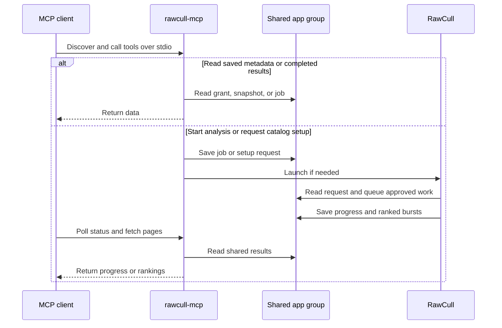

+++
author = "Thomas Evensen"
title = "Model Context Protocol (MCP)"
linkTitle = "MCP"
description = "How RawCull’s local MCP helper works, with copyable prompts for catalog access, approval, and burst analysis."
date = "2026-11-13"
lastmod = "2026-11-13"
weight = 46
tags = ["mcp", "burst analysis", "testflight", "sandbox"]
categories = ["technical details"]
mermaid = true
+++

RawCull exposes catalog metadata and burst rankings to a local Model Context Protocol (MCP) client. With the helper configured, you can ask how many photos are in an authorized catalog, start burst analysis, or ask RawCull to open and approve a new catalog. RawCull performs the analysis with its existing scoring, grouping, and ranking pipeline.

The prompts below cover the ten tools in helper **0.6.0**. The signed **0.5.0** TestFlight build passed an analysis smoke test. The **0.6.0** tools passed local build and protocol checks. The folder selection, approval, and exact-match paths still need end-to-end verification on a signed TestFlight installation.

## Connect the installed helper

Use the executable bundled with the installed RawCull copy you want to test. For Codex CLI, register it under the name used in the examples. Adjust the path if your app is installed elsewhere.

```sh
helper=/Applications/RawCull.app/Contents/MacOS/rawcull-mcp
codesign --verify --strict --verbose=2 "$helper"
codex mcp add rawcull-testflight -- "$helper"
```

Start a fresh client session and run the connection prompt below. If you have multiple RawCull helpers registered, name the server in your prompts. When testing which app copy launches, quit other RawCull copies first.

For the saved-metadata and direct-analysis prompts, select a catalog in RawCull, wait for it to load, then choose **Settings → MCP → Authorize Selected Catalog**. Enable **Allow MCP to start burst analysis** before authorizing if you also want to run analysis directly. For the new-folder setup prompt, you can start with RawCull closed and no existing grant.

## How the integration is built

- **The client** launches the bundled `rawcull-mcp` executable and discovers tools and input schemas over standard input and output. It turns a natural-language prompt into one or more structured calls. The helper receives the tool name and arguments.
- **The helper** is a separate Swift executable using the MCP Swift SDK. Xcode signs and embeds it in `RawCull.app/Contents/MacOS`. The helper handles argument validation, authorization checks, job submission, and paginated replies. Successful data replies include structured JSON and a JSON text fallback. Diagnostic output goes to standard error.
- **The shared app group** holds the catalog grant and saved scan, the analysis job, and setup request receipts. The shared analysis-job lock serializes updates across the app and helper. JSON records are written atomically. RawCull keeps the source folder’s security-scoped bookmark in its own preferences for a remembered grant.
- **The RawCull app** owns folder access and any approval UI. Its MCP controller claims queued jobs, checks the catalog, loads it if needed, and runs the existing full-catalog burst pipeline. It writes progress and results back to the shared job record.



Saved metadata, progress, and completed results can be read with RawCull closed. New burst analysis needs the app running. A direct analysis call can launch RawCull in the background. Prompt-driven setup brings it forward so you can respond if needed.

The helper runs on your Mac. If your client uses a cloud model, that model may receive the metadata and rankings returned by the tools. Filenames and camera strings are untrusted metadata. The current tools return text and ranking evidence. You apply keeper choices and ratings in RawCull.

## Copyable test prompts

Use a small catalog with known bursts for the first successful run. Replace example names with the exact catalog name or path on your Mac. Each quoted block is a prompt you can paste into chat.

### Check the connection

> Use only the `rawcull-testflight` MCP server. Call `rawcull_status` and report the helper version, transport, and available tools.

Expect version `0.6.0`, transport `stdio`, and ten tools on the Phase 3 build.

### List authorized catalogs and summarize the saved scan

> Use `rawcull-testflight` to call `list_catalogs`. Show the catalog name, ID, and whether burst analysis is enabled. If a catalog is available, pass its ID to `catalog_summary` and report the saved photo count, capture date range, and camera breakdown.

The helper exposes at most one saved catalog grant. The summary describes the snapshot taken at authorization. Reauthorize after the catalog loads if you need a fresh snapshot.

### Page through saved photo metadata

> Use `rawcull-testflight` to find the authorized catalog, then call `list_photos` with a limit of 5. Use its `nextCursor` as the cursor for a second five-photo page if one exists. Show each photo’s ID, filename, capture date, and camera when available.

Photo pages default to 50 entries and accept limits from 1 to 100. Use the same catalog ID throughout pagination.

### Start burst analysis for an authorized catalog

> Use `rawcull-testflight`. Find my authorized catalog with analysis enabled. Call `start_catalog_analysis` with its catalog ID and a new request UUID. Show me the catalog ID and job ID as soon as the call returns. Poll `get_analysis_status` to completion and report how many photos were analyzed, how many were singletons or unevaluated, and which similarity backends were used.

The direct start call uses the request UUID as the job ID. Reuse that UUID when retrying the same start. If another catalog is open, select the authorized catalog in RawCull before using the direct start tool.

### Check or cancel an existing job

> On `rawcull-testflight`, call `get_analysis_status` for the catalog ID and job ID from the previous analysis. Tell me its state, stage, and any reported progress.

> On `rawcull-testflight`, call `cancel_analysis` for the catalog ID and job ID from the previous analysis. Poll `get_analysis_status` until the job reaches a terminal state, then tell me what happened.

For the cancellation test, use a catalog large enough that the job is still queued or running. Use the original IDs when reconnecting from another session.

### Read ranked bursts and their alternatives

> On `rawcull-testflight`, use the completed job’s catalog ID and job ID to call `list_bursts` with a limit of 5. Show each recommended frame, its alternate if available, confidence, and the reasons and cautions RawCull returned. Fetch the next page with `nextCursor` if present.

Burst pages default to 10 entries and accept limits from 1 to 25. Each burst includes the ranking evidence and up to five candidate frames. Coverage in the result helps distinguish grouped photos, singletons, and unevaluated photos.

### Add a new folder and approve one analysis

> Use only `rawcull-testflight`. Add my Saturday Shoot catalog and find the best frame in each burst. Call `request_catalog_setup` with catalog hint “Saturday Shoot”, job type `burstAnalysis`, and a new request UUID. Show me that UUID, then poll `get_catalog_setup_status`. Once it returns a catalog ID and job ID, follow the job and show the first five ranked bursts when it completes.

In RawCull, choose the folder, check the path in the approval sheet, and choose **Approve This Job** or **Approve and Remember**. One-job approval leaves the saved grant unchanged. Its results remain readable by job ID until the shared job slot is cleared or replaced. Remembering access saves a grant after the catalog loads. The setup request UUID and the returned job UUID are separate.

### Use an exact name or absolute path

> On `rawcull-testflight`, use `request_catalog_setup` to analyze the catalog named exactly “Saturday Shoot”. Poll its setup status using the same request ID and follow the returned job.

> On `rawcull-testflight`, use `request_catalog_setup` to analyze the catalog at `/Volumes/Photos/Saturday Shoot`. Use that absolute path as the catalog hint. Follow the request and report whether RawCull queued a job or is waiting for me.

A unique match to an accessible folder already authorized for MCP burst analysis queues automatically. A unique accessible match that needs analysis approval goes straight to the approval sheet. An ambiguous, unknown, or inaccessible match asks you to choose a folder. An absolute path can help locate a folder. For a new folder, grant access through the picker.

### Check approval status and retry safely

> On `rawcull-testflight`, call `get_catalog_setup_status` with the request ID from my last setup request. Report its state and include the catalog ID and job ID if it was queued.

> On `rawcull-testflight`, retry my last `request_catalog_setup` with the same request ID, catalog hint, and job type. Tell me whether it returned the same job.

To test denial, submit a new request and choose **Deny** or cancel the folder picker. The status should become `denied` and the request should create no grant or job. A pending setup request expires after ten minutes.

### Verify closed-app reads and revocation

> With RawCull closed, use `rawcull-testflight` to read my saved catalog summary and fetch the first page of ranked bursts from the completed job using its catalog ID and job ID.

> Use `rawcull-testflight` to call `list_catalogs` and report whether any saved catalog authorization remains.

For the second prompt, first choose **Revoke Access** in **Settings → MCP**. Expect an empty catalog list. Starting a new analysis replaces the previous result in the shared job slot, so save the IDs and test closed-app reads before submitting a new job.

## Source map

- [Helper entry point and catalog metadata tools](https://github.com/rsyncOSX/RawCull/blob/a7666557/Tools/RawCullMCP/Sources/RawCullMCP/main.swift)
- [Analysis and catalog setup tools](https://github.com/rsyncOSX/RawCull/blob/a7666557/Tools/RawCullMCP/Sources/RawCullMCP/AnalysisTools.swift)
- [Shared job and setup request stores](https://github.com/rsyncOSX/RawCull/blob/a7666557/Tools/RawCullMCP/Sources/RawCullMCP/AnalysisJobStore.swift)
- [RawCull app controller](https://github.com/rsyncOSX/RawCull/blob/a7666557/RawCull/Main/MCPAnalysisController.swift)
- [Implementation roadmap and signed-build checklist](https://github.com/rsyncOSX/RawCull/blob/a7666557/Docs/mcp.md)
