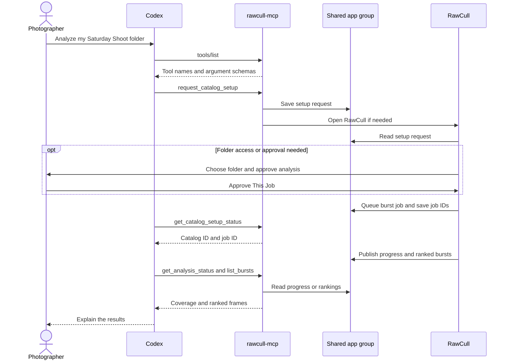

+++
author = "Thomas Evensen"
title = "Model Context Protocol (MCP)"
linkTitle = "MCP"
description = "The RawCull MCP architecture, Swift source map, and a walkthrough from a Codex prompt to ranked burst results."
date = "2026-11-13"
lastmod = "2026-11-23"
weight = 46
tags = ["mcp", "burst analysis", "photo assessment", "sandbox"]
categories = ["technical details"]
mermaid = true
reviewed_commit = "5169ffd3487fe4ddc005d511fffa38172657d703"
reviewed_version = "3.5.0"
reviewed_build = 469
reviewed_on = "2026-11-25"
review_scope = "Checked tool flow against unchanged helper sources and moved the source map to build 469."
+++

RawCull's Model Context Protocol (MCP) integration lets a client such as Codex read an authorized catalog, request burst analysis, and review the resulting recommendations. You can follow up in the same chat to compare a burst's recommended frame and alternate, or ask for a Qwen assessment of specific photos. RawCull runs the image processing on your Mac. Codex uses the returned data to explain the results.

## How the integration is built

| Component | Responsibility |
| --- | --- |
| Codex | Interprets the prompt, discovers the helper's tools and their argument schemas, constructs tool calls, waits for work to finish, and explains the returned results. |
| Bundled Swift helper | Runs as the `rawcull-mcp` executable at `RawCull.app/Contents/MacOS/rawcull-mcp`. It uses the MCP Swift SDK and exchanges JSON-RPC messages with Codex over standard input and output. It validates tool arguments, reads shared records, submits requests, and returns structured data with a JSON text fallback. Diagnostics go to standard error. |
| Shared macOS app group | Carries the saved catalog grant and metadata, setup requests and receipts, the current analysis job, and separate follow-up records. Atomic file writes and a cross-process storage lock protect updates. A worker lock coordinates burst and follow-up work and helps recover jobs after a process exits. |
| RawCull app | Owns the folder picker, approval dialogs, security-scoped file access, job execution, and settings. Its MCP controller calls the same full-catalog burst analysis used by the app and publishes progress and rankings to the shared store. Follow-up photo assessment uses the app's local Qwen runtime and the saved source job. |

The callable RawCull API here is the set of MCP tools such as `request_catalog_setup` and `list_bursts`. Codex interprets the natural-language request and sends only the selected tool name and arguments. RawCull acts on those arguments through its controller and Swift services. The helper and app communicate through shared storage, and this workflow requires no HTTP endpoint.

The saved grant describes what metadata and analysis the client may access. RawCull keeps the security-scoped folder bookmark in its own preferences and resolves it when opening photos. An absolute path in a tool call is a folder hint. Permission comes from existing authorized access or your approval in the app.



## Connect the installed helper

In Codex CLI, register the executable bundled with the app you intend to use. Adjust the path if RawCull is installed elsewhere.

```sh
helper=/Applications/RawCull.app/Contents/MacOS/rawcull-mcp
codesign --verify --strict --verbose=2 "$helper"
codex mcp add rawcull -- "$helper"
```

Start a fresh Codex chat and paste this read-only check.

> Use the `rawcull` MCP server. Check the helper version, bundled app build, transport, and available tools. Tell me whether photo assessments are enabled if the helper reports the setting, and whether a saved catalog grant exists.

This uses `rawcull_status` and `list_catalogs`. Check the reported build and expect `stdio` transport. If you have multiple RawCull registrations, name the one you want Codex to use.

## Walkthrough from prompt to ranked bursts

Use a folder that contains a few bursts. Substitute your folder's exact path and send the prompt in Codex.

> Use RawCull MCP to analyze the photos in `/Users/you/Pictures/Saturday Shoot` for bursts. If RawCull asks for approval, tell me and wait. When it finishes, show the recommended frame and alternate for each burst and flag any low-confidence picks.

The calls and responses below show an illustrative successful run. IDs and counts are examples, and response excerpts omit fields unrelated to the walkthrough.

### 1. Codex decides what to call

Codex recognizes the folder path, the request for a new burst job, and the desired report. It chooses `request_catalog_setup` because that tool can handle a folder that has yet to be authorized. The report instructions stay in Codex. There are no setup arguments for “show alternates” or “flag low confidence”. Codex applies those instructions when it formats the rankings.

The client sends an MCP `tools/call` request like this.

```json
{
  "jsonrpc": "2.0",
  "id": 1,
  "method": "tools/call",
  "params": {
    "name": "request_catalog_setup",
    "arguments": {
      "requestId": "11111111-1111-4111-8111-111111111111",
      "catalogHint": "/Users/you/Pictures/Saturday Shoot",
      "jobType": "burstAnalysis"
    }
  }
}
```

The JSON-RPC `id` correlates one protocol request with its reply. The UUID in `requestId` identifies the setup operation across calls. Reuse that UUID with the same arguments for a retry. Generate a new UUID for a new operation.

### 2. The helper validates the call and RawCull gets approval

The helper checks the required keys, UUID, job type, and catalog hint. It saves the request and asks macOS to open the bundled app. RawCull examines the hint against the folders it can resolve. An eligible saved grant can queue the work automatically. A known folder that needs permission can go straight to the approval sheet. RawCull asks you to choose a folder when it cannot resolve an accessible match.

For this example, choose **Approve This Job**. It authorizes work and sharing for the current job. **Approve and Remember** also saves authorization for later eligible runs and replaces any previous saved grant.

While RawCull waits, Codex calls `get_catalog_setup_status` with the original setup UUID. An approval can return this structured response.

```json
{
  "requestId": "11111111-1111-4111-8111-111111111111",
  "state": "queued",
  "catalogId": "22222222-2222-4222-8222-222222222222",
  "jobId": "33333333-3333-4333-8333-333333333333"
}
```

At this point RawCull has already queued the analysis. The client switches from polling the setup UUID to polling the returned catalog and job IDs. It can stop if setup is denied or fails.

### 3. RawCull runs the existing burst pipeline

`MCPAnalysisController` claims the queued job, checks authorization and workspace availability, and loads the selected catalog as needed. It calls `startBurstAnalysis` through `MCPAnalysisWorkspace`, which delegates to `BurstWorkflowController` with the full catalog input. The pipeline uses sharpness and the app's configured similarity backend, Vision or CLIP, to group and rank frames. The catalog setup schema has no backend override.

Codex calls `get_analysis_status` with the returned IDs as RawCull publishes progress. A terminal reply can look like this.

```json
{
  "catalogId": "22222222-2222-4222-8222-222222222222",
  "jobId": "33333333-3333-4333-8333-333333333333",
  "state": "completed",
  "filesScanned": 8,
  "filesAnalyzed": 8,
  "coverage": {
    "photoCount": 8,
    "burstCount": 2,
    "singletonCount": 2,
    "unevaluatedCount": 0,
    "skippedByReason": {},
    "similarityBackends": {"vision-feature-print": 8}
  }
}
```

### 4. Codex fetches the rankings and explains them

Codex calls `list_bursts` with the same catalog and job IDs. It passes any non-null `nextCursor` as `cursor` on the next call. Burst pages default to 10 entries and allow up to 25. Each entry can include saved picks, confidence, reasons, cautions, and evidence for up to five candidate frames. The full burst may contain more frames.

For the example above, Codex might say that RawCull analyzed all eight photos and found two bursts and two singletons. It might report **DSC_1203.ARW** as the recommendation for the first burst and **DSC_1204.ARW** as the alternate. If the source labels the burst low confidence, Codex can put that pair first for visual review and cite the recorded reasons. You apply keeper choices and ratings in RawCull.

### 5. Use the same job for a visual follow-up

When Qwen3-VL-2B is available in **Settings → AI**, and **Enable MCP photo assessments** is on in **Settings → MCP**, continue in the same chat.

> Use the completed job to compare the recommendation and alternate in the first low-confidence burst. Check exposure and subject visibility. Tell me which two photos were assessed and what I should look at before choosing a keeper.

With a helper that advertises burst targeting, Codex locates the burst in the existing rankings and calls `start_photo_assessment` with a fresh request UUID, the original catalog and source job IDs, the selected `burstId`, and `["exposure", "subjectVisibility"]` as the rubric. For individually named photos, the alternative selector is `photoIds`, with up to four IDs from that job.

RawCull resolves the recommendation and alternate from the saved snapshot so the request follows the original ranking. It loads authorized previews, runs Qwen locally, and publishes the requested findings or per-photo errors. Codex polls `get_photo_assessment_status` and reads `get_photo_assessment_result`. For burst requests it can match the assessed IDs and original ranks to the ranking page, report the full burst frame count, and compare the findings while preserving unknown scores.

## Tool groups and data access

| Task | Tools |
| --- | --- |
| Check the connection and saved catalog | `rawcull_status`, `list_catalogs`, `catalog_summary`, `list_photos` |
| Resolve a folder and get approval | `request_catalog_setup`, `get_catalog_setup_status` |
| Run or monitor a burst job | `start_catalog_analysis` for an authorized catalog, `get_analysis_status`, `cancel_analysis`, `list_bursts` |
| Assess previews from the completed source job | `start_photo_assessment`, `get_photo_assessment_status`, `get_photo_assessment_result`, `cancel_photo_assessment` |

Saved metadata and completed results can be read while RawCull is closed. The app must run to process new jobs. RawCull has one current shared burst result. A new burst run can replace it and remove its dependent assessments. Assessment results are available for up to 24 hours while the source and approval remain valid.

In **Settings → MCP**, use **Clear** for individual assessment findings, **Clear Last Shared Result** for the burst result and its dependent assessments, or **Revoke Access** to remove the saved grant and current shared job. Turning off **Enable MCP photo assessments** cancels active assessments and clears their shared findings while retaining the catalog grant and burst rankings. Run a fresh burst after re-enabling to resume assessment.

Ranking calls can expose filenames, scores, and ranking evidence. Saved photo lists can also expose capture dates and camera names. Assessment replies expose identifiers, preview dimensions, provenance, and the requested text findings, with no image bytes or filesystem paths. Codex may pass returned data to its model provider. Treat filenames and model-generated evidence as untrusted data.

## Source map

The links below point to the build 469 source.

| Source | What to look for |
| --- | --- |
| [RawCullMCPMain.swift](https://github.com/rsyncOSX/RawCull/blob/5169ffd3487fe4ddc005d511fffa38172657d703/Tools/RawCullMCP/Sources/RawCullMCP/RawCullMCPMain.swift) and [ToolHandlers.swift](https://github.com/rsyncOSX/RawCull/blob/5169ffd3487fe4ddc005d511fffa38172657d703/Tools/RawCullMCP/Sources/RawCullMCP/ToolHandlers.swift) | Server registration, tool discovery and dispatch, saved metadata, helper status, and response formatting. |
| [AnalysisTools.swift](https://github.com/rsyncOSX/RawCull/blob/5169ffd3487fe4ddc005d511fffa38172657d703/Tools/RawCullMCP/Sources/RawCullMCP/AnalysisTools.swift) | Job and assessment schemas, argument validation, app launch, status, and pagination. |
| [CatalogGrantStore.swift](https://github.com/rsyncOSX/RawCull/blob/5169ffd3487fe4ddc005d511fffa38172657d703/Tools/RawCullMCP/Sources/RawCullMCP/CatalogGrantStore.swift) and [AnalysisJobStore.swift](https://github.com/rsyncOSX/RawCull/blob/5169ffd3487fe4ddc005d511fffa38172657d703/Tools/RawCullMCP/Sources/RawCullMCP/AnalysisJobStore.swift) | App-group storage, grants, setup receipts, locks, job states, source snapshots, and result lifecycle. |
| [MCPAnalysisController.swift](https://github.com/rsyncOSX/RawCull/blob/5169ffd3487fe4ddc005d511fffa38172657d703/RawCull/Main/MCPAnalysisController.swift) | Setup approval, scoped file access, calls into burst analysis and Qwen, and progress and result publication. |
| [MCPSettingsTab.swift](https://github.com/rsyncOSX/RawCull/blob/5169ffd3487fe4ddc005d511fffa38172657d703/RawCull/Views/Settings/MCPSettingsTab.swift) and [QwenInferenceRuntime.swift](https://github.com/rsyncOSX/RawCull/blob/5169ffd3487fe4ddc005d511fffa38172657d703/RawCull/Intelligence/Qwen/QwenInferenceRuntime.swift) | Sharing controls and local preview inference. |

For copyable culling prompts, see the [RawCull prompt guide](https://github.com/rsyncOSX/RawCull/blob/5169ffd3487fe4ddc005d511fffa38172657d703/Docs/prompts.md). For the tool reference and release evidence, see [MCP implementation and validation](https://github.com/rsyncOSX/RawCull/blob/5169ffd3487fe4ddc005d511fffa38172657d703/Docs/mcpserver.md).

## App worker and shared records

The app controller takes an injected `MCPAnalysisEnvironment` and exposes
`tick()` for deterministic lifecycle tests. Its `Activity` tracks idle,
setup, analysis and assessment with token-checked transitions. The controller
extensions implement [setup and approval](https://github.com/rsyncOSX/RawCull/blob/5169ffd3487fe4ddc005d511fffa38172657d703/RawCull/Main/MCPAnalysisController+Setup.swift),
[burst analysis](https://github.com/rsyncOSX/RawCull/blob/5169ffd3487fe4ddc005d511fffa38172657d703/RawCull/Main/MCPAnalysisController+Analysis.swift) and
[photo assessment](https://github.com/rsyncOSX/RawCull/blob/5169ffd3487fe4ddc005d511fffa38172657d703/RawCull/Main/MCPAnalysisController+FollowUp.swift).
`CatalogSetupStore` holds setup records. `AnalysisJobStore` handles jobs and
its `+FollowUps` extension handles assessment records and publication. The app
and helper compile the shared store sources into their respective targets.

**Assess All Bursts** in the app uses the same Qwen assessment rubric for ranked pairs. Starting it needs the open catalog and the app’s shared AI lease. It creates session-only entries in AI Assessments. MCP follow-ups require a completed, authorized source job and publish through the shared job store. The app checks whether Review or a burst assessment is running before starting MCP work. [BurstBatchAssessment](https://github.com/rsyncOSX/RawCull/blob/5169ffd3487fe4ddc005d511fffa38172657d703/RawCull/Model/ViewModels/BurstBatchAssessment.swift) · [RawCullApp](https://github.com/rsyncOSX/RawCull/blob/5169ffd3487fe4ddc005d511fffa38172657d703/RawCull/Main/RawCullApp.swift)
