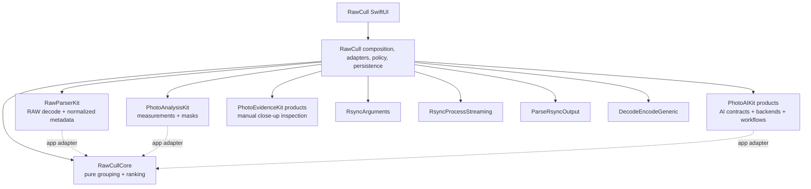

+++
author = "Thomas Evensen"
title = "RawCull Packages"
linkTitle = "Packages"
date = "2026-08-21"
lastmod = "2026-11-08"
description = "Pinned package revisions, imported products, dependency direction, and the recommended architecture reading order."
tags = ["ai", "analysis", "raw", "swift-package", "packages"]
categories = ["technical details"]
mermaid = true
weight = 60
+++

# RawCull Packages

RawCull is the composition root for five architecture packages and four small
rsync/persistence support packages. Package repositories are separately versioned;
paths under `Sources/` and `Tests/` refer to the named repository, not files copied
into this documentation site. The app translates between package contracts and
owns selection, file access, caches, persistence, and review decisions.

The November 8, 2026 review uses RawCull 3.4.0 build 434. Existing guides retain
their explicitly dated architecture audits and add current integration notes.
PhotoEvidenceKit has a new guide covering the resolved 1.0.7 implementation.
Sibling checkout HEADs do not redefine the application's resolved baseline.

## Resolved Dependency Snapshot

This table is derived from the local RawCull
`RawCull.xcodeproj/project.xcworkspace/xcshareddata/swiftpm/Package.resolved`,
reviewed November 8, 2026 alongside `project.pbxproj` and source imports.
“App” means RawCull directly consumes package products; “transitive” means a
package owns the dependency. There are 19 resolved entries.

| Identity | Relationship | Version/branch | Revision |
| --- | --- | --- | --- |
| DecodeEncodeGeneric | app | `1.0.0` | `b5ecbbbe1b244191efec1532a979f6ae342d6617` |
| ParseRsyncOutput | app | `1.0.0` | `e079e0c9d34bf07f7f2a4312b40feea79ae14847` |
| PhotoAIKit | app | `1.0.0` | `4b85056e6c2603b5e382987710ca2f16f4c5c155` |
| PhotoAnalysisKit | app | `1.3.1` | `2a1466e04d821fa2628d6985296643e0d0c7e465` |
| PhotoEvidenceKit | app | `1.0.7` | `7614fd1528bb7cf2549799fb937678ea39d90228` |
| RawCullCore | app | `1.1.2` | `d25a51e65ad32a82bf82f86fa0ec07d6e14498e9` |
| RawParserKit | app | `1.3.3` | `26df4abc2178d5c07d08f3883d84d0648f5141d3` |
| RsyncArguments | app | `1.0.0` | `0ff6518136c208dfbecc1a918f045048ca79853d` |
| RsyncProcessStreaming | app | `1.0.0` | `dd86f012b352888fd146e0b6e103740dc237f740` |
| coreai-models | transitive | `1.0.0` | `5de95c6cd29e5e390fb36d87e13b2396668f7974` |
| EventSource | transitive | `1.6.0` | `bb4b61273b5a976bb571859c17f903ebc3439df1` |
| swift-asn1 | transitive | `1.7.4` | `917b472dbe53ba699cbb0495f9a95a084bc6364d` |
| swift-collections | transitive | `1.7.5` | `f96b909e1a9e469620bc5037c1e24e00153f376f` |
| swift-crypto | transitive | `4.5.2` | `da9d28d69ebe3894b18376c8f2395c2f37b8448f` |
| swift-huggingface | transitive | `1.0.0` | `c30143a4616f3fa994ee3ab3e3464f752845c07c` |
| swift-jinja | transitive | `3.0.0` | `a091d6ae559ee97e904a0f3c2890b21949d0306f` |
| swift-transformers | transitive | `1.4.0` | `402a8a1105f52038b0949d9596981fc9e32bed17` |
| xgrammar | transitive | `0.2.2` | `4d145cc13d878c751ebeed36af1c013074be76bc` |
| yyjson | transitive | `0.13.0` | `6447536015f3d600f3d65323b10976103b337ca7` |

Do not infer the app boundary from every transitive pin. Xcode product
references and source imports define what RawCull actually consumes.

## Imported Products And Boundary Types

| Package                               | Products imported by RawCull                                                                                                                                 | Values or protocols crossing the boundary                                                                                                                                                  |
| ------------------------------------- | ------------------------------------------------------------------------------------------------------------------------------------------------------------ | ------------------------------------------------------------------------------------------------------------------------------------------------------------------------------------------ |
| [RawParserKit](rawparserkit/)         | `RawParserKit`                                                                                                                                               | `RawImageLoader`, `RawImageMetadata`, `RawFocusPoint`, `RawFormatRegistry`, `CGImage` results; the app maps them through `RawParserKitImageLoader`                                         |
| [PhotoAnalysisKit](photoanalysiskit/) | `PhotoAnalysisKit`                                                                                                                                           | `PhotoAnalyzer`, `PhotoAnalysisInput`, `PhotoAnalysisDescriptor`, `PhotoAnalysisResult`, focus evidence and mask values                                                                    |
| [RawCullCore](rawcullcore/)           | `RawCullCore`                                                                                                                                                | `RawCullFileItem`, `RawCullSourceCatalog`, `ExifMetadata`, burst inputs/results/configurations, ranking evidence, histograms; the app exposes compatibility typealiases such as `FileItem` |
| [PhotoAIKit](photoaikit/)             | `PhotoAIContracts`, `CoreAICLIPBackend`, `CoreAIQwenBackend`, `CoreAISAM3Backend`, `CoreAIEfficientSAMBackend`, `VisionFeaturePrintBackend`, `PhotoAIWorkflows`, `PhotoAIStorage` | `AIImageSource`, model identities/resources, similarity artifacts/descriptors, provider protocols, segmentation requests/results, mask stores and workflows                                |
| [PhotoEvidenceKit](photoevidencekit/) | `PhotoEvidenceContracts`, `PhotoEvidenceEngine`, `PhotoEvidenceUI` | `CloseUpFrame`, region/viewport/source descriptors, AF availability, renderer and region-store protocols, `CloseUpModel`, `CloseUpPanel` |
| RsyncArguments                        | `RsyncArguments`                                                                                                                                             | rsync argument builders used by `Params` and `ArgumentsSynchronize`                                                                                                                        |
| RsyncProcessStreaming                 | `RsyncProcessStreaming`                                                                                                                                      | `RsyncProcess` and `ProcessHandlers` used by the copy executor                                                                                                                             |
| ParseRsyncOutput                      | `ParseRsyncOutput`                                                                                                                                           | parsed transfer progress and totals used by `RemoteDataNumbers`                                                                                                                            |
| DecodeEncodeGeneric                   | `DecodeEncodeGeneric`                                                                                                                                        | generic JSON encode/decode used by saved-file persistence                                                                                                                                  |

RawCull owns the translations between these vocabularies. None of the five
architecture packages imports another merely to share an app model.

## Dependency Direction

Solid arrows are compile-time imports by the app. Dotted arrows
are value translation performed by RawCull, not package dependencies.

The three rsync support packages do not depend on one another. RawCull connects
argument building, process execution and streamed-output parsing in its copy
workflow. The runtime sequence is not a package import chain.

## Recommended Reading Order

1. [RawParserKit](rawparserkit/) — a file becomes an orientation-normalized
   image and neutral metadata.
2. [PhotoAnalysisKit](photoanalysiskit/) — a decoded image becomes sharpness,
   saliency, focus evidence, and masks.
3. [RawCullCore](rawcullcore/) — measurements become burst boundaries,
   recommendations, and review state.
4. [PhotoAIKit](photoaikit/) — optional CLIP similarity/semantic search and
   segmentation run behind typed contracts.
5. [PhotoEvidenceKit](photoevidencekit/) — manual regions, retained references,
   source-labeled crops, and optional recorded AF-point assistance.
6. Return to the app pages to see RawCull compose those independent boundaries,
   persist results, and present policy.

When a package pin changes, compare its manifest and public source at the new
resolved revision before updating this documentation. A sibling checkout may be
ahead of the revision RawCull actually builds.

## November 8 Dependency Delta

Compared with the October 31 snapshot, PhotoEvidenceKit is newly resolved at
1.0.7. EventSource moves from 1.5.1 to 1.6.0, swift-asn1 from 1.7.3 to 1.7.4,
swift-collections from 1.7.3 to 1.7.5, swift-jinja from 2.5.1 to 3.0.0,
swift-transformers from 1.3.5 to 1.4.0, and yyjson from 0.12.0 to 0.13.0.
The eight previously direct package pins and the other transitive pins retain
the revisions recorded in the October 31 table.

The Xcode project also lists `PhotoEvidenceDemo`, the package's executable
example, as a product reference. RawCull source imports the three library
products above; the demo is not a fourth library API.

## End-to-End Ownership

| Step | Package output | RawCull responsibility |
| --- | --- | --- |
| Decode | RawParserKit image and metadata | Retain sandbox access, select preview/development policy, cache decoded work |
| Measure | PhotoAnalysisKit scores, evidence, masks | Combine source identity with analysis descriptor and reject stale results |
| Infer | PhotoAIKit embeddings, semantic results, segmentation | Install models, admit requests, choose fallback and publish current results |
| Recommend | RawCullCore grouping and ranking values | Supply ordered inputs and evidence; preserve photographer decisions |
| Inspect | PhotoEvidenceKit crops and session state | Supply truthful source labels, file/settings revisions, AF mapping and region storage |

PhotoEvidenceKit consumes host-rendered images through an injected renderer.
It does not import the decoder, analysis, AI, or ranking packages. A close-up
can help a photographer evaluate a recommendation without becoming new ranking
evidence automatically. See the individual guides for invalidation and failure
behavior at each boundary.
