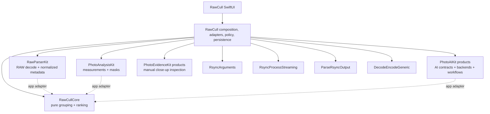

+++
author = "Thomas Evensen"
title = "RawCull Packages"
linkTitle = "Packages"
date = "2026-08-21"
lastmod = "2026-11-25"
description = "Pinned package revisions, imported products, dependency direction, and the recommended architecture reading order."
tags = ["ai", "analysis", "raw", "swift-package", "packages"]
categories = ["technical details"]
mermaid = true
weight = 60
reviewed_commit = "5169ffd3487fe4ddc005d511fffa38172657d703"
reviewed_version = "3.5.0"
reviewed_build = 469
reviewed_on = "2026-11-25"
review_scope = "Confirmed all 24 pins, corrected boundary types and removed superseded snapshots."
+++

# RawCull Packages

Start here: [One Package, Three Imports: Understanding Swift Modules]()
explains packages, products, targets and imports using PhotoEvidenceKit before
you read the individual package architecture guides.

RawCull is the composition root for five architecture packages and four small
rsync/persistence support packages. Package repositories are separately versioned;
paths under `Sources/` and `Tests/` refer to the named repository, not files copied
into this documentation site. The app translates between package contracts and
owns selection, file access, caches, persistence, and review decisions.

The guides describe the revisions that RawCull 3.5.0 build 469 resolves. Where a
section keeps an older audit, it says so. A sibling checkout may be ahead of the
revision the app builds, so always read the lockfile first.

## Resolved dependencies in build 469

The application lockfile records 24 remote pins. They are unchanged since build 466. Every direct package reference uses an *exact* version requirement, so an update is always a deliberate edit to the Xcode project. The MCP helper has a separate package graph. [Application lockfile](https://github.com/rsyncOSX/RawCull/blob/5169ffd3487fe4ddc005d511fffa38172657d703/RawCull.xcodeproj/project.xcworkspace/xcshareddata/swiftpm/Package.resolved) · [MCP helper lockfile](https://github.com/rsyncOSX/RawCull/blob/5169ffd3487fe4ddc005d511fffa38172657d703/Tools/RawCullMCP/Package.resolved)

| Identity | Version | Revision |
| --- | --- | --- |
| `coreai-models` | `1.0.0` | `5de95c6cd29e5e390fb36d87e13b2396668f7974` |
| `decodeencodegeneric` | `1.0.0` | `b5ecbbbe1b244191efec1532a979f6ae342d6617` |
| `eventsource` | `1.6.0` | `bb4b61273b5a976bb571859c17f903ebc3439df1` |
| `parsersyncoutput` | `1.0.0` | `e079e0c9d34bf07f7f2a4312b40feea79ae14847` |
| `photoaikit` | `3.1.0` | `26647c62d9933968d92bd00b162290cdd7c78fee` |
| `photoanalysiskit` | `1.4.1` | `2f41e8b756f006e0218f86b103801ebb47cf8983` |
| `photoevidencekit` | `1.1.5` | `e49d34adcfa2e2c43a4240c2e962dbe9defa4cad` |
| `rawcullcore` | `1.1.5` | `ea8ac2fc6611949af2b55ec433456bfe502cf886` |
| `rawparserkit` | `1.3.3` | `26df4abc2178d5c07d08f3883d84d0648f5141d3` |
| `rsyncarguments` | `1.0.0` | `0ff6518136c208dfbecc1a918f045048ca79853d` |
| `rsyncprocessstreaming` | `1.0.0` | `dd86f012b352888fd146e0b6e103740dc237f740` |
| `swift-asn1` | `1.7.4` | `917b472dbe53ba699cbb0495f9a95a084bc6364d` |
| `swift-atomics` | `1.3.1` | `0442cb5a3f98ab802acb777929fdb446bda11a34` |
| `swift-collections` | `1.7.5` | `f96b909e1a9e469620bc5037c1e24e00153f376f` |
| `swift-crypto` | `4.5.2` | `da9d28d69ebe3894b18376c8f2395c2f37b8448f` |
| `swift-huggingface` | `1.0.0` | `c30143a4616f3fa994ee3ab3e3464f752845c07c` |
| `swift-jinja` | `3.0.0` | `a091d6ae559ee97e904a0f3c2890b21949d0306f` |
| `swift-log` | `1.17.0` | `e3da04078777e6a1b72ce19981fbd6539b0847d8` |
| `swift-nio` | `2.105.0` | `2f58d8ef84438d6517fc78bcea2f8527e3c72936` |
| `swift-sdk` | `0.12.1` | `a0ae212ebf6eab5f754c3129608bc5557637e605` |
| `swift-system` | `1.8.1` | `869129b7bf4ecc57b97d0193ad29690ca2134750` |
| `swift-transformers` | `1.4.0` | `402a8a1105f52038b0949d9596981fc9e32bed17` |
| `xgrammar` | `0.2.2` | `4d145cc13d878c751ebeed36af1c013074be76bc` |
| `yyjson` | `0.13.0` | `6447536015f3d600f3d65323b10976103b337ca7` |

Nine of these are direct dependencies of the app: the five architecture packages
plus RsyncArguments, RsyncProcessStreaming, ParseRsyncOutput and
DecodeEncodeGeneric. `swift-sdk` is used by the `rawcull-mcp` helper target. The
rest are transitive, mostly through PhotoAIKit's Core AI backends and the MCP SDK.

Do not infer the app boundary from every transitive pin. Xcode product
references and source imports define what RawCull actually consumes. Dated
snapshots from October and November are in this site's Git history.

## Imported Products And Boundary Types

| Package                               | Products imported by RawCull                                                                                                                                 | Values or protocols crossing the boundary                                                                                                                                                  |
| ------------------------------------- | ------------------------------------------------------------------------------------------------------------------------------------------------------------ | ------------------------------------------------------------------------------------------------------------------------------------------------------------------------------------------ |
| [RawParserKit](rawparserkit/)         | `RawParserKit`                                                                                                                                               | `RawImageLoader`, `RawImageMetadata`, `RawFocusPoint`, `RawFormatRegistry`, `CGImage` results; the app maps them through `RawParserKitImageLoader`                                         |
| [PhotoAnalysisKit](photoanalysiskit/) | `PhotoAnalysisKit`                                                                                                                                           | `PhotoAnalyzer`, `PhotoAnalysisInput`, `SharpnessAnalysisDescriptor`, `PhotoAnalysisResult`, focus evidence and mask values, `VisionRequestGate`, `FaceEvidenceAnalyzer`, `AnimalCloseUpDetector`                                                                    |
| [RawCullCore](rawcullcore/)           | `RawCullCore`                                                                                                                                                | `RawCullFileItem`, `RawCullSourceCatalog`, `ExifMetadata`, burst inputs/results/configurations, ranking evidence, histograms; the app exposes compatibility typealiases such as `FileItem` |
| [PhotoAIKit](photoaikit/)             | `PhotoAIContracts`, `CoreAICLIPBackend`, `CoreAIQwenBackend`, `CoreAISAM3Backend`, `VisionFeaturePrintBackend`, `PhotoAIWorkflows`, `PhotoAIStorage` (`CoreAIEfficientSAMBackend` is linked but not imported) | `AIImageSource`, model identities/resources, similarity artifacts/descriptors, provider protocols, segmentation requests/results, mask stores and workflows                                |
| [PhotoEvidenceKit](photoevidencekit/) | `PhotoEvidenceContracts`, `PhotoEvidenceEngine`, `PhotoEvidenceUI` | `CloseUpFrame`, region/viewport/source descriptors, AF availability, renderer and region-store protocols, `CloseUpModel`, `CloseUpPanel` |
| RsyncArguments                        | `RsyncArguments`                                                                                                                                             | rsync argument builders used by `Params` and `ArgumentsSynchronize`                                                                                                                        |
| RsyncProcessStreaming                 | `RsyncProcessStreaming`                                                                                                                                      | `RsyncProcess` and `ProcessHandlers` used by the copy executor                                                                                                                             |
| ParseRsyncOutput                      | `ParseRsyncOutput`                                                                                                                                           | parsed transfer progress and totals used by `RemoteDataNumbers`                                                                                                                            |
| DecodeEncodeGeneric                   | `DecodeEncodeGeneric`                                                                                                                                        | generic JSON encode/decode used by saved-file persistence                                                                                                                                  |

RawCull owns the translations between these vocabularies. None of the five
architecture packages imports another merely to share an app model.

## Dependency Direction

Solid arrows are compile-time imports by the app. Dotted arrows
are value translation performed by RawCull, not package dependencies.

The three rsync support packages do not depend on one another. RawCull connects
argument building, process execution and streamed-output parsing in its copy
workflow. The runtime sequence is not a package import chain.

## Recommended Reading Order

1. [RawParserKit](rawparserkit/) — a file becomes an orientation-normalized
   image and neutral metadata.
2. [PhotoAnalysisKit](photoanalysiskit/) — a decoded image becomes sharpness,
   saliency, focus evidence, and masks.
3. [RawCullCore](rawcullcore/) — measurements become burst boundaries,
   recommendations, and review state.
4. [PhotoAIKit](photoaikit/) — optional CLIP similarity/semantic search and
   segmentation run behind typed contracts.
5. [PhotoEvidenceKit](photoevidencekit/) — manual regions, retained references,
   source-labeled crops, and optional recorded AF-point assistance.
6. Return to the app pages to see RawCull compose those independent boundaries,
   persist results, and present policy.

When a package pin changes, compare its manifest and public source at the new
resolved revision before updating this documentation. A sibling checkout may be
ahead of the revision RawCull actually builds.

The Xcode project also lists `PhotoEvidenceDemo`, the package's executable
example, as a product reference. RawCull source imports the three library
products above; the demo is not a fourth library API.

## End-to-End Ownership

| Step | Package output | RawCull responsibility |
| --- | --- | --- |
| Decode | RawParserKit image and metadata | Retain sandbox access, select preview/development policy, cache decoded work |
| Measure | PhotoAnalysisKit scores, evidence, masks | Combine source identity with analysis descriptor and reject stale results |
| Infer | PhotoAIKit embeddings, semantic results, segmentation | Install models, admit requests, choose fallback and publish current results |
| Recommend | RawCullCore grouping and ranking values | Supply ordered inputs and evidence; preserve photographer decisions |
| Inspect | PhotoEvidenceKit crops and session state | Supply truthful source labels, file/settings revisions, AF mapping and region storage |

PhotoEvidenceKit consumes host-rendered images through an injected renderer.
It does not import the decoder, analysis, AI, or ranking packages. A close-up
can help a photographer evaluate a recommendation without becoming new ranking
evidence automatically. See the individual guides for invalidation and failure
behavior at each boundary.
