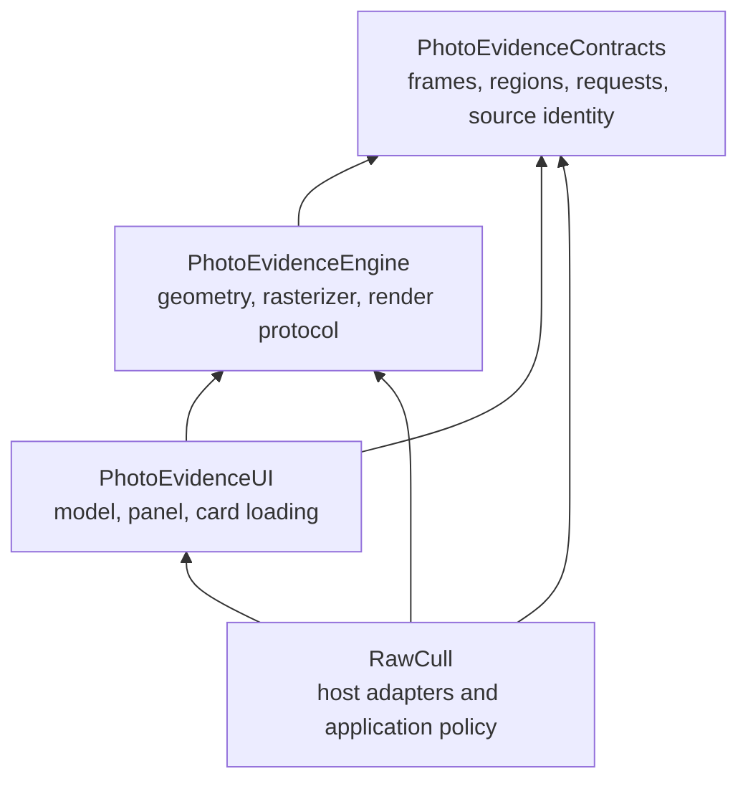

+++
author = "Thomas Evensen"
title = "One Package, Three Imports: Understanding Swift Modules"
linkTitle = "Understanding Package Imports"
date = "2026-11-08"
lastmod = "2026-11-08"
description = "Learn how Swift packages, products, targets, modules, imports, and linking fit together using PhotoEvidenceKit as a concrete example."
tags = ["swift-package", "modules", "learning", "architecture"]
categories = ["technical details"]
mermaid = true
weight = 1
reviewed_commit = "a68253b73cbad14a7b1030dba6b439e6bce7d3da"
reviewed_version = "3.4.5"
reviewed_build = 436
reviewed_on = "2026-11-09"
review_scope = "source delta and reference check; existing content retained; historical package audit retained"
+++

# One Package, Three Imports: Understanding Swift Modules

PhotoEvidenceKit is **one package containing three library modules**. That is why
RawCull can contain these three imports:

```swift
import PhotoEvidenceContracts
import PhotoEvidenceEngine
import PhotoEvidenceUI
```

Each import names a module. `PhotoEvidenceKit` is the package name, but this
package does not define a module with that name. Consequently, adding the package
to Xcode does not make `import PhotoEvidenceKit` valid.

This guide uses the actual
[PhotoEvidenceKit manifest](https://github.com/rsyncOSX/PhotoEvidenceKit/blob/7614fd1528bb7cf2549799fb937678ea39d90228/Package.swift)
at the RawCull-resolved 1.0.7 revision. Alternative designs later in this guide are
teaching examples, not changes made to that package.

## 1. The Names Describe Different Things

| Term | Meaning in this example | Where it appears |
| --- | --- | --- |
| Repository | The Git repository containing the package | GitHub URL and checkout directory |
| Package | The overall SwiftPM definition, named `PhotoEvidenceKit` | `Package(name: ...)` in `Package.swift` |
| Product | A library or executable offered to consumers | The manifest's `products` array and Xcode's product selection |
| Target | A build unit with source files, dependencies and settings | The manifest's `targets` array |
| Module | The namespace and access-control boundary compiled from a regular Swift library target | `import PhotoEvidenceContracts`, for example |
| Source file | One contribution to a target's module | `Sources/PhotoEvidenceContracts/CloseUpContracts.swift` |

In this package, each library product and its target have the same name. That
makes integration convenient, but it can hide the difference between selecting a
product and importing a module. SwiftPM's
[Product documentation](https://docs.swift.org/latest/documentation/packagedescription/product/)
explains that a product is assembled from build artifacts of one or more targets.
A product name does not itself create a new module.

Think of the package as the complete distribution, products as the choices offered
to its consumer, and targets as the units that actually build the code. They do
not have to share a name.

## 2. Read The Real Manifest From The Outside In

The beginning of the manifest declares the tools version, imports the manifest
API, and creates the package description:

```swift
// swift-tools-version: 6.2
import PackageDescription

let package = Package(
    name: "PhotoEvidenceKit",
    // products, targets, platform and language settings follow
)
```

This is a shortened excerpt. `import PackageDescription` is used while evaluating
the manifest. It does not become an application import or add PackageDescription
to the photo-inspection runtime.

The package name identifies the whole package. It does not instruct SwiftPM to
collect all source files into a `PhotoEvidenceKit` module.

### Products: What Consumers Can Select

The actual library product declarations are:

```swift
.library(name: "PhotoEvidenceContracts", targets: ["PhotoEvidenceContracts"]),
.library(name: "PhotoEvidenceEngine", targets: ["PhotoEvidenceEngine"]),
.library(name: "PhotoEvidenceUI", targets: ["PhotoEvidenceUI"]),
```

Each exposes one same-named target as a library product. There is also an
executable product, `PhotoEvidenceDemo`, for running the synthetic example.
The demo is not a fourth library that a host should import to display close-ups.

### Targets: What Gets Compiled And What It May Depend On

The three library targets are declared as:

```swift
.target(name: "PhotoEvidenceContracts"),
.target(name: "PhotoEvidenceEngine", dependencies: ["PhotoEvidenceContracts"]),
.target(name: "PhotoEvidenceUI", dependencies: ["PhotoEvidenceContracts", "PhotoEvidenceEngine"]),
```

The first target has no dependencies on another target in this package. Engine
can use Contracts, while UI can use both Contracts and Engine. There are no
external package dependencies in this manifest. Apple frameworks such as
Foundation, CoreGraphics and SwiftUI are SDK modules used by source files, rather
than downloaded Swift package dependencies.

These declarations establish the build graph. They are not an instruction to
insert `import` statements into every source file.

## 3. How Folders Become Importable Modules

For these regular targets, SwiftPM uses the conventional source directories:

```text
PhotoEvidenceKit/
├── Package.swift
├── Sources/
│   ├── PhotoEvidenceContracts/
│   │   ├── CloseUpContracts.swift
│   │   ├── CloseUpRenderSource.swift
│   │   └── CloseUpAFPoint.swift
│   ├── PhotoEvidenceEngine/
│   │   ├── CloseUpCropGeometry.swift
│   │   ├── CloseUpRasterizer.swift
│   │   └── CloseUpRendering.swift
│   └── PhotoEvidenceUI/
│       ├── CloseUpModel.swift
│       ├── CloseUpCardModel.swift
│       └── CloseUpPanel.swift
├── Examples/PhotoEvidenceDemo/
└── Tests/PhotoEvidenceKitTests/
```

The example executable has an explicit `path` in the manifest because it lives
outside the default `Sources/PhotoEvidenceDemo` location.

All three files under `Sources/PhotoEvidenceContracts` contribute declarations
to the **same** `PhotoEvidenceContracts` module. There is no
`import CloseUpContracts` for the individual file. Source-file names organize the
repository; the target determines the module boundary.

Similarly, a nested folder added inside a target does not automatically become
another module. A separate target declaration and appropriate source layout are
needed to create another regular Swift module. See SwiftPM's
[Target documentation](https://docs.swift.org/latest/documentation/packagedescription/target/)
for the target's role in compilation.

## 4. Follow The Build In Dependency Order



An arrow means “depends on.” Contracts can be compiled before Engine; UI needs
the lower modules' interfaces. The build system schedules work according to this
graph and can reuse outputs when they remain valid.

Conceptually, the build proceeds through these stages:

1. Resolve the package revision and evaluate its manifest.
2. Locate source files and establish the required target dependencies.
3. Compile each required module with its dependencies available.
4. Produce module information for the compiler and object/library artifacts for
   linking, according to the build configuration.
5. Compile the host's source files against the modules it uses.
6. Link the required executable code into the final application arrangement.

The exact artifact layout varies between Xcode and command-line builds. Three
imports do **not** imply three separately downloaded packages, three runtime
processes, or necessarily three dynamic frameworks. These `.library` declarations
do not explicitly choose a static or dynamic library type.

An import is a compile-time language operation. It does not download the package,
run the demo or instantiate a renderer.

## 5. Why Divide This Particular Package Into Three Modules?

The division follows three different responsibilities in the existing source.
It makes those responsibilities enforceable through dependencies rather than
relying only on folder names and developer convention.

### Contracts: Agree On The Vocabulary

Contracts defines values such as `CloseUpFrame`, `CloseUpRegion`,
`CloseUpRequest`, `CloseUpRenderSource` and `CloseUpAFPoint`, plus the
`CloseUpRegionStoring` protocol.

For example, a frame identifies a source and its revision, while a request
specifies the region and rendering source. A renderer and a view can exchange
these values without either defining its own incompatible version.

This module uses Foundation and CoreGraphics, but it does not import SwiftUI or
contain decoded image buffers. A client can use the region-record format without
adopting the panel. “Contracts” describes a responsibility; it is not a special
Swift keyword or a promise of permanent API stability.

### Engine: Produce Inspection Pixels

Engine defines `CloseUpRendering`, `CloseUpRender`, crop geometry and rasterization.
It imports Contracts because it needs the request and coordinate values.

A host can use `CloseUpRasterizer` with a custom user interface. The engine does
not need to know which SwiftUI panel displays the resulting images, which photo
is rated, or which RAW loader produced the source.

Notice that not every protocol is in Contracts. `CloseUpRendering` lives in Engine
because it returns the engine's image-bearing `CloseUpRender`. The division follows
the actual API's dependencies, rather than placing everything named “protocol”
into the lowest module.

### UI: Present And Coordinate Inspection

UI defines `CloseUpPanel`, `CloseUpModel` and its internal card model. It needs
Contracts for frame/region values and Engine for rendering requests and results.
It adds SwiftUI and Observation behavior on top of those lower layers.

This direction prevents a change in presentation from requiring the engine to
import a view. If Contracts tried to depend on UI while UI already depended on
Contracts, that would create a cycle. Shared low-level values must stay in a
layer both higher-level components can depend on.

The split also creates access-control boundaries. For example, the actual
`CloseUpPanel` and `CloseUpModel` are public, while `CloseUpCardModel` is internal
to PhotoEvidenceUI. Moving everything into one module would remove those
particular cross-module boundaries. Other access levels still apply within it.

## 6. Why Does A RawCull File Need All Three Imports?

Look at RawCull's `BurstCloseUpsView.swift`. It performs several jobs at once:

| Code used by the adapter | Defining module | Import |
| --- | --- | --- |
| Frame, request and render-source values | Contracts | `import PhotoEvidenceContracts` |
| Rendering protocol, result and rasterizer | Engine | `import PhotoEvidenceEngine` |
| Panel and session model | UI | `import PhotoEvidenceUI` |

A file that merely handles saved-region values may need only Contracts. A custom
renderer may need Contracts and Engine. The composition file uses declarations
from all three, so it explicitly imports all three.

Imports apply to the source file containing them. Adding an import to another
RawCull file does not provide that import to every file in the app target.
Declarations in the app's own module are a different matter: app files can refer
to that module's accessible declarations without importing each other by filename.

The dependency graph and source imports serve different purposes:

- **Target/product dependencies** make required modules available to the build.
- **Source imports** state which modules a particular file uses.
- **Access control** determines which declarations that file may use across the
  module boundary.

An ordinary `import PhotoEvidenceUI` is not a designed umbrella export of all
Contracts and Engine names. Do not rely on incidental transitive visibility.
Import the modules that define the APIs your file directly uses. The current
package provides no explicit `PhotoEvidenceKit` facade module.

## 7. Selecting Products In Xcode Or SwiftPM

In Xcode, adding the repository makes its products available for assignment to
application targets. Select the library products the app directly consumes.
Selecting UI also brings the lower target dependencies required to build UI;
you do not separately download Contracts and Engine repositories.

For a Swift package consumer, the same distinction is explicit in its manifest.
The following is an illustrative consumer configuration:

```swift
// In the consumer Package.swift, within Package(...):
dependencies: [
    .package(url: "https://github.com/rsyncOSX/PhotoEvidenceKit.git", from: "1.0.7")
],
targets: [
    .target(
        name: "MyInspectionFeature",
        dependencies: [
            .product(name: "PhotoEvidenceContracts", package: "PhotoEvidenceKit"),
            .product(name: "PhotoEvidenceEngine", package: "PhotoEvidenceKit"),
            .product(name: "PhotoEvidenceUI", package: "PhotoEvidenceKit")
        ]
    )
]
```

This excerpt belongs inside a complete manifest, not in a runtime Swift file.
The package requirement permits compatible versions starting at 1.0.7; it is not
an exact revision pin. The consumer's resolution records the chosen revision.
SwiftPM's [dependency guide](https://docs.swift.org/swiftpm/documentation/packagemanagerdocs/addingdependencies/)
describes package requirements and product dependencies separately.

Once configured, that consumer's source files import the modules they use. Adding
a product dependency alone does not create an import in their source text.

## 8. Why Not Offer Only `import PhotoEvidenceKit`?

It is possible. There are several designs, with different consequences.

### Design A: Put Everything In One Target

The package could define one library product and one target, both named
`PhotoEvidenceKit`, and move the three source groups into that target.
Consumers would then use `import PhotoEvidenceKit`.

This reduces integration choices and can suit a small, cohesive library. However,
Contracts, Engine and UI would share a module. A contracts-only consumer would
consume that combined module, and the compiler would no longer enforce the
current separation between those three internal layers.

### Design B: Rename Only The Product

Suppose a maintainer instead changes the product declaration to:

```swift
.library(
    name: "PhotoEvidenceKit",
    targets: ["PhotoEvidenceContracts", "PhotoEvidenceEngine", "PhotoEvidenceUI"]
)
```

That offers one product containing multiple targets. It still does **not** create
a `PhotoEvidenceKit` module. The module names remain the target names, so a single
product selection alone does not deliver the desired single import.

### Design C: Add A Facade Target

A fourth library target named `PhotoEvidenceKit` could depend on the three existing
targets and expose a deliberate convenience API. Consumers of that facade could
write `import PhotoEvidenceKit`, while advanced consumers could keep using the
smaller modules.

The facade must actually provide the intended public API through wrappers,
forwarding functions, public aliases or a consciously chosen export mechanism.
An empty target that merely imports three dependencies does not automatically
create a supported umbrella API for all their declarations. Export mechanisms
also need language/toolchain review; underscored compiler features should not
be presented as an ordinary stable-language recommendation.

The benefit is convenience. The cost is another API surface to design, document,
test and maintain. A convenience name does not remove the underlying dependency
graph or make all three lower layers independently unnecessary.

## 9. What This Design Buys, And What It Costs

| Aspect | Three-module PhotoEvidenceKit design |
| --- | --- |
| Reuse | Contracts and Engine can be consumed without the SwiftUI panel |
| Dependency direction | The build graph enforces lower layers' independence from UI |
| API boundaries | Cross-module use requires suitable access control |
| Integration | Consumers choose products and write explicit module imports |
| Maintenance | More target configuration and public boundary design |
| Build performance | Dependencies can be reused independently, but module count alone guarantees no speedup |
| Versioning | All targets ship under the same package revision; three modules do not mean independent release versions |

For PhotoEvidenceKit, the source demonstrates a useful boundary: **describe an
inspection, render it, then present it**. Those steps can be reused separately.
The decision is an architectural tradeoff, not a rule that every Swift package
should have three modules.

## 10. Diagnose Import Problems By Checking The Correct Layer

| Symptom | Check |
| --- | --- |
| `No such module 'PhotoEvidenceKit'` | The package currently has no module with that name; use the actual module names |
| `No such module 'PhotoEvidenceEngine'` | Product/target dependency, resolution, platform/toolchain requirements and successful dependency build |
| A type is unavailable in one file | That file's imports, the spelling of the type, its defining module and access level |
| Adding a folder did not create a new import | A folder inside a target is not a new target/module |
| Linking fails after compilation | Required linked products/artifacts and target configuration; imports alone do not supply executable code |

Start with the manifest, then identify the target owning the declaration, then
inspect the consuming file's imports. This follows the same structure the build
system uses and avoids confusing a repository name with a module name.

## Source Map

| Topic | PhotoEvidenceKit source |
| --- | --- |
| Package, products and targets | [Package.swift](https://github.com/rsyncOSX/PhotoEvidenceKit/blob/7614fd1528bb7cf2549799fb937678ea39d90228/Package.swift) |
| Shared request and region values | [Sources/PhotoEvidenceContracts/CloseUpContracts.swift](https://github.com/rsyncOSX/PhotoEvidenceKit/blob/7614fd1528bb7cf2549799fb937678ea39d90228/Sources/PhotoEvidenceContracts/CloseUpContracts.swift) |
| Engine imports and rendering boundary | [Sources/PhotoEvidenceEngine/CloseUpRendering.swift](https://github.com/rsyncOSX/PhotoEvidenceKit/blob/7614fd1528bb7cf2549799fb937678ea39d90228/Sources/PhotoEvidenceEngine/CloseUpRendering.swift) |
| UI imports and public panel | [Sources/PhotoEvidenceUI/CloseUpPanel.swift](https://github.com/rsyncOSX/PhotoEvidenceKit/blob/7614fd1528bb7cf2549799fb937678ea39d90228/Sources/PhotoEvidenceUI/CloseUpPanel.swift) |
| Internal UI implementation | [Sources/PhotoEvidenceUI/CloseUpCardModel.swift](https://github.com/rsyncOSX/PhotoEvidenceKit/blob/7614fd1528bb7cf2549799fb937678ea39d90228/Sources/PhotoEvidenceUI/CloseUpCardModel.swift) |

Continue with [How PhotoEvidenceKit Is Constructed]()
for the detailed runtime contracts and RawCull integration, or return to the
[package catalog]().
