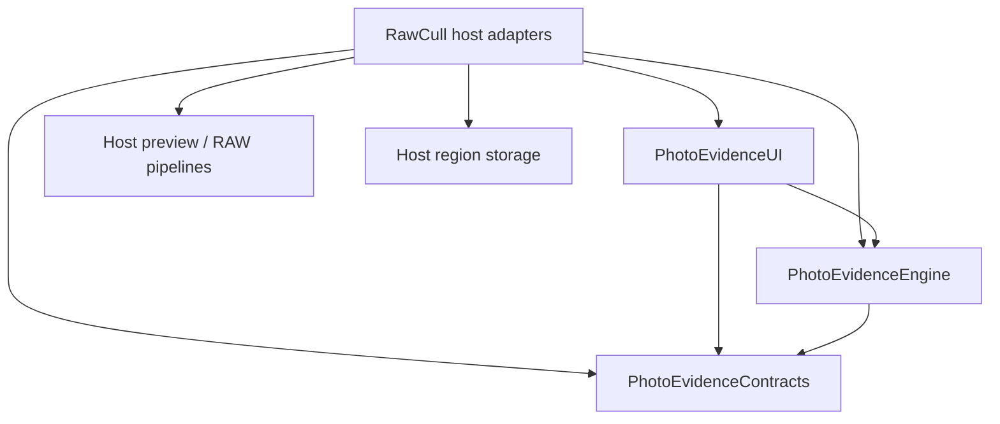

+++
author = "Thomas Evensen"
title = "How PhotoEvidenceKit Is Constructed"
linkTitle = "PhotoEvidenceKit Architecture"
date = "2026-11-08"
lastmod = "2026-11-08"
description = "PhotoEvidenceKit contracts, close-up geometry, bounded rendering, retained references, region persistence, AF assistance, and RawCull integration."
tags = ["close-ups", "image-inspection", "swift-package", "architecture"]
categories = ["technical details"]
mermaid = true
weight = 50
+++

# How PhotoEvidenceKit Is Constructed

> **Revision reviewed:** RawCull resolves PhotoEvidenceKit **1.0.7** at
> [ `7614fd1528bb7cf2549799fb937678ea39d90228`](https://github.com/rsyncOSX/PhotoEvidenceKit/commit/7614fd1528bb7cf2549799fb937678ea39d90228). This guide reviews that source and
> the RawCull 3.4.0 build 434 integration on November 8, 2026. The package README
> and changelog still use initial/unreleased wording; the application's lockfile
> is the authority for the consumed version.

[PhotoEvidenceKit on GitHub](https://github.com/rsyncOSX/PhotoEvidenceKit) is a reusable manual image-inspection package. It lets a
photographer compare selected regions, retain a reference while navigating, and
inspect crops with explicit pixel-source attribution. It was extracted from
RawBrowse and preserves the original MIT attribution.

The package requires Swift tools 6.2, Swift 6 language mode, and macOS 26 or newer.
It has no external package dependencies, bundled photo assets or model downloads.

Repository references: [README](https://github.com/rsyncOSX/PhotoEvidenceKit/blob/7614fd1528bb7cf2549799fb937678ea39d90228/README.md),
[package manifest](https://github.com/rsyncOSX/PhotoEvidenceKit/blob/7614fd1528bb7cf2549799fb937678ea39d90228/Package.swift),
and [MIT license](https://github.com/rsyncOSX/PhotoEvidenceKit/blob/7614fd1528bb7cf2549799fb937678ea39d90228/LICENSE).

## 1. Products And Dependency Direction

| Product | Responsibility |
| --- | --- |
| `PhotoEvidenceContracts` | Sendable frames, regions, viewports, requests, render-source descriptors, coordinate transforms and AF targets; main-actor region-store protocol |
| `PhotoEvidenceEngine` | Pure crop geometry, bounded rasterization, render results, errors and asynchronous rendering protocol |
| `PhotoEvidenceUI` | Embeddable SwiftUI panel and observable comparison-session model |
| `PhotoEvidenceDemo` | Executable example using synthetic portrait/landscape fixtures and public APIs |



No product imports RawCull, RawBrowse, RawParserKit, PhotoAnalysisKit, PhotoAIKit,
or RawCullCore. Contracts contain no SwiftUI views or image buffers. The engine
has no filesystem access, model inference or application file model.

The host owns file permissions, image loading, cache/concurrency policy, comparison
membership, active selection, ratings and review decisions. The package does not
identify subjects, track eyes or animals, score sharpness, choose winners or write
XMP. Comparing several crops is an inspection activity, not an automatically
calibrated measurement.

## 2. Separate File Identity From Render Identity

`CloseUpFrame` contains a stable URL `id`, a display `name`, and a host-supplied
`revision`. The revision must remain stable across launches for an unchanged
source and change when the source changes. A random session token would defeat
saved-region reuse.

`CloseUpRenderSource` independently describes the pixels requested for display:

| Field | Meaning |
| --- | --- |
| `kind` | `unspecified`, `original`, `embeddedPreview`, or `developedRAW` |
| `backendID` | Stable identifier for the host rendering pipeline |
| `revision` | Settings/source token that changes whenever that pipeline's pixels can change |

A preview/developed-RAW toggle changes the render descriptor without changing the
file revision or the saved manual region. Development settings, crop, straightening,
bit depth and color-pipeline changes should also revise the rendering token.
The `.unspecified` default supports hosts with a single fixed pipeline.

A `CloseUpRequest` combines frame, region, scale mode, display scale, viewport,
viewport size and render source. The renderer must honor the source and scale or
fail. Returning a different source with the requested label would break the
inspection contract.

## 3. Manual Regions And Coordinate Spaces

`CloseUpRegion` uses canonical orientation-corrected image coordinates: origin at
the top left, x to the right, y downward. Its default center is `(0.5, 0.5)` and
its default fraction is `0.25`. Bounds clamp the fraction to `0.05...1` and keep
the region within the image. Nonfinite values receive finite defaults.

The fraction applies independently to normalized width and height, so a region
covering one quarter of each dimension in a landscape image is not necessarily a
square in source pixels. `pixelBounds(width:height:)` expands to integral pixel
bounds and intersects the source extent. The normalized representation is used
for persistence and geometry.

`CloseUpViewport` represents temporary inspection around a frame's own region.
Its offset is measured in region fractions, not full-image fractions. Normalization
limits each offset component to `-4...4` and zoom to `0.25...8`.

`CloseUpCoordinateTransform` maps canonical normalized coordinates into the actual
rendered image, including developed crop/straightening. It must be finite and
invertible. Supply the real transform when rendered pixels differ geometrically
from the canonical source; identity is appropriate only when those spaces agree.
Inverse mapping supports overview interactions back into canonical coordinates.

## 4. Fit Region And Source-Pixel Scale

`CloseUpScaleMode.fitRegion` fits the requested inspection region to the viewport.
`sourcePixels` uses zoom in display points per source pixel; zoom 1 means one
source pixel per display point. On a high-density display this is distinct from
one source pixel per physical screen pixel. Display scale controls raster output
resolution separately.

Requests default to a 280 × 210-point viewport. Viewport dimensions are normalized
to `1...4096` and display scale to `1...4`. The panel is 304 points wide and can
be embedded on either side of a host workspace; placement belongs to the host.

The engine's crop geometry computes bounds for the selected mode, viewport and
transform. A region outside a developed crop yields `regionOutsideRender` rather
than an unrelated fallback image.

## 5. Rendering And Memory Ownership

`CloseUpRendering` is a `Sendable` asynchronous provider with
`render(_:) async throws -> CloseUpRender`. The host implements decoding and calls
`CloseUpRasterizer.render` off the UI actor. Rasterization itself is synchronous.

A render returns independently owned crop and overview `CGImage` buffers, source
width/height, a truthful source label, displayed bounds, render-source identity
and the coordinate transform used. The rasterizer checks cancellation before
and after work. Its maximum artifact dimension is derived from the larger
viewport dimension multiplied by display scale, and it does not upscale a source.

The rasterizer redraws both artifacts into new 8-bit premultiplied RGB buffers.
This matters because a `CGImage` crop alone can retain the whole decoded source.
Bounded artifacts avoid that accidental ownership, but decoding a full-resolution
source can still allocate a large transient image. Host decode concurrency and
cache eviction remain necessary.

### Failure And Stale-Result Handling

| Error/state | Meaning |
| --- | --- |
| `unavailable` | Requested pixels or raster buffers could not be produced |
| `sourceChanged` | Host detected a changed file or render source |
| `renderMismatch` | Returned source identity, dimensions or transform failed validation |
| `regionOutsideRender` | Requested canonical region cannot produce a valid developed crop |
| Cancelled/older generation | Card ignores completion instead of publishing obsolete pixels |

The card model increments a generation for each load. It validates the returned
render descriptor, positive source dimensions and valid transform before displaying
a result. It clears old pixels on frame/source changes; during region editing it
can keep the overview mounted so an active drag is not destroyed by its own load.
Releasing an offscreen card invalidates its generation and releases artifacts.

The UI cannot verify file contents from an opaque result alone. The host must
check file/source revision before and after decoding as RawCull's adapter does.

## 6. Comparison Session And Retained References

`CloseUpModel` is a main-actor observable session model. `updateFrames` deduplicates
selected frames by URL and refreshes state for changed revisions.
`comparisonFrames` places the reference first and includes it only once even if
it is also selected.

`pin`, replacement by another pin, and `unpin` affect inspection state only. A
reference survives removal from host selection. `updateReference` refreshes its
metadata/revision without adding it back to selection. The host must continue
supplying render-source and AF information for that retained reference.

Regions remain independent per frame. `setLinked` shares relative viewport offsets
and zoom around each frame's existing region; it does not copy one frame's region
onto another or establish subject correspondence. `resetViews` resets temporary
viewports, while `resetRegion` restores a frame's default manual region.

Current-frame labels and the optional activation callback let the host distinguish
inspection membership from active review selection. Activation, rating changes
and winner selection remain explicit host actions.

## 7. Region Persistence And Retry

Inject `CloseUpRegionStoring` into `CloseUpModel` to make regions durable. Its
`load(for:)` and `save(_:)` methods are synchronous main-actor operations, so use
fast preference-sized storage or an already hydrated repository.

`CloseUpRegionRecord` stores schema version 1, source URL, source revision and a
normalized region. Loading accepts a record only when schema, URL and revision
match. Crops, overview buffers, model output and temporary pan/zoom are not part
of that record.

Without an injected store, regions live only in the current/pinned working set.
Inactive state is trimmed. Failed saves are retained as pending records and expose
`persistenceFailure`; `retrySaving` retries them and can retry failed loads.
Pending choices remain available for retry even after leaving the active selection.

RawCull's `BurstCloseUpRegionStore` encodes records as JSON in `UserDefaults`.
Keys use the `PhotoEvidenceKit.ManualRegion.v1.` prefix plus a SHA-256 hash of the
standardized URL string. The stored record performs source-revision validation;
the key alone is not enough to establish freshness.

## 8. Recorded AF-Point Assistance

The panel accepts an `afPoints` dictionary keyed by frame URL. Omitting an entry
hides assistance; `.unavailable(reason:)` displays a disabled action with an
explanation. `.available(CloseUpAFPoint)` supplies a frame/revision-bound target.
The target's failable initializer rejects nonfinite and out-of-range coordinates.

The host decodes camera AF metadata, resolves any active-point ambiguity and maps
orientation into canonical coordinates. A target from an obsolete frame revision
is disabled/rejected. Supply entries for a retained reference as well as selected
frames, and refresh them when metadata changes.

There are two related behaviors in 1.0.7:

- `useAFPoint(_:)` performs one placement for one active frame. It preserves region
  size, viewport and linking, and persists through the normal store. Existing pan
  can still offset the displayed view.
- `usesAFPoint` is a session preference. When enabled, updating frames or AF entries
  reapplies valid AF centers and clears displaced viewport offsets. Linked viewport
  propagation still follows the model's normal linked behavior.

Both operate on manual regions and neither establishes focus quality or tracks a
subject. The region remains editable. RawCull synchronizes this preference with
its AF overlay state in the burst workspace.

## 9. RawCull Integration

`RawCull/Views/ComparisonGridView/BurstCloseUpsView.swift` defines the adapters:

| Type | Responsibility |
| --- | --- |
| `BurstCloseUpIdentity` | File revision from standardized URL, size, modification time and inode; separate preview/RAW render descriptors |
| `BurstCloseUpRenderer` | Retain catalog access, serialize rendering, decode the requested source, validate identities twice and rasterize |
| `BurstCloseUpRegionStore` | Persist source-bound region records in `UserDefaults` |
| `BurstCloseUpAFPoint` | Read EXIF orientation and map all eight orientation cases |
| `BurstCloseUpSelection` | Plain selection, command-toggle and shift-range comparison membership |
| `BurstCloseUpsView` | Assemble frames, render sources, retained-reference metadata, AF availability and host callbacks |

The preview pipeline uses `FullSizePreviewLoader`; the RAW pipeline uses
`ZoomPreviewHandler.loadDevelopedRAWPreview`. Source labels distinguish sidecar
JPG, embedded preview, and developed RAW/full-size JPEG, including RAW 9 when
supported. The preview descriptor includes sidecar identity so a changed sidecar
can rerender without resetting a manual region bound to the RAW source.

`BurstCullingWorkspaceView` owns panel visibility, the model, renderer and
comparison membership. The package has no knowledge of the app's ranking results,
rsync transfers, rating persistence or selected winner.

## 10. Tests And Qualification

Run package checks from the PhotoEvidenceKit repository:

```sh
swift test
swift build -c release
swift run PhotoEvidenceDemo
```

The synthetic demo exercises the exported APIs without importing a host app.
Package tests cover regions/geometry, AF validation, pin/replace/unpin, independent
and linked viewports, saved-record revision checks, persistence retry, render-source
changes, coordinate transforms and cancelled/out-of-order providers.
RawCull's `RawCullTests/BurstCloseUpTests.swift` additionally covers AF orientation,
comparison selection, persisted regions and preview-versus-file source identity.

For host qualification, inspect portrait/mirrored sources, previews smaller than
the requested viewport, mixed source classes, a retained deselected reference,
rapid selection changes, source/settings changes during decoding, persistence
failures and peak memory during full-resolution loads. The package tests establish
contract behavior; they do not measure a host decoder's cold/warm latency or memory
budget.

## Source Map

Paths below belong to the PhotoEvidenceKit repository at the reviewed revision:

| Topic                                                                  | PhotoEvidenceKit source                                                                                                                                                                                         |
| ---------------------------------------------------------------------- | --------------------------------------------------------------------------------------------------------------------------------------------------------------------------------------------------------------- |
| Products, platform and dependency graph                                | [Package.swift](https://github.com/rsyncOSX/PhotoEvidenceKit/blob/7614fd1528bb7cf2549799fb937678ea39d90228/Package.swift)                                                                                       |
| Frame, region, request, viewport and storage contracts                 | [Sources/PhotoEvidenceContracts/CloseUpContracts.swift](https://github.com/rsyncOSX/PhotoEvidenceKit/blob/7614fd1528bb7cf2549799fb937678ea39d90228/Sources/PhotoEvidenceContracts/CloseUpContracts.swift)       |
| Render identity and affine coordinate transform                        | [Sources/PhotoEvidenceContracts/CloseUpRenderSource.swift](https://github.com/rsyncOSX/PhotoEvidenceKit/blob/7614fd1528bb7cf2549799fb937678ea39d90228/Sources/PhotoEvidenceContracts/CloseUpRenderSource.swift) |
| Validated AF targets and availability                                  | [Sources/PhotoEvidenceContracts/CloseUpAFPoint.swift](https://github.com/rsyncOSX/PhotoEvidenceKit/blob/7614fd1528bb7cf2549799fb937678ea39d90228/Sources/PhotoEvidenceContracts/CloseUpAFPoint.swift)           |
| Fit/source-pixel bounds and coordinate mapping                         | [Sources/PhotoEvidenceEngine/CloseUpCropGeometry.swift](https://github.com/rsyncOSX/PhotoEvidenceKit/blob/7614fd1528bb7cf2549799fb937678ea39d90228/Sources/PhotoEvidenceEngine/CloseUpCropGeometry.swift)       |
| Owned bounded raster buffers                                           | [Sources/PhotoEvidenceEngine/CloseUpRasterizer.swift](https://github.com/rsyncOSX/PhotoEvidenceKit/blob/7614fd1528bb7cf2549799fb937678ea39d90228/Sources/PhotoEvidenceEngine/CloseUpRasterizer.swift)           |
| Async provider, result and error contracts                             | [Sources/PhotoEvidenceEngine/CloseUpRendering.swift](https://github.com/rsyncOSX/PhotoEvidenceKit/blob/7614fd1528bb7cf2549799fb937678ea39d90228/Sources/PhotoEvidenceEngine/CloseUpRendering.swift)             |
| Reference, regions, AF session preference, linked inspection and retry | [Sources/PhotoEvidenceUI/CloseUpModel.swift](https://github.com/rsyncOSX/PhotoEvidenceKit/blob/7614fd1528bb7cf2549799fb937678ea39d90228/Sources/PhotoEvidenceUI/CloseUpModel.swift)                             |
| Generation checks, result validation and release                       | [Sources/PhotoEvidenceUI/CloseUpCardModel.swift](https://github.com/rsyncOSX/PhotoEvidenceKit/blob/7614fd1528bb7cf2549799fb937678ea39d90228/Sources/PhotoEvidenceUI/CloseUpCardModel.swift)                     |
| Embedding API and controls                                             | [Sources/PhotoEvidenceUI/CloseUpPanel.swift](https://github.com/rsyncOSX/PhotoEvidenceKit/blob/7614fd1528bb7cf2549799fb937678ea39d90228/Sources/PhotoEvidenceUI/CloseUpPanel.swift)                             |
| Synthetic public-contract tests                                        | [Tests/PhotoEvidenceKitTests/](https://github.com/rsyncOSX/PhotoEvidenceKit/tree/7614fd1528bb7cf2549799fb937678ea39d90228/Tests/PhotoEvidenceKitTests/)                                                         |

Continue with [RawParserKit]() for decoding,
[PhotoAnalysisKit]() for measurements,
[RawCullCore]() for recommendations, and
[PhotoAIKit]() for optional inference workflows.
