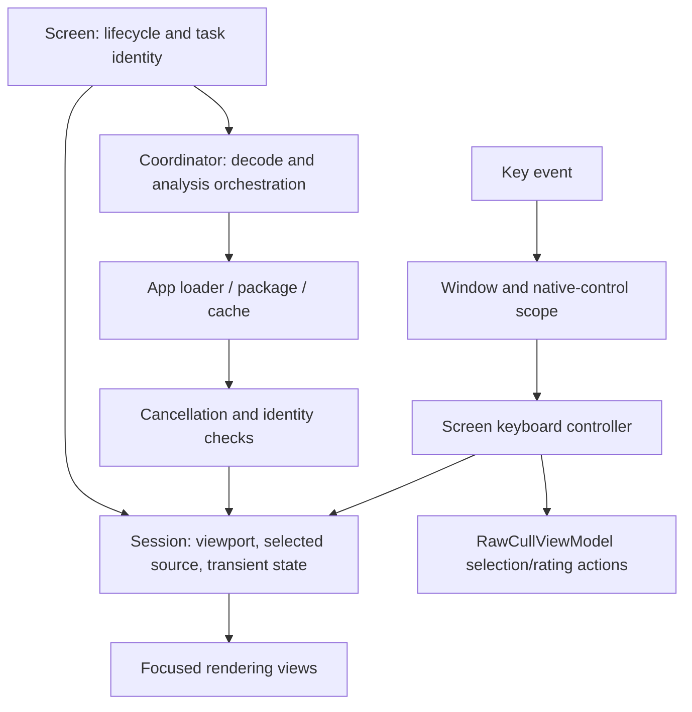

+++
author = "Thomas Evensen"
title = "Viewer Architecture and Keyboard Ownership"
date = "2026-10-22"
lastmod = "2026-11-08"
description = "Trace loupe, zoom, burst, comparison and AI presentation through sessions, task owners, shared geometry and keyboard routing."
weight = 15
mermaid = true

reviewed_commit = "a68253b73cbad14a7b1030dba6b439e6bce7d3da"
reviewed_version = "3.4.5"
reviewed_build = 436
reviewed_on = "2026-11-09"
review_scope = "source delta and reference check; content updated"
+++

# Viewer Architecture and Keyboard Ownership

The October 22 refactor separates screen composition, session state, transient
analysis, and event routing. Read this guide after
[Thumbnails and Scan Pipeline](). It describes
RawCull 3.4.5, build 436 at `a68253b73cbad14a7b1030dba6b439e6bce7d3da` on the unmerged `version-3.4.5` branch. The historical source-level design note is
[ViewComposition.md](https://github.com/rsyncOSX/RawCull/blob/2ca891be5c013dc38fe3c931a829a04083b69c2a/Docs/ViewComposition.md).

## Find the owner before changing a screen

| Screen entry | Persistent screen/session owner | Work and presentation helpers |
| --- | --- | --- |
| [LoupeMainImageView.swift](https://github.com/rsyncOSX/RawCull/blob/a5f35b05c1e206ed4d6aa599522f5c8622b5308a/RawCull/Views/ThumbnailComponents/LoupeMainImageView.swift) | `LoupeSessionModel` owns selected source and loaded source images | `LoupeFocusPresentationModel`, `SubjectOutlinePresentationModel`, `LoupeKeyboardController` |
| [ZoomOverlayView.swift](https://github.com/rsyncOSX/RawCull/blob/a5f35b05c1e206ed4d6aa599522f5c8622b5308a/RawCull/Views/ZoomViews/ZoomOverlayView.swift) | `ZoomSessionModel` owns viewport, source, overlays and exposure inspection | `ZoomNavigationPresentation`, `ZoomOverlayAnalysisCoordinator`, `ZoomKeyboardController` |
| [BurstCullingWorkspaceView.swift](https://github.com/rsyncOSX/RawCull/blob/a5f35b05c1e206ed4d6aa599522f5c8622b5308a/RawCull/Views/ComparisonGridView/BurstCullingWorkspaceView.swift) | `BurstWorkspaceSessionModel` owns viewport and bounded frame cache | `BurstWorkspaceImageCoordinator`, `BurstKeyboardController` |
| [ComparisonGridView.swift](https://github.com/rsyncOSX/RawCull/blob/a5f35b05c1e206ed4d6aa599522f5c8622b5308a/RawCull/Views/ComparisonGridView/ComparisonGridView.swift) | `ComparisonSessionModel` owns image loading and display scope | `ComparisonPager`, `ComparisonPane`, `ComparisonKeyboardController` |
| [CullingGridView.swift](https://github.com/rsyncOSX/RawCull/blob/a5f35b05c1e206ed4d6aa599522f5c8622b5308a/RawCull/Views/CullingGrid/CullingGridView.swift) | Existing projection and selection coordinator | `CullingQueueHeader`, `CullingBurstGroupCard`, `CullingGridThumbnail` |
| [ObjectPhotoDetailView.swift](https://github.com/rsyncOSX/RawCull/blob/a5f35b05c1e206ed4d6aa599522f5c8622b5308a/RawCull/Views/AIAnalysis/ObjectPhotoDetailView.swift) | Local selected object plus `ObjectPhotoPreviewModel` | `ObjectOverviewImage`, `ObjectInstanceList`, `ObjectPhotoAssessmentSection` |

The main actor owns these observable models. A separate view type limits which
properties a section reads: zoom controls observe their session viewport;
changing unrelated loupe zoom must not invalidate those controls. This is an
ownership and observation boundary, not just a file-size convention.

Rendering sections receive values, bindings and actions. They do not independently
decode files or make culling decisions. For example, `ZoomImageCanvas` draws
images and overlays while `ZoomOverlayChrome` and `ZoomOverlayControls` compose
navigation, source and rating controls. Loupe has matching stage/content/controls
and metadata sections; burst has a stage, header, filmstrip and evidence shelf.

## Trace an asynchronous zoom request

1. `ZoomOverlayView.reload()` cancels `viewModel.zoomExtractionTask` and replaces
   it with the task returned by [ZoomPreviewHandler.swift](https://github.com/rsyncOSX/RawCull/blob/a5f35b05c1e206ed4d6aa599522f5c8622b5308a/RawCull/Model/Handlers/ZoomPreviewHandler.swift).
2. The handler chooses thumbnail, embedded JPEG or developed RAW. It keeps a
   dedicated thumbnail analysis image distinct from the display render.
3. A `FocusMaskTaskID` combines analysis-image object identity, selected source
   and file ID. SwiftUI replaces its task when those inputs change; it waits
   300 ms before analysis. Focus-configuration edits use a separate stored task
   with a 400 ms debounce.
4. [ZoomOverlayAnalysisCoordinator.swift](https://github.com/rsyncOSX/RawCull/blob/a5f35b05c1e206ed4d6aa599522f5c8622b5308a/RawCull/Model/Handlers/ZoomOverlayAnalysisCoordinator.swift) checks
   cancellation, file ID, analysis-image identity and source both before and
   after the awaited focus computation. Only the current request publishes the
   mask, breakdown and saliency.
5. Subject-outline loading uses the selected file, mask prompt and visibility
   in its task identity. Disappearance calls session cleanup, which cancels
   session tasks, removes its monitor and releases overlays.

An analysis image can intentionally differ from the displayed full-size image.
`ZoomOverlayImagePolicy` prefers the dedicated analysis image. Selecting a
developed render therefore does not by itself prove that every focus-mask
pixel was measured from that full-resolution render. Follow the actual image
passed to the analysis coordinator when diagnosing a surprising overlay.

## Loupe results have their own lifetime

[LoupeFocusPresentationModel.swift](https://github.com/rsyncOSX/RawCull/blob/a5f35b05c1e206ed4d6aa599522f5c8622b5308a/RawCull/Model/ViewModels/LoupeFocusPresentationModel.swift) owns a task
and generation counter. `cancel()` increments the generation and cancels work;
`reset()` also clears image/source identity. Publication requires the same
generation and a noncancelled task. A completed URL/source pair can reuse its
image, and a pending debounce can be cancelled before expensive work begins.

On a source change within the same photograph, the loupe cancels old focus work
but keeps the normalized mask visible until replacement work completes. On a
new URL or changed configuration, it resets the presentation. Do not replace
these different transitions with one unconditional clear.

[SubjectOutlinePresentationModel.swift](https://github.com/rsyncOSX/RawCull/blob/a5f35b05c1e206ed4d6aa599522f5c8622b5308a/RawCull/Model/ViewModels/SubjectOutlinePresentationModel.swift) applies
the same generation principle to outline publication. The shared
[ImageReviewSubjectOutlineLoader.swift](https://github.com/rsyncOSX/RawCull/blob/a5f35b05c1e206ed4d6aa599522f5c8622b5308a/RawCull/Model/Handlers/ImageReviewSubjectOutlineLoader.swift) loads a
stored Deep Review subject mask and uses the original mask if outline rendering
cannot produce a contour.

## Burst decoding is a bounded working set

[BurstWorkspaceImageCoordinator.swift](https://github.com/rsyncOSX/RawCull/blob/a5f35b05c1e206ed4d6aa599522f5c8622b5308a/RawCull/Model/Handlers/BurstWorkspaceImageCoordinator.swift) derives the
window from `BurstFrameCachePolicy`: selected index plus at most one neighbor on
each side, for capacity three. It prunes other keys, decodes the selected frame
first, then neighbors. [BurstFrameCacheKey.swift](https://github.com/rsyncOSX/RawCull/blob/a5f35b05c1e206ed4d6aa599522f5c8622b5308a/RawCull/Views/ComparisonGridView/BurstFrameCacheKey.swift)
combines file ID and image source; a thumbnail cannot satisfy a developed-RAW key.
An edge selection can have only two cached frames.

Thumbnail and embedded paths reuse comparison decoding. Developed RAW uses
`ZoomPreviewHandler.loadDevelopedRAWPreview`; a selected-frame failure marks
that source unavailable. Focus work runs only when a decoded selected image
exists and lacks a mask. Configuration changes invalidate focus analysis without
discarding all decoded images. This small session cache is separate from the
global thumbnail caches described in [Cache System]().

## Shared geometry keeps overlays registered

[ImageReviewGeometry.swift](https://github.com/rsyncOSX/RawCull/blob/a5f35b05c1e206ed4d6aa599522f5c8622b5308a/RawCull/Model/ImageReviewGeometry.swift) returns one centered aspect-fit
rectangle, or zero for nonfinite/nonpositive dimensions.
[AnalysisImageCanvas.swift](https://github.com/rsyncOSX/RawCull/blob/a5f35b05c1e206ed4d6aa599522f5c8622b5308a/RawCull/Views/AIAnalysis/AnalysisImageCanvas.swift) applies that rectangle
to the photograph, focus map and overlays. Camera AF points are positioned
directly in their normalized visual coordinates. Object boxes use their own
bottom-origin convention; `ObjectOverviewImage` converts Y when displaying them.
Sharing a rectangle does not make these coordinate conventions interchangeable.

`ImageReviewRasterOverlay` shares raster drawing; `OverlayControlCapsule` shares
control chrome. Neither chooses the analysis source or changes mask semantics.
`ZoomViewportMath` handles fit, actual-pixel scale and focus-centered offsets;
its offset clamp keeps the transformed image within the viewport bounds.

## Keyboard registration and keyboard policy are separate

[ReviewKeyMonitor.swift](https://github.com/rsyncOSX/RawCull/blob/a5f35b05c1e206ed4d6aa599522f5c8622b5308a/RawCull/Views/Modifiers/ReviewKeyMonitor.swift) owns one AppKit local
monitor token. Installing removes the previous monitor; removal is idempotent.
The supplied handler returns `.handled` to consume the event and `.ignored` to
let it continue. The helper does not decide which screen owns a key.

[ReviewKeyboardScope.swift](https://github.com/rsyncOSX/RawCull/blob/a5f35b05c1e206ed4d6aa599522f5c8622b5308a/RawCull/Views/Modifiers/ReviewKeyboardScope.swift) accepts an event only
when it belongs to the anchored key window, no attached sheet or modal window
owns input, Command/Control/Option are absent, and a native text/control responder
does not own the keys. The representable anchor updates its weak window and
detaches on teardown. Screens additionally check their mode and overlay state.

Each keyboard controller translates an already admitted action into session
changes or app commands. Loupe's local monitor handles only the subject-outline
shortcut; its focused SwiftUI handler handles other viewer keys. Burst's local
monitor accepts only focus/outline keys. Comparison routes events through its
own controller. Avoid copying one screen's accepted-key list into every screen.

During RAW exposure inspection, `ZoomKeyboardController` consumes recognized
navigation, rating and source/overlay actions without performing them. Escape
ends inspection; zoom in/out remain available. `ZoomSessionModel.navigate` also
refuses movement during inspection. See
[RAW Formats and Exposure Inspection]().

## Tests to read with the implementation

| Contract | Executable reference |
| --- | --- |
| Cancelled focus/outline completions cannot replace newer state | [OverlayPresentationModelTests.swift](https://github.com/rsyncOSX/RawCull/blob/a5f35b05c1e206ed4d6aa599522f5c8622b5308a/RawCullTests/OverlayPresentationModelTests.swift) |
| Section observation and narrow/desktop rendering | [ReviewViewBoundaryTests.swift](https://github.com/rsyncOSX/RawCull/blob/a5f35b05c1e206ed4d6aa599522f5c8622b5308a/RawCullTests/ReviewViewBoundaryTests.swift) |
| Window, sheet and native-control routing | [ReviewKeyboardScopeTests.swift](https://github.com/rsyncOSX/RawCull/blob/a5f35b05c1e206ed4d6aa599522f5c8622b5308a/RawCullTests/ReviewKeyboardScopeTests.swift) |
| Inspection key suppression and outline availability | [ZoomKeyboardControllerTests.swift](https://github.com/rsyncOSX/RawCull/blob/a5f35b05c1e206ed4d6aa599522f5c8622b5308a/RawCullTests/ZoomKeyboardControllerTests.swift) |
| Inspection snapshot, restore and navigation | [ZoomSessionModelTests.swift](https://github.com/rsyncOSX/RawCull/blob/a5f35b05c1e206ed4d6aa599522f5c8622b5308a/RawCullTests/ZoomSessionModelTests.swift) |

These tests document intended behavior. This documentation review read the
fixtures; it did not run the application tests or qualify visual performance.

## Review decisions are separate from the viewport

`BurstWorkspaceSessionModel` still owns viewport state and its bounded image
cache. The view model retains [BurstReviewSessionModel.swift](https://github.com/rsyncOSX/RawCull/blob/a5f35b05c1e206ed4d6aa599522f5c8622b5308a/RawCull/Model/ViewModels/BurstReviewSessionModel.swift)
for decisions, explicit states, queue filter, comparison group and undo entry.
Its identity survives reset while its data is cleared. Facade observation still
works, but result/state writes use session commands.

`CullingGridProjectionKey.reviewRevision` tracks session `contentRevision` so
changed results invalidate cached group presentation. The workspace also
requests missing AF-center evidence without replacing blended scores or
reranking the winner as a side effect.

## Reused navigation and progress presentation

Zoom navigation now reuses a projection containing ordered files, an ID-to-index
map and catalog membership. Its key includes catalog, grid and navigation-context
revisions, source URL, rating filter and analysis-order mode. Selection changes
reuse the projection; relevant content/context changes invalidate it. Cache reads
still read observable inputs, while memoization storage does not publish changes.
Sharpness control labels use `sharpnessScoringTargetCount` to count membership
without constructing and sorting the execution array; execution preserves target
ordering.

Catalog progress is published at a coalesced 100 ms cadence with immediate
initial/terminal states. Only the progress ring animates, respecting Reduce Motion.
These changes do not establish first-painted-frame smoothness; see
[the October 25 findings]().

## Resolution changes retain native geometry

Build 428 adds `ZoomSessionModel.beginPreviewLoad(preservingImage:)` and
`finishPreviewLoad(_:)` operation identity. Fit size follows viewport backing pixels
in 256-pixel buckets; resizing during a RAW load follows the latest size after
completion. `rawPreviewMaximumDimension` becomes nil for native zoom or exposure
inspection. The current image stays visible during upgrades.

`zoomOverlayNativeSize` carries native geometry independently of bounded display
pixels. `ZoomImageCanvas` uses it for actual-pixel framing, and chrome uses it for
the dimensions label. `ZoomPreviewHandler` publishes display pixels before awaiting
analysis. See [RAW source policy]().

## Loupe metadata describes the displayed preview

`ZoomMetadataPanel` labels its histogram “Displayed Preview” and shows the selected
source plus the available bitmap dimensions. “Original Dimensions” remains a
separate EXIF value. Camera settings precede file attributes. The panel's Open
Zoom View action explicitly opens the embedded JPEG source; Show in Finder remains
a quick action. `LoupeMainImageView` supplies the actual selected-source image,
avoiding a thumbnail fallback for an unavailable non-thumbnail source.

## RAW decode status belongs to the displayed result

`RAWPreviewRenderer.Preview` carries `isReducedResolution` (default `false`) beside
`image` and `nativeSize`. Direct rendering sets it from the chosen scale, so the
chrome does not infer decode quality from zoom state or bitmap/native geometry.
`ZoomPreviewHandler` measures the awaited `renderRAW` request with `ContinuousClock`
and publishes `zoomOverlayRAWIsReduced` and `zoomOverlayRAWRenderSeconds` alongside
the display pixels on the main actor, before awaiting analysis.

`ZoomOverlayChrome` receives those values and the session's loading state.
`rawPreviewMaximumDimension != nil` selects the preparing-preview wording; nil
selects preparing-full-detail wording. Completion uses the displayed result's
flag. Preserved-image reloads retain its metadata until replacement publication.
Nonpreserved loads, thumbnail transitions and `closeZoomOverlay()` clear both
optional values. An embedded-JPEG completion publishes nil RAW metadata.

The November 2 fixture in
[RAWPreviewRendererTests.swift](https://github.com/rsyncOSX/RawCull/blob/a5f35b05c1e206ed4d6aa599522f5c8622b5308a/RawCullTests/RAWPreviewRendererTests.swift)
checks a reduced preview held during a gated native replacement, the completed
native flag and clearing after a failed nonpreserved request. The test was
inspected, not rerun in this documentation pass.

## Close-ups: a second inspection working set

[BurstCullingWorkspaceView.swift](https://github.com/rsyncOSX/RawCull/blob/a5f35b05c1e206ed4d6aa599522f5c8622b5308a/RawCull/Views/ComparisonGridView/BurstCullingWorkspaceView.swift)
owns `showCloseUps`, URL-based comparison membership, a `CloseUpModel` with an
injected store, and a `BurstCloseUpRenderer`. These are separate from the main
stage's `BurstWorkspaceSessionModel` and three-frame image cache. The panel is
available in the shared workspace, including Single Images (group ID −1).

Filmstrip clicks first update comparison membership, then set the active frame.
Command toggles membership; Shift selects a displayed-order range using the
previous active frame as anchor; Command-Shift adds that range. Checkboxes change
membership without activating a frame. If explicit membership is empty, the
panel falls back to the active frame. A pinned reference can remain outside
membership; it is not a manual winner.

The JPG/RAW picker shares `sourceSelection` with the main stage. Its support check
includes comparison frames, the active frame and a retained reference. It says
RAW 9 only if every relevant URL supports it; individual crop labels retain the
actual source/decoder attribution. This does not force the main stage and every
crop to share an identical decoded buffer or resolution.

[BurstCloseUpsView.swift](https://github.com/rsyncOSX/RawCull/blob/a5f35b05c1e206ed4d6aa599522f5c8622b5308a/RawCull/Views/ComparisonGridView/BurstCloseUpsView.swift)
builds file/render identities, retains access during loading, updates pinned
metadata independently of selection and maps AF metadata through EXIF orientation.
Group changes clear explicit membership and create a new close-up model. The
main viewport resets while preserving its AF-overlay preference; the new model
inherits that preference. Saved regions can restore when file revisions match.

`CloseUpModel.usesAFPoint` and `viewportState.showFocusPoints` are synchronized.
This session preference reapplies available AF centers and removes displaced pan
offsets; it differs from the one-time per-frame AF placement action. Neither
behavior measures focus quality. The host's AF callback also selects that file
and enables its AF overlay. Show image opens ZoomView using the group's navigation
and selected source; a retained reference absent from the current workspace
cannot activate a missing file.

Burst's focused SwiftUI arrow, Escape and character handlers now check
`ReviewKeyboardScope.controlOwnsKeys` before acting, so native controls retain
their keys. This supplements the existing window-scoped local-monitor rules.
See [BurstCloseUpTests.swift](https://github.com/rsyncOSX/RawCull/blob/a5f35b05c1e206ed4d6aa599522f5c8622b5308a/RawCullTests/BurstCloseUpTests.swift) and
[BurstWorkspaceSessionModelTests.swift](https://github.com/rsyncOSX/RawCull/blob/a5f35b05c1e206ed4d6aa599522f5c8622b5308a/RawCullTests/BurstWorkspaceSessionModelTests.swift) for inspected fixtures;
no new execution result is claimed here.

## Detected crop strip and stage navigation

The strip is keyed by the active file URL and pauses during similarity
indexing. The host keeps detections separate from the manual model and renderer.
Card **Show image** still opens the zoom overlay. Double-clicking a thumbnail
on a burst group card now opens at that frame, and successful navigation clears
single-frame comparison membership so the manual panel follows the active file.
